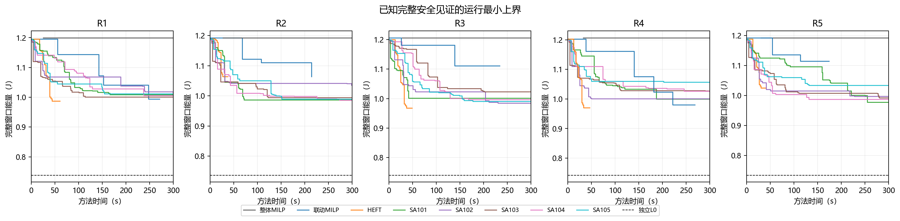

# K161：P2高初温40次完成与证据范围

**本批40/40完成，40份最终安排均通过完整连续热复核。高初温改变了部分候选的安全接纳，但MILP连续热反馈仍为0；联动版只在R2略低于HEFT，未取得一般性能优势。**

## 输入、预算与正确性

本批以P0/base原H响应为对照，仅初温50→78°C，温限80°C及其余条件保持：完整AB/AC三Stage链、合法设备/工作点、期限/权重、功热、auto-L、400 ms窗口/5 ms启动集合均不变，没有叠加P1统一响应。事前冻结提交为`6ecebca`，五输入/224源和40槽在运行前保存。

| 项目 | 实际记录 |
|---|---|
| 调用 | 整体MILP、预消元联动、HEFT每题各1次，SA101—105各1次；共40次，无补跑 |
| 方法预算 | 每次300秒，累计预留12000秒；实计方法根时钟10395.472秒 |
| 日历 | 2026-10-22 01:51:37—04:51:16 UTC；监督时钟10779.703秒＜19200秒 |
| 终态 | worker/supervisor均COMPLETED、退出0；30次正常截止末请求未决，10次正常完成 |
| 接纳与复核 | 40份预算内完整SAFE，最终可用方案各一次既定post，40次通过；post不替换U |
| 来源 | 224源及原218/P0/P1/旧准备关键工件保持；170项启动预检、25项冻结核对及709项终态核查通过 |
| 证明 | 独立最优/无解证明均0；独立L0未闭合，solver-reported状态不升级 |

[终态核查](../p2_audit_tools01/p2_terminal_review01.json)只读取已有证据、精确合法性及既定post；新增求解、构模、热评价和post均0。最大根停止300.016秒属于已记录的停止延迟，已接纳SAFE形成均在300秒之前；420/480秒监督未扩展搜索窗口。旧准备仍保留未授权/零消费历史，新预算由本批独立声明及claims消费。

## 同输入下的方法结果

下表单位J。降幅为`(HEFT−联动)/HEFT`，负值表示联动更差；SA为五次安全能量中位数，逐次数据和范围另存，不能五取一当单次竞争者。

| 输入 | 整体MILP | 联动版 | HEFT | SA中位数 | 联动相对HEFT降幅 |
|---|---:|---:|---:|---:|---:|
| R1 | 1.199893391 | 0.993731506 | 0.986853581 | 1.008576434 | −0.696955% |
| R2 | 1.192992145 | 1.063734477 | 1.064367506 | 0.989858242 | +0.059475% |
| R3 | 1.206641207 | 1.110936987 | 0.967440739 | 0.996844234 | −14.832562% |
| R4 | 1.206924562 | 0.980338828 | 0.969911066 | 1.026149872 | −1.075126% |
| R5 | 1.192962399 | 1.114952432 | 1.025217633 | 0.992559795 | −8.752756% |

HEFT五题均更快完成：36.860—60.312秒，联动为174.297—271.266秒。联动五题均低于本次整体MILP；相对SA中位数仅R1/R4更低。这是限定输入/预算下的单次记录，不作统计稳定性或普遍优劣结论。

联动第一阶段五题均改善完整初始化能量，第二阶段4/5题继续严格改善；R3第二阶段无改善。下表是同一调用内的完整安全U，不是单独等预算的消融。

| 输入 | 第一阶段末U/J | 第一阶段耗时/s | 第二阶段末U/J | 第二阶段耗时/s | 第二阶段严格改善 |
|---|---:|---:|---:|---:|---|
| R1 | 1.072765478 | 141.375 | 0.993731506 | 128.485 | 是 |
| R2 | 1.122172558 | 95.797 | 1.063734477 | 117.063 | 是 |
| R3 | 1.110936987 | 138.984 | 1.110936987 | 93.703 | 否 |
| R4 | 1.076040967 | 140.016 | 0.980338828 | 127.344 | 是 |
| R5 | 1.136029994 | 94.454 | 1.114952432 | 78.781 | 是 |

完整[逐槽CSV](analysis01/results40.csv)、[阶段CSV](analysis01/phases.csv)、首次SAFE/首次严格改善、MATLAB启动与实际阶段耗时均保存。没有因某题失利改变锚、邻域或参数。

此图对已保存完整SAFE评价作运行最小上端后处理，40/40末值与原最终U精确相同；不表示每次SAFE评价都触发了算法正式更新。原[全部SAFE评价曲线](analysis01/safe_energy_and_independent_bound.png)保留，其中SA可出现较高的后续评价值，不能据此称安全上界退化。两种图均未改原U或生成新方案。

## 热约束起作用，但不是MILP反馈收益

17次调用保存已知热违规（HEFT5次、SA12次）。按每个原结果内完整评价对象去重，得到46条THERMAL_VIOLATION存档；这是存档对象数量，不冒称46个独立时间表或全部热评价次数。另25条UNRESOLVED均为`wall_time_limit`，与30次正常截止末请求未决分别登记，不混为数值故障。

[同一安排的P0/P2匹配](../p2_analysis_tools01/thermal_acceptance_review.json)核对五题HEFT的`evaluations[1]`：完整candidate哈希与P0对应候选完全相同，P0均完整SAFE、P2均有温度下端严格高于80°C的点证据，且证据形成在预算内。因此，初温改变了这些具体候选的安全接纳。

例如R1的同一候选：P0在AB场景CPU1的完整峰温约55.558515°C；P2在95 ms的CPU1温度区间约`[81.209166367,81.209166367]°C`，严格超温，不能接纳。这是已有记录配对，没有事后新增热复算。

但五题P0/P2的**最终HEFT完整安排仍全部相同**，上述被拒安排也都不是P0最终方案。因此不能说热约束改变了这五题最终HEFT调度，更不能把HEFT/SA热拒绝算成MILP反馈。整体/联动本批未形成违规反馈，反馈记录总数0；没有同轮反馈消融，未获得反馈净求解收益证据。最终方案节点峰温上端最大约79.858549°C，全部低于80°C。

同一最终安排也提供了热能耗作用的直接对照：R1最终HEFT的基准0.50315 J、活动0.156587032552 J、公共0.12 J保持，温度修正从0.101350964729 J增至0.207116548011 J；增量0.105765583281 J与完整窗口总增量包络相容。这支持声明模型下的入口热状态影响能耗，不是任务响应或模式表被更改。对应[55项解释核对](../p2_analysis_tools01/interpretation_review.json)、30项热接纳核对及40条曲线末值核对均通过，新增科学评价0。

## 结论与停止位置

本批补齐了既定78°C条件下的公平方法记录及候选接纳证据；不能据40份SAFE说热约束不活跃，也不能据若干热拒绝说连续热反馈有效。P0/P2的共同物理变化只有初温，但不同方法可能重选方案；一般跨批能耗差不能全部归因于某一调度机制。已保存共同候选及最终HEFT安排的匹配范围单列。

联动可改善自身初始化，也保留了两阶段搜索覆盖受限的结构；本批差距不能全部归因于这一因素，也不足以建立其优于HEFT或SA的普遍主张。下一步优先收拢P0/P1/P2证据、明确方法贡献与限制，再讨论有通用依据的方法调整；不针对R4补丁、不继续温度扫描或直接启动下一批。

本批预算已消费完毕，P3及新方法/消融/调用未授权。完整原始安排、界、热拒绝、耗时、回执和源快照在本目录，[归档清单](archive_inventory.json)登记全部文件及hash；MAT按gitignore仅本地保留及核hash，不强制上传。
