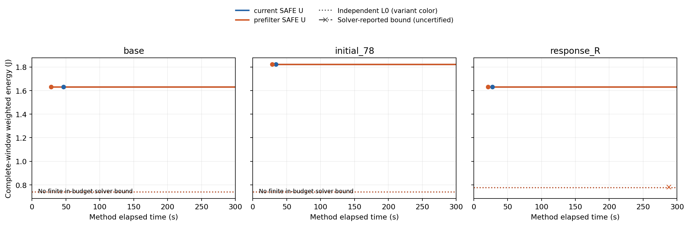

# K.108：期限前置过滤的六次完整链诊断

控制器已验收6/6次；预算内后续MILP严格改善初始化0次。5次没有后续MILP SAFE，1次取得后续SAFE，详见下表。每题每版仅一次、各300 s，只回答本次表达诊断，不推断总体胜率、稳定加速或算法贡献。77项冻结源码与当前文件／运行快照全部匹配。

唯一差异为`prefilter_deadlines=false/true`及相应事件／状态／物理误差包络重建；原三Stage、共享具体单元、物理输入、初始构造器、LP none、连续热标准和预算保持。两版均采用conditional热反馈，本轮未运行assignment反馈消融；即使出现反馈也只支持实际触发／处理，不能把版本间U差归为反馈收益。未重跑原115项，没有跨调用导入旧候选、x0、热缓存或U。

| 条件／版本 | 选项 | 事件总数 | 行数 | 主条件行¹ | 构模s | 首SAFE s | 初始U J | 最终U J | 严格改善 |
|---|---:|---:|---:|---:|---:|---:|---:|---:|---|
| base/current | 6422 | 1781 | 614943 | 480330 | 29.578 | 46.594 | 1.632465 | 1.632465 | 否 |
| base/prefilter | 1681 | 583 | 200205 | 156870 | 19.188 | 28.063 | 1.632465 | 1.632465 | 否 |
| initial_78/current | 6422 | 1781 | 614943 | 480330 | 26.562 | 34.188 | 1.823226 | 1.823226 | 否 |
| initial_78/prefilter | 1681 | 583 | 200205 | 156870 | 19.922 | 28.547 | 1.823226 | 1.823226 | 否 |
| response_R/current | 6350 | 1100 | 382003 | 296460 | 19.156 | 27.750 | 1.632465 | 1.632465 | 否 |
| response_R/prefilter | 1628 | 392 | 134868 | 105300 | 12.437 | 21.157 | 1.632465 | 1.632465 | 否 |

¹主条件行据已完成构模的状态—片段调用次数×2×(4个热节点＋1条能量式)还原，仅指热传播／完整能量条件行；不把它当总约束行。完整选项、变量、场景事件及阶段时间见`calls.csv`、`phases.csv`／`phase_records.csv`。

| 条件／版本 | x0数值接纳 | 进入求解器s | 后续MILP U J | 预算内最大节点² | 求解器报告界 J | 反馈行 | 原状态／原因 |
|---|---|---:|---:|---:|---:|---:|---|
| base/current | True | 61.047 | — | 0 | — | 0 | SAFE/wall_time_limit |
| base/prefilter | True | 32.313 | — | 0 | — | 0 | SAFE/wall_time_limit |
| initial_78/current | True | 44.953 | — | 0 | — | 0 | SAFE/wall_time_limit |
| initial_78/prefilter | True | 32.594 | — | 0 | — | 0 | SAFE/wall_time_limit |
| response_R/current | True | 36.828 | — | 0 | — | 0 | SAFE/wall_time_limit |
| response_R/prefilter | True | 24.297 | 1.632465 | 0 | 0.780766 | 0 | SAFE/wall_time_limit |

²节点来自预算内收到的callback；`0`不能证明根LP已结束，也不能精确归因根LP耗时。root LP配置、非空phase及原生终回执另存；没有阶段证据时明确记未识别。x0数值接纳只是原行／界容差检查，MATLAB的独立x0接纳状态按原回执`not_independently_observed`保留。

response_R__R1__prefilter在288.891 s取得后续完整SAFE，U=1.632465 J，与本次种子等能量，最终保留初始化来源。它在287.500 s收到rootlp回调（报告松弛目标0.780765945 J），在287.797 s收到heuristics及有限内部界0.780765945 J；预算内节点仍0，不能把该松弛目标当SAFE U或独立最优证书。该次没有原生最终response；前五次保存的最终原生response均在Python预算回执之外，不升级为预算内证据。

base__R1：current→prefilter构模29.578→19.188 s，首SAFE 46.594→28.063 s，最终安全U差(current−prefilter)=0.000000 J；两版后续严格改善分别为False/False。
initial_78__R1：current→prefilter构模26.562→19.922 s，首SAFE 34.188→28.547 s，最终安全U差(current−prefilter)=0.000000 J；两版后续严格改善分别为False/False。
response_R__R1：current→prefilter构模19.156→12.437 s，首SAFE 27.750→21.157 s，最终安全U差(current−prefilter)=0.000000 J；两版后续严格改善分别为False/False。

图只使用预算内完整SAFE回执及形成时间已知的L0。内部界使用点划线和×标记、明确`solver-reported`，不升级为独立证书；预算后原生done／response只在`raw_native_receipts.csv`审计，不填入预算内轨迹。没有有限内部界时图中明确标缺失。

未验收／未完成／未启动调用在`calls.csv`单列，未读取其结果文件。反馈为0只表示本次未触发，不能据此证明反馈有效或无用。所有状态、原始原因及求解器界异常保留；性能不佳不触发补跑、扩时或调参。

## P1：已有15题能耗归因（一页）

本次只读取K.104—105档案：MILP全部仍为原种子，HEFT为已有最终SAFE；SA取正式成功种子中最接近中位能量的一条，并列取较小seed。它是展示代表，不是最佳种子或新统计。45份原candidate仅重建共同合法性／功率时间表，与原回执逐项相同；没有热轨迹积分、求解或新方法调用，也不向后续调用提供候选、x0、缓存或U。

**结论：15/15题中，MILP种子的全窗基准项、活动项和温度修正项均高于HEFT及SA代表；公共项始终0.12 J、差为0。差异说明已有方案整体不同，不能解释成单一尾段OPP的因果收益。**

| base R1，J | MILP种子 | HEFT | SA代表seed102 |
|---|---:|---:|---:|
| 完整能量U | 1.632465 | 0.985107 | 0.873164 |
| 全窗基准 | 1.012750 | 0.537125 | 0.507000 |
| 活动 | 0.302450 | 0.220045 | 0.144596 |
| 温度修正 | 0.197265 | 0.107937 | 0.101568 |
| 公共 | 0.120000 | 0.120000 | 0.120000 |
| 执行区间基准 | 0.181100 | 0.189000 | 0.185875 |
| 全域空闲尾段基准 | 0.831650 | 0.348125 | 0.321125 |

执行区间按各场景[0,最后Stage结束)，全域空闲尾段按[最后Stage结束,400 ms]。只能拆分常数基准／活动／公共项；回执没有分段温度积分，执行／尾段的温度修正及完整总能量均不足以判断，不从采样补积分。

| base R1场景／方法 | CPU末忙段→尾段 | GPU末忙段→尾段 | NPU末忙段→尾段 |
|---|---|---|---|
| AB/milp | H 75–81；尾319 ms | 无忙段；L保持400 ms | H 10–75；尾325 ms |
| AB/heft | L 115–121.5；尾278.5 ms | 无忙段；L保持400 ms | L 70–112；尾288 ms |
| AB/sa | L 150–156.6；尾243.4 ms | 无忙段；L保持400 ms | L 80–136；尾264 ms |
| AC/milp | H 60–68；尾332 ms | H 15–60；尾340 ms | H 10–40；尾360 ms |
| AC/heft | L 115–121.5；尾278.5 ms | 无忙段；L保持400 ms | L 30–72；尾328 ms |
| AC/sa | L 120–129.6；尾270.4 ms | L 35–116；尾284 ms | L 65–107；尾293 ms |

所有入口OPP均L；CPU1／CPU2共用CPU域。末忙段将相接且同OPP的占用合并；尾段从该域最后Stage结束起算。逐次轨迹及最后派发事件见`existing_domain_opp_runs.csv`／`existing_domain_tails.csv`，base R1具体单元／起止／依赖后等待见`base_R1_stages.csv`。无工作域仍保留入口OPP并计量。

对HEFT：15题基准项差／总差的数值占比为59.6%–82.8%；base R1为73.5%。base R1总差0.647358 J，其中全域空闲尾段基准差0.483525 J、执行区间基准差-0.007900 J；两者相加才是全窗基准差。
对SA代表：15题基准项差／总差的数值占比为59.6%–72.3%；base R1为66.6%。base R1总差0.759301 J，其中全域空闲尾段基准差0.510525 J、执行区间基准差-0.004775 J；两者相加才是全窗基准差。

base R1仅4/5个正式SA种子成功，中位U为0.897466 J；展示seed102的U不同于中位数。其余14题均5/5。本页不改变原排名、失败状态或统一300 s预算口径。

边界：完成较早与全窗能耗较低并非同义；部署、OPP、时序和温度轨迹同时变化，尚未用合法反事实隔离各因素。原15题只能支持本批事后分项解释，不支持尾段单因素节能率、全方向判断或新方法选择。详细数值及源文件SHA256见本目录CSV和`existing_analysis_audit.json`；至此结束P1，不延伸研究方向。
