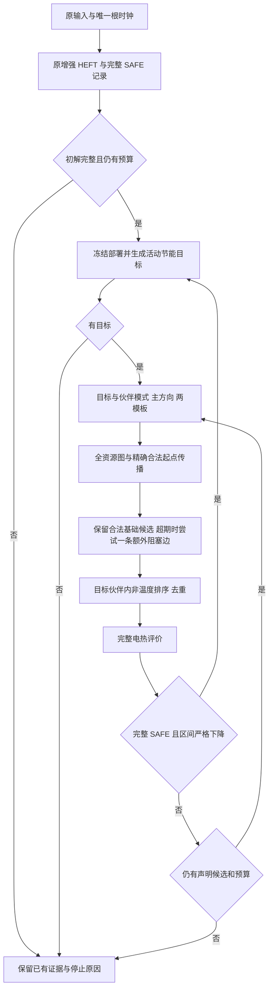

# 第四章算法规格审查、R2/R5 机制核查与 HEFT/SA 比较设计

2026-11-07，客户端时区 UTC+8。基于已推送提交 `d47bfda700ce76df31d9aae0aea97d01279b501f`，分支 `chapter4/r2-r5-validation-20261107`。

**现有实现可以组织成“增强 HEFT 安全初解＋节能模式目标＋主资源与一条截止阻塞边原子联动＋完整电热严格接纳”的完整启发式流程。R2/R5 保存的候选和失败骨架支持这一机制解释，但不支持全局最优、所有局部搜索均失效或优于 SA 的结论。** 本轮只回放已有调度的合法性、读取完整回执、做精确账本代数并提出比较设计，没有新 HEFT、SA、候选生成、热积分、优化或正式实验；没有修改生产源码、main、原数据或推送。

## 1．原始证据和本轮核查性质

原始[六槽计划](../validation_execution_20261107/plan.json)、[六组汇总](../validation_execution_20261107/summary.json)、[变化轨迹](../validation_execution_20261107/detail_audit.json)及 `calls/*/method/result.json` 是依据。本轮新产物 [mechanism_evidence.json](mechanism_evidence.json)保存初解、OFF 最终、ON 第一步及 ON 最终的场景完成时间、期限余量、依赖间隔、资源重叠、原能量分项和峰温；[schedules.csv](schedules.csv)保存全部场景的完整 Stage 表，未只截取 main。

**51/51 自动只读核查通过。** 包含原合法性与完整 SAFE 合同，以及独立的 Fraction 起点／结束、释放、5 ms 网格、任务依赖、同设备互斥、同 CPU 频域异档冲突和期限核对。连续热安全来自已保存的原完整评价回执，本轮没有重新积分；不能把合法性回放叫作新的独立热验证。1189 个冻结源码／既有结果文件运行前后字节一致，15 份重点源码与 d47bfda7 对象逐字一致。

原结果仍为：R2 HEFT/OFF 0.955459934953 J、ON 0.859309627158 J；R5 HEFT 0.917706681081 J、OFF 0.902844894146 J、ON 0.856824091351 J。原三组均独立现场初始化，初解和能量区间一致，ON 对 OFF 的严格收益分别约 10.063249% 和 5.097310%。这些是已运行记录；后文 SA 比较尚未运行。

## 2．R2：两个高档主任务怎样降到低档

下表的起止均为 ms。设备在各阶段保持，表中 H/M/L 表示原模式：CPU 为 1.6／1.2／0.8 GHz，NPU 为 1.0／0.75／0.5 GHz；所有原 pre→main→post 边保留，频档时长、活动功率和斜率都取原表。

| AB Stage | 设备 | 增强 HEFT 初解／OFF 最终 | ON 第一步 | ON 最终 |
|---|---|---|---|---|
| A.pre | CPU2 | L，25–36.2 | L，20–31.2 | L，0–11.2 |
| A.main | NPU0 | H，65–89 | L，35–68.6 | L，15–48.6 |
| A.post | CPU1 | L，90–95.2 | L，70–75.2 | L，50–55.2 |
| B.pre | CPU1 | H，0–18 | H，0–18 | L，0–27 |
| B.main | NPU0 | H，20–62 | L，70–137.2 | L，50–117.2 |
| B.post | CPU1 | L，70–77.92 | L，140–147.92 | L，120–127.92 |

第一步以 B.main 的 H→L 活动节省为目标，枚举其 NPU 伙伴 A.main 的原合法频档；接纳组合中 A.main 也由 H→L。NPU 从 B.main→A.main 改为 A.main→B.main，并额外将 CPU1 的 B.post→A.post 改成 A.post→B.post，采用 earliest 模板。

保存的同模式、同 NPU 换序、**没有额外 CPU 后处理反转**的基础骨架中，A.post 最早在 **155.2 ms** 完成，超过原 **98.8 ms** 期限 **56.4 ms**。该链是 A.pre→A.main→B.main→B.post→A.post。联动后 A.post 完成 75.2 ms；B 完成 147.92 ms，均满足原期限。此处排除的是这份基础骨架与模板，不是整个模型或所有单变量搜索。

第一步 B.pre 仍为 CPU-H，A.pre 为 CPU-L，二者不能在共享 CPU 频域异档并发，所以 A.pre 被传播到 20 ms。第二步把 B.pre H→L，此时两个 CPU 单元可同 L 档并发，A.pre 提前至 0 ms；其后时间表一起传播。第二步没有额外阻塞边。

| 状态 | A 完成／期限／余量 ms | B 完成／期限／余量 ms |
|---|---|---|
| 初解及 OFF | 95.2／98.8／3.6 | 77.92／188.76／110.84 |
| ON 第一步 | 75.2／98.8／23.6 | 147.92／188.76／40.84 |
| ON 最终 | 55.2／98.8／43.6 | 127.92／188.76／60.84 |

AC 场景的设备、频档、起点和能量回执保持原样。AB/AC 权重均 1/2，全 400 ms 计量。

| R2 加权能量分项/J | 初解 | ON 第一步 | ON 最终 | 总节省/mJ |
|---|---:|---:|---:|---:|
| 活动 | 0.212115272972 | 0.144730913110 | 0.138830913110 | 73.284360 |
| 域基准 | 0.517850 | 0.506300 | 0.500000 | 17.850000 |
| 公共 | 0.120000 | 0.120000 | 0.120000 | 0 |
| 温度修正 | 0.105494661981 | 0.101551279524 | 0.100478714048 | 5.015948 |
| 总能量 | 0.955459934953 | 0.872582192634 | 0.859309627158 | 96.150308 |

NPU 高档相对 L 的基准差为 0.35 W，原两主任务 H 驻留共 66 ms，消除后加权节省 `0.35×0.066×1/2=11.55 mJ`；CPU 原 H 驻留 18 ms，H/L 域基准差 0.70 W，第二步节省 `0.70×0.018×1/2=6.30 mJ`，合计 17.85 mJ。CPU 基准始终按域一次计量，未按两个核重复计。

第一步严格改善约 82.877742 mJ，第二步再改善 13.272565 mJ。因此新增阻塞边使搜索进入另一轨迹，后续普通重构也作了贡献，不能把 96.150308 mJ 全部说成那一条边的直接能量贡献。

## 3．R5：OFF 的折中与 ON 的进一步联动

| AB Stage | 设备 | 初解 | OFF 最终 | ON 第一步 | ON 最终 |
|---|---|---|---|---|---|
| A.pre | CPU2 | L，30–44 | L，30–44 | L，30–44 | L，0–14 |
| A.main | NPU0 | L，70–112 | M，80–114 | L，45–87 | L，15–57 |
| A.post | CPU1 | L，115–121.5 | L，115–121.5 | L，90–96.5 | L，60–66.5 |
| B.pre | CPU1 | M，0–21 | M，0–21 | M，0–21 | L，0–27 |
| B.main | NPU0 | H，25–67 | M，25–75.4 | L，90–157.2 | L，60–127.2 |
| B.post | CPU1 | L，75–82.92 | L，80–87.92 | L，160–167.92 | L，130–137.92 |

OFF 有真实改善：B.main H→M，同时伙伴 A.main L→M，保持 NPU 的 B→A 和后处理的 B→A。它以一处增加补偿另一处节省，说明现有普通关联重构本来就不是“所有 Stage 只能降频”的算法。OFF 最终 0.902844894146 J，相对初解节省 14.861787 mJ，不能隐藏这一结果。

ON 第一步让 B.main H→L、A.main 保持 L，同时反转 NPU 次序与额外后处理边，采用 preserve 模板，A.pre 暂保留 30 ms 下界。保存的无额外边基础骨架会使 A.post 在 **176.5 ms** 完成，超过 **123.5 ms** 期限 **53 ms**；联动后 A.post 96.5 ms 完成，B 167.92 ms 完成。第二步 B.pre M→L 后，用 earliest 模板进一步提前任务，没有额外边。

| 状态 | A 完成／期限／余量 ms | B 完成／期限／余量 ms |
|---|---|---|
| 初解 | 121.5／123.5／2 | 82.92／188.76／105.84 |
| OFF 最终 | 121.5／123.5／2 | 87.92／188.76／100.84 |
| ON 第一步 | 96.5／123.5／27 | 167.92／188.76／20.84 |
| ON 最终 | 66.5／123.5／57 | 137.92／188.76／50.84 |

| R5 相对初解节省/mJ | 活动 | 域基准 | 公共 | 温度修正 | 总计 |
|---|---:|---:|---:|---:|---:|
| OFF | 13.025606 | 1.020000 | 0 | 0.816181 | 14.861787 |
| ON | 47.269781 | 10.500000 | 0 | 3.112809 | 60.882590 |

ON 的两步分别节省 54.613128 mJ、6.269462 mJ。域基准总节省可由原 NPU-H 的 `0.35×0.042×1/2=7.35 mJ` 与 CPU-M 的 `0.30×0.021×1/2=3.15 mJ` 驻留消除核算。ON 相对有改善的 OFF，新增净节省为 46.020803 mJ（5.097310%）；相对 HEFT 为 6.634210%。AC 场景保持不变。

## 4．哪些是观察，哪些还只是推断

已观察并可核：原模式与时间表、失败骨架的超期链、完整候选一次接纳、任务／共享域／期限合法性、原完整区间 SAFE、精确分项及接纳顺序。R2/ON 最终连续峰温约 50.012577°C，R5/ON 约 50°C，均远低于 80°C；全场景覆盖到 0.4 s，包括空闲尾部。

据此可作有限推断：在该固定设备、两模板和主对方向组织下，额外后处理换序解除了保存的降档骨架障碍；原子评价避免必须先接纳一份中间变差方案。不能推成增强 HEFT 从理论上无法找到同一安排，不能证明 SA 不能跨越障碍，也没有证明全部资源方向或模型无更优解。

活动／基准节省可以从原表代数归属。温度修正同时受频档对应斜率、注热时间和耦合温度轨迹影响，不能凭本轮账本把这些因素的独立因果份额分开。本轮没有反事实热积分，也不证明紧热约束改变决策。原平台和功率／热参数为自设抽象输入，不是硬件标定或实测。

## 5．现有实现与增强 HEFT／SA 的真实区别

重点函数、哈希及行号保存在 [source_inventory.json](source_inventory.json)，均钉在 d47bfda7。

| 项目 | 增强 HEFT（`run_heft:278`） | 本章完整启发式（现有 ON） | 现有 SA（`run_sa:185`） |
|---|---|---|---|
| 初始构造 | 共享逻辑 Stage 排序、加权设备选择、EFT 插空，必要时 H/M/L 回退 | 完整运行左侧增强 HEFT，冻结同次最佳完整 SAFE | HEFT **构造器**，失败才试 H/M/L 构造，再随机初始化；未调用 `run_heft` 节能遍历 |
| 后续自由 | 一次确定性共享设备变更、逐实例 OPP、下一合法起点延迟；每次重建整表 | 固定同次具体设备，目标 OPP＋伙伴 OPP、主资源方向、最多一条额外阻塞资源边，两种起点模板 | 共享部署、场景 OPP、优先序、网格等待四类随机动作，列表解码 |
| 联合性 | 改设备时会重选相关 OPP 和重排，不能说完全没有联合变化 | 明确打包目标模式、主对及另一资源的阻塞边，完整候选原子评价 | 一个随机动作可影响多个副本／时间表；不定向追踪截止阻塞路径 |
| 接纳 | 完整 SAFE 的严格能量区间下降；一遍能耗调整 | 完整 SAFE 且 `new.upper < incumbent.lower`，成功后重建目标与关联 | 完整 SAFE 中点作为退火分数，可概率接纳变贵的当前状态；最终输出最佳已核 SAFE 上界 |
| 结束与覆盖 | 声明遍历结束或共同预算；构造失败不是不可行证明 | 无活动节能目标／声明遍历无改善／预算结束；不覆盖任意等待与部署 | 原生循环到预算或无可变基因，最低退火温度后仍可继续；列表解码覆盖不完备 |

已有 HEFT 的变化不是“改一个变量后原表其余部分完全固定”；本章不能将改设备、调频、重排、HEFT 初始化或一般成对搜索本身称为创新。SA 的 `INITIAL_RANDOM_BATCH=32` 也不是 32 次后放弃无初解搜索，源码会继续随机重启直到 SAFE 或预算截止。SA 的 0.05／0.0001 等是无量纲退火参数，不是芯片摄氏温度。

## 6．可形成第四章的完整算法流程

工作称谓为“增强 HEFT 初解上的节能模式与截止阻塞边联动重构”。这是已实现启发式的规格整理，不是新增搜索器或原问题完备算法。

1. 在输入、身份检查、导入之前建立唯一方法根；加载原模型、合法选择、场景权重与评价精度。
2. 运行原增强 HEFT，由完整记录器保存同次最佳完整 SAFE。初始化未完成或无 SAFE 时不伪造初解；保留及时已有证据及停止原因。
3. 冻结该完整初解和具体部署。遍历每场景／Stage 的同设备模式，以正的加权 `q×d` 节省建立目标，按节省量、场景、标识、OPP 稳定排序。没有目标就返回现解，不能称全目标已最优。
4. 对每个目标取原资源关联伙伴：同执行单元的相邻 Stage 对，以及同 CPU 频域的 Stage 对（后者可不相邻）；没有伙伴时用单例。目标模式固定，伙伴枚举原合法 OPP，主对试原向／反向，使用 earliest／preserve 两模板。
5. 按新模式重建全资源冲突，含未选第三方：同设备互斥；同频域异档互斥；不同 CPU 单元同域同档可并发。保留全部任务依赖，有环则仅拒绝该骨架。
6. 沿拓扑顺序精确传播 `start_i=next_legal(max(release_i,floor_i,max_pred end))`，`end=start+原时长`，结束时刻不取整。preserve 只保留未选且非所选任务后继的起点下界。若超期，追踪每个超期任务的一条确定最大前驱链；逐一尝试链上的额外资源边反转，排除任务边和主对，每个候选最多一条，独立从同一基础骨架重建，不递归修复。
7. 对合法完整候选在**当前目标／伙伴内**按原全窗口非温度账本和候选 hash 排序，去重后调用原完整合法性及连续电热评价。该排序不是全局候选总排序，也不构成总能量下界或热安全证明。
8. 只有完整 SAFE 且区间严格下降才原子替换。首次改善后停止当前枚举，从最新现解重新生成目标与伙伴；不先接纳变贵的中间动作。全部声明动作无改善则结束。超时、未决和故障保留先前完整 SAFE，并保留诊断。
9. 方法截止后只归档，不再搜索或热计算。独立 post 属于实验交付流程，另计预算，不是额外优化阶段。



继承的是同次最佳完整 SAFE，未必是 HEFT 最后尝试或 `local_base_candidate`。含零权场景也必须安全；全窗口包括空闲尾部。非温度排序只影响次序。预算按合作检查点停止，不能宣称硬实时进程恰好在 300.000 秒结束；只有预算内形成的完整证据可接纳。

## 7．贡献边界与局限

可以据实论证的自主工作是：把共享 OPP 冲突、原合法起点、auto-L 域计量和完整电热接纳适配到资源图重构；用已保存的截止阻塞路径引导一条额外资源边，与模式及主资源次序组成原子候选；接纳后重建搜索状态，避免只能依赖逐步变贵中间状态的路径。实现、证据绑定、单根计费和失效保留是可复现性／工程贡献，不能自动算独立算法新颖性。

HEFT、局部搜索、资源排序图、拓扑传播、退火、RC 模型和区间 Taylor 核属于已有工具或第三章继承内容。本轮没有进行新的邻近文献等价性检索，不能宣称首次、无人研究或文献意义的新颖性已成立。已核的具体方法差异不等于全球研究空白。

固定设备会漏掉迁移／核重分配收益；正活动节能目标会漏掉纯时序热收益或活动变贵而总能量更省的目标；一条并列最大前驱链、单额外边和两个模板会漏掉其他修复；严格下降会漏掉更复杂非单调路径。R3 的无目标例正说明该范围边界。新方法不声明覆盖 SA、原 C 或原模型全部时间表。

## 8．复杂度：按真实代码分解，不移植经典 HEFT 的标称阶数

令 S 为场景数，n 为每场景最多 Stage 数，N≤Sn，q 为同设备最多 OPP 数（当前 3），p 为设备数，K 为每个 Stage 最多合法起点数。T≤N(q−1) 为一轮正活动节能目标数，R≤max(1,n−1) 为每目标伙伴数；最多 B≤n(n−1)/2 条额外资源候选边。具体关系不是每目标必有所有这些边，这是保守上界。

固定目标／伙伴，伙伴 OPP 至多 q、两方向两模板，基础骨架至多 4q；每个基础骨架至多 1+B 个无修复／单边修复尝试。因此一轮结构尝试数保守界为 `M≤4qTR(1+B)`，松上界 `O(S n^4 q²)`。额外边重构会重新生成基础骨架并认证它的阻塞资格，存在重复工作，不能按 O(1) 修复计。

单场景图冲突可达 O(n²) 边。**当前实现反复排序 ready 列表和边，并不是纯 O(n+m) 拓扑队列**；图／传播／全超期链诊断的保守量级为 O(n² log n)。每次还重复校验全部场景、查模式并重建分段功率账本。固定平台与模式规模时，这些合法性和账本扫描约 O(Sn²)，记合并结构费用为 Cg；若有显式起点集合，需额外计完整输入域验证与排序 O(NK log K)，查找本身为 O(log K)。当前均匀网格起点传播用向上取整，不枚举 K 个起点。Fraction 大整数的位复杂度另计，上述是算术／比较操作数。

每一目标／伙伴内若保留 k 个包，还要计候选深拷贝、hash 和 `k log k` 排序。若实际完整评价 E 个候选，单轮可写成：

`C_target + C_association + M·Cg + Σpair C_sort(k) + Σevaluated C_thermal(candidate, accuracy) + C_recording`。

连续热评价费用随功率分段、热节点、区间面板和极值细化及精度变化，不能当作固定常数；source/input hash、缓存、完整回执和诊断序列化也非零成本。严格改善后会重新开始一轮，改善轮数不保证为 N 或其他小多项式；有限网格、固定部署的候选总数本身可达 `(qK)^N` 量级。预算限制实际执行，并不构成全局多项式最优算法证明。

增强 HEFT 构造器的 `_first_start` 会扫描合法网格起点并逐项查占用；完整 `run_heft` 又进行至多约 `4+U(p−1)+N(q_all−1)+N` 次构造尝试（U 为共享逻辑 Stage 数，q_all 为某逻辑 Stage 在全部设备上的 OPP 标识并集大小；当前同为 3），以及相应完整评价。不能把本实现简单写成原始 HEFT 的经典复杂度。SA 也有 J 次计划变异／解码、解码失败及 E_SA 次完整评价，费用可写 `C_init+J(C_move+C_decode)+Σ C_thermal`；原解码同样扫描网格空隙，J 随预算与接纳历史变化。

内存也不是 O(N)：每目标／伙伴的待排序完整包包含场景候选、O(n²) 边及路径；整个调用还保存所有诊断、候选、缓存和完整热回执。应分列当前图／待排序包的工作内存与随累计候选、面板轨迹增长的档案内存，不能凭小例断言规模可扩展。

## 9．HEFT／SA 公平对比预案：未运行、未授权

[comparison_proposal.json](comparison_proposal.json)全部槽为 `NOT_RUN`，`authorized=false`、`execution_enabled=false`。本轮没有生成 SA 成绩，也没有为该预案创建启动 claim。

仅保留同一原 R2/R5 输入，不增加工作负载、温限、释放偏移、规模或参数扫描。它们已被本章分析使用，今后只能作暴露样本上的方法比较，不能再叫盲验证。主比较三方法为原增强 HEFT、现有 ON、本仓库既有 `run_sa` 适配实现（下称原生 SA，而非原论文的原样复现）；OFF 的已有结果继续承担机制消融证据，不默认再加一个新实验臂。

**主问题是同一总预算下的端到端质量与代价，允许各方法原生初始化不同。** HEFT／ON 独立运行完整增强 HEFT；SA 保留原构造／回退／随机初始化及原四类动作，不免费喂入另一调用的完整 HEFT 答案。若强制 SA 也从完整增强 HEFT 开始，那必须命名为另一个 SA-HEFT-init 变体、重新定义并计费，不能静默替换原基线；本最小预案不增加该变体。

随机种子固定 **101、102、103、104、105**，沿用既有种子约定，全部报告，不挑优。SA 参数保持源码值：初始无量纲退火温度 0.05、下限 0.0001、冷却 0.95、每温度级 20 次安全邻域试探、初始随机批 32、随机初始等待最多 4 格、零等待概率 0.5；下限温度不是搜索终止条件。映射／OPP／优先序／等待动作、SAFE 中点分数和概率上坡规则均保持。

每实例 HEFT 一次、ON 一次、SA 五种子各一次，共 **14 个未来方法槽**。每槽同为 300 秒、正常最终 SAFE 最多一次 60 秒 post；建议总上限 4200 方法秒＋840 post 秒，日历 9000 秒，**这些只是待审预算，当前消费为 0**。顺序预先固定：R2 为 HEFT→SA101→ON→SA102→SA103→SA104→SA105；R5 反序。不得把五种子累计 1500 秒中的最佳解当作“单次 300 秒 SA”，不得以历史 HEFT／ON 墙钟充当严格同期控制。

统一原输入知识、约束、原评价器、精度、完整窗口和所有热节点；每次现场独立初始化，输入／导入／构造／变异／解码／排序／完整评价都计费，不共享候选缓存。预算相同不要求完整评价次数相同；记录解码失败、目标／骨架数、唯一完整评价、缓存、首次 SAFE／改善、总耗时及初始化成本，才能解释预算怎样使用。

SA 可接纳更贵的**完整 SAFE 当前状态**，但最佳输出必须单独保留最小已核 SAFE 上界；不能把当前态强制等于档案最优，或把 strict-descent 门强塞给 SA。不得为了 ON 的固定设备范围而关闭 SA 映射动作。三者都不以不完整／超温候选的前缀能量排序；数值未决、身份、技术错误及 post 失败按统一预先规定停止规则保存证据，不补跑。

每种子逐条报告状态和能量区间；SAFE 数／5、故障／正常未得解／超时与缺失都保留。若报告 SAFE 种子中位数／范围，明确是条件统计并同时展示全部五种子；能量缺失不得记 0。仅两题，不报告总体胜率、统计显著性或稳定加速。质量优于 SA 与否必须等未来真实结果，不能由 R2/R5 的 OFF/ON 结果外推。

**当前工程缺口明确存在：** `validation.dispatch` 只有 HEFT/OFF/ON；真实绑定只允许原 `run_heft`；现有 `CompleteRecorder` 冻结初解后会拒绝部署变化，不能直接套给 SA 的映射动作。下一步若获准，需要一个只改变记录／派发层的 SA 适配器：保留原 `run_sa` 及全部变异、当前态和 RNG 语义，应用相同完整回执合同，允许合法部署变化，独立归档最佳 SAFE；还需测试上坡当前态不覆盖最佳、跨场景部署变更、数值未决与截止证据、缓存隔离和不可重试。这个适配器本轮未实施；JSON 预案不可直接作为可运行授权。

## 10．实际执行记录与下一步

首次环境读取为 **2026-11-07 22:13:43+08:00**。本轮主要分析命令工作目录 `/workspace/paper`：

```text
python -B research/chapter4_scheduler/results/algorithm_analysis_20261107/analyze_existing.py
```

实际进程为 **22:21:47.035571—22:21:47.858149+08:00**，0.822581 秒；脚本内部只读分析为约 0.664494 秒。完整 argv、cwd、起止及返回码见 [command_01_return.json](command_01_return.json)，[stdout](command_01_stdout.log)及[stderr](command_01_stderr.log)保留。此前实际只读命令包括 `git rev-parse HEAD`、`git branch --show-current`、`git status --short`、源码 `sed/rg` 和 `git show <subject>:<path>`；没有搜索／热评价入口调用。

运行环境为原 Cloud Linux 6.18.57 x86_64/glibc 2.41、Python 3.12.14、NumPy 2.3.5、SciPy 1.17.0、5 CPU，无 MATLAB／Octave，未安装软件。完整环境、检查、源脚本 hash 和1189 个保护项前后 hash 见 [analysis_run.json](analysis_run.json)。禁用调用为空；自动合法性／代数检查不是外部人工审查，也不是独立数值核。源码阅读、复杂度推导和贡献边界判断由本执行者完成，没有另一研究者独立批准。

本轮完成后先审阅算法规格和上述 SA 初始化／记录器差异；若后续需要三方法正式比较，应先明确预算并完成薄适配器的人工验收，再启动单独冻结的新批次。本轮不运行该批次、不扩例、不修改已推送数据、不修改 main 或推送。
