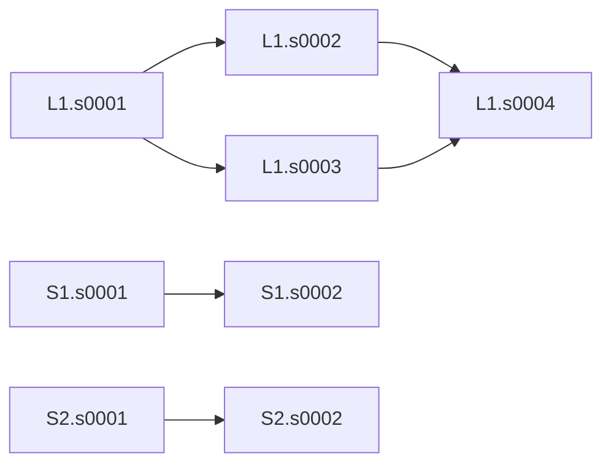

# C01 显式 DAG 向第四章算法的结构迁移检查

本轮已确认：仓库既有 C01 双场景共同输入能由原 HEFT 构造器生成合法候选，原第四章 ON 生成器能在该输入上生成完整合法重构候选，两份候选均通过原完整连续电热 SAFE 检查。必要改动只有独立的候选无关输入加载桥及检查入口，未改算法、物理模型、合法模式、期限或安全标准。未开展正式方法对照、新任务族、完整 HEFT/ON/SA 搜索，也未合并或推送。

这不是 C01 的性能或泛化结论。实际使用的是原合同已选定的 C1/C2 投影，不能写成八场景全量 C01 或更大任务族都已验证。β13/10 沿用既有工程合同，不将其升级为论文最终参数选择。

## 原始来源与合同重建

来源链为：

1. `research/chapter3_workload_calibration/results/calibration01/C01__base_6/evidence.json.gz`：原 C01 工作负载、物理画像、S1 子集期限回执。文件 SHA-256 为 `6f80ec8e944b0753a5a7e73cb8660a0b19c27fd604fba05b6aaf0ce021352d76`。
2. 原 `generator.subset(..., 2)` 与已保存 `S1_projections['2']['deadlines']['13/10']`，配合 `research/chapter3_formal_input_adapter/results/frozen_semantic02/payload.json` 中既有窗口回执。没有重采样、重算参考调度或期限。
3. 原 `research/chapter3_formal_input_adapter/core.py:adapt_bundle` 负责显式 DAG、命名空间、当前场景子集共享 Stage 合法单元交集和响应/功率展开；`semantic_precheck.py:prepare` 记载了原投影与窗口来源。
4. 原 `research/chapter3_method_entry_preparation/prepare.py:prepare` 从既有适配结果导出不含候选和参考表的共同输入。
5. 本轮固定加载 [共同输入](../../../chapter3_method_entry_preparation/results/frozen_entry02/common_input.json)，文件 SHA-256 为 `07e458f3f811746f78931a340d258e230a8de4afb62ac0140459feff6a7bf80a`。

只读重建通过 **14 条检查**：重新经过原适配器得到的 instance、config、适配回执与已有记录逐项一致；模式表没有重新缩放。输入内容哈希为 `b292ced36fec69f4aa97c39edce6df7df58a27b9cec85135ad77a7e0cf4b8f48`，配置内容哈希为 `15ca987441165a0e994ddbe073874ef23c76ee6ec26d4eecfa41b436ca0c6c83`。详见 [lineage_audit.json](lineage_audit.json)。

来源审计读取过含参考表的原归档以核对谱系和回执，但没有用参考表构造候选。实际加载器仅打开候选无关的 `common_input.json`；单元测试限制这一文件读取边界，冒烟候选由原构造器现场生成。未把旧共同输入提案中待批的 whole/HEFT/SA 正式预算作为本次授权。

## 与 AB/AC 输入的语义差别

| 项目 | 原 R2/R5 的 AB/AC | 本次既有 C01 共同合同 |
|---|---|---|
| 任务模板 | A、B、C 各三节点顺序链；每场景 A＋B 或 A＋C | L1 四节点菱形 DAG；C1 另含 S1 两节点链，C2 另含 S2 两节点链 |
| 执行实例 | 每场景 6 节点、2 请求，两场景 | 同为每场景 6 节点、2 请求，两场景；总计 12 次执行 |
| 共享身份 | A/B/C 共 9 个共享 Stage | 共 8 个共享 Stage；L1 的四个节点跨 C1/C2 共享具体部署，S1/S2 分别只出现于一个场景 |
| 实际评价窗口 | 400 ms | **230 ms**；config 旧默认仍为 400 ms，不能覆盖 `instance.window_ms` |
| 起点与结束 | 5 ms 起点网格，执行时长和结束保留精确值 | 原样保留；不把非整数时长或结束时刻强行取整为 5 ms |
| 请求时序 | 原 AB/AC 释放与期限 | 四请求释放均 0；L1 期限 57343/250 ms，C1 的 S1 为 172757/1000 ms，C2 的 S2 为 50011/500 ms |
| 设备与频档 | 原四具体计算单元、CPU 共享频域、合法 H/M/L | 同一物理平台和执行规则；保留原当前子集的 24 个 Stage–单元选择、共 **72 个模式** |
| 热与能量 | 原四节点 RC、温度相关功率、auto-L、完整窗口 | 同一平台/模型；两场景独立从 50°C 开始，80°C 限制、各权重 1/2，完整 0–230 ms |

共享模板如下；C1 实例化 L1＋S1，C2 实例化 L1＋S2，图中不是跨场景执行边：

原适配器已要求所有应用节点是必需输出的祖先并全部执行；当前 L1 必需输出为 s0004，S1/S2 为各自 s0002。没有删除支路或加入零工作量虚拟任务。现有调度验证器按全部请求成员及依赖检查完成，不能只验证菱形的一条路径。

合法单元集合也不按“应用角色”归并：L1.s0001/s0004 为 CPU1、CPU2、GPU0；L1.s0002/s0003 另可选 NPU0；S1 两节点可选 CPU1、CPU2、GPU0；S2 两节点只可选 CPU1、CPU2。跨场景共享的是具体 Stage 的单元选择，OPP 仍可按执行实例选择。执行规则 `migration=false` 禁止任务执行中迁移，不禁止候选之间重选部署。

## 最小接入与依赖核查

新增 [input.py](../../c01/input.py) 的 `load_c01(budget)`：在调用者原计时根内读取、校验固定文件哈希和原共同输入合同，返回新 config/instance 对象；不修改默认值、实例 ID、模式或起点域，也不加载旧参考候选、重建任务或给定映射。输入仍为原 `precheck_C01_s1_2` 身份。

原 P0 `fresh_input` 绑定已声明的 AB/AC 问题编号及 400 ms 条件，不能直接拿来加载 C01。新增桥没有放宽 P0 守卫，也没有把 C01 注册进此前 14 次比较执行器。

现有内核的实际依赖按通用合同读取：

- `heft_method.py` 通过显式 `dependencies`、请求与 `shared_stage_id` 建立共享次序及插空候选；本轮实际构造通过，没有依赖 A/B/C 名称。
- `graph_core.py` 和 `blocking/core.py` 保留全部任务依赖，在其上叠加单元及共享频域次序，再按拓扑传播开始时间。资源边反转不能删除必需任务边，若形成环则拒绝该骨架，不当作全问题无解。
- `blocking/method.py` 按模式表的 q×d 节能目标、资源关联和原非热排序生成候选，未改排序、附加边上限或接纳条件。
- 原共同解码器能处理人工菱形及多节点请求；本轮没有运行真实 C01 SA 搜索，因此不声称已经验证原 SA 在 C01 的完整性能或所有初始化分支。
- 原 `schedules.py` 与连续评价器按实际 instance 窗口、全部场景和节点校验，物理源和精度未变。算法本身的局部搜索/解码子域边界仍保留，不把合同完整等同于穷尽全域搜索。

原共同适配回执中 `linked_C` 的“仍需邻域泛化”标记属于原第三章 C 入口。本轮没有修改或验收那个入口，不能把第四章显式图方法的接入当成原 C 算法已经完成泛化。

## 预先限定的组件冒烟与实际结果

在执行前保存的 [session_start.json](session_start.json) 和 [smoke/plan.json](smoke/plan.json) 限定：一次原 HEFT 构造＋原 ON 生成器最多首个返回包，结构根 10 秒；构造候选与首重构候选各最多一次 10 秒完整评价，总热根最多 20 秒；整包 60 秒，无重试、替换、额外 post 或完整方法运行。

计划 SHA-256：`15e3eef4e67793fcd1e1735f7da6fc9721a7f1682b7e6113685ff6d35db63d38`，于 2026-11-08 04:58:07.391059 UTC 绑定。503 项源码/数据/预检身份冻结；主对照保护清单含 862 项文件和源码。本轮前后均校验相同。

实际组件起止为 **2026-11-08 04:58:27.707270—04:58:30.325003 UTC**，组件内部墙钟 **2.617754 秒**；外部命令墙钟 **2.694042 秒**。结构根为 **0.305695 秒**，没有达到上限或触发失败。

| 候选角色 | 合法性 | 完整热状态 | 评价根实际耗时 | 能量上界显示值 J |
|---|---|---|---:|---:|
| 现场原 HEFT 构造候选 | 两场景全部 12 节点合法 | 全部场景/节点 0–230 ms SAFE | 0.436856 s | 1.208995575719 |
| 原 ON 生成器首个返回包 | 两场景全部 12 节点合法 | 全部场景/节点 0–230 ms SAFE | 0.437784 s | 1.128392748547 |

精确能量上下界、完整安全回执与候选哈希保存于 `smoke/*_receipt.json` 和 `smoke/*_return.json`，未用显示值代替区间。上述第一行只经过构造器，**没有完整增强 HEFT 的能量改进过程**；第二行不是完整 ON 运行结果，两行不能构成 HEFT–ON 能效对照或正式节能百分比。

生成器只调用一次、返回一个包，内部按原规则进行了 **75 次构图试探**：4 次完整合法、71 次骨架拒绝，其中含 39 次额外资源边试探。它们没有逐个做热评价；本轮实际完整热评价只有两次。原始诊断保存在 `smoke/graph_diagnostics.json`。

返回包在 C1 选择 `L1.s0001.r1` 与 `S1.s0002.r1`，将 S1.s0002 在原 GPU0 上由 H 调至 M，采用 incumbent/earliest，**最终没有附加反转边**。C1 的五条原任务依赖全部保留，C2 候选原样保留。本轮证明了对应的构图和评价接口可用，未证明 C01 上新增阻塞边带来收益。

计划中 `no energy-based selection` 的文字应理解为没有根据新完整热能耗结果事后选样；原生成器内置的节能目标排序及非热能耗排序仍然执行，未被关闭。保留原计划和日志，不据实际结果改写选择过程。

## 测试、复核与保护范围

最终新增 **17 项**守卫测试通过，原图/阻塞流程 **109 项**、主比较入口 **20 项**回归通过，共 **146 项最终测试**。另保留加入冒烟边界测试前的首轮 15 项通过记录，不能将其重复累计为不同测试。

测试区分了实际固定合同的只读加载和人工菱形任务：禁止真实 HEFT 构造/方法、SA 搜索、热积分或外部进程。覆盖 230/400 窗口区别、计费与截止前读入、哈希/参考载荷拒绝、无跨调用对象复用、全部合法设备频档、双前驱汇合、共享 CPU 频档、必需依赖反转成环拒绝、缺支路/早汇合拒绝、共享部署一致性、原解码器以及原节能目标和完整候选生成。

结果只读审计 **23 项断言**通过，复核完整调度、全部热 SAFE 回执、形成时间、230 ms 覆盖、固定部署骨架、原任务边和源码/主对照保护；没有新积分，也不是独立热数值实现。详见 [audit.json](audit.json)。

主对照的原始数据、报告、冻结源码及检查记录全部保留；此轮没有修改比较执行器、原算法、输入适配器或模型源码。仅新增 C01 桥、测试和工程检查入口；研究状态另作增量记录。

## 环境、命令与日志

工作目录 `/workspace/paper`；分支 `chapter4/r2-r5-validation-20261107`；HEAD 为 `183701e3394454ad588f538085bc06f08e7621a3`。最早现场观察为 **2026-11-08 04:48:11 UTC**，结束时间及完整文件清单见 `completion_record.json`。

环境为 Linux 6.18.57 x86_64/glibc 2.41、Python 3.12.14、NumPy 2.3.5、SciPy 1.17.0、5 CPU；MATLAB/Octave 不可用但本轮不依赖，未安装软件。执行前 loadavg 为 0/0/约0.045、空闲磁盘 30,726,266,880 B，可用内存 17,457,868 KiB，见 `smoke_resource_preflight.json`。本次不是与前批次的时间基准比较，不把约 0.437 秒评价时间当成加速证据。

证据根目录为 `/workspace/paper/research/chapter4_scheduler/results/c01_migration_20261108/`。下表 `O` 仅为该目录的简写；每条实际 argv、cwd、起止、退出码均存于根目录 `command_NN_return.json`，标准输出/错误为 `command_NN_stdout.log`、`command_NN_stderr.log`。

| 记录 | 实际主要命令 | 命令墙钟 s |
|---|---|---:|
| command_01 | `python -B -m research.chapter4_scheduler.c01.precheck --out O/unit_run01` | 0.378435 |
| command_02 | `python -B O/audit_lineage.py` | 0.205420 |
| command_03 | `python -B -m research.chapter4_scheduler.c01.precheck --out O/unit_run02` | 0.300600 |
| command_04 | `python -B -m research.chapter4_scheduler.blocking.run_precheck --out O/graph_regression` | 2.457151 |
| command_05 | `python -B -m research.chapter4_scheduler.comparison.precheck --out O/comparison_regression` | 0.477236 |
| command_06 | `python -B -m research.chapter4_scheduler.c01.smoke prepare --out O/smoke --checks O/unit_run02/checks.json` | 0.803043 |
| command_07 | `python -B -m research.chapter4_scheduler.c01.smoke execute --out O/smoke` | 2.694042 |
| command_08 | `python -B O/audit_results.py` | 0.865508 |

关键路径：

- `lineage_audit.json`：原输入谱系、回执、模板及语义重建。
- `unit_run02/checks.json`、`unit_run02/test_output.txt`、`unit_run02/source_snapshot/`：最终新增测试与版本。
- `graph_regression/`、`comparison_regression/`：原流程回归。
- `smoke/plan.json`、`smoke/plan_identity.json`、`smoke/claim.json`：执行前固定的范围、源码和单次消费。
- `smoke/constructor.json`、`smoke/first_graph_packet.json`、`smoke/graph_diagnostics.json`：实际构造与图重构明细。
- `smoke/fresh_native_constructor_{candidate,receipt,return}.json`、`smoke/first_original_ON_packet_{candidate,receipt,return}.json`：实际两次评价的完整证据。
- `smoke/result.json`、`audit.json`：总状态、时间与只读核查。

## 尚未验证

没有发现需要改变算法本质或物理合同的接入阻碍；当前最小加载桥和指定组件已验证。仍未验证：完整 C01 HEFT 能量改进、ON 迭代与 SA 搜索的端到端性能；最终附加反转边在 C01 上的节能作用；八场景、重复请求、大图或新任务族；新 DAG 的热违规/紧热边界。没有根据这些缺口扩例、补跑或调参，本轮停在结构迁移工程检查。
