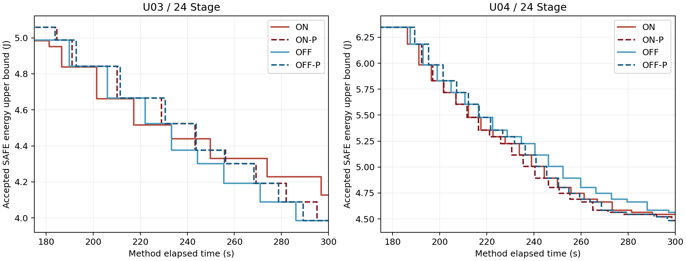
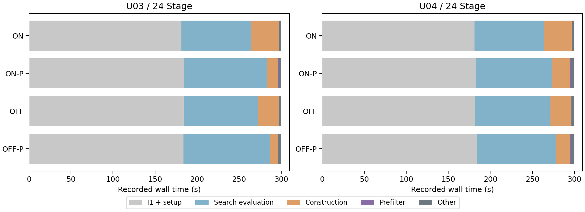

# ON-P正确性与四臂计算成本消融

2026-11-13；开发回归，非严格未见泛化。冻结源码提交`63d2dc9`；用户确认U03/U04–24各ON、ON-P、OFF、OFF-P一次。每场景24 Stage、2场景、50°C，I1新工作准入180秒，方法总预算300秒，每次最终解另作最多60秒完整复评。全部8次按冻结顺序串行执行，无重试、换根或补跑。

**正确性检查通过；8次方法均保留完整SAFE解，8次复评全部通过。预筛在四组配对中均减少实际构造次数与构造加筛选耗时，但ON-P在两个根上均略逊于OFF-P。** 当前支持“结构预筛有实际成本收益”，不支持“额外边在所有实例都改善最终能耗”。四组预筛版最终能耗均低于对应原版；U03 ON配对初解不同，不能把该组最终差值全部归因于预筛。

## 正确性与冻结边界

74项必要测试通过。预筛使用固定设备、模式、排程模板下的精确DAG时间界、任务路径与资源反转必然成环、保留超期路径及反向边时间界。原I1、ON/OFF搜索、完整连续电热评价、严格能量区间接纳均未改写；预筛关闭时直接调用原候选生成器。OFF-P只启用共同基础预筛，ON-P另启用逐条额外边预筛。

归档5724次基础、1417次额外构造中，420次合法基础及8次合法额外构造全部保留；三个人工输入的ON/OFF完整候选序列一致，8个归档状态/开关前缀共64个候选一致。关键反例确认：拒绝第一条额外边不会误删第二条合法修复方向。前缀核对不等于全域穷举；普遍的顺序保持依据是只删除已证明不可行的构造，并沿用原遍历、去重和排序。证明及边界见[实现说明](../../onp/README.md)，测试与两个保留的开发期夹具失败见[正确性报告](../onp_correctness_20261113/summary.md)。

原518份科学/执行源码、原24 Stage归档663份文件逐字节保持。成本批次冻结526份源码及相同输入快照，四臂使用同一构造计数观察器，全部观察和预筛计时计入方法根预算。没有改写热评价器或降低精度。

## 初解与最终能耗

以下均为完整SAFE能量区间上界，单位J。每根每臂仅一次；表中差值不是统计效应估计。

| 根 | 方法 | 搜索初解 | 最终能耗 | 搜索严格接纳 | 含额外边接纳 | 方法/复评 |
|---|---|---:|---:|---:|---:|---|
| U03 | ON | 4.952177529 | 4.126662486 | 7 | 0 | SAFE / SAFE |
| U03 | ON-P | 4.988236703 | 3.985262908 | 8 | 0 | SAFE / SAFE |
| U03 | OFF | 4.988236703 | 3.985262908 | 8 | 0 | SAFE / SAFE |
| U03 | OFF-P | 4.988236703 | **3.984435686** | 9 | 0 | SAFE / SAFE |
| U04 | ON | 6.345577852 | 4.544432983 | 19 | 0 | SAFE / SAFE |
| U04 | ON-P | 6.345577852 | 4.482792705 | 22 | 1 | SAFE / SAFE |
| U04 | OFF | 6.345577852 | 4.563853682 | 18 | 0 | SAFE / SAFE |
| U04 | OFF-P | 6.345577852 | **4.482247908** | 22 | 0 | SAFE / SAFE |

ON-P相对ON的观测节能为U03 **3.426488%**、U04 **1.356391%**；OFF-P相对OFF为**0.020757%**、**1.788089%**。四组最终能量区间均严格分离。U03 ON-P比OFF-P高0.020761%，U04高0.012155%。U04出现一次额外边接纳，仍未超过同预算OFF-P。

横轴为方法根时钟，仅展示175–300秒以辨别搜索轨迹；此前全部接纳事件保存在[完整事件表](energy_time.csv)。曲线相近或重叠不意味着排程相同。

## 计算成本与评价次数

“I1阶段”为初始化调用本身；“搜索交接”还包括根时钟内的启动、身份核查、输入导入和初解冻结，搜索时间按此交接点计算。180秒是新工作准入门限，不是初始化硬停止时刻；门限前已准入的完整评价可以继续，但仍受300秒总预算约束。

| 根/臂 | I1阶段s | 搜索交接s | 搜索s | 初始化完整SAFE评价 | 搜索完整SAFE评价 | 预算未决评价 |
|---|---:|---:|---:|---:|---:|---:|
| U03 ON | 180.187 | 181.391 | 118.625 | 40 | 18 | 1 |
| U03 ON-P | 183.547 | 184.750 | 115.266 | 30 | 17 | 1 |
| U03 OFF | 182.969 | 184.203 | 115.813 | 36 | 18 | 1 |
| U03 OFF-P | 174.157 | 183.968 | 116.032 | 30 | 19 | 0 |
| U04 ON | 180.235 | 181.375 | 118.656 | 41 | 19 | 1 |
| U04 ON-P | 181.688 | 182.812 | 117.188 | 42 | 22 | 0 |
| U04 OFF | 180.797 | 182.016 | 118.000 | 37 | 18 | 0 |
| U04 OFF-P | 182.719 | 183.922 | 116.094 | 39 | 22 | 1 |

| 根/臂 | 实际基础构造 | 实际额外构造 | 基础预筛排除 | 单边额外排除 | 构造阶段s | 预筛s | 构造+预筛s |
|---|---:|---:|---:|---:|---:|---:|---:|
| U03 ON | 600 | 340 | 0 | 0 | 33.784 | 0 | 33.784 |
| U03 ON-P | 150 | 114 | 366 | 0 | 13.294 | 0.484 | 13.778 |
| U03 OFF | 660 | 0 | 0 | 0 | 25.204 | 0 | 25.204 |
| U03 OFF-P | 164 | 0 | 499 | 0 | 9.654 | 0.550 | 10.204 |
| U04 ON | 672 | 244 | 0 | 0 | 33.109 | 0 | 33.109 |
| U04 ON-P | 343 | 183 | 602 | 50 | 21.534 | 0.919 | 22.453 |
| U04 OFF | 538 | 0 | 0 | 0 | 24.921 | 0 | 24.921 |
| U04 OFF-P | 383 | 0 | 649 | 0 | 16.701 | 0.909 | 17.610 |

实际构造计数包括调用开始后因总预算到期而未返回的3次构造，因此可能比旧`graph_reconstruction_attempts`大1。预筛排除计数来自各自实际走到的路径，不能直接相减解释为共同完整邻域；基础组合被排除时，其潜在额外方向不再枚举，未冒充逐边排除数。

四组“构造+预筛”观测减少20.006、15.000、10.656、7.311秒，筛选成本0.484–0.919秒。搜索完整评价在三组增加；U03 ON-P为17次、ON为18次，并非所有预筛版都增加评价数。方法全部用尽预算，不能把构造阶段节省写成总运行时间缩短。

U04 ON-P基础排除602次，其中DAG时间界328次、必然成环274次；逐边排除50次，其中保留超期路径32次、反向边时间界18次。U03 ON-P逐边排除为0，仍有基础预筛收益。OFF-P也获益，表明收益很大一部分来自共同基础预筛；本矩阵不能单独估计ON中“额外边预筛”相对“仅基础预筛”的净贡献。

## 初始化截断与可比性

四组预筛/原版配对均有初始化候选序列的共同前缀，但完成数量不同；只有U03 ON配对最终初解不同。U03 ON-P与ON的前30次相同候选完整评价耗时分别178.174和132.310秒，差45.864秒；预筛尚未进入初始化，因此该差不能归于预筛。U03 OFF-P比OFF的相同前30次评价多19.657秒。U04两组共同初始化评价前缀的预筛臂分别少3.329和8.010秒。日志能确认墙钟波动及180秒截断影响，不能确认具体主机负载原因。

U03 OFF-P的I1阶段仅174.157秒，但交接183.968秒；其中`frozen_identity_and_scientific_imports`明确耗9.672秒。此差属于启动/身份核查及导入阶段，不能全部写成初始化计算或热评价开销。

三组初解相同的配对中，实际搜索候选共同前缀完全一致：U03 OFF为19个，U04 ON为20个，U04 OFF为18个。四组初始化候选集合差异与各组已观察搜索候选交集均为空，且本批全部缓存命中为0；未发现额外初始化缓存改变已观察搜索路径。但“相同初解”和“完全相同初始化执行历史”仍是不同条件，不能把本批表述为严格等状态、等运行成本的因果估计。

## U04额外边与预算证据

U04 ON/ON-P的前20个搜索候选hash完全相同。第20个普通候选`06a7ffedf800…`在ON-P中281.015秒提出、285.093秒取得SAFE并接纳，能耗4.543768908 J；ON在296.031秒才提出该候选，300.016秒返回`UNRESOLVED/wall_time_limit`，没有接纳。

ON-P随后在288.109秒提出第21个联合候选，含额外反转边`C1::L1.s0001.r1 → C1::S1.s0006.r1`，292.125秒完成SAFE并接纳到4.520991115 J；之后第22个普通调整降至4.482792705 J。该轨迹支持“节省结构工作后，本次预算覆盖到更深搜索位置”。联合步骤收益不能全部算给一条边；也不能说ON已构造过该第21个候选。全部时间与hash见[补充路径核对](audit_details.json)。

## 失败、范围与后续

方法内453次评价尝试均有回执：448次完整SAFE（初始化295、搜索153），5次因300秒墙钟到期返回UNRESOLVED并拒绝，0热违规、0无回执评价。另有3次构造因预算到期中止。8次均正常返回已有SAFE，方法计时300.000–300.031秒；31毫秒最大尾部超出属于到期返回及记账，所有获接纳回执和最终SAFE回执均在300秒内完成。没有技术故障、看门狗终止或重试。

8次复评全部SAFE，单次复评内部耗时5.688–7.625秒，整批含进程启动、输出和复评共2492.782秒。最高最终峰温61.584876°C，低于80°C，仍未展示紧热约束。完整复评调用相同数值评价器，不属于独立数值实现或真实硬件验证。

本批保留旧I0/I1、全部原24 Stage结果、零额外边收益、ON-P低于OFF-P表现及预算未决记录。当前结论足以保留ON-P作为待验证版本，尚不足以确定论文算法名称、声称稳定加速或未见泛化。下一步若继续，应先固定新根生成规则及少量比较矩阵，再检验覆盖、成本和能耗；本轮未生成新根，未启动48 Stage、更多场景、I2或SA。

完整证据：[全部8次指标](all_metrics.csv)、[配对比较](comparisons.csv)、[分析与核对](analysis.json)、[执行冻结计划](execution/plan.json)、[批次回执](execution/batch_return.json)。分析脚本`analyze.py`和`audit_details.py`只读取归档，不触发科研调用。
