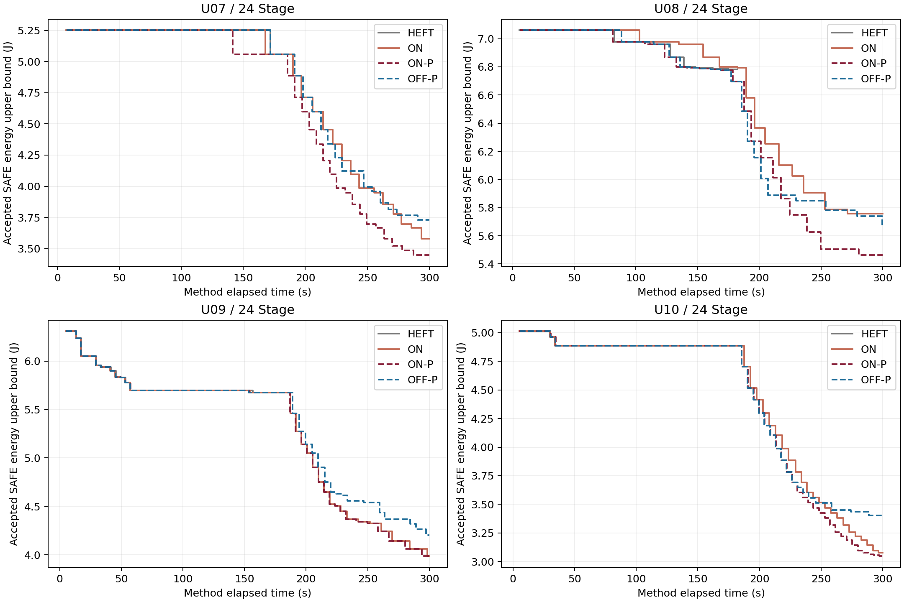
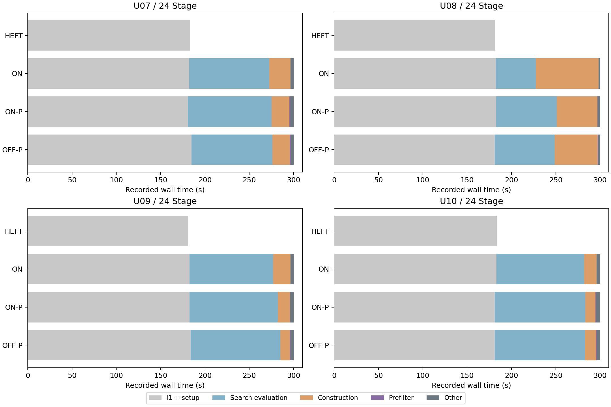

# U07–U10：冻结 I1/ON-P 的四个全新24 Stage参数根验证

16次方法运行及16次逐次完整复评全部SAFE；没有筛选、替换、重跑或技术故障。ON-P对OFF-P为4胜0平0负，对原ON为3胜1平0负。四组ON-P/OFF-P交接初解完全一致，其中三组初始化候选序列也相同；U08的ON-P/原ON初解不同，仅能作端到端比较。12个搜索臂全部耗尽预算，不能据这四根认定普遍优势或稳定加速。

## 执行边界与预登记

执行前已提交并推送[6ef60be](https://github.com/YBEMR/paper/commit/6ef60beb5a8b84dbf4e6b6c4d1deb1004edffc4c)及[预登记](../../onp_new24/PREREGISTRATION.md)，随后一次生成U07–U10。命名空间为`ch4-independent-onp24-v1`，种子为2026111307–2026111310，沿原合成分布直接生成24 Stage，parent=None；没有提前生成6/12 Stage或试跑候选根。它们属于已有拓扑/参数族的新参数根，不是新任务族或外部盲测。

保持2场景、50°C初温、80°C温限、300秒方法总预算、180秒初始化新工作准入。每个方法结束后单独最多60秒完整复评，复评不计入方法预算，也不用于回填搜索。冻结算法版本63d2dc9，536份已有源码逐字节不变；新增入口后541份执行源码与快照一致。执行前24项必要模拟/回归及单独TEST_ONLY静态夹具检查通过，没有真实方法、热评价或新根抽样。全过程沿用原模型、评价精度、严格区间节能接纳和失败处理。

四根顺序为HEFT/ON/OFF-P/ON-P、ON/ON-P/HEFT/OFF-P、ON-P/OFF-P/ON/HEFT、OFF-P/HEFT/ON-P/ON。各方法占据每个位置一次、12种有序相邻方法对各出现一次；16次串行同机运行。批次含进程与复评开销共4504.203秒；未在运行期间修改源码或并行运行其他科研调用。

| 根 | 每场景Stage / 执行次数 / 共享部署身份 | 合法模式数 | 窗口ms |
|---|---|---:|---:|
| U07 | 24 / 48 / 32 | 276 | 915 |
| U08 | 24 / 48 / 32 | 198 | 1465 |
| U09 | 24 / 48 / 32 | 267 | 1045 |
| U10 | 24 / 48 / 32 | 258 | 960 |

各根有16个身份同时出现在两场景。期限和窗口仍由原全H时间构造及β=1.3规则推导；全H参考没有热预跑或被注入初解。[输入与生成计数](input_generation/inputs_manifest.json)、[执行计划](execution/plan.json)保存全部身份、哈希和预算。

## 覆盖、初解与能耗

I1首份SAFE在5.266–8.531秒取得。U07/U08默认构造成功；U09/U10各臂原默认/H/M/L四次均失败，唯一冻结后备成功。合计32次`NO_LEGAL_EFT_INSERTION`均保留：U09前三构造失败于S1.s0008、L失败于S2.s0007；U10四种均失败于S2.s0006。这支持本批I1后备恢复覆盖，不能将16次方法视为16个独立根或直接估计总体成功率提升。

16次初始化全部触发180秒准入，交接180.781–184.766秒；已准入工作可以跨过180秒完成。初始化质量调整相对首份SAFE节能：U07为3.697%，U08为3.786%–5.172%，U09为10.006%，U10为2.509%。HEFT在交接时自然结束，不强制占满300秒。

下表为最终完整SAFE能耗上界，单位J。节能率以表内对应参考臂为分母；判胜用完整能量区间严格不重叠判定，非四舍五入比较。

| 根 | HEFT-I1 | 原ON | ON-P | OFF-P | ON-P较HEFT | ON-P较原ON | ON-P较OFF-P |
|---|---:|---:|---:|---:|---:|---:|---:|
| U07 | 5.056740954 | 3.579157948 | **3.448147974** | 3.729898465 | 31.811% | 3.660% | 7.554% |
| U08 | 6.781808841 | 5.756417971 | **5.463386563** | 5.661972938 | 19.441% | 5.091% | 3.507% |
| U09 | 5.675947563 | **3.988236342** | **3.988236342** | 4.205818036 | 29.734% | 0 | 5.173% |
| U10 | 4.887302451 | 3.076578241 | **3.047872878** | 3.402778352 | 37.637% | 0.933% | 10.430% |

可比性分层：A=初解排程/能量区间及初始化候选序列一致；B=初解一致、候选序列截断长度不同；C=初解不同，只作端到端比较；D=无完整SAFE，未在本批出现。

| 根 | ON-P / OFF-P | ON-P / 原ON | ON-P / HEFT | 初始化评价数 HEFT/ON/ON-P/OFF-P |
|---|---|---|---|---|
| U07 | B，胜 | B，胜 | B，胜 | 29 / 29 / 33 / 29 |
| U08 | A，胜 | C，胜 | C，胜 | 33 / 28 / 37 / 37 |
| U09 | A，胜 | A，平 | B，胜 | 44 / 45 / 45 / 45 |
| U10 | A，胜 | A，胜 | B，胜 | 44 / 43 / 43 / 43 |

U07/U09/U10四臂交接初解分别为5.056740954、5.675947563、4.887302451 J。U08原ON为6.792667166 J，HEFT为6.781808841 J，ON-P/OFF-P为6.694812589 J；ON-P较自身初解节能18.394%，不同于较独立HEFT的19.441%。U08共同前28次初始化评价，ON-P耗135.889秒、原ON耗176.253秒；相同180秒门限下截断长度不同，不能把终差5.091%解释为纯预筛收益。全部方法缓存命中为0，未观察到B层初始化缓存差异影响搜索。完整分层见[20组比较](comparisons.csv)。

## 接纳轨迹与机制证据

曲线取已保存完整SAFE回执的完成时刻；`accepted_steps.csv`另列评价返回时刻，包含少量记录开销，二者不混作同一计时点。所有接纳严格节能且完整回执在300秒内完成。

| 根 | ON-P / OFF-P共同接纳前缀长度 | ON-P额外边联合接纳数 | ON-P / OFF-P总接纳数 | 第一次额外边评价返回s |
|---|---:|---:|---:|---:|
| U07 | 4 | 4 | 17 / 13 | 209.109 |
| U08 | 3 | 3 | 9 / 9 | 211.047 |
| U09 | 7 | 2 | 17 / 16 | 218.765 |
| U10 | 10 | 1 | 26 / 17 | 230.828 |

四组在共同普通接纳之后因额外边联合步骤分叉，ON-P在本次预算内均获得OFF-P未达到的更低终值。联合步骤同时改变OPP、资源次序，后续普通调整也贡献收益，不能把表内净差全部归于某一条边。[逐步接纳](accepted_steps.csv)、[路径核对](path_diagnostics.json)保留全部排程哈希和额外边身份。

原ON/ON-P的可比共同前缀还揭示预筛的边界：

| 根 | 相同候选载荷前缀 | 共同接纳数 | 达到最后共同接纳时刻 ON→ON-P，s | 共同路径构造+预筛 ON→ON-P，s |
|---|---:|---:|---:|---:|
| U07 | 15 | 14 | 293.718→263.609 | 23.047→14.282 |
| U08 | 0 | 0 | 初解不同，不作同工作量归因 | 同左 |
| U09 | 26 | 17 | 298.500→293.812 | 18.515→12.957 |
| U10 | 24 | 23 | 296.735→284.297 | 13.358→10.589 |

候选载荷比较仅排除时刻与预算边界接纳结果。U07和U10的ON-P分别多接纳3个后续普通候选；原ON的下一候选因预算未决。U09虽提前到达同一最终排程，并多完成一次安全但不改善的评价，终值仍完全相同，是明确的预筛零终值收益。共同路径时间差还含电热评价波动：U07为85.139→65.846秒，U09为94.015→94.954秒，U10为96.455→88.922秒。不能把总时差全部归因预筛，也不据单次墙钟宣称稳定加速。

## 计算成本与全部未完成工作

表内“交接”含初始化前设置；构造和预筛为搜索阶段独占计时。完整评价数仅计返回完整SAFE，不含10次预算未决及另行16次复评。“首SAFE”“总时”“完整评价均值”、所有失败见证详见[全部16次指标](all_metrics.csv)。

| 根/方法 | 交接s | 搜索s | 构造s | 预筛s | 搜索电热s | SAFE评价 初始/搜索 |
|---|---:|---:|---:|---:|---:|---:|
| U07 HEFT | 183.375 | 0 | 0 | 0 | 0 | 29/0 |
| U07 ON | 182.359 | 117.688 | 23.844 | 0 | 90.389 | 29/14 |
| U07 ON-P | 180.781 | 119.265 | 20.075 | 0.893 | 94.346 | 33/18 |
| U07 OFF-P | 184.766 | 115.250 | 19.719 | 0.828 | 91.403 | 29/18 |
| U08 HEFT | 181.953 | 0 | 0 | 0 | 0 | 33/0 |
| U08 ON | 182.344 | 117.671 | 70.720 | 0 | 45.173 | 28/8 |
| U08 ON-P | 182.922 | 117.125 | 45.966 | 0.516 | 68.126 | 37/13 |
| U08 OFF-P | 181.328 | 118.672 | 48.281 | 0.608 | 67.688 | 37/17 |
| U09 HEFT | 180.906 | 0 | 0 | 0 | 0 | 44/0 |
| U09 ON | 182.719 | 117.297 | 19.577 | 0 | 94.312 | 45/25 |
| U09 ON-P | 182.500 | 117.515 | 13.438 | 0.598 | 99.829 | 45/26 |
| U09 OFF-P | 184.015 | 115.985 | 10.783 | 0.716 | 100.986 | 45/25 |
| U10 HEFT | 183.422 | 0 | 0 | 0 | 0 | 44/0 |
| U10 ON | 183.032 | 116.984 | 13.889 | 0 | 99.048 | 43/23 |
| U10 ON-P | 181.110 | 118.906 | 11.620 | 0.827 | 102.109 | 43/26 |
| U10 OFF-P | 181.079 | 118.937 | 12.704 | 0.593 | 101.968 | 43/25 |

四根原ON/ON-P实际构造次数分别为433→407、1890→1102、562→335、295→208。ON-P/OFF-P合计预筛拒绝2460个基础构造、307个单独额外边方向，单臂筛选耗时0.516–0.893秒。该计数不能等同节省完整电热评价；许多候选原本会被构造器拒绝。不同终止前缀的全程计数也不能当作严格相同工作量加速比。

方法内855次评价：845次完整SAFE（初始化607、搜索238），10次因300秒`wall_time_limit`返回UNRESOLVED且拒收；另U08/U10的OFF-P各有1次构造预算中断。0热违规、0异常中断、0重试，4个HEFT自然交接、12个搜索臂全部预算耗尽。最大方法返回计时300.047秒为返回记录开销，所有被接纳完整SAFE仍在300秒内形成。所有结构成环、期限/窗口拒绝及预筛必要条件见证均归档，没有删除无收益候选。[批次返回](execution/batch_return.json)、[非SAFE记录及严格接纳核对](analysis.json)可逐次追溯。

每次完整SAFE评价平均3.865–6.108秒，搜索电热占38.4%–87.1%。U08原ON构造耗70.720秒，明显受结构工作限制；其余多臂主要成本仍是连续电热。16次初始化均占用约181–185秒，搜索仅余约115–119秒；这支持后续单独研究预算分配，但本轮没有调整门限。

## 结论范围与归档

本批在四个预登记新参数根上重复观察到安全覆盖、ON-P相对OFF-P的预算内收益及部分构造成本降低，增强了U05/U06正面结果的可重复性证据。三条证据分别成立，不能合并成一个“算法提升率”。U09保留预筛终值零收益，U08保留初解不可严格配对的限制；旧U03/U04负结果不被覆盖。四根每臂一次，只报告描述性胜平负，不做显著性、总体胜率或复杂度推断。

最高最终峰温66.652048°C，所有已评价候选的峰温上界最高70.323636°C，仍低于80°C，未补足紧热证据。复评使用同一连续电热实现，不是独立数值实现或真实硬件验证。I1可选择/调整共享设备部署；交接后ON/ON-P/OFF-P固定设备，仅搜索场景内OPP、资源次序与有限模板。

冻结源码541份、输入快照8份及旧U05/U06–24归档741份均核对一致。只读分析0新科研调用；一次只读时间戳核对将“回执完成”和“返回记录”误作同刻，已按原始字段修正，并保留[分析检查说明](analysis_audit.json)，不影响任何方法结果或冻结源码。[最终核对](verification.json)、[全文件SHA256](files_sha256.json)与原始快照支持复查。

本轮到此结束。未调参、未设计I2、未调整预算或启动SA、更多场景/规模。U07–U10从本轮完成起属于已见参数根；后续若使用它们设计新机制，应另用新根验证。
