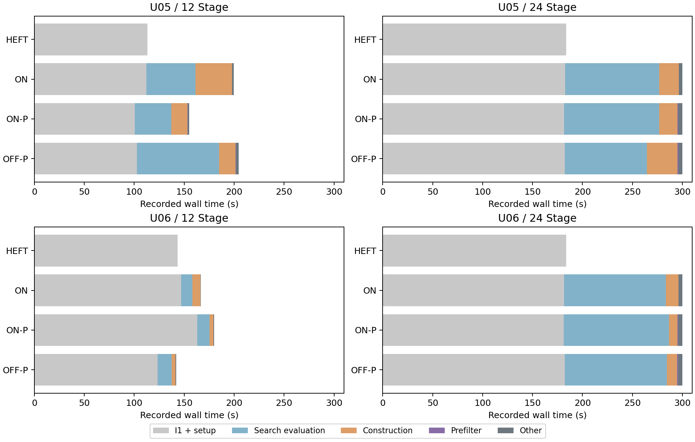
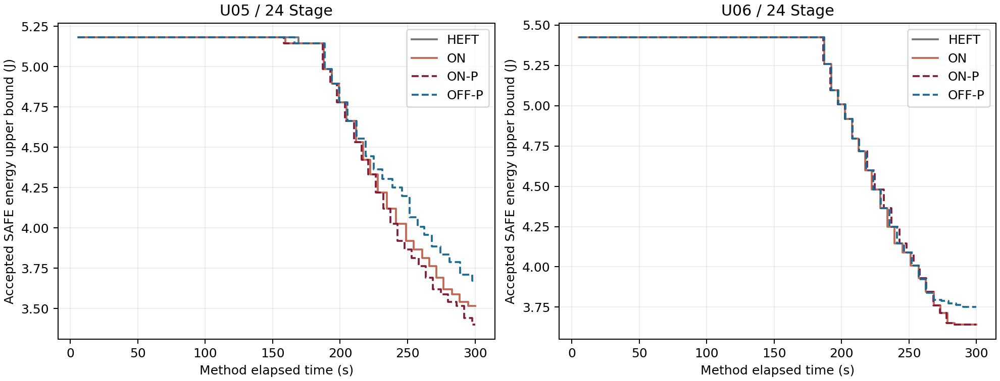

# U05/U06：冻结 I1/ON-P 的12→24 Stage规模扩展

2026-11-13。本轮8次方法运行、8次独立进程完整复评均为SAFE。U05–24的ON-P比原ON节能3.349%，U06–24两者最终排程和能量区间相同；ON-P分别比OFF-P节能7.452%和2.954%。24 Stage仍能取得安全初解并继续节能，但六个搜索臂全部用尽300秒，初始化质量调整和完整电热评价已明显限制可搜索范围。

## 冻结与执行口径

先提交并推送执行冻结版本 `a16515a24fd41747f44faae0a75bcb8365d8cffc`，再生成输入、串行运行固定8槽。已有531份源码逐字节不变，连同5份新增规模入口共536份执行源码保存快照；I1、ON、OFF及结构必要条件预筛继承冻结版本，未改搜索、排序、接纳、连续电热精度或参数。23项模拟及独立人工结构夹具检查通过，没有用于检查的真实方法或热调用。

每臂300秒总预算，I1的180秒是**新工作准入门限**，不是强制切断已开始评价的时刻。最终另做一次最多60秒完整复评，不反馈搜索。保持原计时口径：方法根计时包含科学模块导入、身份核对、输入加载、初始化和搜索；解释器及标准库启动不在方法根内，进程与归档耗时另存。全过程0重试、0替换、0追加实验；总批次2250.969秒。原ON指共用I1、关闭预筛的冻结ON。

运行顺序：U05的HEFT-I1→ON→ON-P→OFF-P，随后U06的OFF-P→ON-P→ON→HEFT-I1。各方法独立初始化，没有直接注入参考排程或复制另一臂初解。

输入沿用已保存的U05/U06参数根，种子分别2026111305/2026111306；原S2扩展规则保持原工作参数与依赖边，添加任务并重算期限/窗口。每根只生成一次，未按结果筛选。两场景、50°C初温及80°C温限不变。

| 根 | 每场景Stage | 共享部署身份数 / 总执行数 | 合法模式数 | 窗口ms |
|---|---:|---:|---:|---:|
| U05 | 12→24 | 16 / 24→32 / 48 | 123→258 | 320→1035 |
| U06 | 12→24 | 16 / 24→32 / 48 | 114→225 | 510→1135 |

“共享部署身份”是统一部署决策的身份总数；实际出现在两场景的共同身份为8→16。本轮属于**已见根的规模扩展**，不是新的未见参数根验证。工作量、期限与窗口随扩展共同变化，不能将结果解释为只改变任务数量的控制实验。12 Stage使用原归档，不重跑。

## 最终能耗与安全覆盖

下表为完整安全能量区间上界，显示值四舍五入，严格改善判定使用原有精确区间。

| 根 / 规模 | HEFT-I1 J | 原ON J | ON-P J | OFF-P J | ON-P较HEFT节能 | ON-P较OFF-P节能 |
|---|---:|---:|---:|---:|---:|---:|
| U05 / 12 | 1.559538 | 1.375554 | 1.375554 | 1.508477 | 11.797% | 8.812% |
| U05 / 24 | 5.143721 | 3.517908 | 3.400088 | 3.673865 | 33.898% | 7.452% |
| U06 / 12 | 2.015246 | 1.795047 | 1.795047 | 1.795047 | 10.927% | 0% |
| U06 / 24 | 5.424654 | 3.640077 | 3.640077 | 3.750893 | 32.898% | 2.954% |

两种规模各8/8取得最终SAFE并通过8/8完整复评。所有24 Stage最终解在300秒前已有完整安全回执；方法返回最长300.032秒，末尾是退出与记账，不含预算后接纳。24 Stage的原ON较HEFT节能分别31.608%和32.898%。绝对能耗增大包含新增工作与更长窗口的影响，不表示算法效率恶化；较HEFT的节能比例上升，也混有初解质量调整被截断的影响。

全部418次完成的方法内评价均SAFE，无完整超温回执；最高已评价峰温上界69.828558°C，低于80°C。这组结果仍不能说明紧热条件下的表现。复评与方法共享数值实现，是最终解一致性核验，不是独立数值实现或真实硬件验证。

## 初始化覆盖、初解质量与180秒门限

每个24 Stage根的四臂初始排程、能量区间完全相同，U05为5.143720946 J，U06为5.424654395 J。初始化评价条数不全相同：U05为36/38/38/36，U06按实际运行顺序为38/37/35/37；共同前缀候选及其能量一致，差异来自180秒门限在不同耗时轨迹上的截断。已观察搜索候选与初始化缓存差集交集为0，没有发现缓存差异造成的搜索评价省略。

| 根 / 规模 | 首SAFE时刻范围s | 初始化交接时刻范围s | 首SAFE→交接初解节能 | 后备构造 | 180秒准入触发 |
|---|---:|---:|---:|---|---|
| U05 / 12 | 3.016–3.390 | 100.547–113.250 | 25.043% | 否 | 否 |
| U05 / 24 | 5.547–5.875 | 181.453–183.813 | 0.735% | 否 | 四臂均触发 |
| U06 / 12 | 3.610–3.875 | 123.406–163.062 | 26.867% | 否 | 否 |
| U06 / 24 | 5.266–5.937 | 181.328–183.703 | 0% | 四臂均使用 | 四臂均触发 |

U06–24的默认构造及三种原频档构造均报`NO_LEGAL_EFT_INSERTION`：前两次停在`S1.s0008`，随后停在`S2.s0007`和`S2.s0006`。冻结I1已有的`deadline_scarcity`后备构造取得SAFE，每臂的四次失败完整保留。这证明本实例中后备路径实际恢复覆盖，不能将原构造失败解释为实例不可行，也没有新增初始化机制。

U05–24首SAFE能耗5.181822855 J，至交接仅改善0.735%；U06–24首SAFE与交接初解相同。两根都在约6秒内解决安全覆盖，但之后质量调整仍占据大部分180秒阶段。它是本轮明确的成本边界；本次没有修改预算分配，也没有据此设计I2。12→24的初始化候选单次成本和质量机会均有变化，不能单凭条数减少推断候选生成变少或算法覆盖收缩。

## 24 Stage成本账目

初始化列为包含启动与交接的根时钟时刻；搜索成本为交接后的实际消耗。构造/预筛列只计搜索部分。电热列为连续电热评价独占时间，失败或未决调用消耗也计时；评价数量列只计完整SAFE，未决另列。其余时间包括目标生成、关联、合法性检查及记账。

| 根 / 方法 | 总时s | 初始化交接s | 搜索s | 构造s | 预筛s | 搜索电热s | 初始化/搜索完整评价 | 搜索接纳/含额外边 |
|---|---:|---:|---:|---:|---:|---:|---:|---:|
| U05 HEFT-I1 | 183.813 | 183.813 | 0 | 0 | 0 | 0 | 36/0 | 0/0 |
| U05 ON | 300.032 | 182.532 | 117.500 | 19.624 | 0 | 94.329 | 38/19 | 19/4 |
| U05 ON-P | 300.000 | 181.453 | 118.547 | 18.031 | 0.797 | 95.438 | 38/21 | 21/5 |
| U05 OFF-P | 300.031 | 182.187 | 117.844 | 30.514 | 0.985 | 82.454 | 36/18 | 18/0 |
| U06 OFF-P | 300.016 | 182.172 | 117.844 | 10.514 | 0.795 | 102.186 | 38/21 | 20/0 |
| U06 ON-P | 300.016 | 181.328 | 118.688 | 8.610 | 0.828 | 105.141 | 37/22 | 19/1 |
| U06 ON | 300.016 | 181.688 | 118.328 | 12.941 | 0 | 101.639 | 35/22 | 19/1 |
| U06 HEFT-I1 | 183.703 | 183.703 | 0 | 0 | 0 | 0 | 37/0 | 0/0 |

| 根 / 搜索臂 | 实际基础/额外构造调用 | 基础预筛拒绝 | 逐边预筛拒绝 | 构造因预算中断 |
|---|---:|---:|---:|---:|
| U05 ON | 264/105 | 0 | 0 | 0 |
| U05 ON-P | 221/128 | 78 | 32 | 1 |
| U05 OFF-P | 671/0 | 210 | 0 | 1 |
| U06 OFF-P | 182/0 | 214 | 0 | 0 |
| U06 ON-P | 129/3 | 123 | 0 | 0 |
| U06 ON | 252/9 | 0 | 0 | 0 |

预筛共拒绝625个基础构造、32个逐边方向；基础拒绝中588个为必然成环、37个为DAG时间界，逐边32个均为反转边时间界。拒绝数不等于安全评价节省数：未预筛时其中许多候选仍会被后续结构构造拒绝。U06的逐边预筛实际拒绝为0，不能把其全部结构成本下降归因于额外边预筛；基础预筛也减少了后续无望的额外构造。

12 Stage六个搜索臂全部自然结束，24 Stage全部预算耗尽。各臂完整SAFE评价的平均单次成本，U05由2.090–2.477秒升至4.585–4.936秒，U06由2.486–3.183秒升至4.639–4.849秒；这是混合候选路径上的描述值，不是纯规模复杂度估计。24 Stage连续电热评价占搜索时间约70.0%–88.6%，构造加预筛约9.4–31.5秒，故预筛并未消除主要评价成本。

## 接纳轨迹：收益出现在哪里

U05–24的ON与ON-P前20个候选的完整构造载荷一致（仅排除提案时刻和预算影响下的接纳结果）；前19次均严格接纳、排程相同。ON在295.032秒到达3.517907718 J，ON-P在286.297秒到达同一排程。第20个候选是同一个额外边联合调整：原ON于296.266秒开始提案，评价至预算耗尽仍未决；ON-P于287.500秒提案，291.781秒安全接纳至3.441898250 J，随后普通第21步于297.922秒进一步降至3.400087806 J。因而当前终值差异表现为**同一搜索前缀在预算内推进的深度不同**，不是新增候选方向。

达到共同第19次接纳时，ON→ON-P的构造加预筛为18.499→14.750秒，搜索电热为90.642→86.345秒；初始化交接也提前1.079秒。约8.735秒的到达时刻差同时含结构开销减少、评价耗时波动和初始化时差，不能将最终3.349%能耗优势全归因于预筛，或据单次运行声称稳定加速。

U06–24的ON/ON-P共23个提案载荷一致，前19次接纳完全相同；第20–22次完整SAFE但不严格节能，第23次同一候选均因预算未决。两者最终排程及能量区间完全相同，保留预筛最终能耗收益0的结果。共同第19次接纳的构造加预筛11.675→8.907秒，但电热时间87.280→88.907秒，部分抵消节省；其到达时刻只提前1.141秒。

ON-P对OFF-P的额外边机制对照在24 Stage两根均有终值收益。U05 ON-P有5次额外边联合接纳，随后仍有普通改善；U06 ON-P第14步含额外边，之后与OFF-P走向不同终解。12 Stage时U05有3次额外边接纳且较OFF-P节能8.812%；U06虽有1次额外边接纳，但第二步即与OFF-P汇合，终值收益0。本轮支持“机制效果依赖规模和搜索路径”，不能把整条联合轨迹的节能归给某一条边，或认为额外边越多收益必然越高。

共同前缀的逐阶段账目见[path_diagnostics.json](path_diagnostics.json)，12/24的全部接纳步骤、候选hash、时刻和额外边见[接纳轨迹CSV](acceptance_steps_12_24.csv)。

## 全部失败、未决和局限

方法内共422次物理电热调用：418次完整SAFE（初始化295、搜索123），4次`wall_time_limit`未决，0热违规、0技术故障。另有8次完整复评，全SAFE。四个未决分别位于U05原ON、U06 OFF-P/ON-P/原ON；U05 ON-P和OFF-P分别有一次构造被预算截断。未决未参与安全接纳，也不冒充完整评价。所有16次U06原初始化构造失败、搜索成环/超期、非改善以及U06 ON-P对原ON的零终值收益均保留，未补跑。

可确认：两个24 Stage扩展实例均有安全覆盖、搜索阶段仍能降低能耗，必要条件预筛减少部分构造成本；U05的预算内推进更深，U06终值保持不变。尚不能确认：跨实例稳定加速、可扩到更大规模、严格热条件收益、全局最优或真实SoC有效性。每根每臂仅一次运行，初始化/评价耗时波动存在；规模扩展也改变工作量和窗口，故不进行统计显著性或普适性推断。

当前证据已足够将“24 Stage可运行”与“300秒内充分搜索”区分开：前者成立，后者未建立。后续判断应优先依据本轮成本和轨迹证据，不宜据此直接扩大规模。本轮到此结束，未修改算法、未设计I2、未运行SA/48 Stage/更多场景，也未重跑12 Stage。

## 复核入口与证据

- [预登记](../../onp_scale24/PREREGISTRATION.md)、[执行计划与源码hash](execution/plan.json)、[23项模拟检查](preflight/checks.json)。
- [生成计划](input_generation/input_plan.json)、[输入清单](input_generation/inputs_manifest.json)、[父根继承检查](scale_comparison.json)。
- [本轮8次完整指标](all_metrics.csv)、[12/24对照](scale_comparison.csv)、[同规模方法比较](comparisons.csv)、[全部细节及失败原因](analysis.json)。
- [批次返回](execution/batch_return.json)、[初始化与峰温补充核查](supplementary_checks.json)、[最终只读验证](verification.json)、[全档案SHA256](files_sha256.json)。
- [12 Stage原归档报告](../onp_unseen_20261113/summary.md)。原728份归档工件逐字节保留。

在仓库根运行`python -B research/chapter4_scheduler/results/onp_scale24_20261113/analyze.py`及`path_diagnostics.py`可重算只读汇总；两者均不调用调度器或电热评价器。已消费的8槽批次不得作为复核步骤重跑。图表布局和标注已人工查看；完整证据保留未舍入的能量区间、时钟、输入/源码hash及候选轨迹。
