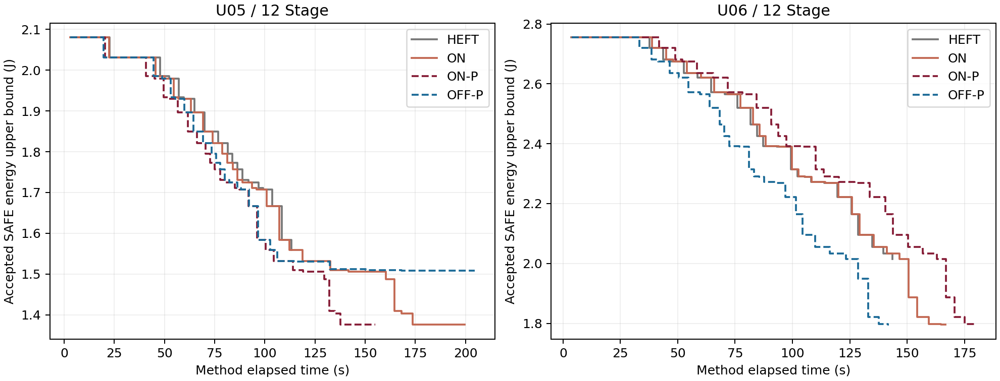
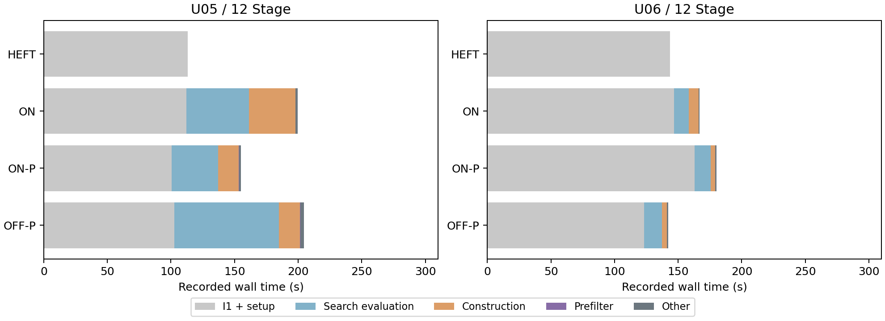

# 冻结ON-P：U05/U06新参数根12 Stage验证

2026-11-13。材料类型：预登记后的仿真实验结果；状态：8次方法及8次同核完整复评完成。算法冻结`63d2dc9`，本轮输入/执行入口及规则冻结`cde5e801a26f3980babaf7110a485bffa62f3624`；生成前已推送该提交。未修改I1、ON、预筛、电热模型或评价精度。

**两根均成功初始化并完成搜索；预筛保留了原ON的完整候选及接纳路径，减少实际构造工作。额外边机制在U05带来8.812%配对净节能，在U06净收益为0。当前值得继续安排少量24 Stage规模验证，没有证据要求设计I2或修改搜索机制。** 本轮只完成12 Stage，未启动后续规模或SA。

## 设计、输入与覆盖

按[执行前预登记](../../onp_unseen/PREREGISTRATION.md)，固定U05/U06种子2026111305/2026111306，使用新命名空间`ch4-independent-onp-v1`。先冻结代码、规则和顺序，再各生成一次，不换根、不调参、不预跑筛选。复用第三章生成器与既有直接12 Stage入口；每场景12 Stage、2场景、初温50°C、温限80°C、5ms网格及原期限/窗口规则不变。

两根均有16个共享Stage身份、24次任务执行，其中8个身份同时出现在两场景；合法模式数U05/U06为123/114，窗口320/510 ms。全H参考仅用于期限及窗口生成和静态结构检查，未经热评价，未传入正式初解器。

U05顺序HEFT-I1→ON→ON-P→OFF-P，U06反向；共8次独立方法调用，每次最多300秒，I1新工作准入180秒，最终SAFE各另作最多60秒完整复评。HEFT-I1只运行同一初解器及质量调整；ON/OFF-P/ON-P使用剩余原根预算搜索，没有共享初解或缓存。ON是不加预筛的原ON对照，所有臂均为I1。

20项新入口模拟和必要接线/预筛回归通过；真实调用前未生成测试U05/U06。526份已有源码逐字节保持，本次冻结531份源码。8方法+8复评全部SAFE，均自然结束，0重试、技术故障、预算中断、未决或热违规；方法内460次完整评价全部SAFE（初始化376、搜索84），全部缓存命中为0。整批含启动、归档和复评耗时1367.891秒，约22.80分钟。

8次首次默认构造即取得SAFE，首个SAFE时间3.016–3.875秒；均未使用I1后备。180秒准入门限均未触发，初始化质量调整正常穷尽。因此本批确认这些新根上的覆盖成功，不提供I1后备机制或门限截断的新实证。

## 初解与最终能耗

单位J，均为完整SAFE能量区间上界；原始精确区间保存在回执中。每根四臂的初解排程、能量区间及初始化候选序列完全一致，U05为45次、U06为49次评价。

| 根 | 共同初解/HEFT-I1 | OFF-P最终 | ON最终 | ON-P最终 | ON-P比HEFT节能 | ON-P比OFF-P节能 |
|---|---:|---:|---:|---:|---:|---:|
| U05–12 | 1.559537966 | 1.508476921 | 1.375553614 | **1.375553614** | 11.797363% | **8.811756%** |
| U06–12 | 2.015246005 | 1.795047363 | 1.795047363 | **1.795047363** | 10.926638% | **0%** |

两根ON/ON-P分别拥有完全相同的18个、4个完整有序搜索候选，除提出时刻外所有候选元数据均一致，严格接纳路径和最终排程相同。不是只有能耗四舍五入后相同；候选hash、精确能量区间和排程均一致。

U05/U06首份SAFE能耗分别为2.080572615/2.755596892 J，I1质量调整在搜索前已节省25.042849%/26.867169%。这部分收益属于共同初始化，不能算为额外边或预筛贡献。

横轴为各自方法根时钟，曲线从首个SAFE起至该臂自然结束；时间差包含初始化与评价耗时波动。完整接纳事件见[事件表](energy_time.csv)。

## 成本与预算

“交接”含启动、身份核查、输入导入、I1和初解冻结；“I1阶段”仅初始化调用本身。所有预筛和构造计时均计入同一300秒根预算。

| 根/臂 | 首SAFE秒 | I1阶段秒 | 搜索交接秒 | 搜索秒 | 总秒 | 初始化/搜索完整评价 |
|---|---:|---:|---:|---:|---:|---|
| U05 HEFT-I1 | 3.390 | 112.031 | 113.250 | 0 | 113.250 | 45 / 0 |
| U05 ON | 3.078 | 111.094 | 112.265 | 87.313 | 199.578 | 45 / 18 |
| U05 ON-P | 3.109 | 99.375 | 100.547 | 54.578 | 155.125 | 45 / 18 |
| U05 OFF-P | 3.016 | 101.594 | 102.766 | 101.859 | 204.625 | 45 / 36 |
| U06 OFF-P | 3.750 | 122.234 | 123.406 | 18.719 | 142.125 | 49 / 4 |
| U06 ON-P | 3.875 | 161.859 | 163.062 | 16.938 | 180.000 | 49 / 4 |
| U06 ON | 3.766 | 145.657 | 146.828 | 19.922 | 166.750 | 49 / 4 |
| U06 HEFT-I1 | 3.610 | 142.406 | 143.563 | 0 | 143.563 | 49 / 0 |

| 根/搜索臂 | 实际基础构造 | 实际额外构造 | 基础预筛排除 | 单边额外排除 | 构造秒 | 预筛秒 | 合计秒 |
|---|---:|---:|---:|---:|---:|---:|---:|
| U05 ON | 984 | 784 | 0 | 0 | 36.579 | 0 | 36.579 |
| U05 ON-P | 633 | 372 | 351 | 377 | 16.265 | 0.188 | 16.453 |
| U05 OFF-P | 966 | 0 | 558 | 0 | 16.451 | 0.267 | 16.718 |
| U06 ON | 216 | 152 | 0 | 0 | 7.891 | 0 | 7.891 |
| U06 ON-P | 84 | 53 | 132 | 75 | 3.580 | 0.155 | 3.735 |
| U06 OFF-P | 132 | 0 | 132 | 0 | 3.766 | 0.172 | 3.938 |

ON-P相对ON：U05实际构造1768→1005，构造加预筛少20.126秒（55.02%）；U06为368→137，少4.156秒（52.67%）。单边排除不包含基础组合被排除后未枚举的额外方向，不能把所有额外减少次数都算为逐边预筛。U05逐边证据为反向边时间界287次、保留超期路径90次；U06为43/32次。

两组都自然搜索结束，预筛没有增加完整评价次数或改善最终能耗；它在本批节省了达到相同搜索结果所需的结构工作。原ON和ON-P均仅一次，计时仍是观测值，不能推广成稳定加速倍数。

U05 ON-P总时少44.453秒，但其中初始化交接少11.718秒，搜索完整评价少12.472秒；不能把总差全算为预筛收益。U06 ON-P构造成本更低，总时却比ON多13.250秒，主要伴随初始化交接多16.234秒：相同49个初始化候选的完整评价耗时156.205对140.998秒。预筛尚未进入初始化，这个差不是预筛造成。与OFF-P相比，U06 ON-P同一初始化评价序列还多38.439秒。日志确认墙钟波动，未确认具体主机负载原因。

## 额外边机制的实际贡献

U05 ON/ON-P均7次严格接纳，其中3次含额外边；OFF-P有5次普通接纳。ON-P的第4、8、9个送评候选分别接纳到1.509403409、1.487015894、1.410059425 J，含额外边的联合步骤之后还有普通调整，最终为1.375553614 J。额外边机制开启后的配对净节能是8.811756%，不是把某条边或3个联合步骤的下降量相加；同一邻域轨迹中的后续机会也发生变化。其搜索完整评价18次对OFF-P的36次，反映本例路径差异。

U06 ON/ON-P在首个搜索步骤接纳一项含额外边的联合调整，降到1.886058822 J；OFF-P首步降到1.948682138 J。两条路径在第二步汇合到完全相同的候选1.820346404 J，随后两步及最终排程均相同，三臂都是4次搜索评价。这里额外边改变了中间路径，但没有最终能耗或评价次数净收益。

因此，本批分别提供了“预筛降低构造工作”和“额外边有条件改善搜索结果”的证据，不能合并成同一个贡献。没有原OFF臂，不能独立估计OFF-P基础预筛相对OFF的成本；没有ON仅基础预筛臂，也不能完全拆分基础预筛与额外边预筛的净效应。

## 证据边界与下一步

最高最终峰温56.619817°C；全部460次评价中的最高峰温64.858617°C，均低于80°C，本批仍未展示紧热约束表现。复评内部耗时3.250–4.891秒，使用相同数值实现，不能视为独立数值或硬件校验。

U05/U06在本轮之前未参与ON-P开发，但仍是同一合成分布、同一拓扑族中的两个参数根；每根每臂一次，不作统计显著性、跨任务族泛化或普遍成功率主张。本轮后它们成为已见实例；后续24 Stage应描述为冻结算法的规模扩展验证。旧结果、全部失败构造、非改善候选及U06零净收益均保留。

建议下一步将这两根按原扩展规则增至24 Stage，仍保持I1/ON/预筛、2场景、50°C、180/300秒不变，继续保留HEFT-I1、OFF-P、ON-P及原ON四臂。重点看首次SAFE、初始化截断、逐次改善时刻、构造/预筛/完整评价成本与预算内最终解；规模增大时总工作和期限/窗口随既有规则变化，不能宣称只有Stage数量变化。本轮不执行该扩展，不设计I2、不加入SA。

证据：[全部8次指标](all_metrics.csv)、[配对核对](comparisons.csv)、[详细分析](analysis.json)、[完整候选与峰温补充核对](supplementary_checks.json)、[20项检查](preflight/tests.log)、[输入规则](input_generation/input_plan.json)、[执行冻结计划](execution/plan.json)、[批次回执](execution/batch_return.json)。`analyze.py`只读取归档，不调用调度或电热评价器。
