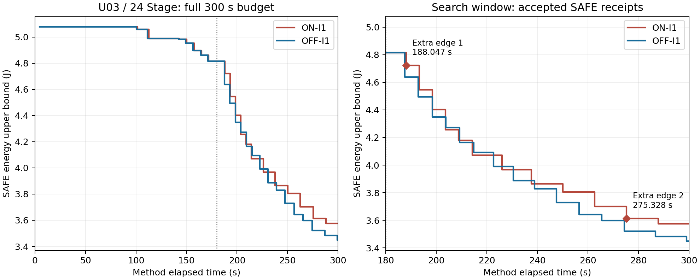
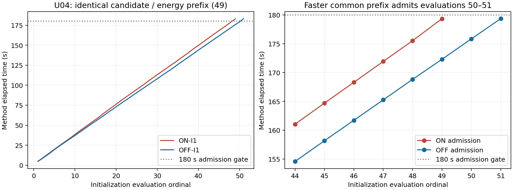

# 24 Stage搜索效率与路径诊断

2026-11-13。只读分析提交 `581a77ed8dafb4099d4acd186c554db03cb23969` 保存的U03/U04日志；2场景、50°C、冻结I1/ON/OFF、300秒总预算、180秒初始化新工作准入门限。本轮新增方法调用、候选排程重建和电热评价均为0，未修改算法、精度或门限，未启动I2、48 Stage、4场景或SA。

**结论：值得先研究廉价、严格的结构必要条件，但现有证据不足以承诺它能让ON反超OFF。** U03同时存在搜索开销、接纳路径和全候选哈希破同分的影响；U04初始化差异来自同一路径的不同截断长度，未发现初始化策略分叉。

| 问题 | 本轮证据 | 不能据此推出 |
|---|---|---|
| U03为何ON最终落后 | ON两次额外边联合步骤均严格节能；后半程推进更晚，300秒内仅接纳12次，OFF接纳15次；另有确定性的路径分叉 | 两条额外边本身有害；去掉某条边必然达到OFF终解 |
| 无效构造可否提前识别 | 精确必要条件覆盖U03的817/1066次、U04的186/351次额外边尝试，归档合法候选均未被排除 | 同比例的时间节省、额外评价次数或最终节能收益 |
| U04初始化是否走了不同路径 | 前49个候选、能量区间和接纳决定一致；ON初解等于OFF第49评后的最佳档案；OFF共同前缀评价快6.881秒，多准入两次 | ON/OFF最终差值是纯阻塞边机制效果；门限应立即修改 |

## 1. U03：能耗—时间曲线与接纳路径

纵轴为已接纳完整SAFE回执的能量区间上界，横轴为方法起点后的墙钟时间；采用归档回执形成时刻，阶梯保持至下一次改善。无SAFE之前不补线，300秒后的返回开销不补算搜索。虚线为180秒准入门限；红色菱形是含额外反转边的联合接纳步骤。

| 指标 | OFF-I1 | ON-I1 |
|---|---:|---:|
| 初解/J | 4.814224356 | 4.814224356 |
| 初解交接时刻/s | 182.203 | 183.359 |
| 实际搜索时间/s | 117.797 | 116.672 |
| 结构构造时间/s | 63.205 | 69.891 |
| 搜索完整评价时间/s | 52.485 | 41.955 |
| 搜索完整SAFE评价/严格接纳 | 15/15 | 12/12 |
| 额外边尝试/结构合法/送评/接纳 | 0/0/0/0 | 1066/8/2/2 |
| 最终能耗/J | 3.449138547 | 3.575443751 |

ON最终高0.126305205 J，即3.661935%。ON末次候选在296.953秒进入评价，300秒返回`UNRESOLVED/wall_time_limit`，未接纳；这3.047秒计入成本，但不是完整评价或数值不收敛。两个方法最后SAFE均通过原批次完整复评，本轮直接使用该回执。

ON相对OFF的计时差可核对为：交接晚1.156秒，结构构造多6.686秒，完整搜索评价少10.530秒，另消耗3.047秒于未完成评价；其他搜索成本少约0.328秒，最终返回时刻差0.031秒。两臂完整搜索评价均值约3.50秒，差异主要体现为能在预算内完成多少次评价，而非本组单次完整搜索评价明显变慢。这是已观察成本的分解，不是单独开关额外边的反事实时间估计。

两次额外边接纳均为完整联合调整，以下箭头是被反转前的资源边，不能把整步收益归给一条边：

| ON步骤/形成时刻 | 降档目标 | 额外反转前资源边 | 整步能耗下降/J |
|---|---|---|---:|
| 1 / 188.047 s | C1 S1.s0001：H→L | S1.s0002 → L1.s0006 | 0.092490831 |
| 11 / 275.328 s | C2 L1.s0003：H→L | L1.s0008 → S2.s0003 | 0.087552473 |

ON并非全过程劣于OFF。第6次接纳后，ON为4.070568 J@214.219秒，OFF为4.093390 J@214.796秒；但后续共有目标的推进逐渐落后：

| 两臂都已接纳的目标 | OFF时刻/s、能耗/J | ON时刻/s、能耗/J |
|---|---|---|
| C2 L1.s0015→L | 230.500，3.887010 | 237.578，3.864590 |
| C2 L1.s0008→L | 247.593，3.728471 | 262.625，3.701529 |
| C2 L1.s0003→L | 256.531，3.642108 | 275.328，3.613976 |

这些是共有目标的进度标记，不是相同状态。在最后一个标记，ON能耗低约0.028132 J，却晚18.797秒。此后OFF又接纳4次普通调整（C2 L1.s0005、S2.s0001、S2.s0002及C1 L1.s0014），累计下降0.192969299 J；ON只接纳C2 S2.s0003一次，下降0.038532458 J。最终差异由此在预算尾段形成。没有续跑，因此不能断言给ON更多时间就能取得OFF的机会或结果。

**路径确实改变，但包含一个非物理的跨场景因素。** 首次C2分叉发生在普通目标`C2::S2.s0008.r1 H→L`（ON第6步、OFF第5步）。此前C2排程完全相同；选择同一对Stage、同一OPP和earliest模板，两种主次序在两臂均已记录为结构合法。两种C2排程的非热能量台账相同，均为`11224274103/2890000000 J`。

冻结算法按“完整候选非热能耗、完整候选哈希”排序。C1状态因先前路径不同，导致同一对C2排程的全候选哈希大小关系翻转：

| C1上下文 | C2 reverse排程哈希前缀 | C2 incumbent排程哈希前缀 | 先选 |
|---|---|---|---|
| ON的C1 | 8a933e84 | 8b1f3744 | reverse |
| OFF的C1 | 6bfe2871 | 1f28f70c | incumbent |

完整哈希和合法性记录见`path_comparison.json`。这里只组合保存的场景字段核对身份哈希，没有构造新排程或进行评价。这说明存在确定性的算法破同分联动；不能将其写成新增物理场景耦合，也不能把随后C2变化全部归因于额外边直接重排了C2。

进一步，在目标C2 L1.s0003及伙伴L1.s0004都选L时，OFF对应普通incumbent模板合法；ON在自己的当前状态下，同一L/L组合的earliest和preserve基础构造都使S2.s0008超期10.412 ms（720.823 > 710.411 ms），随后借额外边获得接纳。**ON仍有伙伴取H的普通合法替代**，所以只能说该L/L组合的普通机会改变，不能说整个目标必须依赖额外边。

## 2. 失败构造与可提前识别的必要条件

下面统计的是构造尝试，同一结构可能跨轮次重复，不能当作独立样本或唯一候选数。“基础”包含目标/伙伴OPP及主资源次序调整，“额外”是在基础超期后再反转一条阻塞边。

| 根/方法/构造 | 总次数 | 仅截止期超限 | 截止期且窗口超限 | 成环 | 结构合法 |
|---|---:|---:|---:|---:|---:|
| U03 OFF 基础 | 2335 | 1298 | 0 | 945 | 92 |
| U03 ON 基础 | 1404 | 696 | 0 | 622 | 86 |
| U03 ON 额外 | 1066 | 1058 | 0 | 0 | 8 |
| U04 OFF 基础 | 1046 | 548 | 44 | 330 | 124 |
| U04 ON 基础 | 939 | 524 | 8 | 289 | 118 |
| U04 ON 额外 | 351 | 342 | 9 | 0 | 0 |

归档诊断没有直接保存窗口违规列表；本批所有请求截止期均不大于窗口，因此可从完整期限失败记录中的`end_ms > window_ms`恢复窗口超限子集。成环记录可能只传播部分节点，不再混入完整期限/窗口统计。8次结构合法额外构造仅2次送评接纳；其他6次可能受去重、首次改善重启等影响，日志不足以逐一归类，不能全部称为重复候选。

失败集中且重复：U03 ON的1058次额外期限失败全部包含C1 S1.s0008超期，1042次也包含S1.s0007；U04 ON额外失败中，342次包含C2 S2.s0008，336次包含C2 L1.s0016。一个候选可有多个超期任务，这些见证计数不能相加成候选数。

### 必要条件及安全边界

以下只判定**当前设备、OPP组合和排程模板**不可行，不评价热安全，不证明原实例全局无解，也不删除其他模式组合。全部时间运算使用精确分数。本批为5 ms网格，无额外显式起点集合。

1. **基础反转必成环。** 已有合法排程中，若所选两节点之间存在任务DAG路径，并且新OPP下确实生成对应资源边（同设备，或同频域且OPP不同），把该资源边反向必闭合有向环。仅凭任务可达性还不够，必须核对新OPP下资源边仍存在。该条件覆盖U03 OFF的534/945次基础成环、U03 ON的324/622次，以及U04 OFF的330/330、ON的289/289；其余成环还依赖其他资源边。

2. **DAG最早/最晚界。** 固定模式后，令任务时长为`d_i`，起点下限`b_i`包含release与0；preserve模板还对未选中且不在所选节点任务后继集中的节点保留原起点下限。忽略资源边，只在任务DAG上计算：

   `ES_i = ceil_g(max(b_i, max_p(ES_p + d_p)))`

   `LS_i = floor_g(min(min(D_i, W) - d_i, min_j(LS_j - d_i)))`

   其中p为任务前驱，j为任务后继，空集合项忽略。任何合法排程都必须满足`ES_i ≤ start_i ≤ LS_i`：前向界来自释放、任务依赖和网格，后向界来自截止期、窗口和任务后继。若已有`ES_i > LS_i`，任何资源次序修复均无望。对原资源边`u→v`的反转`v→u`，还必须满足：

   `ceil_g(max(ES_u, ES_v + d_v)) ≤ LS_u`。

   违反即有不可行见证。U03诊断索引45中，反转`C1 S1.s0003→L1.s0006`迫使S1.s0003最早175 ms启动，而DAG最晚界为140 ms；无需完整资源图或热评价即可拒绝。U04索引542同样出现550 > 435 ms。

3. **仍保留一条超期见证路径。** 已有基础构造超期后，若拟反转的原方向边不在某条超期关键路径上，该路径的所有边、时长及起点下限都保留；其结束时间下界仍超期。即使其他路径缩短，也不能消除此见证。U04索引309尝试反转`C2 S2.s0008→L1.s0005`，但S2.s0008自己的超期路径不经过这条出边，因而无法修复它。该条件需要基础传播已有见证，不能宣传为免除基础传播。

| 额外构造必要条件 | U03 ON | U04 ON |
|---|---:|---:|
| 原DAG/模板时间界已不可行 | 749 | 136 |
| 原界可行，但反转边违反最晚界 | 68 | 18 |
| 存在未被打断的超期路径 | 0 | 168 |
| 上述条件并集 | **817/1066（76.64%）** | **186/351（52.99%）** |
| 归档合法额外构造被误排除 | 0/8 | 0/0 |

U04的两类路径/时间界证据重叠136次，不能直接相加。基础构造的“任务可达成环或DAG时间界不可行”并集为U03 OFF 1199/2335、ON 1098/1404，U04 OFF 667/1046、ON 608/939；同样没有排除归档合法基础构造。零误排除只是归档一致性检查，安全依据是上述必要条件推导。

DAG可达性可随输入预计算；固定上下文的ES/LS可按DAG线性传播，并在同一基础构造的多条额外边之间共用，单条反转只需查界。现实现对每条额外边再次准备上下文、传播基础图和反转图，因而存在减少重复工作的空间。是否实际更快，仍需后续单独版本验证。

### 能归因到多少时间

日志的`blocking_graph_construct`把“一次基础构造及其所有额外尝试”合并计时，没有逐额外边耗时：

| ON根 | 含额外尝试的组数/总耗时 | 全部额外尝试均有必要条件证据的组数/组耗时 |
|---|---|---|
| U03 | 456组 / 43.143 s | 287组 / 29.378 s |
| U04 | 349组 / 20.081 s | 186组 / 10.862 s |

右列时间包含仍需完成的基础工作，**不是可节省时间**。两臂访问轮次、状态和基础构造数量也不同，不能用ON−OFF结构时间作为额外边的独立单位成本。现有数据足以定位大量可证无望的构造和结构开销暴露，尚不能量化预筛后的净收益。

## 3. U04：180秒准入门限的可比性

两臂前49次评价的候选哈希、能量区间和档案替换决定逐项相同；ON的48条局部调整记录也是OFF前48条的相同前缀（去掉准入时刻）。进一步核对：ON最终初解恰好等于OFF完成前49评后的最佳档案。此前“初始化路径不同”应细化为**同一路径的截断长度不同，而非前缀内策略分叉**。

| 指标 | ON-I1 | OFF-I1 |
|---|---:|---:|
| 初始化评价次数 | 49 | 51 |
| 共同49评累计评价时间/s | 176.800 | 169.919 |
| 第49评返回时刻/s | 182.860 | 175.750 |
| 初始化最终能耗/J | 6.278853999 | 6.239218629 |
| 初解交接时刻/s | 182.938 | 183.265 |

共同前缀返回时刻相差7.110秒，其中6.881秒来自完整评价累计耗时，约0.229秒来自其他前置/构造/记账成本。日志只能确认运行耗时变化，不能确定机器负载或其他系统因素的具体来源。

门限附近的完整评价记录如下。表中时刻为评价准入；局部调整构造准入稍早，具体值保留在JSON中。

| 初始化评序 | 调整 | ON准入→返回/s | OFF准入→返回/s | 两臂共同或OFF新增决定 |
|---|---|---|---|---|
| 48 | C1 L1.s0002→L | 175.531→179.250 | 168.812→172.203 | 接纳，6.278853999 J |
| 49 | C1 L1.s0002→M | 179.344→182.860 | 172.297→175.750 | 不接纳 |
| 50 | C1 L1.s0003→L | 未准入 | 175.844→179.265 | OFF接纳，6.239218629 J |
| 51 | C1 L1.s0003→M | 未准入 | 179.359→183.219 | OFF不接纳 |

ON第49评在180秒前准入，允许完成后停止新工作；OFF第49评较早返回，随后第50、51评都在180秒前准入。两臂遵守同一门限，没有越过180秒启动新工作。OFF因此多降低C1 L1.s0003的OPP，后续13个任务起点各后移20 ms，初解能耗低0.039635370 J。

这解释了为什么共用确定性初解器、相同180秒门限仍不能保证同一初解。U04最终ON 4.495593663 J、OFF 4.433243675 J可保留为同总预算的方法结果，但不能作纯阻塞边归因；也不能从最终差值中简单减去初解差，就当作独立机制贡献。OFF多做两评并未获得更多搜索时间，交接反而晚约0.327秒。

## 4. 本轮判断与后续边界

保持I1、180秒门限及当前ON冻结，暂缓48 Stage、4场景和I2。现有证据支持优先考虑一个**单独版本的精确结构必要条件预筛**：共同基础条件对ON/OFF一致应用，额外边条件只作用于对应额外构造；保持合法候选排序、严格区间接纳和完整连续电热评价。此处仅提出候选方向，没有实施或运行新版本，也不将哈希破同分因素顺手改掉。

提出该方向的依据是大量可证无望的构造与已占用的结构时间，而不是已经测得加速。若后续获准验证，应先证明合法候选集合及次序保持，再比较实际筛选成本、预算内评价次数和最终能耗；保留当前冻结结果作为消融基线。没有这些证据前，不宣称搜索成本问题已解决或ON将反超。

## 5. 材料与复现

原始输入、计时、失败记录、完整回执及最终复评均取自[既有24 Stage归档](../scale24_i1_20261113/summary.md)，没有补跑。518份冻结源码身份不变；原归档663份清单文件全部哈希一致，见`verification.json`。

- [接纳轨迹](accepted_steps.csv)、[完整能耗时间点](energy_time.csv)：逐次严格接纳及其候选身份。
- [结构分组与成本](graph_groups.csv)、[1417条额外构造必要条件证据](necessary_condition_certificates.json)：包含轮次、基础候选哈希、归档诊断索引及时间界。
- [路径对照与完整哈希](path_comparison.json)、[U04初始化共同前缀](U04_initialization_prefix.csv)、[汇总及来源哈希](diagnostic.json)。
- [只读统计与必要条件计算](diagnose_archives.py)、[路径核对与绘图](path_and_figures.py)：依次执行，仅需Python标准库及Matplotlib；不导入科研评价器，不调用初始化、搜索或热积分。
- 冻结实现：[资源边和传播](https://github.com/YBEMR/paper/blob/581a77ed8dafb4099d4acd186c554db03cb23969/research/chapter4_scheduler/blocking/core.py#L112)、[分组生成及全候选哈希排序](https://github.com/YBEMR/paper/blob/581a77ed8dafb4099d4acd186c554db03cb23969/research/chapter4_scheduler/blocking/method.py#L144)、[I1准入规则](https://github.com/YBEMR/paper/blob/581a77ed8dafb4099d4acd186c554db03cb23969/research/chapter4_scheduler/i1/admission.py)。

结论限于两个根各一次的保存轨迹；未做反事实续跑、逐额外边性能测量或独立电热数值验证。所有原失败、零收益和负结果继续保留。
