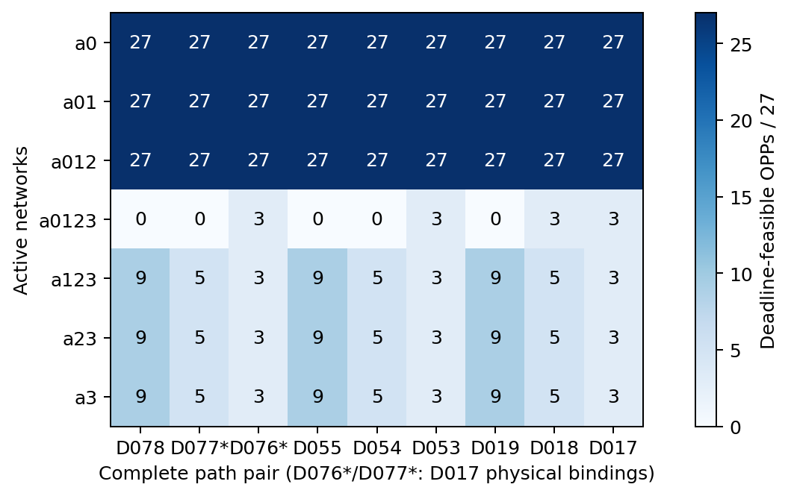
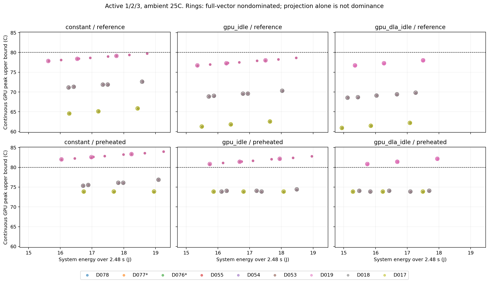
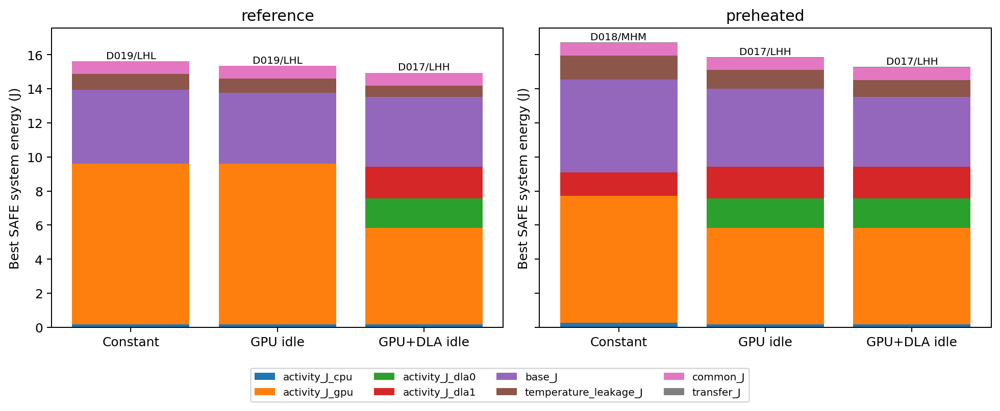

# D017有限常驻九路径：机制价值诊断

**本轮不建议进入独立热感知多路径算法开发。** 指定路径确实存在能耗与空间热分布权衡；恒频下3组、仅GPU空闲降频下2组配对因入口热状态改变最优路径。但GPU与共享DLA都拥有理想空闲降频权限后，这些选择差异全部消失：固定D017的两条完整双DLA路径可覆盖全部最低SAFE能耗动作，频率只随活跃网络集合变化。保留条件性正证据与权限敏感性负证据，不继续加算法或新工况。

## Material Passport

- 执行冻结：[b829978](https://github.com/YBEMR/paper/commit/b8299787f70fa81d1d2b2a875c0ae1e04fc26a2a)。基线d61e84d保留45b14f9原负载/预热输入和af6dd97空闲基线；没有合并或改写旧物理源文件。旧D038/D040双路径目录与本轮无关。
- 一次正式运行，整批预算900秒，实际**23.659秒**（包含初始化、JIT、调度、热系数、完整连续峰温检查、归档）。没有追加运行、调参或超时。
- 7个周期活跃集合×9路径×27频率=1,701个调度；894个期限可行。8个原驻留输入分别保留62/63帧，单周期与驻留共3,645动作窗口×2环境×2入口×3权限=**43,740行**。其中22,140行期限失败，545行热超温，21,055行SAFE，无UNRESOLVED。
- 10,728条实际热回放至该负载最长驻留；单周期和62/63帧证书取同一连续轨迹前缀。重复/等价动作行不是独立统计样本。
- [核验](verification.json)：41个冻结来源/输入/代码哈希；全部动作归档、3,691,656次逐请求展开检查通过；能量分解误差最大7.11e-15 J。执行前小核验与原评价器对照温度误差0、能耗误差≤1.12e-16 J。

## 1. 路径和期限

常驻固定为YOLOv2的DLA0[0–29]、DLA1[30–40]及YOLOv3的DLA1[0–36]、DLA0[37–78]，每个DLA两段，总数始终4；未选中的段也不释放名额。两个tiny全部GPU。D076*、D077*交换原代表的DLA标签以恢复D017绑定，全部重新认证。完整计算覆盖、跨分区活跃张量、L/M/H阶段时间/功率与传输见[path_audit.json](path_audit.json)、[path_summary.csv](path_summary.csv)、[stage_profiles.csv](stage_profiles.csv)。

表中为27频率中满足全部40 ms期限的数量；a123表示网络1/2/3活跃。所有权限使用相同计算时间轴；理想空闲切换不改变计算档位。

|活跃网络|D078|D077*|D076*|D055|D054|D053|D019|D018|D017|
|---|---:|---:|---:|---:|---:|---:|---:|---:|---:|
|0|27|27|27|27|27|27|27|27|27|
|0,1|27|27|27|27|27|27|27|27|27|
|0,1,2|27|27|27|27|27|27|27|27|27|
|0,1,2,3|0|0|3|0|0|3|0|3|3|
|1,2,3|9|5|3|9|5|3|9|5|3|
|2,3|9|5|3|9|5|3|9|5|3|
|3|9|5|3|9|5|3|9|5|3|



在四网并发下，GPU执行整个YOLOv3的路径0没有期限可行频率，所以这个负载不会提供“GPU整网低能耗→热状态触发换路”的空间。仅有D076*、D053、D018、D017各3个频率满足期限。无SAFE只限本次九路径动作域，不能推广到原81部署域或扩展域。

## 2. 有真实权衡，但不等于普遍需要动态选择

代表例为原均衡sc2活跃1/2/3、25°C、参考入口，连续62帧（2.48秒）。此时YOLOv2不活跃，D019/D018/D017只代表YOLOv3有效路径0/1/2；其他YOLOv2路径编号是等价项。

|恒频动作|系统能耗 J|CPU/GPU/DLA0/DLA1峰温 °C|GPU终温 °C|最小期限裕量 ms|
|---|---:|---|---:|---:|
|路径0，D019/LHL|15.620464|39.072 / 77.821 / 36.124 / 36.124|77.621|3.322009|
|路径1，D018/MHM|16.261029|42.036 / 71.130 / 37.219 / 43.372|71.018|0.308690|
|路径2，D017/LHH|16.282156|39.347 / 64.553 / 46.310 / 46.811|64.425|1.248307|

路径2比路径0多0.661692 J，GPU峰温低13.269°C，但两个DLA更热、期限裕量更小。这是实际的多指标权衡，不能仅凭GPU更冷判定全面支配。各入口的前沿同时考虑能耗、四节点连续峰温、四节点终温和期限裕量，完整向量保留在[pareto_fronts.csv](pareto_fronts.csv)；图只投影能耗与GPU峰温，圈表示全向量非支配，超温点仍保留作诊断。



图中选择上述有路径变化的冻结输入作说明；全部180条件组均完整归档，没有只保留该例。重叠点来自不活跃网络的等价路径，不算独立证据。局部前沿不证明跨场景后续价值，更不证明某动作在任意入口状态都支配其他动作。

## 3. 入口温度何时改变最优有效路径

90组冷/热配对中：83组最低SAFE动作无实质改变，5组改变路径，2组从有SAFE变成无SAFE；没有“仅频率变化”的配对。42组单周期配对全部不改变最优路径/频率。变化均出现在原驻留时长热积累后，且全部涉及YOLOv3：

|权限|负载 / 环境 / 帧数|参考入口→预热入口的最优有效路径|频率变化|冷态沿用热态最优路径并重选频率的代价|
|---|---|---|---|---:|
|恒频|1/2/3，25°C，62|0→1|LHL→MHM|+4.101%|
|恒频|3，30°C，63|0→1|LHL→MHM|+4.373%|
|恒频|2/3，30°C，63|0→1|LHL→MHM|+4.304%|
|GPU空闲L|1/2/3，25°C，62|0→2|LHL→LHH|+0.899%|
|GPU空闲L|2/3，30°C，63|0→2|LHL→LHH|+1.127%|
|GPU及共享DLA空闲L|全部30组配对|均不变|均不变|0|

上表五组中，预热入口沿用冷态最优路径0，即使重新搜索其全部频率也无SAFE；因此不是极小数值排序或编号变化。代价以同一冷态最低SAFE为分母，**不是已经实现的跨场景动态算法节能率**。详细动作/峰温/期限及两个方向的替换代价见[decision_changes.csv](decision_changes.csv)。

另两组是四网并发、30°C、62/63帧：恒频参考入口有5个SAFE名义动作，预热入口0个。GPU空闲降频即恢复D017/LHH等SAFE动作；63帧时D017为20.303797 J、峰温78.111984°C。该两组是同一活跃集合的两种原驻留长度，不称作两种独立热难题。

## 4. 统一空闲权限改变结论

以下仍为活跃1/2/3、25°C、62帧，分别列各条件下最低SAFE动作；不同入口能耗不直接计算节能率。

|权限|参考入口动作 / 能耗 J / 峰温 °C|预热入口动作 / 能耗 J / 峰温 °C|
|---|---|---|
|恒频|D019/LHL，15.620464，77.821|D018/MHM，16.720434，75.330|
|GPU空闲L|D019/LHL，15.354000，76.715|D017/LHH，15.865022，73.849|
|GPU及共享DLA空闲L|D017/LHH，14.939376，60.917|D017/LHH，15.289903，73.849|

恒频下D017的活动能耗其实比D019低0.193523 J，但基础能耗高0.868 J；后者抵消了活动能耗优势。固定D017/LHH及其完整计算时间轴，增加GPU理想空闲管理使基础/漏电分别减少0.613108/0.177064 J；再允许共享DLA空闲管理，额外减少基础0.475302 J、漏电0.077305 J。活动、传输及板级能耗不变。于是共同权限下D017同时比D019省能且GPU更冷，原“付额外能耗缓解GPU热点”的主取舍不再决定最佳动作。

这里“DLA基础功耗”来自频档相关截距；不是把未选引擎卸载或减少常驻名额。DLA0、DLA1必须同时空闲才能降低共享频域，低频时截距与漏电斜率同步变化。全部同动作归因见[same_action_idle_attribution.csv](same_action_idle_attribution.csv)，非仅从原能耗扣除常数。



在第三种权限的**全部60个条件组**中，最优动作都可由固定D017完整双DLA路径实现：YOLOv3活跃用LHH，否则用LLL。仅当网络不活跃时可能有其他等价编号。其他路径仍可能因DLA温度或期限裕量位于多目标前沿；不能把“不是能耗最优”写成“全面被支配”。

## 5. 立项判断与边界

**回答问题1：有非支配权衡。回答问题2：有限条件下热入口确实改变最优路径。回答问题3：该热状态驱动选择的最优能耗增量对普通DLA空闲管理权限高度敏感，本轮统一GPU+DLA理想管理后未保留。**

按本轮门槛，停止当前九路径的独立热感知算法开发，保留上述诊断作为研究证据；不调整第三、四章。若实际目标环境无法提供共享DLA空闲降频，GPU-only下两组0.899%–1.127%的冷态路径替换代价仍是条件性研究空间，但本轮不据此立即追加控制器或联合算法。

不能成立的结论：没有证明多路径动态策略优于原81域全窗最优；没有证明跨场景预测增益；没有证明真实设备能实现零开销权限；没有证明所有有限常驻多路径问题无价值。第三权限没有最优路径变化，也不意味着前沿的其他终温分布永远无后续价值——需要另一个被批准的全窗问题才能判断。

本轮全部为冻结合成FP16参数。原四DLA段在抽象计算图中合法，不等于真实TensorRT分区编译、设备放置或输出一致性验证。YOLOv2/YOLOv3各三种完整/后缀GPU执行图，加两个tiny，共8种逻辑GPU执行图（相较固定D017多4种）；能否共享权重、所需显存/执行上下文/张量缓存及额外静态功耗均未测量。四个DLA名额不增加不代表零额外资源成本。

四节点初温按原JSON逐位复用；30°C环境的预热向量是25°C旧运行产生的共同外生初态，不是30°C实测预热。温度逐事件/逐周期连续继承，数值峰温证书沿用原binary64边界标准，非有向舍入形式证明。零切频时间/能耗仅用于理想敏感性，不能把表中净能量变化称作硬件可实现收益。

## 复核与交付

完整结果[action_results.csv](action_results.csv)包含所有九路径×频率×输入条件，失败行不附虚假热能耗；[coverage.csv](coverage.csv)记录状态覆盖，[best_actions.csv](best_actions.csv)包含等价最优集合。可编辑图为同名SVG；原始压缩证书、周期边界四节点状态及完整首周期忙闲轨迹见[raw](raw/)。

离线复核/重绘（不运行新物理实验）：

```text
python -B research/d017_nested_paths/archive.py
python -B research/d017_nested_paths/verify.py
python -B research/d017_nested_paths/analyze.py
python -B research/d017_nested_paths/report_data.py
```

首周期请求/阶段+40 ms平移规则是已验证无跨帧遗留的无损轨迹编码。可用`expand_trace.py a123_D017_LHH --frames 62 --output <新输出目录>`展开全部186请求及阶段；不重置热状态、不重新仿真。各动作每周期四节点终温及累计峰温上下界保存于raw/*_cycle_states.npz，积分证书保留最终完整能量分解。

独立重现实验须检出执行冻结提交到全新目录，再运行`launch.py`；它拒绝覆盖已存在raw。Python3.12.4及已有numpy/numba/matplotlib/pandas环境，版本见[environment.json](environment.json)及[dependencies.json](dependencies.json)。不把重复复现作为本轮追加实验。原事件模型/功热参数/旧正式结果均保持不变。
