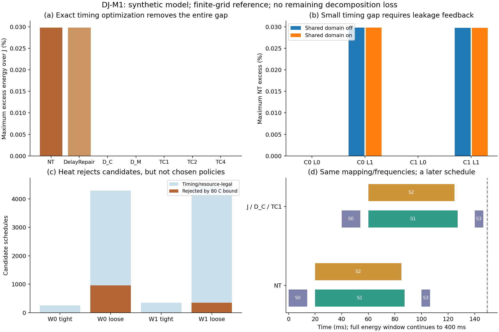

# DJ-M1：分解式与联合式热感知优化边界

**结论：当前有限域内，固定NT映射和频率后优化时序即达到联合最优；未发现专门联合算法的收益空间。** 微小热能量差≤0.02984%，且共享频率一致性约束没有实际排除候选。因此本轮不覆盖三类因素同时活跃的边界，也不能否定更广泛场景。

- [研究报告](REPORT.md)：严格结论、能耗分解、消融与停止判断。
- [文献能力矩阵](LITERATURE_MATRIX.md)：四篇全文核查；Li 2018仅摘要/引言，保留缺口。
- [冻结协议](PROTOCOL.md)、[机器参数](protocol.json)、[冻结哈希](freeze.json)。
- [方法比较](results/comparisons.csv)、[各臂候选数](results/arms.csv)、[映射条件最优](results/mapping_conditionals.csv)。
- [数值核验](validation_results.json)、[结果分析](analysis/summary.json)。



## 复现

Python 3.12；numpy 1.26.4、scipy 1.13.1、numba 0.61.2、matplotlib 3.10.0。本目录含全部实验输入，复算不需要下载论文。`sources/config_old.json`和`thermal_old.py`是只读来源快照；后者不是本轮入口，不单独运行。

```sh
python -m pip install -r requirements.txt
python verify_manifest.py
python validate.py
python run_experiment.py --out replay
python validate.py --results results --replay replay
python analyze.py
python plot_results.py
```

正式枚举约19秒；首次运行Numba编译增加启动时间。代码内限制每次正式运行300秒，不含准备与校验；没有大型求解器。`replay/`独立输出，保留`results/`原始记录。运行验证与绘图会重生成相关文件；跨软件版本的末位或图片差异不应直接解释为科学结果改变。

## 原始数据格式

`results/w*_pool.npz`保存完整候选与配置：

- `pool`每行依次为配置ID、映射ID、四起点、共享域合法标志；行号就是候选ID。
- 起点和持续时间均以100μs为单位；候选起点间隔200单位即20ms。
- `configs`为四执行单元、四L/H档位编号、四持续时间；`powers`为四活动功率。
- 单元0/1/2/3对应CPU1/CPU2/GPU0/NPU0，频率0/1对应L/H。各配置另有可读`*_configs.json`。

`*_t50_c1l1s1_raw.npz`的`metrics`每行与候选行对应；字段顺序在`results/summary.json`的`metrics`中。H开关只筛温限，不改变同一轨迹，所以h0/h1共用原始矩阵。C/L/S分别表示跨节点热耦合、温度反馈、共享频率。

导出单臂完整CSV，无需重算：

```sh
python export_raw.py w1_d149500_t78_c1l1s1 --out raw_example.csv
```

`analysis/witnesses_refined.csv`单独保存1ms数值复核；不会覆盖正式5ms结果。报告“最优”仅限冻结的完整合法有限域；基线均为适配或条件最优参照，不是原论文忠实复现。未经实测的功率、热参数和零开销假设均未升级为硬件证据。

不重分发第三方论文PDF、提取全文或安装包。原论文来源、阅读范围和哈希见`SOURCE_LEDGER.json`；本目录未擅自给第三方内容授予新许可。
