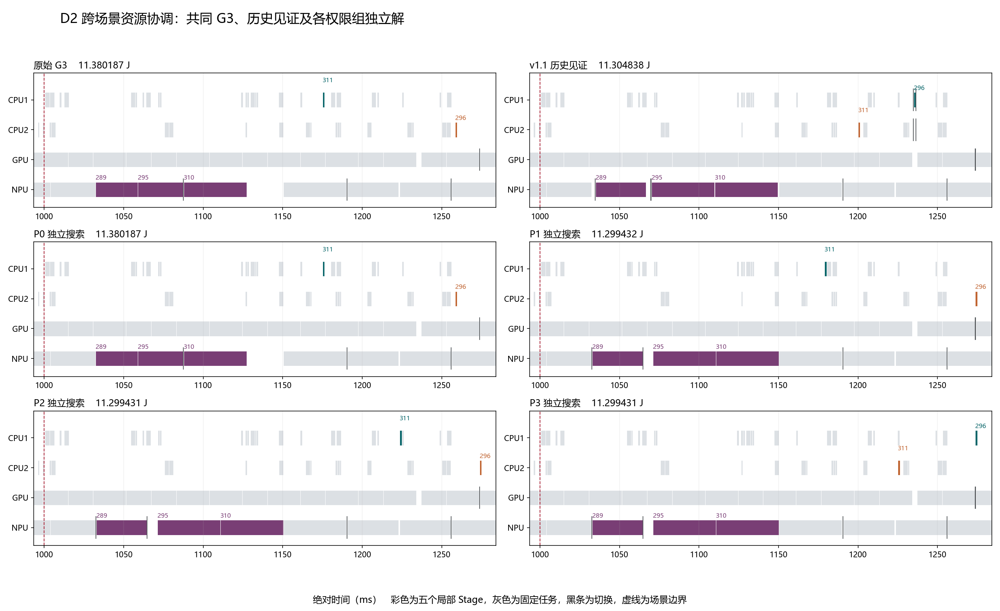

# P1 紧凑频域联合优化 E0/E1 诊断

**第三章应优先研究固定设备映射、固定资源次序下的频率与时序联合优化。** 六个区域都已确定 P0 空闲控制的最优排程身份。将权限扩到 P1 后，六个区域均有安全解的能耗上界低于 P0 的最优能耗下界。五个区域至少获得 24.700–98.816 mJ 的额外节能，另一个区域 R4 的可靠下限为 3.310 µJ。各结论都针对指定区域的完整系统窗口。

换序是有具体依据的次级方向。D3 的 NPU 区域在场景转换处和高负载场景内部都找到了明显更好的安全解。两处的条件最优节能区间均包含零，现有证据支持记录换序结构、保留研究问题。设备重映射的最大可区分观察量出现在 D2，约 9.63 nJ，低于本轮预设的 1 µJ 数值容差，现阶段缺少将其列为核心机制的证据。

## 哪些决策产生了差额

| 区域与比较 | 两个安全解的全窗差额 | 对应的执行变化 |
|---|---:|---|
| D1，P0→P1 | 24.701 mJ | Stage 148 在 NPU 由档 2 降至档 1，提前 2.7 ms 开始。活动能耗减少 17.884 mJ，域基准与温度项合计减少 6.817 mJ。 |
| D2，P0→P1 | 80.755 mJ | 第一场景的 289、295 在 NPU 分别由档 2 降至档 1、0。第二场景的 310 后移 23.0 ms。两项 CPU 后处理 296、311 保留原核，全部设备上的任务相对次序保持。 |
| R2，P1→P2 | 47.852 mJ | 5000 ms 边界附近，CPU1 后处理重新排序，NPU 的 895 由档 1 降至 0、913 由档 2 降至 1。活动、域基准、温度项分别减少 31.769、12.640、3.442 mJ。条件最优差区间为 [0, 103.575] mJ。 |
| R4，P1→P2 | 32.082 mJ | 7500 ms 高负载场景内部，原 G3 的 Stage 1636 在 NPU 从档 2 降至档 1，后处理 1637 后移 49.7 ms 并与固定 CPU 任务换序。相较 P1，活动与域基准合计减少 33.755 mJ，多三次切换，增加 4.500 mJ 开销。条件最优差区间为 [0, 190.553] mJ。 |

D2 的 P1 解将全窗能耗从 11.380186764 J 降至 11.299431625 J。活动、域基准、温度修正分别减少 59.938、14.365、7.953 mJ，新增一次切换耗费 1.500 mJ。v1.1 的 75.349 mJ 来自另一份调整过 CPU 映射的历史排程，本次 P1 独立从 G3 得到了更低能耗。P3 的独立解也交换了 296 与 311 的执行核，相较 P2 的观察差额仅约 9.63 nJ。

R1、R2、R3、R4 的空闲控制最优解较 G3 分别节省约 1.136、5.134、7.533、0 mJ。进一步开放换序，四区相较各自 P1 的最佳已知安全解分别下降约 3.339、47.852、8.519、32.082 mJ。四个区域的 Stage 无重叠，均来自同一 D3 基线，不能相加为一份可实施排程的收益。

## 证据范围

输入核对了 57 项工件身份。24 个权限子问题各自从原 G3 独立开始，按组共记录 57,299 次 SAFE 评价。最终 25 份不同排程全部通过连续认证和矩阵指数端点复核。固定种子为 101，单线程，数值批次实耗 5,373.7 s。六个 P0 提前取得最优排程证书，其余 18 组保留限时上下界。全窗能耗的单候选最大认证区间宽度为 0.033 µJ 以下。

报告中的“已证严格额外节能”比较旧权限的数学下界和新权限的安全上界。“观察到额外节能”比较已找到排程的认证区间。后者不能保证换一种求解方法后窄权限仍会落后。归档复核还检查了所有最终解在同区域四组中的归属，包括由宽权限求得、实际也满足窄权限限制的解。完整精度数据见[条件价值](e1/endpoint_conditional.csv)、[最终排程权限归属](e1/endpoint_membership.csv)及[设备、档位和资源边变化](e1/decision_changes.json)。

## 紧凑模型一致性

门控通过。4 个预先限定的小域中，两种独立生成方式得到相同物理排程集合，共 109 个。五份实际时间表均能编码，切换、功率事件、精确参考分项、连续安全能耗与峰温证书通过复核。逐夹具数据见 e0/equivalence.csv，一般对应说明见 e0/model.md。

## 四级权限的真实安全能耗

|区域|权限|独立搜索/J|真实最优可靠区间/J|独立解较 G3 至少节能/mJ|切换次数|上界来源|
|---|---|---:|---:|---:|---:|---|
|D1|P0|10.95132749|[10.951327, 10.951328]|0.000|25|G3|
|D1|P1|10.92662669|[10.887001, 10.926627]|24.700|25|P1 independent|
|D1|P2|10.92662634|[10.887001, 10.926627]|24.701|25|P2 independent|
|D1|P3|10.92662634|[10.887001, 10.926627]|24.701|25|P2 independent|
|D2|P0|11.38018676|[11.380186, 11.380187]|0.000|27|G3|
|D2|P1|11.29943162|[11.270322, 11.299432]|80.755|28|P1 independent|
|D2|P2|11.29943134|[11.270322, 11.299432]|80.755|28|P2 independent|
|D2|P3|11.29943133|[11.270322, 11.299432]|80.755|28|P3 independent|
|R1|P0|63.39049532|[63.390495, 63.390496]|1.135|461|P0 independent|
|R1|P1|63.35826111|[63.288198, 63.358262]|33.369|460|P1 independent|
|R1|P2|63.35492192|[63.288198, 63.354922]|36.708|459|P2 independent|
|R1|P3|63.35492192|[63.288198, 63.354922]|36.709|459|P3 independent|
|R2|P0|63.38649714|[63.386497, 63.386498]|5.133|460|P0 independent|
|R2|P1|63.28768104|[63.184106, 63.287682]|103.949|457|P1 independent|
|R2|P2|63.23982912|[63.184106, 63.239830]|151.801|457|P2 independent|
|R2|P3|63.23982913|[63.184106, 63.239830]|151.801|457|P2 independent|
|R3|P0|63.38409837|[63.384098, 63.384099]|7.532|459|P0 independent|
|R3|P1|63.32516001|[63.270793, 63.325161]|66.470|458|P1 independent|
|R3|P2|63.31664091|[63.270793, 63.316641]|74.990|459|P2 independent|
|R3|P3|63.31664089|[63.270793, 63.316641]|74.990|459|P3 independent|
|R4|P0|63.39163095|[63.391630, 63.391631]|0.000|461|G3|
|R4|P1|63.39162761|[63.201075, 63.391628]|0.003|461|P1 independent|
|R4|P2|63.35954581|[63.201075, 63.359546]|32.085|464|P2 independent|
|R4|P3|63.35954580|[63.201075, 63.359546]|32.085|464|P3 independent|

每行独立从原 G3 开始。数学上界另可继承较小权限的安全计划，或使用属于该域的既有见证。参考目标、停止状态、能耗分项与原始独立上界见 e1/results.csv。

## 条件节能价值

|区域|权限变化|最佳已知解差/mJ|条件最优价值可靠区间/mJ|证据|
|---|---|---:|---:|---|
|D1|P0→P1|24.701|[24.700, 64.326]|已证严格额外节能|
|D1|P1→P2|0.000|[0.000, 39.625]|观察到额外节能|
|D1|P2→P3|0.000|[0.000, 39.625]|有限搜索未发现改善|
|D2|P0→P1|80.755|[80.755, 109.865]|已证严格额外节能|
|D2|P1→P2|0.000|[0.000, 29.110]|观察到额外节能|
|D2|P2→P3|0.000|[0.000, 29.110]|观察到额外节能|
|R1|P0→P1|32.234|[32.234, 102.298]|已证严格额外节能|
|R1|P1→P2|3.339|[0.000, 70.064]|观察到额外节能|
|R1|P2→P3|0.000|[0.000, 66.724]|有限搜索未发现改善|
|R2|P0→P1|98.816|[98.816, 202.391]|已证严格额外节能|
|R2|P1→P2|47.852|[0.000, 103.575]|观察到额外节能|
|R2|P2→P3|0.000|[0.000, 55.723]|有限搜索未发现改善|
|R3|P0→P1|58.938|[58.938, 113.305]|已证严格额外节能|
|R3|P1→P2|8.519|[0.000, 54.367]|观察到额外节能|
|R3|P2→P3|0.000|[0.000, 45.848]|有限搜索未发现改善|
|R4|P0→P1|0.003|[0.003, 190.556]|已证严格额外节能|
|R4|P1→P2|32.082|[0.000, 190.553]|观察到额外节能|
|R4|P2→P3|0.000|[0.000, 158.471]|有限搜索未发现改善|

## 历史见证与 D2 跨场景结构

- D1 历史改善排程属于 P2、P3，统一作为归档见证。
- D2 历史改善排程属于 P3，统一作为归档见证。

D2 六份排程的逐 Stage 档位、映射与起止时刻可与下图逐项对照。[五个可动 Stage 的变化](e1/D2_changes.csv) · [含固定任务的时间表](e1/D2_timeline.csv)

## 场景转换与内部区域

- R1，中心 5000 ms，选中的主 Stage 为 [898, 892, 901, 907]。P0–P3 各自相较 G3 的安全节能下界依次为 1.136、33.370、36.709、36.709 mJ。
- R2，中心 5000 ms，选中的主 Stage 为 [895, 886, 904, 913]。P0–P3 各自相较 G3 的安全节能下界依次为 5.134、103.950、151.802、151.802 mJ。
- R3，中心 2500 ms，选中的主 Stage 为 [451, 448, 457, 442]。P0–P3 各自相较 G3 的安全节能下界依次为 7.533、66.471、74.990、74.990 mJ。
- R4，中心 7500 ms，选中的主 Stage 为 [1654, 1645, 1663, 1636]。P0–P3 各自相较 G3 的安全节能下界依次为 0.000、0.003、32.085、32.085 mJ。

D3 不同中心的请求负载和局部结构不同。重叠 Stage 见 regions.json，区域间差异不作场景转换的因果估计。

## 立项判断

采用调频与移时作为主要研究权限，用全窗安全能耗检验解质量。CPU 后处理换序与 NPU 主任务降档的联动在 R2、R4 均有可解释的安全见证，仍缺窄权限最优值的分离证明。映射权限的独立节能价值尚未建立。本轮止于 E1，E2 和 H1–H3 均未启动。
