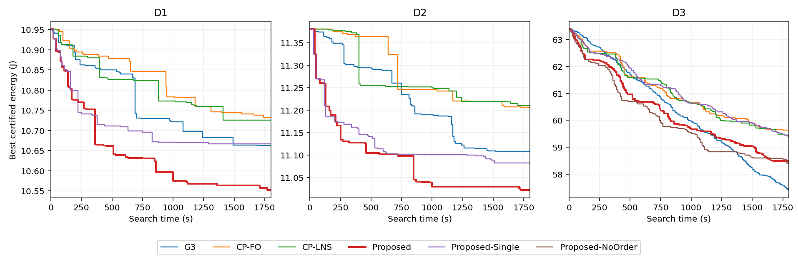

# E2-b 完整任务流联合节能优化

**本轮未建立满足预设条件的跨工况核心算法优势。** 普通 CP-LNS 的九个同工况、同种子配对中，Proposed 严格胜 8、负 1、认证区间重叠 0。相对 Single 的对应计数为 6、3、0。D3 上相对 NoOrder 为 0、3、0。

## 第三章立项判断

多任务联合优化在 D2、D3 对普通 CP-LNS 均为三种子全胜。D1 的种子 103 则多耗 59.56 mJ。在 D3 允许单轮多个配置联动后，相对 Single 的三个终点各省 0.853–1.014 J。关闭专门换序算子后，三个终点又各省 0.102–0.202 J。专门释放的次序确有 14 次被改善步骤采用，但三组 D3 消融均未显示该算子带来额外终点节能。

Proposed 在 D1 和 D2 取得最低的三种子中位能耗，D3 的最低中位能耗来自 G3（57.41186 J），低于 Proposed 的 58.48696 J。建议保留 D3 的多配置联合收益作为局部结论，暂缓把整套协调机制列为第三章已验证的核心创新。D2 对 Single 只有一个种子严格获胜，D1 对普通 CP-LNS 也出现负配对，限制了跨工况推广。每个工况只有三个种子。

## 1800 秒末完整安全能耗

|工况|方法|种子 101 / J|种子 102 / J|种子 103 / J|中位数 / J|中位净节能率|
|---|---|---:|---:|---:|---:|---:|
|D1|G3|10.6888652|10.6633107|10.6502672|10.6633107|2.630%|
|D1|CP-FO|10.7314837|10.7772584|10.6845571|10.7314837|2.007%|
|D1|CP-LNS|10.7252219|10.8471632|10.6634979|10.7252219|2.065%|
|D1|Proposed|10.5123461|10.5527204|10.7230553|10.5527204|3.640%|
|D1|Proposed-Single|10.5707841|10.6665635|10.7036456|10.6665635|2.600%|
|D2|G3|11.1083408|10.9338398|11.1494778|11.1083408|2.389%|
|D2|CP-FO|11.1825553|11.2492280|11.2060017|11.2060017|1.531%|
|D2|CP-LNS|11.2104459|11.2788683|11.1759872|11.2104459|1.492%|
|D2|Proposed|11.0224743|11.0167019|11.0859906|11.0224743|3.143%|
|D2|Proposed-Single|11.0202375|11.1034901|11.0825858|11.0825858|2.615%|
|D3|G3|57.1113408|57.4118556|58.8398452|57.4118556|9.433%|
|D3|CP-FO|60.0718206|59.4395752|59.6430014|59.6430014|5.913%|
|D3|CP-LNS|59.4062587|59.4562059|59.3339025|59.4062587|6.287%|
|D3|Proposed|58.4869627|58.6442777|57.8430779|58.4869627|7.737%|
|D3|Proposed-Single|59.3394874|59.6585727|58.8471994|59.3394874|6.392%|
|D3|Proposed-NoOrder|58.3853626|58.4419349|57.6807855|58.3853626|7.897%|

## Proposed 相对各基线的配对差额

正值表示 Proposed 的最终全窗能耗更低。每行依次为种子 101、102、103，单位 mJ。完整认证上下端及三个时点见 paired.csv。

|工况|基线|101|102|103|
|---|---|---:|---:|---:|
|D1|G3|176.519|110.590|-72.788|
|D1|CP-FO|219.138|224.538|-38.498|
|D1|CP-LNS|212.876|294.443|-59.557|
|D1|Proposed-Single|58.438|113.843|-19.410|
|D2|G3|85.867|-82.862|63.487|
|D2|CP-FO|160.081|232.526|120.011|
|D2|CP-LNS|187.972|262.166|89.997|
|D2|Proposed-Single|-2.237|86.788|-3.405|
|D3|G3|-1375.622|-1232.422|996.767|
|D3|CP-FO|1584.858|795.298|1799.923|
|D3|CP-LNS|919.296|811.928|1490.825|
|D3|Proposed-Single|852.525|1014.295|1004.121|
|D3|Proposed-NoOrder|-101.600|-202.343|-162.292|

## 已采用的机制

Proposed 共接受 585 次严格改善，其中 316 次实际同时改变至少两项配置。88 次采用至少两个暂定目标配置，232 次实际采用跨资源移时支撑，45 次实际采用加速补偿，14 次用了专门释放的次序对。这些事件可以重叠。

跨场景接受 16 次。最大单次安全节能下限为 105.798 mJ，来自 D2_Proposed_101 的 202.43 s。涉及 2 项配置变化、14 项移时、0 个同设备相对次序反转。对应前后排程为 fce6e159951ce6cece7399ed55e08be0c3c04242359fb13d182adc1ba393e978 与 dd5917946381fec54fcf6a4cd13807d4e2eb65af27023861c600cec8b364c904。场景按请求释放记录划分。

## 解质量与覆盖

48 个终点全部通过独立事件和矩阵指数复核。48 个运行访问了全部释放窗口，逐 Stage 覆盖与全局下界在 results.csv。48 个运行中 43 个在最后 180 s 仍有可认证改善。原全局下界来自原模型有效温区功率下界，未闭合差距逐运行列出。三个种子的比较仅用于初步稳定性判断。

每个运行的 plans.jsonl.gz 保存全部接受状态的完整物理排程，history.jsonl.gz 给出前后身份、分项及真实变化。CP 的 iterations.jsonl.gz 保存候选、当前排程绑定的边界、时序路径、缺口与释放次序。G3 的 moves.jsonl.gz 保存冻结随机重构的选点。

本轮结束于 D1–D3 的固定预算验证，H1–H3 和第四章未启动。

## 配对差额随预算的变化

下表为普通 CP-LNS 减去 Proposed 的同种子安全能耗差，再取三个配对的中位数。正值表示 Proposed 节能。

|工况|180 s / mJ|900 s / mJ|1800 s / mJ|终点严格胜／负／区间重叠|
|---|---:|---:|---:|---:|
|D1|81.54|176.55|212.88|2／1／0|
|D2|132.27|212.90|187.97|3／0／0|
|D3|291.14|917.99|919.30|3／0／0|

## 终点余量与能耗构成

每行取 Proposed 三个运行中能耗居中的实际排程。全局下界按原连续模型给定，差距采用该排程认证上界减去全局下界。五项均为完整窗口的焦耳数。

|工况（种子）|活动|域驻留|温度修正|切换|外部常量|全局下界|未闭合差距|峰温上界 / °C|最小期限余量 / ms|
|---|---:|---:|---:|---:|---:|---:|---:|---:|---:|
|D1（102）|5.93436|3.32812|0.55944|0.04050|0.69030|7.89302|2.65970|67.46544|0.00000|
|D2（101）|6.22829|3.44902|0.63236|0.02250|0.69030|7.89302|3.12946|68.31719|0.00000|
|D3（101）|35.66127|17.00998|2.12841|0.59700|3.09030|37.79755|20.68941|62.70691|0.00000|

## 可归因范围

|工况|Proposed 接受数|一次改变多个配置|采用至少两个暂定配置|采用跨资源移时支撑|实际加速补偿|采用专门释放的次序对|
|---|---:|---:|---:|---:|---:|---:|
|D1|100|52|14|34|7|3|
|D2|92|61|19|27|27|6|
|D3|393|203|55|171|11|5|

Single 保留跨任务移时及多轮改配置的权限，配对结果检验单轮多配置联合的终点价值。跨资源支撑记录表明对应目标与其他资源移时在被接纳的同一步发生；本设计没有单独关闭时序支撑的对照，不能把该步全部节能分摊给支撑。D3 的 NoOrder 配对检验专门换序算子，普通全权限轮仍可换序。

## 预检、预算与回放

首次预检中，D2 的单目标可行支撑需 42 个 Stage，超过 24 个时序变量上限。回退后首次仅返回移时方案。经授权，所有 CP 方法只在第二次候选调用中要求配置与起点均改变。六个复检子问题的初解、选点、权限与种子逐项一致，D2 两组各产生 6 个联合候选。首次门控、复检和边界重建记录分别见 preflight/gate.json、preflight/recheck/gate.json 和 preflight/recheck/boundary_replay.json。

正式批次在 5 个不同物理核心上轮转，同批各运行分开绑定核心，每次仅用一个核，共 10 批。48 次累计墙钟预算耗用 86348.45 / 86,400 s，单次 1798.53–1799.39 s。两轮预检累计 231.64 s，独立数值复核及制表 233.14 s。执行冻结为 3605c6f0a367277b75fbcece5d48d9628743c688。

独立矩阵指数复算的最大节点温度端点偏差为 7.46e-13 K。全部终点中的最高峰温上界为 71.36947 °C，最小期限余量为 0.00000 ms。逐运行的三时点轨迹、余量和能耗上下界见 results.csv；39 个同种子配对的完整区间见 paired.csv。

首次离线复核在读取前态排程行时遇到索引错误。修正固定映射和补偿时长两项检查后，对全部 48 个终点从头复核。复核前后 231 份原搜索记录的 SHA-256 逐份相同，新增搜索次数为 0。首次错误日志、回放记录和复核源文件的前后身份保存在 logs/audit.txt、logs/audit_replay_receipt.json 和 manifest.json。

## 15 分钟之后还有多少收益

各方法按三种子的安全能耗中位数排名。下表的节能量为对同一种子计算 15 至 30 分钟的能耗下降后取中位数。末 3 分钟仅计通过严格区间比较的改善。

|工况|Proposed 后 15 分钟 / mJ|普通 CP-LNS 后 15 分钟 / mJ|15 分钟领先方法|30 分钟领先方法|完整方法排序是否改变|
|---|---:|---:|---|---|---|
|D1|22.99|47.97|Proposed|Proposed|是|
|D2|21.57|41.11|Proposed|Proposed|否|
|D3|1460.28|1275.30|Proposed-NoOrder|G3|是|

48 次中有 48 次在 15 分钟后继续改善，后半程下降中位数为 93.60 mJ，范围 3.70–2807.89 mJ。43 次在末 3 分钟仍取得严格改善。30 分钟是统一的观测截点，这些结果只能评价延长至此的实得收益。

## 版本与归档

[数值执行冻结](https://github.com/YBEMR/paper/commit/3605c6f0a367277b75fbcece5d48d9628743c688) · [完整数值结果提交](https://github.com/YBEMR/paper/commit/ce7b33548471b8d5f9d39db71ce6d2e51b257e57)。从最后一项搜索结束至本地结果提交核验共 387.06 s，两轮预检与该段归档合计 618.70 s。
