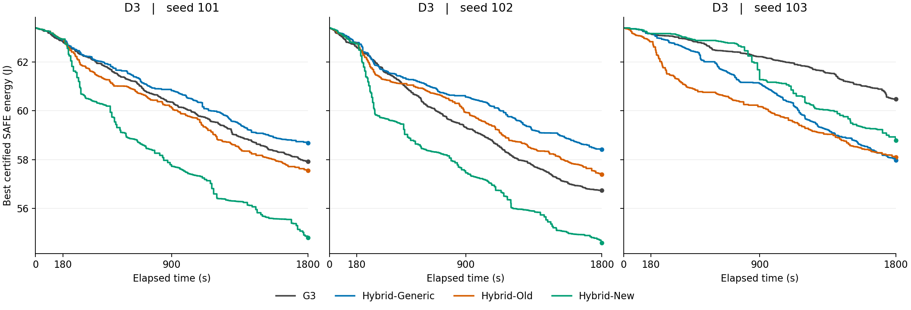

# D3 完整任务流混合联合节能验证

**D3 能耗与机制条件满足，完整预算门控待定。** 12 个独立运行的终点均通过连续热认证、独立事件及矩阵指数复核。

|方法|种子 101 / J|种子 102 / J|种子 103 / J|中位数 / J|中位净节能率|
|---|---:|---:|---:|---:|---:|
|G3|57.92494082|56.73289610|60.47697225|57.92494082|8.624%|
|Hybrid-Generic|58.68408375|58.42035152|57.98224849|58.42035152|7.842%|
|Hybrid-Old|57.55614782|57.38679601|58.09276913|57.55614782|9.205%|
|Hybrid-New|54.80273151|54.58953077|58.78356518|54.80273151|13.549%|

正配对差表示 Hybrid-New 节能。表内为完整系统能耗点估计差；严格胜负按上下界判定。

|基线|101 / mJ|102 / mJ|103 / mJ|严格胜／负／区间重叠|
|---|---:|---:|---:|---:|
|G3|3122.209|2143.365|1693.407|3／0／0|
|Hybrid-Generic|3881.352|3830.821|-801.317|2／1／0|
|Hybrid-Old|2753.416|2797.265|-690.796|2／1／0|

## 实际联合更新

Hybrid-New 接纳 119 项非普通回退的多配置联合改善。
最强一次发生在种子 103 第 3 周期，可靠节能 281.650 mJ，变档 10 项、移时 20 项、支撑并集 24 项。所有接纳的前后排程可由该运行的 accepted.jsonl 完整恢复。

三个种子的联合阶段合计，提示、紧凑辅助 CP、完整 Core、回退及第四次普通全权限邻域的顺序增量分别为 11.67836、3.34649、0.06790、0.00000、0.76113 J。

各终点的热认证区间、能耗分项、峰温上界、期限余量、原全局下界及未闭合差距见 results.csv。阶段收益和实际支撑见 phase_results.csv、mechanisms.csv。完整轨迹见 curves.csv.gz。

过程记录有计时越界，严格门控留待判读。本轮范围止于 D3，尚未检验跨工况优势。

阶段收益沿已发生的搜索轨迹累计。本轮没有 Single 消融，不能从这些增量推断多配置协调的普遍独立贡献。

## 预算

预检计费 406.31/900 s，正式运行计费 21600.00/21600 s。核验及归档见 snapshot.json 与预算回执。

## 完整任务流能耗随时间变化

图中每个台阶对应该运行一次严格接纳。下表各时点取三个种子的中位数，末段节能取逐种子可靠改善下限的中位数。

|方法|180 s / J|900 s / J|1800 s / J|末 180 s 节能 / mJ|
|---|---:|---:|---:|---:|
|G3|62.838741|60.354924|57.924941|373.374603|
|Hybrid-Generic|62.888985|60.823653|58.420352|318.265008|
|Hybrid-Old|62.828162|60.117354|57.556148|358.747504|
|Hybrid-New|62.935181|57.727822|54.802732|498.525172|

## 种子波动与求解开销

|Hybrid-New 种子|G3 尝试数|联合子问题数|全流涉及 Stage / 2400|最终安全能耗 / J|
|---:|---:|---:|---:|---:|
|101|28054|65|2400|54.802732|
|102|34618|75|2400|54.589531|
|103|15104|38|2400|58.783565|

相同墙钟预算下，Hybrid-New 的三个终点相差 4.194034 J。每个普通全权限子问题和辅助求解均占用联合阶段的 120 秒额度，可比较的执行量见上表。不同种子面对不同的当前排程，单次子问题耗时也会变化，现有数据不能把终点差额归因于某一项开销。

该方法共接纳 128 次非普通邻域联合改善，其中 128 次在至少两个设备上同时移时，3 次改变横跨场景的任务。两类事件可以重叠。完整前后排程及每项证书随运行归档。

## 逐项截止核对

复核 648 次正式联合子问题。最长本地用时 29.6528 s，最长辅助阶段 11.0076 s。局部、阶段、数值终点及必要结果文件共记录 1 项越界。另有 4 次监管进程观察到退出时已超过 1800 s；该观测包含退出清理和轮询延迟。最晚必要终点文件的写入时刻为 1799.7288 s（文件系统时间相对启动 UTC）。逐项记录见 [timing.json](timing.json)。
