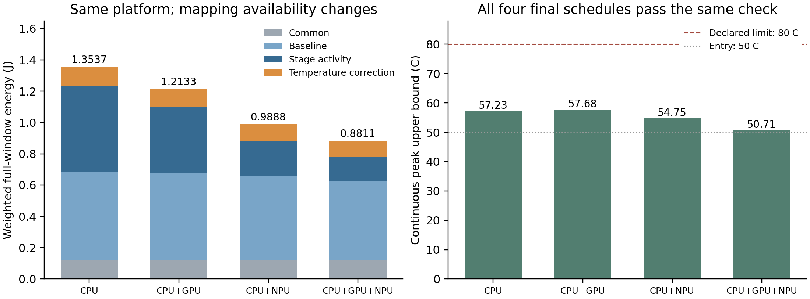

# E2同平台设备可用范围对照：正式结果

日期：2026-10-26。执行分支：`codex/e1-e4-preparation`。执行源码封版：`7f544b59c009f3c0a76027a4f62b5d1788d6d54d`；清单hash：`aa67066cbb2c216da609d14a88b67e0ec18f9c47c3c9a38e175c644ca022868d`。

**四组均得到完整安全方案并通过固定候选连续热后验。CPU＋GPU、CPU＋NPU、全设备相对仅CPU的本次能耗分别低10.37126%、26.95252%、34.91035%。** 这是同一抽象平台上设备可用域对照的结果；四组均沿用同一个FULL-HEFT，不构成算法间优劣对照。

## 1．实验与预算执行

用户在上一轮明确的冻结提案后回复“继续”，本次据此启用独立授权`E2-RES-01-20261026`。原R1、AB/AC完整三Stage链、共享部署、H响应、auto-L、400 ms窗口、5 ms启动域、50°C入口、80°C温限和全部参数保持。依次仅允许Stage映射CPU、CPU＋GPU、CPU＋NPU、全部设备；闲置GPU/NPU仍计基准、漏电与热耦合。

实际消费**4次规划＋4次后验，各一次；无补跑、延期或技术故障，8个进程均自然退出并回收**。单次上限300/60秒，整批上限1800秒；实际规划根累计185.250秒、后验根8.437秒、整批195.984秒，含控制器交接/记账开销。初始化、源码校验复制、启动导入、搜索及连续复核均在各根内；自然结束不人为用满预算。

启动前[核查](evidence/e2_launch_preflight01/preflight.json)确认冻结依赖/输入与180项预检一致、无并发科研进程。默认真实闸门仍关闭，专用E2授权已一次消费；E1授权未使用。全设备组独立重新生成输入和搜索，没有用E1方案或缓存免费初始化。

## 2．安全能耗与本次耗时

| 任务可用设备 | 加权完整能耗/J | 相对CPU降低 | 最大连续峰温上界/°C | 规划根/s | 后验根/s | 首个安全方案/s |
|---|---:|---:|---:|---:|---:|---:|
| CPU | 1.353653003322 | — | 57.23093 | 43.031 | 1.968 | 1.453 |
| CPU＋GPU | 1.213262149725 | 10.37126% | 57.67609 | 27.172 | 1.703 | 1.453 |
| CPU＋NPU | 0.988809437621 | 26.95252% | 54.74911 | 45.516 | 2.344 | 1.453 |
| CPU＋GPU＋NPU | 0.881087997281 | 34.91035% | 50.71088 | 69.531 | 2.422 | 1.313 |

这里的能量在相同完整400 ms窗口和场景权重下评价，四组均计完整平台。可靠能量区间严格分离；表中小数是显示近似，原区间保存在[analysis.json](results/e2_res_01/analysis.json)。四组最小期限余量均2 ms；不将首次安全输出时间视为最优收敛时间。单次耗时不代表统计稳定性。

## 3．差异来自什么安排

四组均使用两颗CPU处理前后阶段，但计算主阶段的安排不同：

| 资源范围 | A.main | B.main | C.main |
|---|---|---|---|
| CPU | CPU2/H | CPU1/H | CPU1/H |
| CPU＋GPU | GPU0，AB用L、AC用M | CPU2/H | GPU0/H |
| CPU＋NPU | NPU0/L | NPU0/M | CPU2/H |
| 全设备 | NPU0/L | NPU0/M | GPU0/L |

共享的是Stage执行单元；工作点和时序仍可随场景改变。例如AC中，CPU＋NPU组的C.main在CPU2/H上20—110 ms执行；全设备组将其放在GPU0/L上25—106 ms，A.main同时在NPU0/L上20—62 ms执行。AB中A.main和B.main共用NPU，按顺序执行。这些是实际导出安排，不是另外搜索的解释性反例；完整设备/工作点/起止见[schedules.csv](results/e2_res_01/schedules.csv)。

| 资源范围 | 基准/J | 活动/J | 公共/J | 温度修正/J |
|---|---:|---:|---:|---:|
| CPU | 0.566500000 | 0.549433086 | 0.120000000 | 0.117719917 |
| CPU＋GPU | 0.558400000 | 0.419070100 | 0.120000000 | 0.115792050 |
| CPU＋NPU | 0.538850000 | 0.221778415 | 0.120000000 | 0.108181022 |
| 全部设备 | 0.503150000 | 0.156587033 | 0.120000000 | 0.101350965 |

CPU到全设备总差约0.472565006 J，其中活动项降低0.392846054 J、基准项降低0.063350000 J、温度修正项降低0.016368952 J，公共项不变。活动能耗减少占主要部分，同时忙段工作点与auto-L改变了基准积分。这里比较的是四套完整安排的分项差，不把收益全部归因于单个Stage或某一新增设备。

闲设备功耗确实保留：CPU-only组GPU约0.196576 J、NPU约0.126867 J，均含低档基准与温度修正；CPU＋GPU组仍计NPU约0.126837 J，CPU＋NPU组仍计GPU约0.196434 J。没有通过删除不可映射设备的功耗制造节能。

## 4．热关系与结论范围

CPU＋GPU比仅CPU低10.37%能耗，但峰温从57.23093°C略升到57.67609°C，说明总能耗与局部峰温需要分别评价。全设备组本次两者均更低。

四次规划分别评价23/23/34/44个候选，共124个，全部SAFE；已访问最大峰温约57.95108°C，低于80°C，热违规0。每次规划内部的这些评价计入其300秒根，另有4次固定最终候选后验；不能把它们写成128次独立算法试验。本批未体现温限改变可行性，也不承担连续热反馈MILP的有效性证明。

当前支持：在声明的H响应/功热模型、R1负载和既有HEFT规则下，开放异构资源会改变映射、工作点、时序，并获得更低的完整安全能耗。所有场景和物理输入相同，CPU域包含于其他资源域，但有限HEFT输出的一般单调性、全域最优、普遍算法优势及实机收益仍未证明。本批不修改参数或增加温度扫描寻找另一种结果。

## 5．证据与核查

- [原始档案与分析](results/e2_res_01/analysis.json)：完整输入/源码hash、每槽job、检查点、原回执、进程时间、最终选择、逐场景分项与状态均保存；CSV及图由只读脚本生成。
- [身份/预算内部核查](results/e2_res_01/internal_review_identity.md)：224份部署源码hash、15原依赖、25份正式账本记录、8次后端进入、所有输入/最终候选/原后验身份一致。
- [数值内部核查](results/e2_res_01/internal_review_numeric.md)：442项精确算术核对通过，覆盖权重、能耗分项、保留闲设备成本、资源/期限及热证据守恒；没有重新积分热核。两份审查均为内部只读复核，不冒充外部批准。
- 只读汇总初版错用了裸授权ID的hash查找目录，曾临时显示0次消费；已按实际Ledger的规范化对象hash修正并强制核验账本存在，最终4＋4。启动前附加目录断言也采用了裸hash，但真实控制器始终执行规范目录的独占消费。原记录保留，补充见[说明](evidence/e2_launch_preflight01/post_execution_note.json)；未改运行源码/原回执或补跑。

E2已完成并收口，预算全部消费。本轮没有MILP、MATLAB、额外模型对照或新温度条件。下一项建议按原排期整理E3“跨场景共享A部署／允许分场景部署”的接口与合法域，另定最小预算；不沿用本次E2额度，不自动启动E3/E4。
