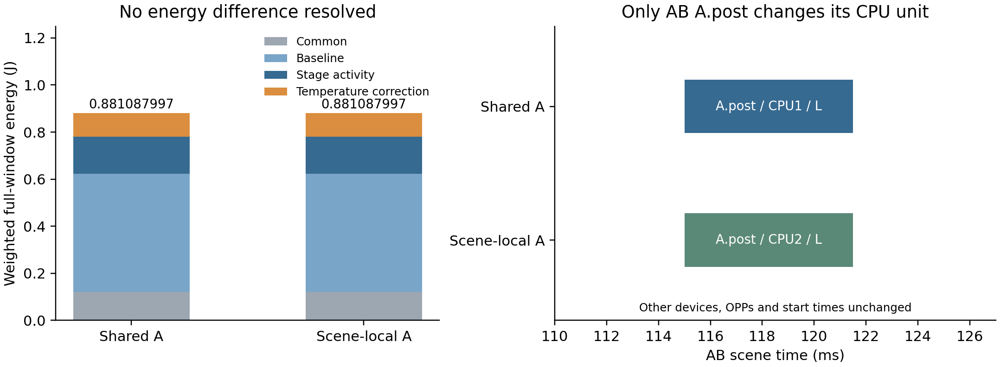

# E3共享A部署与分场景部署：正式对照结果

日期：2026-10-26。分支：`codex/e1-e4-preparation`。执行源码：`0bd5943118abc8cf3613523667f71ae523a8b419`；清单：`daa25c665af339c9c9721646211d05e83ea2391e85960eecb410a0422cce92ad`。

**两组均通过各自部署要求下的完整期限和连续热安全复核，本次未得到解除共享部署后的能耗改善。** 两者加权完整能耗均约0.881087997281 J，保存的可靠区间及四分项逐项相同。分场景组确实使用了不同CPU部署，不能写成“部署没变化”。

## 1．按冻结方案完成了什么

用户明确“开始实验吧”后，独立授权`E3-DEPLOY-01-20261026`执行共享A、分场景A两个FULL-HEFT调用，各300秒上限；合格最终候选各一次60秒后验，整批960秒上限。原R1、AB/AC完整三Stage链、H响应、auto-L、400 ms窗口、5 ms起点、50°C入口、80°C温限、完整平台、权重与期限不变；仅解除A.pre/main/post跨场景具体执行单元绑定。OPP与起点两臂原本都可随场景变化。

**实际2次规划＋2次同候选后验，无补跑、延期或技术故障；四进程均自然完成并回收。** 规划根累计149.640秒、后验根6.907秒、整批158.312秒，包含交接与记账。每个根从输入展开、源码校验复制和启动导入之前开始。共享组也独立重新运行，没有复用E1/E2最优解、检查点或热缓存。

[启动核查](evidence/e3_launch_preflight01/preflight.json)保存47份源码、31份运行依赖、原15份依赖与两输入身份一致、无并发科研进程及规范化一次消费目录。默认闸门仍关闭；E3专用授权已消费，不能再启动第三次调用。

## 2．结果与唯一安排差异

| 对照臂 | 完整能耗/J | 最大峰温上界/°C | 规划根/s | 后验根/s | 首个安全输出/s | 唯一候选数 |
|---|---:|---:|---:|---:|---:|---:|
| 共享A部署 | 0.881087997281 | 50.710882 | 68.031 | 3.860 | 1.313 | 44 |
| 分场景A部署 | 0.881087997281 | 50.710882 | 81.609 | 3.047 | 1.688 | 50 |

分场景组仅改变AB中的`A.post`：

| 项目 | 共享组 | 分场景组 |
|---|---|---|
| AB中的A.post | CPU1，L档，115—121.5 ms | CPU2，L档，115—121.5 ms |
| AC中的A.post | CPU1 | CPU1 |
| A.main设备 | 两场景均NPU0 | 两场景均NPU0 |
| 其余设备、全部OPP与起止 | 原安排 | 相同 |

因此分场景方案违反原共享组的具体单元绑定；它是放松参照域内的安全方案，不能直接替代共享问题的合法输出。共享组自身已经给出本次相同能耗的安全见证。

基准、活动、公共、温度修正四项分别约0.503150000、0.156587033、0.120000000、0.101350965 J，两臂保存的区间均完全相同。完整数据见[分析](results/e3_deploy_01/analysis.json)、[时间表](results/e3_deploy_01/schedules.csv)和[功率分段](results/e3_deploy_01/domain_segments.json)。JSON中的能耗差状态`NUMERICALLY_UNRESOLVED`指差异界包含0；两组最终状态均`POST_SAFE`，不是热安全未决。

## 3．为何这对方案没有节能差

当前两个CPU的时长、功耗系数、热容与热耦合对称；此次变化没有改变各频率域的工作点，CPU总参考注热以及GPU/NPU输入也相同。内部核查逐段确认这些条件，CPU温度之和与GPU/NPU温度具有相同的闭合状态方程及入口。因此系统总温度修正和总能耗保持相同；个体CPU温度仍会变化。

实际AB窗口末CPU1约低0.023679605°C，CPU2高同值，GPU/NPU末温不变。这个解释只针对两套已选安排，不是两类调度域最优值相同的证明，也不代替各自完整热复核。

共享与分场景分别评价44、50个候选，候选hash交集只有2个；分场景访问的48个候选不满足旧A设备绑定。增加部署变量改变了既有HEFT的排序、邻域和搜索路径，数学上的合法域包含关系并不意味着有限搜索集合包含。当前结果只表明这两次既定搜索没有发现额外节能，不能据此断言共享约束普遍无代价。

## 4．证据等级与阶段结论

- [内部身份与预算审查](results/e3_deploy_01/internal_review_identity.md)：124份部署源码副本、15份原依赖、两输入、13条规范账本、4次真实后端进入、最终候选与原后验身份一致，预算与最早截止核对通过。
- [内部数值核查](results/e3_deploy_01/internal_review_numeric.md)：214项精确核对通过，包括权重/分项、期限/资源、节点热守恒及这对候选的聚合等价条件；没有重新积分热核。二者均为内部只读审查，不冒充外部批准。
- 四次方法调用中的规划内部共94个候选全SAFE，另有两次固定候选后验。最终峰温均约50.710882°C，远低80°C；本批不支持热约束改变接纳或连续热反馈带来收益。
- 没有全域最优证明、精确共享成本证明、算法间排名或实机收益结论。没有新增参数、温度条件、邻域或研究调用。

**E3完成并收口，保留无节能改善结果。** 后续可按原计划准备E4期限/规模条件，独立确认具体范围与预算；不因本批无收益追加场景、调温限或重跑，E3额度不延续给E4。
