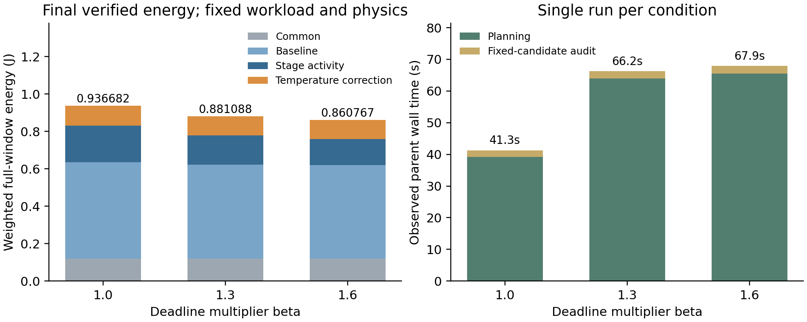

# E4a期限压力正式实验结果

日期：2026-10-26。分支`codex/e1-e4-preparation`。**三档均通过完整合法性和连续热后验；期限越宽，本次找到的安全能耗越低，β1.6比β1.0低8.1047%。** 设备映射未变，主要改变工作点和启动时序。

## 1．冻结与实际执行

沿用[冻结条件](E4_DEADLINE_PREPARATION.md)，唯一授权`E4-DEAD-01-20261026`，源码`d3d5fd61364e102e926b94b9e320ab8a128e4c70`，清单hash`76488623f08ec2a902aaa8ce5429a853a3f9ffa07ffc195c7eee4322d0e20d16`。同一R1完整AB/AC三Stage、H响应、共享具体单元部署、auto-L、400 ms窗口、5 ms启动域、50°C入口/80°C上限及原功热参数；只按原配置β1.0/1.3/1.6改变期限。同一FULL-HEFT构造及单遍局部调整，三个独立进程，不共享候选、热缓存或历史答案。

实际**3次规划＋3次固定最终候选后验**，全部自然完成并回收，无技术故障、补跑、延长或第四槽。各规划低于300秒，各后验低于60秒；规划父进程墙钟累计168.641秒，后验6.781秒，阶段合计175.422秒，整批177.656秒，低于1380秒上限。293项冻结前静态/mock检查未计作科研。未运行MILP或MATLAB。

| β | 最终安全能耗J | 相对β1.0降低 | 连续峰温上界°C | 最小期限余量ms | 首个SAFE秒 | 规划/后验父墙钟秒 |
|---|---:|---:|---:|---:|---:|---|
| 1.0 | 0.936682145480 | — | 52.320522 | 0.4 | 1.422 | 39.157 / 2.141 |
| 1.3 | 0.881087997281 | 5.935220% | 50.710882 | 2.0 | 1.266 | 63.922 / 2.297 |
| 1.6 | 0.860766924353 | 8.104694% | 50.002312 | 5.5 | 1.312 | 65.562 / 2.343 |

能耗为两个场景按原权重汇总的完整窗口真实H评价上界；科学结论用保存的可靠能量区间判断，表内仅作小数展示。β1.3→1.6另严格降低2.306361%。三对能量区间均分离；缺失结果不填0，本次没有缺失。

## 2．期限怎样影响选择

全部9个Stage部署身份在三档的设备选择相同：A.main与B.main使用NPU0，C.main使用GPU0，pre/post仍在CPU。**不能把本次收益解释为设备重选。** 工作点和起点有明确改变，例如：

| 场景/Stage | β1.0 | β1.3 | β1.6 |
|---|---|---|---|
| AB的A.main（NPU0） | M，50—84 ms | L，70—112 ms | L，90—132 ms |
| AB的B.main（NPU0） | H，15—50 ms | M，25—67 ms | L，30—86 ms |
| AB的B.pre（CPU1） | H，0—15 ms | L，0—22.5 ms | L，5—27.5 ms |
| AC的C.pre（CPU1） | M，0—14.4 ms | L，5—24.2 ms | L，5—24.2 ms |

12次Stage执行的L/M/H数量由8/2/2变为11/1/0，最后12/0/0。较宽期限保留了较慢低工作点方案，后继与同设备占用一起调整。β1.0最紧的是AC的C请求，109.6 ms完成、110 ms截止；这里期限确实接近活跃。

只按已记录完成时刻核算：将β1.3最终方案原样放回β1.0期限，AB的A和AC的C会超期；将β1.6方案放回β1.3期限，AB的A会超期。因此这些低能量输出并非原紧期限下可直接替换的同一方案。此为完成时刻算术对照，未运行新搜索或热评价，也未生成额外SAFE。

## 3．能量差来自哪里

| 加权分项J | β1.0 | β1.3 | β1.6 |
|---|---:|---:|---:|
| 工作点相关基准 | 0.516085000000 | 0.503150000000 | 0.500000000000 |
| Stage活动 | 0.195934482250 | 0.156587032552 | 0.140285994489 |
| 公共固定部分 | 0.120000000000 | 0.120000000000 | 0.120000000000 |
| 温度修正 | 0.104662663229 | 0.101350964729 | 0.100480929864 |

主要差异来自活动能耗，工作点基准与温度修正也降低；公共部分完全一致。温度变化与工作点、时序共同发生，本批不能把分项变化当作单独控制温度因素所得的因果效应。

## 4．证据与结论范围

[身份/预算内部审查](results/e4_dead_01/internal_review_identity.md)通过：33份运行依赖、198份实际进程源码副本、15份原核心及19条规范账本核对，无漂移；六个真实后端标记与六次消费对应，规划和后验候选一致。[数值内部审查](results/e4_dead_01/internal_review_numeric.md)310项全通过，独立核算权重/能量分项、半开资源与共享域、逐请求期限、完整窗口和全节点连续热回执，以及区间严格比较；审查没有重新积分温度或科研调用。这是内部证据复核，不冒充外部协议批准。

各档完整评价32/44/50个候选，共126个，记录均SAFE，最终峰温明显低于80°C。**本批说明期限松紧会影响本方法选择的工作点、时序和能耗；没有执行连续热反馈算法对照，不能据此证明热反馈收益。** 三次都是有限启发式单次运行，不证明全局最优、一般单调性、总体可调度率、稳定性或算法间优势。首个SAFE与最终择优时间分开保存。

这是新E4a批次，不补旧期限24槽；旧整体MILP数值接纳故障不在本次HEFT路径内，仍不能称已修复。β1.3本次能耗与既有独立R1记录一致，只作历史一致性说明，不代替本次调用或增加统计样本。

## 5．归档与下一项

[原始与结构化证据](results/e4_dead_01/analysis.json)、[结果CSV](results/e4_dead_01/results.csv)、[完整时间表](results/e4_dead_01/schedules.csv)、[逐请求期限](results/e4_dead_01/request_deadlines.json)、[域工作点片段](results/e4_dead_01/domain_segments.json)、每阶段job/返回/检查点/后验、独立授权及一次消费账本均保留。重复源码bundle按.gitignore不上传，源码SHA及完整hash可重建；图PDF仍按仓库忽略，PNG和绘图入口保留。

E4a到此结束。下一项可准备E4b请求规模实验，先核对每应用1/2个同时释放请求及副本共享部署语义，再独立冻结预算；本批授权不续用，不自动运行E4b、不改main或论文正文。
