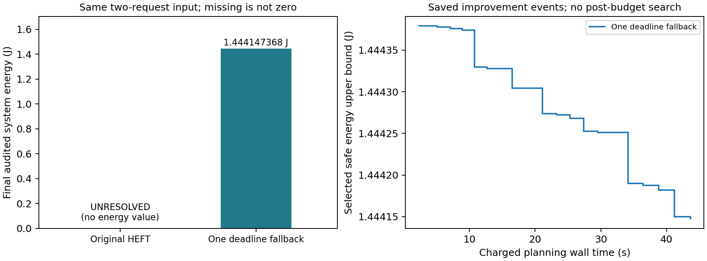

# E4b单次期限优先回退配对：恢复安全方案

2026-10-26。**同一双请求问题下，旧HEFT没有完整候选；新增一次期限优先初始构造后，得到最终连续电热后验通过的安全方案，系统能耗1.444147367589J。改进是恢复安全输出，不能计算相对旧方法的节能百分比。**

## 1．范围与运行

[调用前方案](E4_DEADLINE_FALLBACK_PREPARATION.md)与[预检02](evidence/e4_deadline_fallback_precheck02/precheck_result.json)，固定源码`a953ee7715c063052e24191e27613cb99acb58b8`，封版提交`c5a4639c`。用户授权本批正式执行，原requests_2__R1/FULL科学packet在两槽完全相同。每应用2个同时释放请求，AB/AC完整三Stage链，跨副本/场景共享具体Stage单元；原H响应、400ms窗口、5ms启动集合、50°C入口/80°C温限、auto-L、期限与功热参数均不变。

最多2×300秒规划、合格最终候选各最多一次60秒后验，整批960秒；实际2次规划＋1次后验，3次真实后端入口，整批51.812秒。每次独立进程、输入、缓存和候选，无历史答案初始化。未使用满预算不强制空跑；没有补跑/延期/真实MILP或MATLAB启动。

## 2．同输入结果

| 项目 | 原共享多场景HEFT | 单次期限优先回退版 |
|---|---|---|
| 最终状态 | UNRESOLVED；自然结束 | SAFE，且POST_SAFE |
| 规划进程计费 | 0.844秒 | 47.344秒 |
| 最终后验计费 | 无候选，不调用 | 2.812秒 |
| 首个候选/合法候选 | 无 | 0.859/0.875秒 |
| 首个SAFE | 无 | 2.297秒 |
| 最终选中形成时刻 | 无 | 43.640秒 |
| 初始构造次数 | 4，均失败 | 原4次失败＋单次回退成功 |
| 候选完整热评价 | 0 | 21，全部SAFE |
| 系统能耗U | 缺失，非零能耗 | 1.444147367589J |
| 平均每请求能耗U | 缺失 | 0.361036841897J（加权分母4） |
| 最小请求期限余量 | 无见证 | 1.3ms |
| 连续峰温上界 | 无见证 | 55.9919752412°C＜80°C |

计费的父根覆盖输入、构造/源包、启动导入、搜索、缓存及完整电热评价。启动时间另见process记录，不能把其余准备成本扣除后继续称总耗时。规划和后验根分别300/60秒；后验不修复或重选。

## 3．为什么这次得到方案

旧构造按rank先安排B/C，把共享NPU上的B排到A之前；A的两份主阶段来不及完成。新增规则只在原4次都没有完整合法候选时执行一次：就绪组按最早关联请求期限、原rank、ID排序，其余EFT插入和合法性检查保持原构造。

真实日志确认回退恰好执行1次，优先序为A.pre→A.main→A.post→C.pre→C.main→C.post→B.pre→B.main→B.post，首个安全来源为`heft:deadline-ready-fallback`。没有按保存夹具硬编码A/B/C；通用排序函数及输入hash已冻结。最终A/B.main用NPU、C.main用GPU，与先前必要容量分析相符。

随后仍按原单遍局部搜索，85次局部构造尝试，16次严格接受；完整访问21个候选。初始安全能耗1.444379003005J，最终1.444147367589J，减少约0.016037%。首末映射和工作点均相同，19项执行起点不同。**本例主要支持构造次序修正，后续节能细化很小；不据此宣称显著能耗竞争力。**

## 4．完整物理评价与证据边界

| 加权完整窗口能耗组成 | J |
|---|---:|
| 基准功耗 | 0.5925 |
| Stage活动增量 | 0.6049 |
| 公共功耗 | 0.1200 |
| 温度修正 | 0.126747367589 |
| 合计 | 1.444147367589 |

每场景完整400ms均评价，包括空闲尾段；逐请求期限、依赖、资源、共享频率域及连续温度按同一标准复核。SAFE属于声明抽象模型、给定入口和有限启动域下的完整见证，不是实机测量、精确最优或完整域覆盖。当前21个候选全SAFE、无热违规，不能支持连续热反馈加速或热约束改变本组选择。

旧方法UNRESOLVED表示该启发式未构造出方案，不是原问题已证无解。其能量缺失，禁止填零、报告100%改善或作两方法能量排名。原E4b单请求结果与本批方法版本不同，不拼成同一次公平规模实验。

## 5．复核与完成边界

[只读汇总](results/e4_df_01/readonly_analysis.json)、[局部细化](results/e4_df_01/local_refinement_readonly.json)、[完整时间表](results/e4_df_01/stage_schedules.csv)、[逐请求期限](results/e4_df_01/request_deadlines.csv)。预检421项全过；首轮1个旧mock余量不足失败及修正完整保留。原15项科学依赖与原E1搜索源码保持；两槽方法身份显式绑定授权/清单/持久claim/job/回执，科学输入一致。

[执行身份审查](results/e4_df_01/internal_execution_review.md)核对117份源码副本、10份持久账本及预算，结论为通过但保留范围限制；[内部数值审查](results/e4_df_01/internal_numeric_review.md)8061项通过，覆盖21份已存SAFE、最终plan/post、完整时间表与窗口能量。二者均为子代理只读审查，不属于另一ChatGPT会话的外部批准，也未调用热核补证。原始回执和历史结果未修改。

本批完成即停止新增调用。建议保留旧HEFT基线，将回退版单列为构造稳健性补充，收拢第三章E1—E4证据；不要继续围绕此例加邻域或温度扫描。是否在后续正式基线统一采用该版本，应单独声明方法版本，不能静默替换历史对照。

材料身份：受控仿真实验；输入/源/预算在调用前冻结；单次同输入配对；无全域最优证明和统计稳定性结论。
