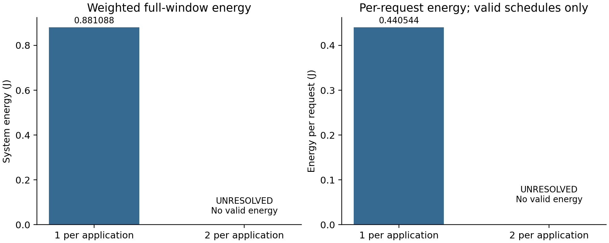

# E4b请求规模实验结果

2026-10-26，分支`codex/e1-e4-preparation`。**单请求组取得完整安全方案；双请求组的既定HEFT构造未找到完整候选，保持未决，没有可比能耗。** 本批正常结束，不补跑、不调期限。

## 1．条件和执行

按[调用前冻结](E4_REQUESTS_PREPARATION.md)，同R1完整AB/AC三Stage、H响应、auto-L、原CPU/GPU/NPU及功热参数、400ms窗口、5ms启动域、50°C入口/80°C上限；仅把每应用请求数由1增至2，所有副本0ms释放，单请求期限仍A123.5/B157.3/C143ms。具体Stage设备跨副本/场景共用，工作点和起点按执行分别选择。每景请求2→4、Stage执行6→12，模式目录9组/66项保持。

源码`cc6babb3542a57656c8007819c48e1ce7c067ec6`，清单`cfe2e91a37ba6d3282b4e31aafd454ac948483b4ac449ca98ba1b0d111fc060e`，独立授权`E4-REQ-01-20261026`。两槽独立初始化，没有借用E1—E4a或前槽答案/缓存。实际**2次规划＋1次最终后验**，均自然退出并回收；双请求无SAFE故不调用后验。规划父进程墙钟合计65.766秒、后验2.906秒，阶段合计68.672秒，整批69.656秒，低于960秒日历上限。没有补跑、延期、技术故障或第三槽；未运行MILP/MATLAB。

| 每应用请求数 | 加权请求数 | 结果 | 完整窗口系统能耗J | 平均每请求J | 父规划/后验秒 |
|---|---:|---|---:|---:|---|
| 1 | 2 | SAFE＋POST_SAFE | 0.881087997281 | 0.440543998640 | 65.047 / 2.906 |
| 2 | 4 | 未决：未构造完整候选 | 缺失 | 缺失 | 0.719 / 未调用 |

单请求首个SAFE在1.234秒，最终峰温上界50.710882°C，最小期限余量2ms。其能耗与此前独立R1记录一致，只作历史一致性说明，不能复用为额外样本。

平均每请求能量使用E/(Σw_s n_s)，分母2或4；不能除替代场景合计请求4或8。双请求没有完整安全能耗，故未计算单位请求值，未填0、未汇总部分任务能耗，也没有计算节能百分比。

## 2．双请求为什么约0.7秒就结束

300秒是方法上限，不是必须跑满的时长。既有HEFT按固定次序尝试默认选点以及高/中/低三次构造，共四次；全部没有生成完整候选，因此没有进入单遍能量调整，也没有进入连续热评价。失败原件见[构造元数据](results/e4_req_01/construction_failures.json)：

| 内部尝试 | 频点构造规则 | 失败Stage | 已存原因 |
|---|---|---|---|
| 1 | 默认EFT选点 | A.main | NO_LEGAL_EFT_INSERTION |
| 2 | rank0／最高档 | A.main | 同上 |
| 3 | rank1／中档 | A.main | 同上 |
| 4 | rank2／最低档 | C.main | 同上 |

四次都是第二次规划调用的内部步骤，不是四次新研究调用。它们的`thermal_status`均为NOT_EVALUATED；归档中候选数0、评价数0、best为空。最终状态是`UNRESOLVED`＋`NO_SAFE_CONSTRUCTED_WITNESS`，搜索按声明规则自然结束，未触及300秒截止。

当前方法先按共享Stage优先级，为该Stage的所有副本完成贪心插入，再处理后面的Stage；本次先放B.main等，再到A.main。失败只表示在当次已固定的部分部署与占用下，后续未找到合法插入，不证明换设备、改前面频点或交错次序也不可行。原方法没有在这些失败点回溯，固定三种频点回退也没得到初始解。日志支持的瓶颈位于**初始完整候选构造**，不能归因于热约束或热反馈。

保持原算法/预算的本批已经结束。不会重复同样的构造凑满300秒，也不在失败后临时加入修复或放宽期限。若后续改构造规则，应作为新的方法任务单独说明，不能倒改本批结果。

## 3．检查和保证范围

冻结前[356项静态/mock预检](evidence/e4_requests_precheck01/precheck_result.json)通过、15原核心保持，预检科研/热积分/新SAFE均0。多副本输入、逐请求期限、共享部署及独立工作点由原生成器与原动态验证链支持；没有因为旧MILP只支持单副本就更改本路径。

[内部身份审查](results/e4_req_01/internal_review_identity.md)通过：35份运行依赖和105份实际进程副本hash一致，10条规范账本对应2规划＋1后验，3个真实后端标记，无源码漂移。单请求最终候选身份与后验一致；双请求无候选，未消费第二后验额度，原批次不可重启或移目录补用。

[内部数值审查](results/e4_req_01/internal_review_numeric.md)141项通过，核算复制输入、0释放/原期限、单请求四分项/加权能量、半开资源/共享频率、完整窗口连续热回执，以及双请求能量缺失与四次构造状态。审查仅检查已存记录和有理数算术，没有重新构造、验证调度或积分热轨迹；不是外部协议批准。

本批只能报告两个给定负载的安全输出状态；**不能报告双请求能耗趋势、热致失败、总体可调度率、全域无解、全局最优或算法间优势。** 单请求完整热安全是该最终候选在声明模型/窗口下的保证，不是双请求问题的可行性结论。

## 4．交付与下一步

保存[统计JSON](results/e4_req_01/analysis.json)、[结果CSV](results/e4_req_01/results.csv)、[单请求完整时间表](results/e4_req_01/schedules.csv)、[请求期限](results/e4_req_01/request_deadlines.json)、域工作点片段、两槽job/返回/检查点/构造过程、单请求后验、原始调用账本和审查记录。重复源码bundle及绘图PDF按.gitignore保留本地、不强制上传；源码SHA/hash、PNG和绘图入口可复现。绘图只修正标题为有效方案口径，没有改数据。

E4b预定调用结束；E1—E4补充排期已执行到末项，但请求规模的双安全能量比较尚未完成。建议先汇总各组能支撑的论文结论和缺口；若继续处理规模问题，下一项只做贪心构造失败的离线分析，判断是否值得改进初始方案生成，再另定实验。当前不增加请求档位、不加预算、不改物理模型、不启动新的研究调用。
