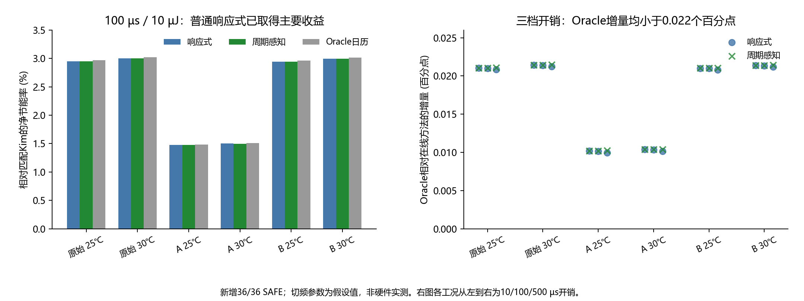
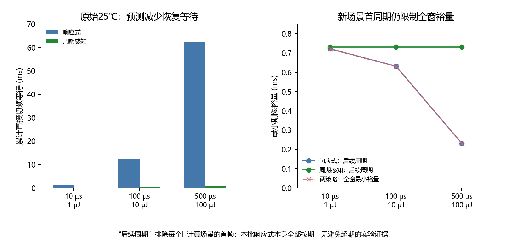

# GPU空闲调频：普通动态调频强基线补全

**结论：普通响应式已获得Oracle约99.24%–99.32%的节能收益；周期预测明显减少等待，但没有增加节能。建议结束这条路线的复杂算法开发。** 保留普通空闲管理作为运行时控制基线，不据此改动第三、四章安排。

新增36次完整回放，全部SAFE；Kim与Oracle各18条复用归档。未使用上一轮“忙时全H”策略充当强基线，未追加工况、调参或重复正式运行。执行冻结：[35fb9f0](https://github.com/YBEMR/paper/commit/35fb9f073bec069059f7c9f3dadb57e71bc338bc)；基准：[40f8f095](https://github.com/YBEMR/paper/commit/40f8f095ff067cc388890c824908592c3bcf8659)。独立目录与分支`codex/gpu-idle-baselines`，旧成果不变。

## 结果表

以下为每次切频100 µs、10 µJ时的10.04秒全窗系统能耗，单位J。完整三档开销与所有指标见[comparison.csv](comparison.csv)，18个匹配区组见[summary.csv](summary.csv)。只在同负载、同环境、同开销内比较。

| 工况 | Kim恒频 | 响应式 | 周期感知 | Oracle日历 |
|---|---:|---:|---:|---:|
| 原始25°C | 41.725328 | 40.494846 | 40.494866 | 40.486080 |
| 原始30°C | 42.349936 | 41.078779 | 41.078799 | 41.069724 |
| A 25°C | 32.152811 | 31.678585 | 31.678602 | 31.675319 |
| A 30°C | 32.707817 | 32.217222 | 32.217239 | 32.213843 |
| B 25°C | 41.710400 | 40.483075 | 40.483096 | 40.474326 |
| B 30°C | 42.335009 | 41.066998 | 41.067019 | 41.057960 |

| 单次切频假设 | 响应式净节能率范围 | 响应式保留Oracle节能 | 两在线策略最小期限裕量 |
|---|---:|---:|---:|
| 10 µs / 1 µJ | 1.496%–3.046% | 99.30%–99.32% | 0.721332 ms |
| 100 µs / 10 µJ | 1.475%–3.002% | 99.29%–99.32% | 0.631332 ms |
| 500 µs / 100 µJ | 1.364%–2.774% | 99.24%–99.28% | 0.231332 ms |

范围是六工况逐项结果的最小/最大值，没有混合不同负载的绝对焦耳。净节能率为`100×(E_Kim−E)/E_Kim`；Oracle增量为`100×(E−E_Oracle)/E_Kim`，单位百分点；保留率为`100×(E_Kim−E)/(E_Kim−E_Oracle)`。Kim自身场景切频也计时、计能，复用同档开销归档作分母。

新增36/36均完成500请求并满足40 ms期限；最高连续峰温上界76.267002°C，低于80°C。切频延迟确实进入时间轴，重新传播后继阶段时间、计算漏电和连续峰温；没有删除晚到任务或忽略场景尾部。Oracle最小期限裕量为0.731332 ms。

## 机制与独立收益

**1．响应式能否接近3%？能。** 原始/B负载的中档开销结果为2.942%–3.002%；A为1.475%–1.500%。全部18个条件下为1.364%–3.046%。因此，此前主要节能可以由保留Kim计算频率的普通空闲功率管理解释，无须完美未来信息。

原始25°C、中档开销的响应式分解：空闲截距节省0.868313884 J，温度相关漏电节省0.364658689 J，额外切频付出0.002490000 J，计算活动能耗不变；合计节省1.230482573 J（2.949006%）。切换能量已注入GPU热源并包含于物理活动能耗，表中单独拆出，不重复相加。详见[energy_attribution.csv](energy_attribution.csv)。

**2．周期预测的额外价值在等待时间，没有能耗增益。** 相比响应式，其净节能率反而低0.0000049–0.0002601个百分点；差异极小，不能据此主张响应式在实际硬件上更省电。两者计算活动、空闲能量和切频开销相同，模拟器中差异来自执行时序改变后的漏电积分。

原始25°C、500 µs/100 µJ时，累计直接切频等待由62.5 ms降为1.0 ms（减少98.4%），500个GPU阶段的平均开始时刻偏移由0.249 ms降为0.004 ms；受影响阶段由249个降为4个。这里累计等待是各次恢复阻塞的总和，不是单请求响应时间。周期感知在后续H场景帧中恢复了0.731332 ms最小期限裕量，但新场景首帧仍需响应式冷启动，两策略全窗最小裕量同为0.231332 ms。响应式本身全部按期，**没有证明预测避免了本批中的超期**。[等待与时序表](timing_diagnostics.csv)保存全部工况。

**3．Oracle相对周期感知仅多0.01021–0.02147个百分点。** 周期感知保留99.23%–99.32%的Oracle节能；剩余不到0.8%的“已节省能量”，不是总系统能量的0.8%。Oracle是有完整时间轴的有利离线参照，不是允许事件移位后的全局能耗下界。

归因还须区分阈值：两个在线策略统一等待100 µs再下降，Oracle沿用已归档的空闲开始立即下降规则，最短L驻留同为100 µs。因此Oracle差值包含等待阈值及恢复时序差异，不能全称为预测信息的纯贡献。原始25°C中档，Oracle比周期感知多12.5 ms低频驻留，对应0.00625 J空闲截距节省，余下约0.002536 J来自漏电。严格相同阈值的响应式/周期感知直接比较才是本轮预测增量证据；没有为压低这个差值再调阈值。

**4．没有需要读取热状态才能作出更好决策的证据。** 两在线策略均不读温度，25/30°C控制轨迹逐项一致。温度影响漏电和安全认证，是物理响应，不能包装为热状态驱动的调频创新。

**5．不建议发展为独立硕士论文算法。** 主要收益来自开放“场景内空闲调频”的控制权限。固定周期信息改善时序，但最终能耗、SAFE覆盖和全窗最小裕量均未改善。响应式已在全部工况满足冻结止损判据（SAFE、保留率≥95%、Oracle增量≤0.1个百分点），见[decision.json](decision.json)。停止复杂预测开发，保留结果与普通空闲控制组件；本轮不再设计新评分、热规则或更广实验。

## 实现、可信度与边界

- 固定四YOLO、X4139374、原始/A/B×25/30°C、500请求、40 ms期限与10.04秒计能；CPU/DLA不变，GPU计算严格L/L/H/H，阶段不抢占、顺序不变。四节点RC、初温30°C、温度继承、漏电和80°C判据原样复用。
- 响应式仅在任务实际就绪时恢复；周期感知只用当前场景内已观察到的(app, GPU阶段)就绪偏移加40 ms，场景切换清空预测。仿真器虽需持有事件堆和固定GPU排序，控制器接口不接收它们。无预训练、未来真实完成时刻或归档时间轴输入。
- [核验](verification.json)通过145个冻结来源/输入哈希、36份新证书、18,000个请求、126,000个阶段、7,200次转换及3,570条因果预测样本。计算活动能量最大回归误差1.85e-13 J。整批20.66秒，正式运行一次，无重试；图表与统计从归档派生，不增加物理实验。
- 切频时间/能量为声明的合成假设，未测量NVIDIA governor或真实硬件。输入严格周期、无抖动，仅此部署与三类负载；不能推广为所有响应式策略都优于预测，或更紧期限/不规则负载下预测没有价值。没有把极小漏电差作为硬件可测收益。

交付：[冻结协议](PROTOCOL.md)、[配置](config.json)、[控制器](controller.py)、[事件适配](online_events.py)、[原始证书/决策日志/完整温度轨迹](raw/)、[核验脚本](verify.py)、[统计绘图脚本](analyze.py)、[能耗SVG](energy_comparison.svg)、[时序SVG](timing_comparison.svg)、[复算说明](REPRODUCE.md)。
