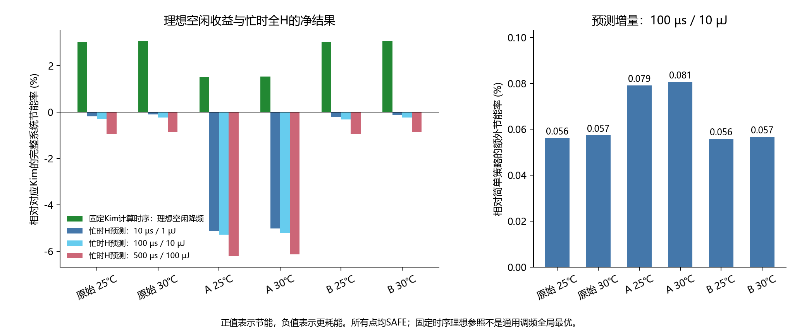

# GPU空闲窗口调频：最小价值验证结果

**纯空闲功率管理有1.509%–3.072%的零开销潜力；本轮两种忙时全H策略没有净节能。** 即使完美预知GPU阶段就绪时间，预测策略也只比简单策略省约0.06%–0.08%。本轮不支持把它升级为新的热状态感知调度算法。

执行冻结：[0b63a41](https://github.com/YBEMR/paper/commit/0b63a417f73cbe4f9307633ec9dba1fa40e09e5b)。基准4d0e719；独立分支codex/gpu-idle-dvfs。未改旧源码、部署、请求或原功热参数。三档非零切频参数是敏感性假设，结果是合成平台仿真，均非硬件实测。

| 工况 | Kim J | 固定时序理想 J | 理想节能 | 简单策略净节能¹ | 预测策略净节能¹ | 预测相对简单¹ |
|---|---:|---:|---:|---:|---:|---:|
| 原始 25℃ | 41.725317 | 40.465867 | 3.018% | -0.365% | -0.308% | 0.056% |
| 原始 30℃ | 42.349925 | 41.048932 | 3.072% | -0.286% | -0.229% | 0.057% |
| A 25℃ | 32.152800 | 31.667721 | 1.509% | -5.377% | -5.294% | 0.079% |
| A 30℃ | 32.707806 | 32.206019 | 1.534% | -5.287% | -5.202% | 0.081% |
| B 25℃ | 41.710389 | 40.454147 | 3.012% | -0.370% | -0.314% | 0.056% |
| B 30℃ | 42.334997 | 41.037201 | 3.066% | -0.291% | -0.234% | 0.057% |

¹表中非零开销为每次100 µs、10 µJ。各策略与**同开销假设的Kim恒频方案**比较，Kim的场景边界切频也计费；负值表示更耗能。完整四档、所有能量分量与证书路径见[all_results.csv](all_results.csv)。

## 五个问题的答案

**1. 零开销最多能省多少？** 固定Kim每个计算阶段的频率和实际起止时刻，仅把全部空闲窗口切L，六工况节省0.485079–1.300993 J，即1.509%–3.072%。这是该固定计算时间轴的纯空闲管理上界：空闲L的截距/漏电系数均较低，温度不低于参考温度，正热系统中L不会比H产生更高状态或全窗能耗。它不是允许重新选择所有计算阶段L/H、改变计算时刻时的全局最大值；本轮没有求解那个更一般的问题。

**2. 加入切频开销后净收益多少？** 本轮指定的简单策略忙时H；为隔离空闲预测增量，预测策略也忙时H。两者在全部档位都比Kim更耗能，连零切换开销时也如此：

| 每次切频时间 / 能量 | 简单策略相对Kim节能范围 | 预测策略相对Kim节能范围 | 预测相对简单节能范围 |
|---|---:|---:|---:|
| 0 / 0 | -5.181% 至 -0.152% | -5.097% 至 -0.095% | 0.056% 至 0.081% |
| 10 µs / 1 µJ | -5.200% 至 -0.166% | -5.117% 至 -0.108% | 0.056% 至 0.081% |
| 100 µs / 10 µJ | -5.377% 至 -0.286% | -5.294% 至 -0.229% | 0.056% 至 0.081% |
| 500 µs / 100 µJ | -6.314% 至 -0.917% | -6.230% 至 -0.860% | 0.055% 至 0.080% |

根因是Kim前两个场景原本用L，忙时全H增加了GPU计算能耗。以100 µs/10 µJ、25°C为例，原始/B负载的计算活动能耗各增加约0.994 J，A增加约1.590 J；A中连全窗频率相关空闲截距与漏电能耗也上升。降低峰温不必然降低全窗能耗。[分量差值](energy_components.csv)使用“新策略减同条件Kim”，切换能耗从活动能量中拆出，未重复计数。

**3. 预测是否额外有用？** 有很小的能耗增量和明确的时序效果。三档非零开销下，预测相对简单省0.055%–0.081%；预测最小期限裕量始终0.731332 ms，简单策略随10/100/500 µs唤醒延迟降为0.721332/0.631332/0.231332 ms。所有78次均SAFE，所以本轮没有证明预测是取得安全可行解的必要条件。增量同时包含立即下降、短间隙判断和提前恢复，不能只归因于其中某一个动作。

**4. 是否真正依赖热状态决策？** 不依赖。本轮策略从不读取温度；25°C/30°C使用完全相同的事件及切频序列。理想参照的直接空闲截距节省为0.367–0.887 J，温度相关漏电再节省0.118–0.414 J。后者是降功耗引起的连续热响应，不是热感知决策带来的收益。连续热模型仍用于完整计能和80°C认证。

**5. 是否发展为第三/四章新算法？** 目前不建议将“GPU空闲预测调频”单独发展成新的热感知主算法；普通空闲功率管理已能解释理想收益，预测的最终能耗增量很小。这里也不能据此否定所有空闲管理：保留Kim计算频率的1.5%–3.1%理想收益是真实的模型内空间，**该保留计算频率策略的非零开销净收益本轮未测量**。忙时全H的负结果不能当作所有阶段调频策略无价值的证明。本轮按冻结范围结束，不因负结果增加混合控制器或参数轮次。

## 模型、证据与边界

- GPU切频只发生在计算阶段边界或空闲段；转换期间GPU不可计算，CPU/DLA/XFER继续按原资源规则执行。转换使用H空闲截距/漏电，额外能量E以E/τ注入GPU热节点；计入完整10.04秒系统能耗。初始GPU=L，不免费设为H。CPU/DLA保持L。
- 原GPU阶段顺序固定；所有后继时间重新调度，队列不按场景清空。满500请求和40 ms期限逐条核验。转换能耗、板级常驻能耗、活动/传输/温度相关漏电全部保留。
- 预测使用确定性模型的完美就绪时间，属于有利参照，未验证在线预测误差。它没有优化计算阶段L/H选择，也没有温度驱动动作。100 µs空闲等待/最短驻留预先固定，未调参。
- 原连续热积分器逐频段接续四节点温度，保留所有功率事件及原连续峰温界精度。继承原二进制浮点数值界，不冒充严格有向舍入形式证明。
- 78次完整热回放一次完成，整批约65.29秒；没有搜索调用或追加运行。六工况零开销Kim能耗回归最大误差约1e-13 J，峰温误差约1e-14°C，阶段行及请求完成时间完全一致。
- [离线核验](verification.json)：78份SAFE证书、39,000条请求完成记录、273,000个阶段记录、40,852条切频记录通过；检查合法阶段功率/时长、资源不重叠、不抢占、固定GPU顺序、温度继承与能量分解。核验不重新运行优化或热评价。

配置与原始证据：[协议](PROTOCOL.md)、[配置](config.json)、[执行环境](environment.json)、[源/输入哈希](execution_manifest.json)、[原始记录](raw/)、[逐运行CSV](all_results.csv)、[六工况汇总](summary.csv)、[可编辑SVG](value.svg)、[复算说明](REPRODUCE.md)。图表由本脚本直接读取已归档结果生成。
