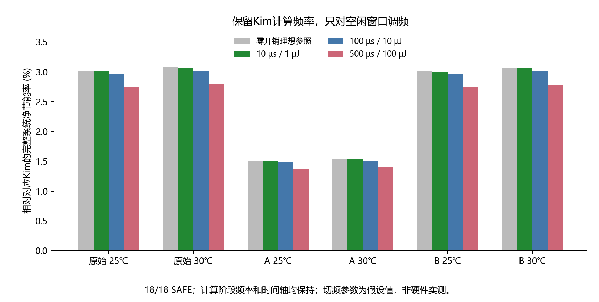

# 保留Kim计算频率的空闲降频：最后一项补充对照

**确认有净节能：三档非零假设开销下，完整系统总能耗降低1.374%–3.067%，18/18全部SAFE。** 原始/B负载约2.74%–3.07%，A负载约1.37%–1.53%。上一轮负结果主要来自把原本可用L的计算阶段改成H，不能用来否定空闲管理。

本轮只补一个策略，直接复用原Kim部署X4139374、四场景计算频率L/L/H/H与上一轮空闲窗口规则。没有重新设计算法或调整参数。执行冻结：[aba1c4c](https://github.com/YBEMR/paper/commit/aba1c4c30f4f585e9bfe03a6cabd1892ef3c09b2)；基准2a70dda7，独立分支codex/gpu-idle-preserve。所有旧文件保持不变。

## 六工况结果

| 工况 | 理想零开销 | 10 µs / 1 µJ | 100 µs / 10 µJ | 500 µs / 100 µJ | 中档峰温 °C |
|---|---:|---:|---:|---:|---:|
| 原始 25℃ | 3.018% | 3.014% | 2.970% | 2.744% | 69.696 |
| 原始 30℃ | 3.072% | 3.067% | 3.023% | 2.795% | 75.154 |
| A 25℃ | 1.509% | 1.506% | 1.485% | 1.374% | 65.878 |
| A 30℃ | 1.534% | 1.532% | 1.510% | 1.399% | 71.316 |
| B 25℃ | 3.012% | 3.007% | 2.963% | 2.738% | 70.576 |
| B 30℃ | 3.066% | 3.061% | 3.017% | 2.789% | 76.037 |

表中每个非零节能率均以同工况、同切频开销的Kim恒频结果为分母；Kim自身的场景切频也付费。零开销列复用上一轮理想结果。相对历史零开销Kim的节能率同时保存在[comparison.csv](comparison.csv)，没有用不同域或不同负载能耗混比。

全部18个策略的500请求均在40 ms内完成，最小期限裕量均为**0.731332 ms**；连续峰温上界最高为**76.247163°C**。不仅满足期限，全部计算阶段的起止时间、频率和活动功率都逐行等于原Kim记录，没有通过缩短任务或牺牲期限取得收益。

## 能量来自哪里

原始25°C、100 µs/10 µJ的匹配对照：

| 指标 | 结果 |
|---|---:|
| Kim全窗能耗 | 41.725328268 J |
| 保留计算频率＋空闲降频 | 40.486080201 J |
| 净节省 | 1.239248067 J（2.970%） |
| 空闲截距能量节省 | 0.874563884 J |
| 计算活动能耗变化 | 0 J（核验误差≤1.85e-13 J） |
| 温度相关漏电节省 | 0.367174183 J |
| 比Kim多付的切换能量 | 0.002490000 J |

与上一轮同档“忙时全H”的预测策略比较，其能耗为41.854047037 J，较Kim反而增加0.308%。现在唯一调整是保留原计算频率，净节能由负转正。转换能量已注入GPU热节点并进入活动能量，分解时拆出一次，不重复加总；开销增加也减少L驻留并改变漏电，已完整重算。

三档开销下保留了各自零开销理想能量差的90.90%–99.84%。这支持冻结模型内空闲管理的实用价值，不能视为设备上的实测收益。

## 机制与取舍

1. **是否兑现了此前发现的空间？** 是。在声明切频假设下，大部分理想收益可以保留；原始/B工况仍接近3%，A约1.4%–1.5%。
2. **是否证明新的预测机制？** 没有。直接复用上一轮规则，没有新增预测方法；利用冻结请求和阶段就绪时间提前恢复H，属于确定性已知时间轴上的空闲控制。没有测试在线预测误差或完全反应式的保留频率控制器。
3. **是否是热状态驱动的收益？** 不是。25/30°C动作完全相同，决策不读取温度；普通空闲功率下降与后续漏电减少可以解释全部收益。连续热模型负责完整能量与80°C认证。
4. **是否值得继续？** 值得保留为运行时功率管理组件，当前证据仍不足以将其单独作为第三/四章新的热感知主算法。要主张独立算法贡献，仍缺与常规GPU动态调频策略的公平比较及可信切频参数依据；本轮不自动追加这些工作。

## 核验与复算

新增18次完整热回放，整批12.04秒完成。上轮Kim各档、零开销理想、忙时全H结果直接复用，未重跑旧78次。所有新策略调用原dispatch/certify，保留全部事件、4节点连续热、10.04秒全窗系统能量及原峰温界精度。

[核验](verification.json)通过：117个执行来源/输入哈希，18份SAFE证书、9,000条请求完成记录、63,000个阶段、3,600次切换；GPU阶段频率与起止逐条相同，切频不与GPU计算重叠，热状态逐段继承，活动计算能量误差≤1.85e-13 J。物理模型仍是冻结合成平台，切频10/100/500 µs和1/10/100 µJ均是假设，不是板端测量。

交付：[协议](PROTOCOL.md)、[配置](config.json)、[适配源码](preserve.py)、[完整CSV](comparison.csv)、[六工况表](summary.csv)、[原始证书和温度轨迹](raw/)、[可编辑SVG](net_savings.svg)、[复算说明](REPRODUCE.md)。本轮到此结束，不追加算法或实验。
