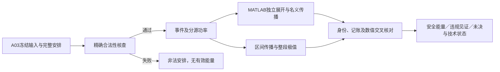

# A04：完整调度的连续热能耗评价接入

2026-10-22。**已接通A03完整安排的合法性、事件功率、完整窗口能量及连续峰温评价。** 最终Python预检21/21、MATLAB端到端8/8通过；A03冻结输入未改，研究求解／优化器调用0。

两份原有TEST_ONLY安排均取得模型内连续热安全回执。它们没有触及温限，本轮不提供设备选择改变、搜索最优或算法收益的证据。

## 1．完整流程



- 时间表包含全部6个Stage的合法模式和启动时刻；独立检查释放、每请求期限、依赖、设备互斥及CPU同域同频。
- 区间侧使用精确十进制／有理数，按半开执行区间展开事件。支持非网格启动；不将结束时刻取整。
- 一个CPU空闲、同域另一CPU忙时，空闲核仍按该域工作点计基准与漏电。全域空闲立即auto-L，空闲尾段完整计到1 s。
- CPU／GPU／NPU本地活动进入本地节点，存储活动进入U；U基准和漏电系数各计一次。所有模型内功率均注热，旧external字段设0。

MATLAB独立组装事件与功率，调用A02矩阵指数内核得到名义温度与能量。安全判断由Python标准库区间侧程序完成，不是纯MATLAB认证器，也不依赖新求解器或新增软件包。

## 2．连续保证与能量

固定工作点和活动状态片段内，功率仍随温度变化：

\[
C\dot\theta=(-G+\operatorname{diag}\lambda)\theta+b+q,
\qquad
E=\int_0^W\left[\sum_j(b_j+q_j)+\sum_j\lambda_j\theta_j(t)\right]dt.
\]

复用K152的Decimal向外舍入和Taylor余项核，按整段区间像、导数及必要细分给出极值包络，包含事件之间的峰值。数值面板不是启动网格或温度采样间隔。温度逐段继承，不在Stage或空闲段开始时重置。

能量同时按基准、活动、温度修正分项，并以热平衡恒等式交叉核对。精度字段显式映射A03目标：温度极值宽度1e−4 K；能量宽度≤max(1e−8 J,1e−8×max(0,E下端))。安全温限无额外容差。

SAFE要求完整窗口、合法性、模型有效温区、连续温度上界及能量精度均通过。可靠点温度下界超过温限才能形成违规见证；预算耗尽、有效温区或数值精度未分辨记UNRESOLVED。未完成能量不能进入有效比较。

该保证针对A03抽象模型、声明初态和这一张完整安排；不包含实机建模误差、设备内部热点、长期重复或任意模式切换。MATLAB double无法一致核对极近事件时保留未决，不据此合并事件或改成网格问题。

## 3．预检结果

| 预检 | 最终结果 | 覆盖 |
|---|---|---|
| Python解析／软件夹具 | 21/21，0.782 s | 5节点注热、同域和auto-L、非网格起点、标量漏电闭式解、共享节点精确能量、端点安全但段内超温、分段等价、非法安排、精度传参、身份及中断 |
| MATLAB端到端 | 8/8，含启动26.926 s | 两份A03完整安排、独立事件／功率核对、能量和末温交叉核对、空闲尾段、非法输入、技术状态、正常早期截止 |
| 内部代码复核 | 已处置发现的问题 | 见[evidence/a04/internal_review.md](evidence/a04/internal_review.md)；不作为外部独立批准 |

两份既有安排的回执：

| TEST_ONLY安排 | 模型内状态 | 完整窗口能量J（显示近似值，完整区间另存） | 五节点峰温 |
|---|---|---:|---|
| parallel_reference | SAFE | 1.372479247243 | 均为入口35°C |
| B_shifted_62p5ms | SAFE | 1.372470138505 | 均为入口35°C |

两份安排的基准能量均为1.1745703125 J，活动能量均为0.06922265625 J，差异只落在温度修正积分。这说明评价链能保留时序影响，不证明某类设备或共同规划存在额外收益。完整区间、逐段功率、连续峰温界、请求完成时刻和末温在`evidence/a04/matlab_attempt03/`与`fixture_summary.json`。

MATLAB最终能量距区间最大约2.22e−16 J，末温距区间最大约7.11e−15 K。核对容差只用于名义计算诊断，不扩大安全证书的温度界或能量区间。

## 4．修正与完整记录

首轮Python15/18：标量夹具的适用温区使功率出现负值，另有数值零的字符串断言错误。只修TEST_ONLY温区与断言，第二轮18/18通过，A03参数未动。随后内部复核发现接口问题：技术标志丢失、文件分次读取导致可能错绑，以及早期预算状态不完整；修复并加回归，最终21/21。

MATLAB三次整组预检分别6/6、7/7、8/8，含启动41.863、24.912、26.926 s，累计93.701 s。每轮重跑同两份既有夹具，用于核对受影响接口；共6次完整安排软件评价，不是6次独立研究实验或性能重复测量。修正前源码、哈希和所有检查记录保留，不以最终通过覆盖早期记录。

违规事实与预算资格分列：超时后可保留已有可靠违规，但只有`entry_evidence_in_budget`满足时才能列预算内证据。技术故障保留原始原因；不能因同样返回未决就当作正常截止。

只对A03读取函数做一行必要加固：解析与哈希使用同一字节快照。A03输入、manifest、A02内核和主线代码未改；旧A03检查仍按其历史源码解释，当前读取接口由A04重新核查。

## 5．复现入口与下一步

工作目录为本探索worktree，MATLAB与Python路径可显式设置：

```text
python -B research/hetero_thermal_pilot/tests/run_a04_precheck.py
python -B research/hetero_thermal_pilot/tests/run_a04_matlab.py
```

默认复跑结果进入忽略的`.runtime_a04/`，不覆盖历史证据。每次区间评价上限60 s；MATLAB整组外部上限240 s含启动，均为正确性检查限额，不继承主线研究预算。

MATLAB调用既有夹具或外部完整安排JSON：

```matlab
addpath('research/hetero_thermal_pilot/matlab');
outDir = fullfile('research','hetero_thermal_pilot','.runtime_a04');
if ~isfolder(outDir), mkdir(outDir); end
r = htp_evaluate_schedule('parallel_reference', fullfile(outDir,'one_fixture.json'), 'F:/Anaconda3/python.exe', 60);
% 首参也可为完整时间表JSON路径；启动值可写精确十进制或有理数字符串。
```

**下一项建议：先核对新到C02—C05建议与A04接口的适用对象，再确定一项静态验证或小域研究任务。** C02已给出A03全时域约35.624°C上界，本输入不能承担热约束活跃或热反馈收益的验证。C05的固定锚释放仍是待评议候选，不因本次评价器完成而自动获得实现或研究调用授权。 本轮只完成评价链，未搜索、未比较算法、未运行正式研究实验。是否需要新方法应在后续观察到具体决策／求解问题后判断。
