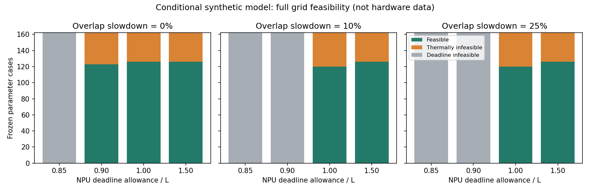
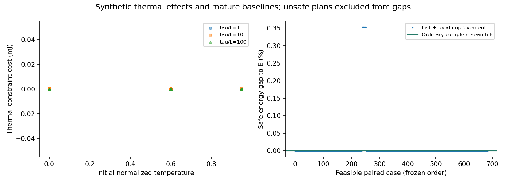

# K5多核NPU联合调度最小准入结果

2026-11-16。**研究建议：只保留建模参考；停止本轮K5新算法开发与扩模。**

本轮确认了核组宽度与请求并发之间的普通资源协调矛盾，也确认在给定合成功率比下，核组选择能够改变最低系统能耗。但**没有发现热因素改变可行案例的最优能耗或必要核组选择**。普通能量排序完整搜索解决了全部1944个有限域案例，与独立完整枚举一致；列表方法的失败不能据此包装成新的独立方法困难。

材料性质：公开单模型中位时延＋明确合成的功率/热参数＋确定性有限域仿真。不是RK3588实机能耗、热安全或硬实时实验。旧论文、正式MILP、参数和实验记录均未修改。

## 1．工程依据及不可越过的边界

[rk-bench固定提交][bench]报告：RK3588、driver 0.9.8、librknnrt 2.3.2；预热后3个独立会话，取会话p50的中位数。两种FP模型的core0／01／012时延为A=37.52／35.65／35.62 ms、B=114.55／102.15／100.62 ms。它们是作者公开实测报告，未由本任务上板复测。

同提交[测量协议][bench-readme]说明使用PERF_RUN硬件计数，板上存在其它负载，采用`rknpu_ondemand`，并通过priming处理首进程较慢现象。因此，**这些数据不是已证锁频时长，不是主机端到端时延，也不是WCET**。本实验将它们视为一个固定共享控制状态下的确定性输入，是额外假设。原文`NPU_ONLY`按CPU fallback小于1%且无较大单算子定义，不能严格等同“CPU参与为零”。输入是固定形状零张量，模型功能/输出一致性未在本轮重新验证。

[RKNN v2.3.2头文件][rknn]提供0、1、2、01、012等核选择接口，但接口不证明跨上下文的实际并发、独占预约、确定性派发或逐核独立频率。core1/core2时延等于core0、不相交可并发、固定共享频率、CPU前处理同步及后处理互不冲突，全部作为本轮限定假设。σ敏感性仅研究假定并发后的慢化，不能验证设备是否允许所假定的并发。

初版任务固定为两条CPU.pre→NPU.main→CPU.post。GPU没有任务或映射选择，其基准归入公共系统项；CPU也没有调频/占核选择。本轮不能外推到完整CPU/GPU/NPU联合配置问题，或三个NPU核心的独立热点安全。

## 2．25组独立核验与能量条件

全部有序核组见[ordered_masks.csv](stage1_results/ordered_masks.csv)。集合相交判据与独立位占用/事件生成器用有理数逐项核对，25/25通过。

| 核验项 | 结果及限定 |
|---|---|
| 不相交组合 | 8：不同单核6组，{2}与{0,1}互换2组 |
| 相交组合 | 17，必须串行；端点相接合法 |
| 不相交组合最短NPU makespan | max(dA,dB) |
| 相交组合最短NPU makespan | dA+dB |
| 全核组最短NPU完成时间 | **102.15 ms**，A用{2}、B用{0,1}同时启动 |
| 仅独立单核 | **114.55 ms** |
| 两任务均三核 | 136.24 ms，必须串行 |

102.15—114.55 ms只表示共同前处理完成后、无干扰限定模型下的期限可行性分界。加入本轮固定前后处理后，共同完整请求期限的对应边界为113.605／126.005 ms。它们不是实机SLO。热约束或并发慢化可以进一步使方案失效。

固定窗口公共基准抵消，单个任务从窄核组改为宽核组降低活动能量的条件为`p宽/p窄 < d窄/d宽`：

| 功率比条件 | A：YOLOv8n | B：YOLOv8s-seg |
|---|---:|---:|
| p2/p1 | <1.052454 | <1.121390 |
| p3/p2 | <1.000842 | <1.015206 |
| p3/p1 | <1.053341 | <1.138442 |

例如双核功率比在1.052454和1.121390之间时，A偏好单核、B偏好双核；可用{2}与{0,1}并行。这是时延表与合成功率共同给出的条件性比较，不是热感知收益，也不需要新算法解释。

## 3．冻结模型、参数和评价域

完整[输入契约与冻结表](PROTOCOL.md)、[inputs.json](inputs.json)、[1944项参数网格](parameter_grid.json)于UTC 11:06:51冻结；代码于11:13:48冻结，第一次热计算在其后。哈希见[freeze.json](freeze.json)、[code_freeze.json](code_freeze.json)，没有根据结果改参数或筛选案例。

时间标尺L=114.55 ms；CPU前/后处理各0.05L，每个阶段活动增量0.5 W；系统基准P0=1 W只计一次；W=4L=458.2 ms，全部候选完成后的空闲尾段仍计费。单核活动功率1 W；p2/p1={1,1.1,2}，p3/p2={1,1.1,1.5}。完整能量为

\[
E=\underbrace{0.4582}_{公共基准}+\underbrace{0.011455}_{CPU活动}
 +p_A(f_A-s_A)+p_B(f_B-s_B)\quad[\mathrm J].
\]

并发期间两任务进度率均为1/(1+σ)，σ={0,.1,.25}；不重叠时为1，功率不另改变。若重叠长度为O，慢化新增活动能量为`(pA+pB)σO/(1+σ)`。无干扰时同核组能量不随起点变化；缩短makespan不会减少固定窗口基准。没有温度漏电、热降频、睡眠或切换成本。

热模型为**一个NPU聚合RC节点**，NPU基准0.2 W和NPU活动注入该节点；CPU及其它0.8 W公共基准在热边界之外，但全部计入系统能耗。设θ=(T−25)/20，温限θ≤1；45°C只是归一化约束的合成单位换算，绝非芯片温限。θ0={0,.6,.95}，τ/L={1,10,100}，κ=p1/(20G)={.5,2}，C=Gτ。所有G、C为正，系统被动稳定；先验最大原则给出T≤153°C，落在声明计算温区25—155°C内。

范围按无量纲边界选择：功率从近似同功率到按核数增长；时间常数覆盖两数量级；入口从冷态至近约束；期限β={.85,.9,1,1.5}覆盖不可行、核组分界与宽松条件。**这些是条件网格，不是RK3588可信标定区间。**没有使用不相容的整板/分域实测功率。

每个核组对枚举两种顺序、两种起点锚、四档首延迟及四档次延迟，共1600原始基因；拒绝340个核冲突基因，1260个合法基因去重为**1168条时间表/慢化档**。C、D、E、F拥有相同核组和有限时序权限，A/B仅用于固定配置对照。完整域是协议明确定义的有限集合，非全连续时间最优，非仅25个映射最优。

每段恒功率解析传播。单节点段内单调，故初温及所有事件端点的最大值就是完整连续峰值，包含尾段；这项性质不迁移为四节点仅查端点。所有候选距温限至少0.00202449 K；1e−8 K缓冲内未决数为0。高精度复核与误差记录见第6节。

## 4．完整结果及负结果

| 全部1944项预定组合 | 数量 |
|---|---:|
| 有完整、按时、NPU连续安全方案 | **867** |
| 去热约束也无按时方案 | 810 |
| 去热有解、加热后有限域无解 | 267 |
| 至少排除一条原按时时间表的热约束案例 | 318 |
| 可行案例中热约束抬高最低能耗 | **0** |
| 可行案例中热约束迫使最优核组集合改变 | **0** |
| 有效最优核组集合缩小 | 0 |
| 未决、未算、预算超时 | 0 |

更强的负结果是：867个可行案例的**原样去热最优见证全部安全**，不需要热修复才达到相同最优能量。318项热筛除中，267项排除所有按时方案，其余51项仍保留原样无热最优见证；这不意味着每条并列最优时间表都安全。约束确实有作用，但没有转化成已观察到的增量节能决策价值。

冻结网格的热参数分组如下，每行324项，含135项期限本已不可行；表格是枚举计数，不是现实发生率。

| τ/L | κ | 完整可行 | 热导致不可行 | 至少一条按时表被热排除 |
|---:|---:|---:|---:|---:|
| 1 | .5 | 180 | 9 | 45 |
| 1 | 2 | 0 | 189 | 189 |
| 10 | .5 | 189 | 0 | 3 |
| 10 | 2 | 120 | 69 | 78 |
| 100 | .5 | 189 | 0 | 0 |
| 100 | 2 | 189 | 0 | 3 |

慢化也不能忽略：β=.9时σ=0有123个安全案例，而σ=.1或.25的162项各全部因期限不可行。这说明无并发慢化假设对可行性结论敏感；不是实际RK3588慢化已经测得。

### 方法对照

“超额能量”定义为100(E方法−E参照)/E参照，仅在两者均完整按时安全时计算。不是相对方法自身能量的节能率。失败或超温行不参与百分比排名。

| 方法 | 安全解数 | 达同域最优数 | 安全配对最大超额能量 | 求解墙钟中位/ms |
|---|---:|---:|---:|---:|
| A 固定单核，完整时序搜索 | 504 | 168 | 2.612664% | .1446 |
| B 固定三核串行，完整时序搜索 | 357 | 42 | 41.280309% | .1297 |
| C 全核组最早完成 | 849 | 475 | 18.961760% | 2.5509 |
| C_repair 固定C映射后完整热修复 | 864 | 531 | 14.435643% | .1442 |
| D_list 普通双次序能耗列表 | 684 | 586 | 3.017411% | .2475 |
| D 列表＋坐标局部改进 | 684 | 670 | **.352681%** | 1.0889 |
| E 同域完整枚举 | **867** | **867** | 0 | .3069 |
| F 普通能量排序完整搜索 | **867** | **867** | **0** | .0757 |

核组选择在336个与A共同可行的案例、315个与B共同可行的案例降低能量；但这些差异来自合成功率—时长与资源协调，不能归为热感知。A/B的受限权限也不能用于论证新方法优越。最强简单对照F与E权限相同，所有1944项的可行性和867项最优能量一致；F最大记录耗时4.1827 ms。

D漏掉183个本来可行的案例，返回方案均为**期限违规**；另14个安全解仍有小额能量差距。没有局部搜索步数上限触发。此结果只说明冻结的单坐标列表修补不完备；普通完整搜索已解决，不需要借此发明新的热机制。

计时包含各方法的能量准备、候选选择及自身热评价；共用的纯几何/执行时序目录生成另计0.12528 s，计入总预算。D时间包含列表初始化；E0从已保存参考评价中提取，没有独立求解计时。不同实现的向量化、候选数及调用方式不同，本轮不报告加速倍数，也不声称毫秒级硬件部署开销。

### 预声明规则选出的首个失败例

K5_0018：p2/p1=p3/p2=1、σ=0、β=.9、θ0=0、τ/L=1、κ=.5。列表优先选两项三核并串行；B于147.695 ms完成，超过114.55 ms期限。改为A占{2}、B占{0,1}同时启动，完整请求于48.975／113.605 ms完成，峰温33.709465°C，系统能量0.609325 J；C、E、F均直接得到此解。

该例没有热约束活跃，是普通宽度—并发—期限协调。违规列表方案的原始耗电保留于数据，但不作为有效低能耗方案排名。按预先规定检索“首个热致能量改变/必要映射改变”的结果均为空，未另外挑例或造例。

## 5．与旧成果的关系

| 已有记录 | 本轮继承的能力／不能重复命名的结论 |
|---|---|
| [70号][r70] | 核选择、频率域、功率计量组及热节点是四种不同边界；单核时长不能直接当并发实测 |
| [102号K5][r102] | 原候选是CPU占核集合与完整调度；本轮NPU扩展由本次任务明确授权，未改旧候选状态或R86 |
| [17号][r17] | 固定窗口、恒定活动功率时存在简单能量分解；简单完整搜索/下界已足够时停止，不以MILP较慢立题 |
| [46号][r46]、[47号][r47] | 仅当前安全不保证后缀安全；简单完整后缀评价已修复旧构造。本轮D/F检查完整未来轨迹，未使用那个已知弱前缀基线 |
| [正式第三章][ch3] | 已有有限模式、共享频率、完整系统能量、被动RC及连续安全。当前正式单元独占需按核组资源集合做常规扩展，但“模式＋资源需求集合＋查表搜索”不是独立新方法 |
| [K.194][k194]、[K.196][k196] | 已有完整链有限域枚举和MILP对照；旧小域全部安全、反馈零触发，不能把配置/时序节能全部归因为热 |

本轮新得到的是NPU核组模型的有限域正确性证据、参数敏感性和负结果，不是正式四节点模型的新求解机制，也没有对整个moldable任务调度领域作穷尽文献新颖性判断。

## 6．独立核验、预算与复现

[独立核验记录](run01/independent_verification.json)通过：4800条基因合法性、3504条独立事件进度时间表、**2,270,592条**候选的能量/热峰交叉核对、1944个参考最小值、17,496条方法记录、2729条独立物理轨迹的60位Decimal重算。这里“独立”指同一助手编写的不同实现，不冒充外部审查或硬件验证。

原评价器按恒功率段递推；独立程序用热脉冲卷积叠加核对全部候选，另用事件功率积分重算能量。最大完成时间差5.55e−17 s、峰温差4.62e−14 K、能量差2.22e−16 J；选定轨迹Decimal差2.13e−14 K。数值一致性不提高公开中位时延或合成参数的物理精度，也不是形式化浮点区间证书。

本次完整流程墙钟**126.2545 s**，其中主实验进程11.9227 s、独立核验110.5583 s、汇总绘图2.3767 s，含第一阶段保守记账0.6928 s及控制开销；余下预算未用于扩例。后续仅对已保存表做描述性计数，进程0.7953 s，合计约**127.05 s＜600 s**。无仿真重试、参数改动、MILP调用或硬件实验。时间以[execution_receipt.json](execution_receipt.json)为准；读取/压缩数组与核验成本不当作求解算法开销。

全部输入与程序身份见冻结文件，全部交付文件哈希见MANIFEST.json。所有1944项结果见[cases.csv](run01/cases.csv)，每方法结果见[methods.csv](run01/methods.csv)，每一枚举候选的能量、峰温、状态见[all_candidates.npz](run01/all_candidates.npz)。完整解析热轨迹由事件端点、时间常数及分段功率确定；返回方案含所有端点及CPU时序，见[selected_trajectories.jsonl](run01/selected_trajectories.jsonl)。目录说明和复现命令见[README](README.md)。

## 7．研究决策

**只保留建模参考。** 核组权限与局部效率/并发机会的矛盾成立，功率未知时可给条件比较；热约束可以排除时间表和整个实例，但本冻结网格没有留下热感知增量最优决策价值。列表局部方法不足已被毫秒级普通完整搜索覆盖，未观察到值得专门设计新算法的剩余困难。

据此停止本轮，不为寻找正结果增加温度漏电、CPU—NPU热耦合、四节点、更多请求或更密起点。保留接口、解析阈值和复算程序作为未来有匹配数据时的建模参考；本结论只限制当前两请求、合成功率RC及有限时序域，不证明所有真实多核NPU问题都容易，也不否定整篇论文方向。没有新的实测并发/功率/热证据或用户另行提出的独立研究理由时，不建议将K5直接升级为硕士论文第三、四章的新算法主线。

[bench]: https://github.com/anguoyang/rk-bench/blob/ededa97f7009ac9a2361dad5fb2e8cba1f62c27f/docs/CORE_MASK_STUDY.md
[bench-readme]: https://github.com/anguoyang/rk-bench/blob/ededa97f7009ac9a2361dad5fb2e8cba1f62c27f/README.md#how-it-is-measured
[rknn]: https://github.com/airockchip/rknn-toolkit2/blob/42aa1d426c0a9e0869b6374edba009f7208a1926/rknpu2/runtime/Linux/librknn_api/include/rknn_api.h#L558-L577
[r70]: https://github.com/YBEMR/paper/blob/bba552e5f045c805be9d6274eaafb83e64b2815f/research/70_RK3588研究平台适用性核查.md
[r102]: https://github.com/YBEMR/paper/blob/bba552e5f045c805be9d6274eaafb83e64b2815f/research/102_研究要素组合与问题选择.md
[r17]: https://github.com/YBEMR/paper/blob/bba552e5f045c805be9d6274eaafb83e64b2815f/research/17_固定模型求解审计结果.md
[r46]: https://github.com/YBEMR/paper/blob/bba552e5f045c805be9d6274eaafb83e64b2815f/research/46_前缀热可完成性条件与最小对照定义.md
[r47]: https://github.com/YBEMR/paper/blob/bba552e5f045c805be9d6274eaafb83e64b2815f/research/47_前缀热可完成性配对验证.md
[ch3]: https://github.com/YBEMR/paper/blob/bba552e5f045c805be9d6274eaafb83e64b2815f/research/latex/chapter03_revised_20261025/chapter03.tex
[k194]: https://github.com/YBEMR/paper/blob/bba552e5f045c805be9d6274eaafb83e64b2815f/research/完整链小域独立穷举结果_K194.md
[k196]: https://github.com/YBEMR/paper/blob/bba552e5f045c805be9d6274eaafb83e64b2815f/research/完整链小域整体MILP结果_K196.md
