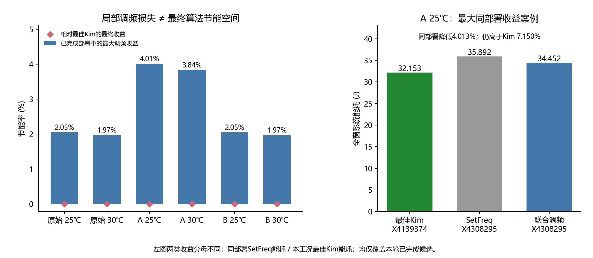
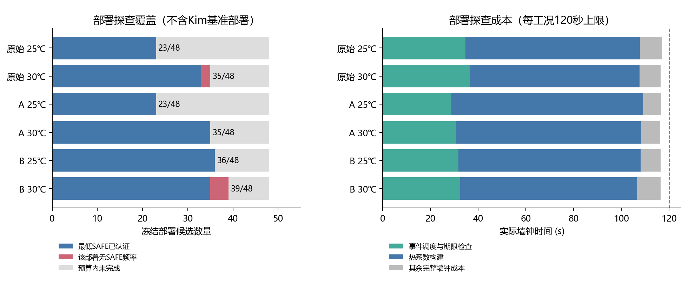

# Kim节能空间与缺陷定位：一次限定诊断

**结论：未找到低于六个工况最佳Kim-Anytime+SAFE的方案，实得节能率均为0%。** 六个获胜部署的完整频率域最优性已认证。其他部署确实存在SetFreq漏搜，最大同部署损失4.013%，但补回这项损失仍比最佳Kim高耗能7.150%。现有证据不支持为追求最终3%–5%节能立即开发新算法；也不构成431万域没有更优解的证明。

执行冻结：[1b03f12](https://github.com/YBEMR/paper/commit/1b03f122e9f7b80cbdf2b06a6aa8f4e35854ae71)；独立分支 `codex/kim-gap-diagnostics`，基于 `72afaa4`。本轮只新增此目录。旧M2、Energy-Only、Kim、物理评价器和历史数据未改；没有重跑Kim，没有使用新增网络研究线。

## 1. 六工况结果

| 工况 | 最佳Kim J | 固定部署最优 J | 本轮最好SAFE J | 节能率 | 固定/探查耗时 s | 探查完成 |
|---|---:|---:|---:|---:|---:|---:|
| 原始 25℃ | 41.725317 | 41.725317 | 41.725317 | 0.000% | 11.34 / 116.83 | 23/48 |
| 原始 30℃ | 42.349925 | 42.349925 | 42.349925 | 0.000% | 10.43 / 116.43 | 35/48 |
| A 25℃ | 32.152800 | 32.152800 | 32.152800 | 0.000% | 11.18 / 116.69 | 23/48 |
| A 30℃ | 32.707806 | 32.707806 | 32.707806 | 0.000% | 10.41 / 116.33 | 35/48 |
| B 25℃ | 41.710389 | 41.710389 | 41.710389 | 0.000% | 10.75 / 116.45 | 36/48 |
| B 30℃ | 42.334997 | 42.334997 | 42.334997 | 0.000% | 10.91 / 116.46 | 39/48 |

时间为两个独立冷进程各自的完整墙钟，不是合计120秒：每段上限120秒、116秒停止接纳，各运行一次。固定调频全部完成；部署探查全部按预算停止，剩余候选保留为未决。本轮最好SAFE包括已知Kim方案的完整重放，不表示发现了新方案。能耗只在同一负载内比较。

六个基准均为 **X4139374，LLL/LLL/LHL/LHL**。原始/A负载选历史种子20261121，B负载选20261123；均是各工况三个种子的最低SAFE能耗，并列按种子升序。固定部署下无温限最低**连续**能耗候选已经SAFE，因此完整频率下界直接闭合，无需热回退。核的仿射能耗与完整评价器一致到1e-7 J内。

| 工况 | 连续峰温上界 °C | 最小期限裕量 ms | 满足期限的频率序列 |
|---|---:|---:|---:|
| 原始 25℃ | 72.404647 | 0.731332 | 59,049 |
| 原始 30℃ | 77.949870 | 0.731332 | 59,049 |
| A 25℃ | 68.081091 | 0.731332 | 59,049 |
| A 30℃ | 73.593041 | 0.731332 | 59,049 |
| B 25℃ | 73.193763 | 0.731332 | 59,049 |
| B 30℃ | 78.738989 | 0.731332 | 59,049 |

每个SAFE证书都覆盖500个请求、40 ms期限、完整10.04秒计能窗和四节点连续峰温，未用场景末温代替峰温。三种负载、25/30°C环境、四节点初温30°C、FP16、温度相关漏电及原功热参数均直接复用。负载A改变请求份额，负载B改变共现结构，详见冻结输入及[原配置](../ch3_algorithm_selection/config.json)。

## 2. SetFreq存在局部缺陷，但未损伤六个最终基准

197个已完成“部署—工况”判定中，191个有SAFE最优方案，6个证明无SAFE频率。191个含6个基准，185个为探查候选；其中58个候选存在SetFreq能耗损失，133个未发现损失（含6个基准）。这不是191个不同部署，也不是对全域抽样误差的统计估计。

最明显案例是 **A 25°C、X4308295**：

| 项目 | SetFreq | 同部署联合频率最优 |
|---|---:|---:|
| 四场景频率 | LLM/LLM/LHL/LHL | LML/LML/LHL/LHL |
| 真实全窗能耗 J | 35.891916807 | 34.451614377 |
| 独立场景代理总和 J | 35.542918955 | 34.094143290 |

该部署内节能 **4.012888%**；但最低能耗仍比本工况Kim的32.152799730 J高 **7.149656%**。[SetFreq证书](raw/A_25C/deployment_probe/safe_007.json.gz); [联合调频证书](raw/A_25C/deployment_probe/safe_008.json.gz)。

58个改进频率策略的独立代理能耗也全部更低，支持原SetFreq有限坐标扫描遗漏更优频点。原实现从HHH出发、按GPU/CPU/DLA顺序扫描两轮；本例需要改变GPU/DLA频率组合。**不能将这58个局部缺口解释为连续热代理反转造成的损失，更不能报成超过最终Kim的节能。** 未修改原SetFreq，也未开发替代算法。

代理复算仅使用已归档完整轨迹：对于同一场景、频率及长度，入口温度的仿射能耗系数为 `w = slopeᵀ ∫exp(At)dt`，故 `E_reset = E_continuous - w·(T_entry−30)`。原SetFreq策略的复算代理与原记录最大误差7.11e-15 J。这里只求已知系数并做代数还原，没有新增调度、物理回放或搜索调用。[归因脚本](frequency_attribution.py)与[逐对结果](frequency_attribution.csv)。

## 3. 部署遗漏和代理偏差：哪些得到证明

候选仅由冻结拓扑规则选出：40个切点/绑定/名额交换邻居，8个至少三个网络切点结构不同的远端部署；六工况共享列表和顺序，未按代理分数筛选。共完成191个探查部署—工况对，涉及39个不同部署，另有6次基准固定调频。完成组数为：原切点68、绑定24、交换52、补充切点1、远端46。每工况只覆盖23–39/48个计划候选，全部未完成项和正在处理项保存在原始结果。

**没有找到低于最佳Kim的完整SAFE见证，故本轮未证实其部署搜索遗漏了更好最终方案。** 不能称48个候选集合全局最优，更不能称4,319,803域最优。

历史18次Kim运行的有效候选池都已完整认证；每次按代理总和排序的第一个SAFE方案，恰好也是其完整认证池中的最低真实SAFE能耗。已观察到1,819次两两排序反转记录（跨种子可能重复，非独立样本），最大真实能耗反转幅度0.068303 J，来自A 30°C种子20261121。**存在排序偏差，但没有观察到由认证顺序导致的最终损失。**

Lexicase使用四场景代理向量；代理总和只用于认证池排序。因此本轮两两反转不能证明遗传选择受到了何种因果影响。没有更优遗漏见证或反事实遗传运行，也就不能把生成偏差写成已证实原因。[历史逐次审查](historical_proxy.csv)、[本轮已评估策略](new_proxy_policies.csv)、[空改进见证归因记录](attribution.json)均保留。

6个无SAFE判定均有59,049条满足期限的频率序列，全部连续超温：original 30°C的X4319802/X4139360，以及B 30°C的X4319802/X4319620/X4139360/X4134092。它们证明对应固定部署无安全频率，不意味着该工况整个部署域无解。其余191个固定部署的无温限能耗最小候选都SAFE；本轮没有出现“固定部署通过更高能耗频率回退取得SAFE”的新例子。

## 4. 成本、正确性与范围

部署探查总墙钟成本中，事件调度/期限检查约27.8%，热核系数构建约64.7%；其余为初始化、核查询、SetFreq查表、联合频率、完整认证、日志及进程收尾等。两项主成本直接分别计时；“其余”为总墙钟减去这两项，避免把包含式回放/请求明细计时重复相加。详细调用数和热回退计数见[成本表](phase_costs.csv)。进程外无求解功能的压缩/校验归档另行执行，不计为算法时间；没有免费提供预构建热核。

实验1初次SAFE用时5.76–5.85秒、实验2为3.89–4.86秒，均是**重放已知Kim输入**，不能当作从零发现优质解的速度。实验1在10.41–11.34秒完成最优性认证；历史Kim不同批次耗时不用于严格速度比。实验3归档分析和代数归因共约1.29秒，不追加候选或物理评价。

全部12进程正常结束，未追加运行/种子/预算。每个进程对历史获胜策略的完整物理记录和500请求明细回归相等。离线核验覆盖70个冻结源/输入文件哈希、原始文件收据、完整27⁴编码数组（总计7,818,300条期限可行序列）、197个固定部署结论、261次完整物理记录，其中255份SAFE证书和127,500条请求完成记录；核验PASS。197个结论包括191份最低SAFE证书与6份无SAFE证明，不能全部称为有解最优证书。[核验结果](verification.json)。

当前仍是冻结合成平台的模型结论。DLA合法性遵守已有拓扑/容量规则，不新增真实硬件编译、放置或功耗实测证据。

## 5. 取舍

1. **SetFreq是否有损失？** 六个最强Kim部署没有；其他已完成部署有明确损失，最大4.013%，但没有改变最终最佳部署。
2. **部署搜索是否遗漏更优SAFE？** 本轮没有找到证据。有限探查不能排除未评估域内的更优部署。
3. **连续热代理偏差是否造成实际损失？** 排序偏差存在；最终能耗损失及生成因果关系均未证实。已确认的58个调频缺口在Kim自身代理目标下也成立。
4. **是否找到最终3%–5%节能空间？** 没有。不能将局部4.013%替换为相对最强Kim的收益。
5. **改进上限是多少？** 固定六个获胜部署的全频率域，额外节能为0%（1e-7 J数值容差）；加上各工况已完成探查部署，最好值仍相同。48候选未完成部分和431万全域没有有效全局下界，故不能给出“全域至多可改进x%”的非平凡上限。
6. **是否开发新算法？** 不建议据此启动以击败最终Kim能耗为目的的新算法轮次。保留SetFreq局部漏搜作为已证实实现局限；现有证据尚不能将其转化为第三章最终节能贡献。本轮到此结束，不扩大候选、温度、负载或种子。

## 6. 交付索引

- [冻结协议](PROTOCOL.md)、[实际配置](formal_experiment_config.csv)、[环境](environment.json)、[冻结源哈希](execution_manifest.json)。
- [六工况对比CSV](comparison.csv)、[候选结论](candidate_results.csv)、[频率归因](frequency_attribution.csv)、[全部SAFE见证索引](safe_witnesses.csv)。
- [原始记录与完整频率数组](raw/)、[绘图数据](figure_data.csv)、[可编辑SVG](figures/)、[报告与绘图脚本](build_outputs.py)。
- [复算说明](REPRODUCE.md)、[归档清单](archive_manifest.json)。新数据与旧结果分目录保留；执行冻结与结果为两个不同提交。
