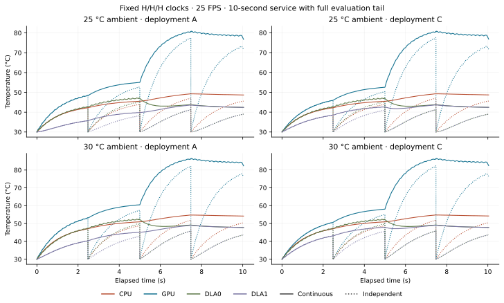
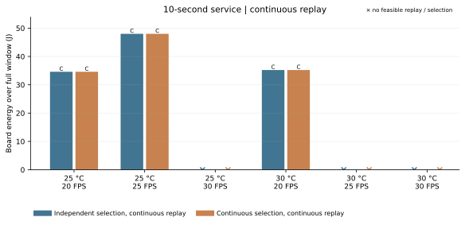
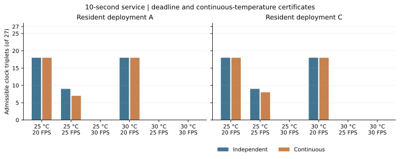

# Kim 跨场景热感知常驻部署 · 首次合成实验

**同一动作的热安全和能耗估计受场景热历史影响，最终选出的部署和频率没有改变。** 40 个预定条件中，两种方法在 24 个条件选出同一可行方案，均为部署 C；其余 16 个条件，两种方法的 54 个候选均无一同时通过期限及温限。24 个有解条件逐一连续重放，选策带来的整板节能均为 **0 J**。独立场景评价接受过 19 个在真实连续**模型轨迹**中超温的配置。结论只针对这组透明合成条件。

## A · 平台是否正确、完整且可复现

预实验提交 [6bad679a](https://github.com/YBEMR/paper/commit/6bad679a3992ced1e7ce3f04b6e693be74a4b6ed) 直接基于输入冻结 [2084947a](https://github.com/YBEMR/paper/commit/2084947a67118c92e7f389c1e1dfa43c3fd2e246)。在查看首个 A/C 比较结果之前，已提交动力学、全部输入、运行器、选择方法、并列规则和初始测试。[协议](protocol.md) · [冻结哈希清单](freeze_manifest.json) · [参数来源及绝对尺度](parameters.md)

应用是 YOLOv2、YOLOv2tiny、YOLOv3tiny、YOLOv3。A 的 YOLOv2 为 DLA0[0–29]→GPU[30–53]，C 为 DLA0[0–29]→DLA1[30–40]→GPU[41–53]；另三网完全共用部署。A、C 分别常驻 3、4 个 DLA 阶段。根据参考图在 256×256 下传播张量尺寸，计算卷积 MAC 和访存量，通过同一组合成服务率产生阶段时间；两部署完成同样的计算。27 个三域恒定工作点对两部署完全开放，两枚 DLA 分别执行，共享频率设定。时钟从首请求前固定至整窗结束。

CPU 预后处理、GPU、两个 DLA 和交接资源分别进入离散事件队列。请求即使逾期或超过尾窗，也执行到结束并保留记录；能耗始终只积到同一个评价窗终点。热模块复用 V1 的对称特征分解，解析积分四个独立节点的常系数动力学和温度漏电。连续峰温用事件内上下界判定；本次所有节点报告界宽最大为 0.00050°C，无未决判定。这个数表示数值包络精度，不代表平台物理误差。

27 项单元与协议测试通过，含零负载、恒功率解析解、独立矩阵指数积分、端点安全而内部超温、资源竞争、阶段先后、迟到请求排空和离散事件的独立逐时钟核验。冻结短窗首先执行固定 H/H/H，两套动作的四条回归记录与枚举逐项一致。结果审计展开 486 条不同资源时序，复核 244,296 条请求记录及 1,648,998 次阶段执行；这是跨时序累计的审计数。两种方法共 48 次选中方案的独立连续重放全部一致。另一次在同机、同栈、独立空目录的完整复跑得到 16 个逐字节相同的结果文件，包括所有事件分片、候选、选择、热轨迹和物理重放。没有新增参数点。[测试代码](test_thermal.py) · [短窗固定频率原始值](raw/fixed_HHH.csv) · [完整性核验](raw/validation.json) · [复跑核对](raw/reproduction.json)

## B · 热继承改变了哪些结果

25 FPS 为主要帧率。短窗发出 8 个请求，10 秒和 20 秒分别发出 500 和 1000 个。各窗另含 40 ms 尾段。表中为基准热阻、温度漏电开启，初温固定四节点 30°C。可行数以 54 个部署–频率动作为分母；物理能量取最终选中方案重新运行的完整板能耗。LHL 表示 CPU 低、GPU 高、两枚 DLA 低。

| 服务窗与环境 | 独评 / 连评可行数 | 两种方法选择 | 独评分数 J | 连续物理能量 J | 连续峰温 CPU / GPU / DLA0 / DLA1，°C |
|---|---:|---|---:|---:|---|
| 短窗，25°C | 18 / 18 | C–LHL | 0.810354 | 0.813247 | 30.66 / 35.13 / 30.37 / 30.10 |
| 短窗，30°C | 18 / 18 | C–LHL | 0.810698 | 0.814437 | 31.56 / 35.84 / 30.97 / 30.75 |
| 10 s，25°C | 18 / 15 | C–LHL | 47.203695 | 47.996293 | 40.20 / 77.53 / 37.88 / 37.83 |
| 10 s，30°C | 0 / 0 | 均无可行选择 | — | — | — |
| 20 s，25°C | 18 / 14 | C–LHL | 94.307536 | 96.384806 | 40.22 / 77.60 / 39.36 / 38.01 |
| 20 s，30°C | 0 / 0 | 均无可行选择 | — | — | — |

主条件 C–LHL 的 500 个请求均在 40 ms 内完成；最坏响应 34.504348 ms，最小裕量 5.495652 ms。两种评价只切换场景入口温度，工作点和服务时间固定，同一动作的期限及各阶段忙时完全相同。模型内热历史通过漏电或热上限起作用，未加入温度导致的自动降频。在 30°C、10 秒主帧率，仍有 18 个动作通过期限，但这些动作中最低的连续 GPU 峰温也有 83.0591°C，超过 80°C。低能耗的失败记录保留在明细中。

**两个帧率反例。** 20 FPS 基准在两个环境、三种窗口和两种漏电设置下，均选 C–LML；10 秒、25°C 和 30°C 开漏电的整板能量分别为 34.6010、35.2101 J。30 FPS 的全部 12 个基准条件均无解。以 10 秒为例，在 54 个工作点和部署中，即使取最大的最坏期限裕量，仍是 −0.209786 ms。该失败已能由合成服务时间解释。Kim 的 32 FPS 原实验使用原引擎、频率与调度体系，不能用本模型的失败推翻原文结果。[全部 40 组结果](decisions.csv) · [4320 行原始评价](raw/candidates.csv)

### 主条件资源和能量账

以下取 10 s、25 FPS、25°C、C–LHL 的连续物理重放。共同计能窗 10.04 s；八个 CPU 核的忙闲按核秒求和，其余为单资源秒。参考待机项持续覆盖忙、闲与尾窗。漏电列仅计高于 25°C 参考截距的增量。最后一列为该项整窗能量除以 10.04 s。

| 资源 | 忙 / 闲 | 参考待机或公共基准 J | 活动增量 J | 温度漏电增量 J | 窗均功率 W |
|---|---:|---:|---:|---:|---:|
| CPU，8 核合计 | 1.57164 / 78.74836 核秒 | 6.024 | 0.44746 | 0.46578 | 0.69096 |
| GPU | 4.56032 / 5.47968 s | 9.036 | 20.52146 | 2.64807 | 3.20772 |
| DLA0 | 2.72121 / 7.31879 s | 1.255 | 2.00883 | 0.16740 | 0.34176 |
| DLA1 | 1.29085 / 8.74915 s | 1.255 | 0.95292 | 0.14951 | 0.23480 |
| 交接资源 | 0.08810 / 9.95190 s | 0 | 0.05286 | 0 | 0.00526 |
| 板级公共项 | 整窗 | 3.012 | 0 | 0 | 0.30000 |

所有动作及失败项的各逻辑核/设备忙闲、分项焦耳与终温均在原始 CSV 中。按行用对应的 window_s 除各能量项即可得平均瓦数。完整事件与超期后完成记录可逐请求解码。[资源与热积分原始明细](raw/candidates.csv) · [选中方案的连续重放](raw/physical_replays.csv) · [原始事件归档](raw/ledger/manifest.json)

## C · 哪些效应能归因于热历史

- **候选的安全误判可以归因。** 2160 个相同条件、相同部署和频率的配对中，41 个由独评安全变为连续超温，反向变化为 0。其中 22 个本已逾期，另 19 个通过期限，因而是实际可行集合的损失，集中在 4 个条件。以主条件的 C–HHH 为例，GPU 峰温从独评 77.5527°C 变为连续 80.7730°C，候选从可行转为超温。两条时序和处理量完全相同。
- **能量修正和实际节能应分别计量。** 主条件同一 C–LHL 的连续能耗比独评多 0.792598 J，20 秒时多 2.077270 J。由于两种方法都选中它，对同一物理任务获得的节能仍为 0 J。主条件的 A 与 C 各自最优工作点都是 LHL，连续能耗分别为 48.767992 和 47.996293 J；0.771699 J 来自部署差异，两种方法均可利用。1080 组同频对照保留两部署比较，不以额外频点覆盖解释热收益。[分部署结果](deployment_choices.csv) · [全体同频对照](matched_frequencies.csv)
- **关闭温度相关漏电后**，每个固定动作的连续和独评能量完全相同，温度及温限仍受历史影响。10 秒、25 FPS、30°C、关漏电时，独评 18 个可行，连续 12 个；两者仍选 C–LHL，物理能耗 44.5655 J。相同环境、同窗开漏电后两者均无解。只改变漏电设定，没有更换任务或放宽限温。
- **散热不确定性会改变可行集合。** 10 秒、25 FPS、开漏电，将全部热阻预设为 0.8 / 1.0 / 1.2 倍时，25°C 的连续可行数为 18 / 15 / 0，30°C 为 18 / 0 / 0。两种方法在有解点仍选同一方案。三个样本约束的是这些离散点，无法定位真实设备的临界热阻，也不支持推广到任意平台。







## D · 是否出现需要 MILP 或启发式的计算困难

本轮每个条件只有 2×27=54 个动作。各评价都穷举了全部 54 个；在这个有限动作空间，得到的最小可行板能量可逐行复核。两种方法的搜索能力、可见工作负荷及预算一致。486 条跨温度条件共用的资源时序足以覆盖整批。此次机器上固定频率 CSV 写出到完整枚举和归档结束约 20 秒（文件时间差，仅作量级参考，不含单元测试、首次初始化、绘图和独立重放）。没有观测到需要 MILP 或启发式来替代枚举的计算困难。

**研究判断：保留连续热复核用于候选安全性筛查，当前不开发新的求解算法。** 本轮没有观测到提前考虑热历史带来的部署选择节能；也没有证明其他负载、设备或控制粒度一定无收益。若后续论文要讨论实际端侧平台，优先明确时序模型、温升和阈值的适用范围，以及温度是否实际改变服务速率。目前为静态服务时长、独占 FIFO、近似共享交接成本、合成板基准及热阻；没有实机标定、真实推理精度验证、多副本设备测量或不同硬件之间的绝对值拼接。

## 复现

从该结果提交检出整个仓库，Python 3.12.4 及固定包版本见 [run.json](raw/run.json)。在本目录执行下列命令。若需保留分支自带的原始结果，可在另一个检出目录复跑。Linux/macOS 也可将 BLAS/OMP 线程数设为 1；本次逐字节复核使用相同 Windows 数值栈。

```sh
python -B -m unittest discover -v
python -B run_experiment.py --freeze 6bad679a3992ced1e7ce3f04b6e693be74a4b6ed
python -B analyze_results.py
python -B figure_layout.py
python -B run_experiment.py --freeze 6bad679a3992ced1e7ce3f04b6e693be74a4b6ed --replay-decisions decisions.csv
python -B check_results.py
```

[计算图、时长和功率生成器](profiles.py) · [离散事件派发](events.py) · [四节点热积分](thermal.py) · [实验条件](experiments.json) · [独立结果核验器](check_results.py)
