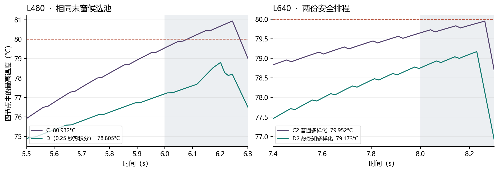

# M1 瞬态热容量联合配额小规模机制验证

2026-11-26　｜　4 个确定性开发工况　｜　20 次搜索　｜　80 份终端认证记录，54 份不同物理排程

**最明确的正证据在 L480。** 普通搜索和热引导搜索面对相同的 79 个末窗合法候选。四次认证预算内，普通参考能耗排序全部超温；将同一 1 秒动作窗内的热积分细化至 0.25 秒后，热引导搜索第 2 次认证就找到 SAFE，四次中有三次 SAFE。**两个优先长工况没有显示热引导的净节能优势。** L640 上普通多样化搜索给出了本批最低安全能耗，L800 上五种方法均未找到 SAFE。建议继续检验热容量参与候选生成的价值，把普通多样化搜索保留为强对照。

## 1　同预算下的完整结果

每格给出「SAFE 份数/4；最佳 SAFE 完整能耗」。没有 SAFE 时列出四份证书中最低连续峰温上界。各列的四份均来自不同物理排程。不同方法可能选中同一排程，表中份数只用于描述本次选择。

| 工况 | C 普通多配额 | D 1 秒热近似 | D 固定 0.25 秒热积分 | C2 普通多样化 | D2 热感知多样化 |
|---|---|---|---|---|---|
| L640 | 0/4；80.983°C | 0/4；80.983°C | 0/4；80.983°C | **1/4；39.024095 J** | 1/4；39.695234 J |
| L800 | 0/4；80.737°C | 0/4；80.721°C | 0/4；80.740°C | 0/4；80.759°C | 0/4；80.496899°C |
| L320 | **4/4；18.809844 J** | **4/4；18.809844 J** | **4/4；18.809844 J** | 1/4；18.821557 J | 4/4；18.844522 J |
| L480 | 0/4；80.851°C | 0/4；80.851°C | 3/4；29.603372 J | 0/4；80.965°C | **2/4；29.591439 J** |

原核另对 C2 的四份终端排程给出 OUT_OF_MODEL，每例各一份，峰温越出 100°C 模型有效上界，均未计入安全结果。其余非安全排程均为 HOT。本批无未决、无超时；80 份终端记录均完成全部请求，满足各自硬期限。[逐工况汇总](data/audit/summary.csv) · [80 份证书指标及能耗分解](data/audit/terminal_certificates.csv)

## 2　模型、实现与公平性审查

- 保持 P1 固定资产、原 1 倍热容、四节点耦合、35°C 环境及其空闲平衡初态、80°C 连续温限、300 ms 硬期限和 301 ms 末段。所有方法每 1 秒决定一次 GPU/NPU 频档和分给 NPU 的 A/B 配额，保留完整 pre/main/post、CPU 低档、非抢占、原切换成本和外部公共功率。
- C/D 共用每父前缀 30 对频档及相同配额集合，即时间平衡点、参考忙态能耗最低点和各自的四个一阶邻点。每个频档对最多 10 个候选。相同映射去重，每窗全局保留 4 个前缀。C 按 35°C 参考能耗排序，D 保留参考能耗第一名，其他位置按预计热可行性与参考能耗选择。单步预测来自当前候选实际忙、闲、切换事件的加权功率与斜率，以及父前缀的四节点温度。原核认证使用完整时间轴，独立重建事件。
- 修正了跨窗空闲控制的一个歧义。如果上一决策边界已经过去，当前决定不能回到前一窗安排降频。所有方法共用这一限制。E0 中七个历史样本在该规则下仍得到相同的计划哈希。跨窗的在途任务、排队 post、当前 OPP 和温度均继承。最终认证另外核对热引导选中路径的递推结果与全程事件。
- 每方法每例使用同一单核、300 秒、4 个前缀和 **4 次全程认证**。完整记录 109,619 次提案及 108,959 次 FIFO 试排。逐一核对 12 组配对比较的共同父前缀，共 51,264 项子动作比对一致。分歧后不同父前缀可产生不同的实际提案数。首轮 C/D 四例的实际 FIFO 次数也逐项相同。所有认证均在上限内结束。[配对动作核对](data/audit/paired_permissions.csv) · [首次前缀分歧](data/audit/first_divergence.csv)
- 首轮与改进轮分别在运行前保存代码和任务书哈希。改进轮只依据 L640、L800 的首轮失败设计，规则冻结后才打开 L320、L480 的搜索结果。四例都属于开发诊断。各方法每例只计时一次，表中秒数包含本机开销，可用于核对 300 秒上限。完整耗时还包括终端证据保存和一致性核查。[初始任务书](诊断任务书.md) · [改进轮任务书](改进轮任务书.md)

原 1 秒 D 的变化限于排序。D2 同时使用固定细积分、低风险前缀保留和一步持续负载外推，C2/D2 的差异只能归于这组热风险信息的整体作用。L480 的同池 C/D-quarter 比较提供了更窄的归因。当前母池只在两个非热中心附近生成配额，因此这次直接检验的是热容量引导筛选；热边界直接生成新配额的价值仍需另测。

### E0 校验

第一次核对检出了新统计程序误用 CPU post 功率画像计算 CPU pre 的错误。按冻结画像纠正后，原 L640、L800 Q4 证书及五份历史重放证书均复现，计划哈希、状态一致，能耗差小于 10⁻⁸ J，峰温上界差小于 10⁻⁶°C。恒功率、恒斜率的四节点矩阵传播与原积分核末温差小于 10⁻⁹°C。对七份计划独立检查了跨窗事件、实际占用时间及热连续性。

61 个归档观察窗中，以真实入口温度传播时，四节点窗末绝对误差均值为 0.0471°C，最大为 0.7656°C。以递推入口传播时分别为 0.0526°C 和 0.6730°C。比较递推末温与连续窗内峰温，有两个尾段漏判。L640 临界候选尾段末温估计 78.507°C，窗内实际峰温上界 80.032°C；L800 细分候选为 79.226°C 和 80.441°C。由此触发预先约定的固定 0.25 秒热积分，决策次数和动作空间保持一致。[逐窗原始数据](data/e0/window_calibration.json) · [模型与证据核验](data/audit/verification.json)

## 3　为什么会出现这些结果

**L480 给出了同池、同认证次数的直接证据。** 三种首轮方法前五窗均留下相同的前缀集合，末窗共有相同的 79 个合法排程。普通 C 选择的参考能耗第一名配置为 GPU/NPU 档位 (5,1)，NPU 配额 (30,0)。原 D 预测其峰温为 79.156°C，细化热积分预测 80.738°C，原核给出 GPU 峰温 80.932°C。两种热模型在同一计划上跨过了不同侧的筛选阈值。

细化后第 2 次送验的候选采用 (4,2) 档与 (32,1) 配额，热点移至 NPU。该计划在共同池中按参考能耗排名第 **16**，连续峰温上界 **78.805328°C**，最小期限余量 **2.0 ms**。它与第一名来自不同的已保留父前缀，归因对象是完整候选的排序。历史 L480 容量构造已有 **28.310781 J** 的 SAFE 证书，本轮最佳热引导解 29.591439 J 仍高 1.280658 J。本例支持有限认证预算下发现安全候选的能力。[两份计划在共同池中的排名与证书索引](data/audit/L480_common_pool.csv)

**L640 暴露了前缀淘汰问题，也验证了普通强基线。** 首轮第 7 窗，固定 0.25 秒热积分的合法候选中最低预计峰温约 77.17°C，但保留的四份均约 79.62–79.73°C。只要预计未超限，原规则就继续优先压低参考能耗。到最后一窗，幸存路径全部超温。

改进轮仍用四个位置，分别保留低耗、早排空、低风险和三项折中的前缀。C2 用设备工作量表征风险，D2 用四节点当前热态和持续负载外推表征风险。C2 第 1 次认证即得到 39.024095 J、79.952117°C，最小期限余量 5.033 ms。D2 第 2 次认证得到 39.695234 J、79.173166°C，期限余量 26.1 ms。D2 降低峰温 0.779°C，多消耗 0.671138 J（1.72%）。C2 相对已有 40.016292 J 安全参照节省 0.992197 J（2.48%），热引导没有额外降低安全能耗。两者各完成 4 次认证，FIFO 次数分别为 6,330、6,321，本机总耗时 1.83、4.81 秒。

**L800 仍有缺口。** 首轮 D 最低峰温 80.720586°C，改进轮 D2 降至 80.496899°C，但仍超过温限 0.496899°C。该计划在 D2 中的预测峰温为 80.230°C，连规划近似也判断超温。仅校正事后证书阈值无法恢复它。既有 1 秒细分候选曾达到 80.441011°C，同样为 HOT。现有结果只能界定本候选生成、前缀宽度和四次认证预算的表现。L320 三种首轮方法则选择了相同的四份计划，热排序没有改变决策或能耗。



图中曲线来自原核事件端点，图例数值取连续证书峰温上界。灰区为 301 ms 末段。L480 的超温发生在最后一次配置决定之后，L640 的两份 SAFE 计划具有不同的能耗和温度余量。

## 4　下一步建议

1. **优先诊断 L800 候选是否覆盖热容量边界。** 固定少量已保存的高负载入口，按相同频档对比较当前双中心邻域与完整整数配额格点。记录满足期限的安全配额距现有候选最近有几步，以及它是否在后续窗仍可延伸。局部枚举用于区分“未生成”“被提前淘汰”“进入候选但未送验”，其额外认证单列为诊断成本。
2. **若发现邻域覆盖不足，再改进配额生成。** 从四节点瞬态功率约束的边界生成整数配额，把时间平衡点、低参考能耗点和热边界点并入共同动作池。热引导与普通对照同样有权挑选这些动作，再匹配认证次数及时间预算。保留 C2，并把“热边界生成”和“热排序”分开消融。
3. **分别判定安全覆盖与节能。** 预先记录首次 SAFE 的认证序号、达到指定安全能耗的耗时、相对同工况最优已知 SAFE 的差额。L480 适合验证排名机制，L640 用 39.024095 J 的普通搜索解检验节能，L800 用于检验能否首次跨过 80°C。增加认证预算时报告整条预算曲线。暂以固定 1 秒决策窗继续研究 M1。

## 数据与复现

原始输入在 `inputs/`，冻结源码与物理画像在 `frozen/`。每个工况、方法目录均有 `trials.csv.gz`（全部候选及淘汰原因）、`beam.json`（保留前缀及配额路径）、`result.json`（顺序与计时）和 `evidence/`（完整调度、连续证书、事件与温度轨迹）。`data/e1/` 为首轮，`data/e1b/` 为改进轮。原提交身份为 P1 `be641ce06a4f496d2b1f233a09bdfc3776738668`。

交付包同时附带两份源 ZIP。解压后使用 Python 3.12.4、NumPy 1.26.4、SciPy 1.13.1、Numba 0.61.2、psutil 和 Matplotlib。进入实验目录后，可在一个尚不存在的新目录完整复现。程序会逐例核对终端计划哈希、认证顺序与状态，不覆盖本次证据。

```powershell
python -B reproduce.py "F:/M1_reproduction_new"
```
