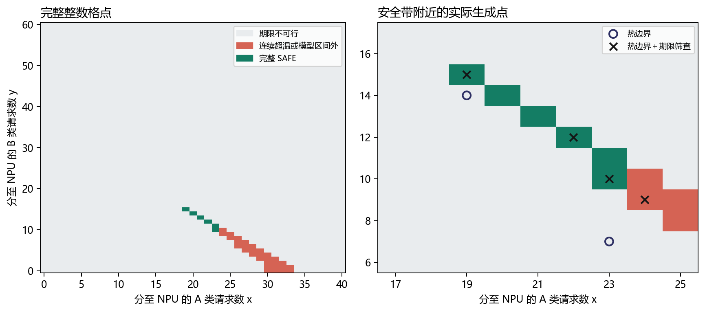

# M1-b　瞬态热容量驱动的配额生成

**L800 找到了从空前缀生成的完整 SAFE 排程。** 热边界生成配合热排序，在第 2 次连续认证得到 **49.601232 J、79.292221°C**，800 个请求全部完成，最小硬期限余量 **5.333 ms**。只使用非热时间几何生成、保持同一热排序，也找到 49.730450 J 的安全解。两者差 **0.129218 J（0.260%）**。热边界生成配普通排序在该工况未找到 SAFE。全部能耗均为固定服务量、含 301 ms 末段的系统能耗。

## 1　L800 的失败发生在哪里

选用旧 M1 已保存的三条路径。冷入口取 D2 第 2 份终端计划的祖先，普通入口取 C2 第 1 份的祖先，已热入口取 D2 第 1 份的祖先。每个被检窗口遍历 10 个 GPU 档、3 个 NPU 档、41 个 A 类 NPU 配额和 61 个 B 类 NPU 配额，共 **75,030 个动作**。表中“安全”均指延伸至完整 10.301 秒仍获原核 SAFE。第 8、9 窗改变当前动作时，后续请求重新排时，但后续的配置取表中指定的延伸方案。

| 入口和后续配置 | 第 8 窗：时序合法 / SAFE | 第 9 窗：时序合法 / SAFE | 第 10 窗：时序合法 / SAFE |
|---|---:|---:|---:|
| 普通 C2，沿用原后续配置 | 2,159 / 0 | 2,022 / 0 | 2,097 / 0 |
| 冷 D2，沿用原后续配置 | 2,850 / 0 | 3,414 / 0 | 3,333 / **6** |
| 同一冷 D2，末窗改用新认证的低耗配额 | 2,269 / **7** | 2,653 / **7** | 同上 |

- **安全配额未生成。** 冷入口末窗的 6 个 SAFE 全部位于 GPU/NPU 频档 (4,1)，原生成器漏掉全部 6 个。最低能耗为 **50.231147 J、79.992460°C**，NPU 的 (A,B) 配额为 (23,10)。该值只对这个固定入口和所枚举的末窗动作有最小值含义。
- **已生成但被淘汰。** 沿用新安全末窗时，第 8、9 窗各有 1 个历史上生成过、但当时被移出束的动作可形成全程 SAFE。其中第 9 窗 (4,1,29,4) 的全程证书为 50.239904 J、79.999271°C。两个窗口各另有 5 个安全动作原先未生成。
- **前缀已保留，但这条完整后缀未认证。** 第 8、9 窗各有 1 个这样的动作。从原保留前缀接上新末窗即可得到 50.231147 J 的见证。历史搜索认证过同一前缀的其他后代；末窗原来实际保留的四份终端计划也全部送过认证。三者可由物理计划哈希区分。
- **入口没有安全后缀。** 普通 C2 第 10 窗对全部 75,030 个末窗动作检查后，时序合法的 2,097 个均未通过热安全。另一条已热 D2 路径在第 8、9、10 窗入口之前分别已经达到至少 80.245、80.648、80.995°C，后续任意动作都无法消除既有违规。对于第 8、9 窗只改变一个窗口而得到的零结果，结论仅限当时固定的其余后续配置。

[逐入口计数](data/audit/diagnostic_counts.csv) · [完整格点记录与证书](data/diagnostic/) · [安全末窗动作的原核复核](data/diagnostic_checks/) · [跨窗后缀复核](data/recovered_checks/)

## 2　热容量如何生成整数配额

每个前缀及频档对选三个互不共线的校准配额，占用原有的试排名额。由实际 FIFO 事件取得四节点在各积分区间的忙态、驻留、切换参考功率和温度功耗斜率。以时间平衡点的斜率冻结系统矩阵，另外两个校准点的斜率差按参考轨迹折算为功率。用这三个点拟合每段关于两个配额的仿射功率。

令 θ=T−35，D 为冻结节点热容对角阵，G 为热导矩阵。对每段 h，由 A=D⁻¹(diag β−G)、F=exp(Ah)、H=∫exp(As)D⁻¹ds 得到 θ_out=Fθ_in+H p(x,y)。从父前缀温度递推后，每节点、每个检查时刻给出一条关于 (x,y) 的线性温度约束。逐个取整数 x，以这些约束计算 y 的上下界，在边界附近取整，再按预计能耗、热余量与覆盖程度分配有限名额。因此即使后续只用普通排序，温度仍可改变送入试排的具体配额。校准有效性、误判和完整峰温都由冻结的 P1 连续核另外检查。

普通生成沿用 Q4 时间平衡点、参考能耗中心及相邻点。非热几何生成保留相同的三个校准点、取点数和排序程序中的能耗/覆盖规则，仅使用时间约束及负载风险。热边界生成使用四节点约束。普通排序沿用 C2，热排序沿用 D2。所有方法每 1 秒才改变配置；0.25 秒和末段 0.05 秒是热计算网格。CPU 前后处理、跨界 FIFO、1 倍热容、80°C 温限、300 ms 期限、服务量、初始温度和全窗计能均沿用 M1。

## 3　生成与排序的配对结果

下表为从空前缀开始、每窗最多 4 个前缀、每例 4 次全程认证的最低 SAFE 能耗（J）。横杠表示四次认证均无 SAFE。

| 生成 / 排序 | L800 | L640 | L480 | L320 |
|---|---:|---:|---:|---:|
| 原生成 / 普通 C2 | — | **39.024095** | — | **18.821557** |
| 原生成 / 热排序 | — | 39.695234 | 29.591439 | 18.844522 |
| 非热几何 / 普通 C2 | — | — | 29.324921 | 19.486489 |
| 非热几何 / 热排序 | 49.730450 | 39.854117 | **29.280115** | 19.377194 |
| 热边界 / 普通 C2 | — | — | 29.392239 | 19.486489 |
| 热边界 / 热排序 | **49.601232** | 39.677404 | 29.311159 | 19.377194 |

**L800 的归因有边界。** 固定热排序，增加热容量约束比非热几何生成少耗 0.129218 J；固定热边界生成，从普通排序换成热排序则从无 SAFE 到有 SAFE。两种几何生成的束在第 1 窗就出现差异。沿 49.601232 J 的实际优胜路径，逐窗固定完全相同的父前缀重新生成，10 个入选动作也都在非热几何生成器的动作池中。因此观察到的是候选集合变化在有限束搜索中的整体效果，尚不能把这份 L800 安全解归于某一个只有热边界才能生成的动作。L480 优胜路径第 5 窗的 (3,0,26,5) 则确实只被热边界生成器提出，但该工况非热几何的最低能耗更低。[逐窗动作来源](data/audit/winning_paths.csv)

**预算扩展对照。** L800 的普通 C2 在（束宽，认证数）分别为 (8,4)、(4,8)、(8,8) 时均无 SAFE，最低连续峰温分别为 80.757、80.743、80.737°C。L480 的普通 (8,8) 找到 **28.879164 J**，优于上述所有 4/4 从零热搜索，但比历史 28.310781 J 高。L640 的普通 (4,8) 保留了 39.024095 J，宽度增至 8 的两组均丢失该解。L320 的普通 (4,8) 和 (8,8) 均取得 **18.809844 J**。扩大束后中间保留的集合会变化，不能假定较宽搜索一定包含较窄搜索的完整路径。

**实际代价。** L800 普通 C2、非热几何加热排序、热边界加热排序分别用时 2.33、9.07、11.33 秒。后者有 8,086 次提案、8,035 次 FIFO 调用，其中 3,330 次为纳入试排名额的校准调用。L320 上热边界加热排序耗时 3.58 秒，普通 C2 为 0.79 秒；其最佳安全能耗还高 0.555638 J。各方法均受单核 300 秒上限，绝对时间来自本机单次测量。[全部运行成本和预算](data/audit/case_summary.csv) · [终端证书明细](data/audit/terminal_certificates.csv)

## 4　已知安全解的质量复查

另以相同安全排程为初解，三种生成器分别尝试单窗替换，各认证 4 次。初解不进入从零搜索。L640 三种生成器都未严格改善 **39.024095 J**。普通生成送验的最接近者为 39.024195 J，仍高约 0.100 mJ。L480 的普通生成将第 2 窗替换为 GPU/NPU (0,0)、NPU 配额 (26,0)，完整安全能耗由 **28.310781 J 降至 28.304177 J**，峰温 77.379438°C，约节省 6.605 mJ。两份能耗证书区间严格分离。非热几何和热边界在这轮各自四次认证中均未改善历史解。[安全初解复查原始数据](data/incumbent/) · [逐项认证](data/audit/incumbent_certificates.csv)

## 5　边界配额漏选后的修正

对同一冷前缀、同一档位、同一候选名额再查一次。原热模型对六个已证安全配额的预计峰温为 79.705–79.938°C，全部判在边界内，但稀疏取点没有选中其中任何一个。相邻的 (19,14) 被取中后却迟到 12.7 ms；(19,15) 的实际期限余量为正 1.4 ms。误差同时来自整数采样与粗略时间约束，单纯加严温限会误删安全点。

保留校准和热模型，在几何边界两侧各增加一个整数邻点，用逐请求 main 完工加最短必要 post 时间筛查，再决定送入完整 FIFO 的有限配额。修正后的 H 在此固定入口生成了 **3/6**，包括最低能耗 (23,10)；相同修正的非热几何只生成 **1/6**。H 选中的三点均未被对应的非热几何选中。从空前缀开始时，修正后的热边界加热排序在 L800 四次认证却均为 HOT，最低峰温为 **80.302634°C**，用时 25.57 秒，共做 306,818 个廉价时序筛查，另有 8,054 次完整 FIFO。这说明同一入口的配额覆盖提高，并不能保证从零搜索保留了能到达该入口的前缀。

修正后热边界加热排序在 L640、L480、L320 的最低 SAFE 能耗分别为 40.422021、29.130651、19.473507 J。L480 较修正前 29.311159 J 下降，仍高于历史安全计划。L800 修正后非热几何加热排序仍找到 50.084248 J 的 SAFE。此阶段使用了已经看到的 L800 反例，属于开发性修正。[修正前逐点预测与覆盖](data/audit/archived_prefix_recall.json) · [修正后逐点覆盖](data/audit/screened_prefix_recall.json)



图固定 GPU/NPU 频档 (4,1)。左图展示全部 41×61 个整数配额，绿色表示可以延伸到全程终点的安全排程。右图放大安全配额附近，叠加修正前后的热边界采样点。初始温度与之前九个窗口的计划完全相同。

## 6　结论与下一步

1. **保留两个独立判据。** 固定父前缀时，以连续认证的安全配额召回数和最低 SAFE 能耗检验生成器；从零搜索时，考察每个窗口是否仍有至少一个能安全延伸的前缀。L800 同时出现了“固定入口选中 3 个独有安全配额”和“从零搜索该版本没有 SAFE”，两者需要分别度量。
2. **下一轮先改前缀保留。** 使用本次已获证的 L800 路径做离线回溯：固定每个已保留前缀与其合法候选，检查最后一条可安全延伸的分支在哪个窗口被挤出。比较在四个位置中保留一个原 C2 的低耗前缀、一个具热余量与期限余量的前缀，以及现有规则。在同一候选池、束宽、认证次数下计量，另给真实耗时。完整整数枚举继续作为局部覆盖参照。
3. **保留质量与代价基线。** L640 继续用 39.024095 J，L480 同时报告历史 28.310781 J 与本次普通单窗修复的 28.304177 J。L320 值得检验只在确有热压力时启用热边界计算，以 18.809844 J 和单位工况时间共同评价。这些检查均可在固定 1 秒决策窗下进行。

## 证据与复现

八个完整格点表共 600,240 个动作位置，20,797 项时序合法，连续热分类未决数为零。诊断重用**同一前缀**的物理入口状态，在变动段重建真实事件并调用冻结的连续积分核。入口数值误差保守取 10⁻⁶°C；P1 系统的无穷范数收缩保证该误差界可向后传播。对 20 个诊断正例位置及 17 个对照另从初始时刻重建整条计划、独立事件账本并调用原 P1 核。52 次从零搜索产生 240 份认证记录，涉及 192 份不同物理排程；安全初解复查另有 24 次认证。312 组方法配对通过同父前缀的动作名额核对。一次运行不作统计显著性或跨机器加速推断。[审计结果](data/audit/verification.json) · [同父前缀名额与动作核对](data/audit/paired_action_audit.csv) · [运行环境](data/audit/environment.json)

基于同一 Git 分支中相邻的 M1 实验目录 `research/m1_transient_thermal_quota_20261126`。算法、诊断、后缀回溯、初解复查和时序修正分别留存协议。入口从 M1 清单验证全部基础文件；原模型、画像、请求与历史证据可直接从仓库读取。复现环境使用 Python 3.12、NumPy、SciPy、Numba、psutil、Matplotlib（本次具体版本记录于审计环境）。在本目录可运行以下命令：

```powershell
python -B audit.py
python -B reproduce.py "F:/M1b_reproduction_new"
```

第一条仅审计已保存材料；第二条在新目录复制冻结资产、重做诊断及搜索并比较终端计划身份。原始资料位于 [完整枚举](data/diagnostic/)、[逐方法试排和连续轨迹](data/search/)、[安全初解复查](data/incumbent/)。完整表中的计数按工况、入口和方法分别统计，同一物理排程可以在多个对照中出现。
