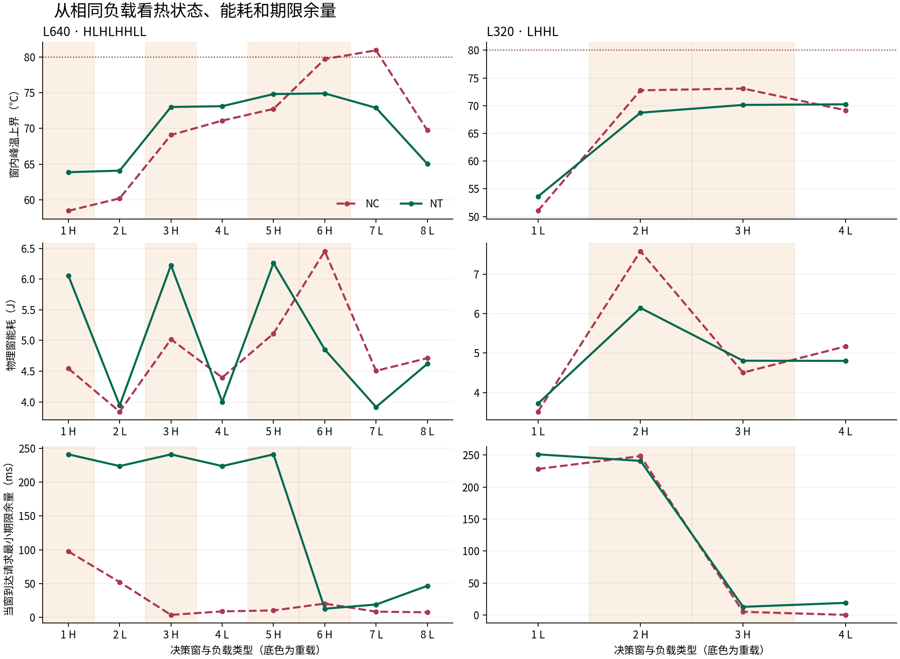

# 从前缀保留到物理结果

**重放两套冻结策略，在十四个工况的第一窗都观察到保留集合变化；只有九个工况最终选择了不同的代表排程。** 旧束宽四、四次认证下，NT 相对 NC 六条节能、五条同一物理排程、三条新增 SAFE。新增 SAFE 的 NC 对照取其已送验四份中连续峰温上界最低者，均为 HOT。因此安全覆盖和双 SAFE 能耗分开统计。这些轨迹解释旧固定规模机制；扩大束宽后产生的新候选另见质量曲线。

## 证据能回答到哪一步

| 检验 | 固定项与干预 | 可作出的判断 |
|---|---|---|
| 归档重放及同池换序 | 核对原档 SHA-256，重建实际候选状态，同父动作、身份、合法性、参考能耗、排空、峰温和原风险逐项吻合。在完全相同的池上分别使用 C/T 风险键重选四席 | 排序改变保留的前缀。每个开窗两条实际路径上，备选的四席、父计划、两种风险、预测进出温度均有记录 |
| 只切换一个中间窗口 | 对 NC 在首次保留集合分叉窗只用一次 T，再恢复全 C；对 NT 做对称操作。每条从空搜索，终端仍四次连续认证，共 112 个送验位置 | 直接检验第一处分叉对最终结果是否足够。三条 NC 未解的次序，在单窗换 T 后仍全部未解；六条节能中有两条在这个单窗干预下已经改善，其余保持原 NC 质量 |
| 交换真实前缀与后缀 | 在全部 90 个内部边界，对已归档的两条代表动作序列构造四种拼接，按照同一 FIFO 与因果空闲控制从空重排。先检查全体请求，再连续认证合法排程 | 180 个异源组合中，112 个 SAFE、19 个 HOT、49 个时序不可行。联合效应含设备积压、频档和温度；物理后缀事件会随前缀改变 |
| 只改变进入后缀的温度 | 在每个边界冻结后缀原始事件及功耗系数，只交换来自两条真实排程的四节点边界温度，用 P1 连续热积分再算。自然边界拆分前后，能量复核误差低于 10⁻⁷ J | 可识别在相同事件下温度继承对后缀能耗及峰温的模型内直接效应。交叉初温不代表能从原请求初态到达，不授予全程 SAFE 证书 |
| 分离改派与调频 | 各窗从一个代表解取 A/B 到 NPU 的整数配额，从另一解取 GPU/NPU 档位，重建整个任务序列。原组合也重放，逐工况共四种 | 给定两组已知动作时，检验改派、调频能否单独达到期限与热安全。属于离线反事实，不能作为 NT 自主求得的能耗 |

在 NC 的首窗单次换序中，9 条的 SAFE 能耗不变，2 条降低，3 条仍未获得 SAFE。对 NT 反向换为一次 C，10 条持平、3 条退化、1 条反而改善。可以归因于某个中间排序动作的变化，不能由此推断“任意窗口热排序都更好”。[逐窗同池换序](data/trace/same_pool_decisions.csv) · [单窗干预及四份证书身份](data/trace/one_window_intervention.csv) · [真实拼接](data/trace/prefix_suffix.csv) · [固定事件温度干预](data/trace/fixed_suffix_temperature.csv) · [配额与档位交叉](data/trace/mapping_frequency.csv)

图中深浅负载按请求到达窗划分。能耗按实际物理时间分窗，末窗含 301 ms 尾段；期限余量按该窗到达的请求计算，包括跨窗完成的请求。频档是 P1 离散 OPP 编号。给定两套方案，“改派”指相同请求的主任务去了不同设备。

## L640 · HLHLHHLL：热继承能改变安全性，也可能付出能耗

NC 的四次送验均未 SAFE；最低峰温上界方案为 80.9621°C。在相同首窗候选池上，C 和 T 的前两席相同。第 3 席从 GPU/NPU 9/2 档、A/B 送 NPU 9/25 个（热延拓风险 106.69°C），改为 2/1 档、12/26 个（62.88°C）。第 4 席从 5/1 档、30/0 个改为 4/1 档、31/0 个；后者成为 NT 最终选中的首窗配置。这里的延拓风险是规划分数。NT 的完整方案为 74.9131°C、39.87496 J。NC 的这一 HOT 方案能耗为 38.58438 J，低于 NT 的安全解；本例没有可计算的双 SAFE 节能率。

| 窗 | 方法 | GPU/NPU 档 | A/B 送 NPU 数 | 边界 GPU/NPU 温度 °C | 窗内能耗 J | 本窗请求最小期限余量 ms |
|---|---|---|---|---|---:|---:|
| 5，H | NC | 4/0 | 30/0 | 72.739/56.658 | 5.113 | 10.3 |
| 5，H | NT | 4/1 | 31/0 | 74.823/66.360 | 6.261 | 240.9 |
| 6，H | NC | 5/1 | 29/1 | 79.735/65.360 | 6.454 | 20.4 |
| 6，H | NT | 3/0 | 31/0 | 72.889/60.751 | 4.852 | 12.8 |
| 7，L | NC | 0/0 | 25/0 | 69.732/61.646 | 4.506 | 8.5 |
| 7，L | NT | 0/0 | 24/0 | 65.026/58.159 | 3.917 | 19.0 |

NT 在第 5 窗实际更热，且消耗了更多能量。第 6 窗相对 NC 有 9 个请求改到 GPU、10 个改到 NPU，留在原设备的 81 个请求均降档。第 6 窗末，GPU、NPU 的温度分别比 NC 低 6.846°C、4.609°C。该窗内较低的频档、不同积压和下一轻载窗的期限余量，是观察到的联合变化。

**只交换温度。** 从第 6 窗末开始保留 NC 的全部后缀物理事件，将初温换为 NT 当时的四节点状态，后缀峰温上界从 80.962°C 降至 75.352°C，能耗从 9.2177 降至 9.1485 J。**实际交换排程。** NT 前六窗接 NC 后两窗重新从空回放，获得完整 SAFE，39.8704 J；NC 前六窗接 NT 后两窗则产生 −26.6 ms 期限余量。将 NC 的全程分配单独配上 NT 档位也能获得 SAFE，39.7761 J；反向组合违反期限。该例支持给定物理状态下的热继承效应，也显示仅靠“设备改派”无法解释成功。

## L320 · LHHL：更大的节能来自后续配置

NC 与 NT 分别为 20.77012 J 和 19.46945 J，均 SAFE，节能 6.262%。第一轻载窗，NC 将 25 个 A、0 个 B 派给 NPU；NT 则为 0 个 A、20 个 B，GPU 档从 0 调到 2。NT 第一窗多用 0.205 J。下一重载窗，GPU/NPU 从 NC 的 5/2 档改为 NT 的 4/1 档；仍在原设备的 87 个请求均降档，窗能耗由 7.5805 降至 6.1428 J。这一窗节省约 1.438 J，已超过前窗付出的代价。

把 NC 第一窗接到 NT 后三窗，完整回放得到 19.2772 J，低于 NT 实际发现的 19.4694 J；NT 第一窗接 NC 后三窗为 20.9614 J。固定 NT 后缀事件，仅换为 NC 第一窗末温度，后缀能耗从 15.7494 降至 15.7323 J，差约 0.0171 J。直接热继承对这一切点的能耗作用较小，观测到的 1.30067 J 总节能主要体现在配置与时序变化。全程只交换配额或只交换频档的两种组合均违反期限（分别为 −328.0 和 −215.9 ms，见交叉表）；两个部件不能在此例任意拆开使用。

## 反向与持平证据

- 对六条共同 SAFE 且节能的工况作描述性加总，NT 相对 NC 的 35°C 参考能耗降低 3.2406 J，温度相关能耗项降低 0.6334 J。前者占总差约 84%，包含执行、空闲、切换等配置影响；后者也会随配置一起改变，这个分解不能替代固定事件的初温干预。
- L640 · LHLLHHHL 的两个代表方案前三个窗口的实际设备配置完全相同，虽然第一窗保留集合已经分叉。L800 · HLHLLLHHLH 等五条最终甚至回到了同一物理计划。出现不同前缀不能自动算成节能。
- L320 · HLLH 上保留 NC 的设备分配、改用 NT 的窗口频档，离线可达 18.25759 J，比 NT 的 18.31290 J 更低；反向组合超期。它是给定已知排程后得到的反事实，未纳入在线曲线。

[14 条代表方案与能耗分解](data/trace/summary.csv) · [逐窗执行、热状态、改派与期限](data/trace/physical_windows.csv) · [实际窗口动作与配置哈希](data/trace/winning_actions.csv) · [可重建的干预配置](data/trace/offline_plans.json.gz)

对照组中的所有时序合法物理计划另存有[完整离线证书](data/trace/intervention_certificates.jsonl.gz)。按工况、计划哈希调用 replay_plan.py 并加 --offline 可复原排程与事件数组。

## 旧固定规模下的全部轨迹

“代表动作首异窗”比较两条最终代表排程，中间保留集合的首异窗在全部工况均为第 1 窗。能耗栏只展示 SAFE；三条 HOT 的能耗与峰温仍可在逐工况原始表中查到。

| 请求数 · 轻重次序 | 代表动作首异窗 | NC SAFE，J | NT SAFE，J | 共同 SAFE 节能率 |
|---|---:|---:|---:|---:|
| 800 · LLHHLHHLLH | 2 | HOT | 47.9948 | — |
| 800 · HHLHHLLHLL | 同计划 | 47.8494 | 47.8494 | 0.000% |
| 640 · LHLLHHHL | 4 | HOT | 38.7683 | — |
| 640 · HLLHHLHL | 3 | 37.8187 | 37.5167 | 0.799% |
| 480 · LLHHHL | 2 | 29.8025 | 28.9938 | 2.714% |
| 480 · HHLLLH | 同计划 | 28.1152 | 28.1152 | 0.000% |
| 320 · LHHL | 1 | 20.7701 | 19.4694 | 6.262% |
| 320 · HLLH | 3 | 18.4986 | 18.3129 | 1.004% |
| 800 · LLHHHLLHLH | 2 | 48.3514 | 48.1439 | 0.429% |
| 800 · HLHLLLHHLH | 同计划 | 46.9425 | 46.9425 | 0.000% |
| 640 · LHHLHLHL | 1 | 39.6362 | 38.5667 | 2.698% |
| 640 · HLHLHHLL | 1 | HOT | 39.8750 | — |
| 480 · LLHLHH | 同计划 | 28.6653 | 28.6653 | 0.000% |
| 480 · HLHHLL | 同计划 | 28.9181 | 28.9181 | 0.000% |
