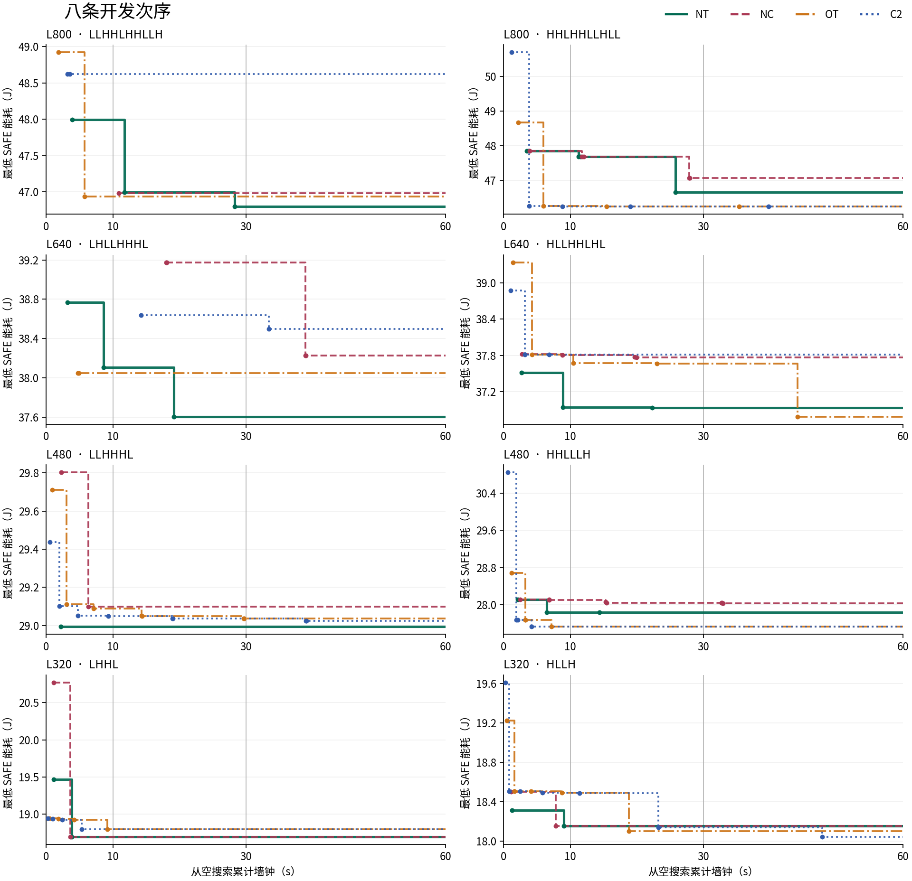
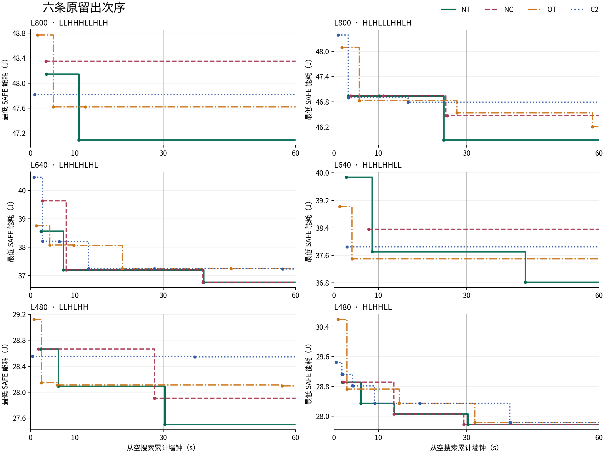

# 逐工况 SAFE 能耗质量

每个工况的四种方法分别从空运行。横轴是单调墙钟秒数，纵轴是截至该时刻已认证 SAFE 的最低能耗（J）。首个 SAFE 之前留白；此后的每个台阶是一次真正完成的改善。原八条开发与六条留出在本轮均是公开样本。图表单元四舍五入，配对胜平负用未舍入值和证书界判断。

## 八条开发次序

每格依次为 **10 / 30 / 60 秒**的最低 SAFE 能耗（J）。“—”表示当时尚无 SAFE。

| 工况（请求数 · 轻重次序） | NT | NC | OT | C2 |
|---|---:|---:|---:|---:|
| 800 · LLHHLHHLLH | 47.9948 / 46.7953 / 46.7953 | — / 46.9819 / 46.9819 | 46.9335 / 46.9335 / 46.9335 | 48.6229 / 48.6229 / 48.6229 |
| 800 · HHLHHLLHLL | 47.8494 / 46.6585 / 46.6585 | 47.8494 / 47.0738 / 47.0738 | 46.2708 / 46.2545 / 46.2522 | 46.2545 / 46.2522 / 46.2517 |
| 640 · LHLLHHHL | 38.1039 / 37.6046 / 37.6046 | — / 39.1743 / 38.2259 | 38.0499 / 38.0499 / 38.0499 | — / 38.6394 / 38.4991 |
| 640 · HLLHHLHL | 36.9413 / 36.9345 / 36.9345 | 37.8094 / 37.7709 / 37.7709 | 37.8182 / 37.6690 / 36.7879 | 37.8182 / 37.8182 / 37.8182 |
| 480 · LLHHHL | 28.9938 / 28.9938 / 28.9938 | 29.0977 / 29.0977 / 29.0977 | 29.0893 / 29.0367 / 29.0367 | 29.0494 / 29.0367 / 29.0241 |
| 480 · HHLLLH | 27.8431 / 27.8424 / 27.8424 | 28.1015 / 28.0463 / 28.0313 | 27.5321 / 27.5321 / 27.5321 | 27.5321 / 27.5321 / 27.5321 |
| 320 · LHHL | 18.6985 / 18.6985 / 18.6985 | 18.6985 / 18.6985 / 18.6985 | 18.7987 / 18.7987 / 18.7987 | 18.7987 / 18.7987 / 18.7987 |
| 320 · HLLH | 18.1501 / 18.1501 / 18.1501 | 18.1501 / 18.1501 / 18.1501 | 18.4923 / 18.1016 / 18.1016 | 18.4923 / 18.1388 / 18.0431 |

## 六条原留出次序

每格依次为 **10 / 30 / 60 秒**的最低 SAFE 能耗（J）。“—”表示当时尚无 SAFE。

| 工况（请求数 · 轻重次序） | NT | NC | OT | C2 |
|---|---:|---:|---:|---:|
| 800 · LLHHHLLHLH | 48.1439 / 47.0899 / 47.0899 | 48.3514 / 48.3514 / 48.3514 | 47.6203 / 47.6181 / 47.6181 | 47.8169 / 47.8169 / 47.8169 |
| 800 · HLHLLLHHLH | 46.9425 / 45.8989 / 45.8989 | 46.9425 / 46.4724 / 46.4724 | 46.8325 / 46.5388 / 46.2110 | 46.8996 / 46.7910 / 46.7910 |
| 640 · LHHLHLHL | 37.2023 / 37.2023 / 36.7646 | 37.2023 / 37.2023 / 36.7646 | 38.0684 / 37.2439 / 37.2379 | 38.1953 / 37.2379 / 37.2274 |
| 640 · HLHLHHLL | 37.7093 / 37.7093 / 36.8224 | 38.3618 / 38.3618 / 38.3618 | 37.5043 / 37.5043 / 37.5043 | 37.8463 / 37.8463 / 37.8463 |
| 480 · LLHLHH | 28.0931 / 28.0931 / 27.5031 | 28.6653 / 27.9050 / 27.9050 | 28.1119 / 28.1119 / 28.0974 | 28.5519 / 28.5519 / 28.5440 |
| 480 · HLHHLL | 28.3461 / 28.0583 / 27.7761 | 28.9181 / 27.7761 / 27.7761 | 28.7253 / 28.3479 / 27.8275 | 28.3479 / 28.3475 / 27.8273 |

## 首次 SAFE、峰温与实际终止时间

各格为 **首次 SAFE 秒 / 60 秒最佳 SAFE 的连续峰温上界 °C / 实际终止秒**。首次 SAFE 包含写盘。截止后才完成的调用保留在账本，排除在能耗曲线之外。

| 工况 | NT | NC | OT | C2 |
|---|---:|---:|---:|---:|
| 800 · LLHHLHHLLH | 3.90 / 77.41 / 60.06 | 10.86 / 77.40 / 60.10 | 1.79 / 76.92 / 60.03 | 3.16 / 78.27 / 60.01 |
| 800 · HHLHHLLHLL | 3.48 / 76.90 / 60.02 | 3.87 / 76.90 / 60.03 | 2.15 / 75.33 / 60.05 | 1.17 / 74.67 / 60.06 |
| 640 · LHLLHHHL | 3.17 / 77.75 / 60.02 | 18.03 / 78.39 / 60.08 | 4.72 / 77.85 / 60.06 | 14.27 / 77.98 / 60.09 |
| 640 · HLLHHLHL | 2.71 / 72.32 / 60.02 | 2.77 / 74.99 / 60.02 | 1.39 / 74.36 / 60.08 | 1.04 / 76.26 / 60.05 |
| 480 · LLHHHL | 2.16 / 75.94 / 60.03 | 2.26 / 78.48 / 60.04 | 0.87 / 78.53 / 60.06 | 0.57 / 78.51 / 60.07 |
| 480 · HHLLLH | 2.12 / 68.24 / 60.01 | 2.48 / 71.34 / 60.03 | 1.16 / 68.27 / 60.06 | 0.58 / 68.27 / 60.06 |
| 320 · LHHL | 1.12 / 72.82 / 60.01 | 1.11 / 72.82 / 60.00 | 0.49 / 72.92 / 60.01 | 0.26 / 72.92 / 60.04 |
| 320 · HLLH | 1.29 / 67.03 / 60.02 | 1.08 / 67.03 / 60.00 | 0.49 / 64.79 / 60.03 | 0.23 / 64.91 / 60.02 |
| 800 · LLHHHLLHLH | 3.53 / 75.97 / 60.01 | 3.48 / 79.15 / 60.07 | 1.52 / 77.64 / 60.02 | 0.90 / 78.50 / 60.05 |
| 800 · HLHLLLHHLH | 3.18 / 74.68 / 60.00 | 3.73 / 79.49 / 60.03 | 1.75 / 74.90 / 60.06 | 0.91 / 79.53 / 60.01 |
| 640 · LHHLHLHL | 2.35 / 72.85 / 60.04 | 2.68 / 72.85 / 60.02 | 1.26 / 73.06 / 60.04 | 0.78 / 72.97 / 60.05 |
| 640 · HLHLHHLL | 2.72 / 73.91 / 60.03 | 7.80 / 77.54 / 60.06 | 1.23 / 79.18 / 60.06 | 2.89 / 75.79 / 60.01 |
| 480 · LLHLHH | 2.16 / 74.85 / 60.03 | 1.73 / 76.40 / 60.03 | 0.75 / 75.12 / 60.05 | 0.39 / 76.72 / 60.03 |
| 480 · HLHHLL | 1.83 / 74.44 / 60.03 | 2.10 / 74.44 / 60.04 | 0.86 / 74.39 / 60.04 | 0.44 / 74.43 / 60.01 |

各观察点的峰温、期限余量、实际送验量、SAFE 证书数、当前解所在束宽、构造及认证耗时、首次 SAFE 和实际停止原因见[168 个截面](data/quality/checkpoints.csv)。按窗口加宽的终端候选池规模见[阶段账本](data/quality/stages.csv)。完整 193 个台阶见[改善事件](data/quality/improvements.csv)，包括未改善及超时认证在内的 21,873 条调用见[全部调用](data/quality/all_calls.csv.gz)。
