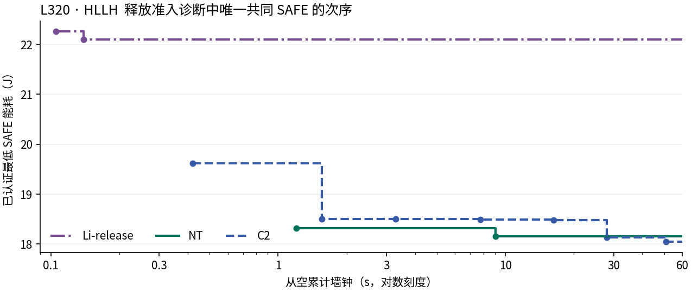
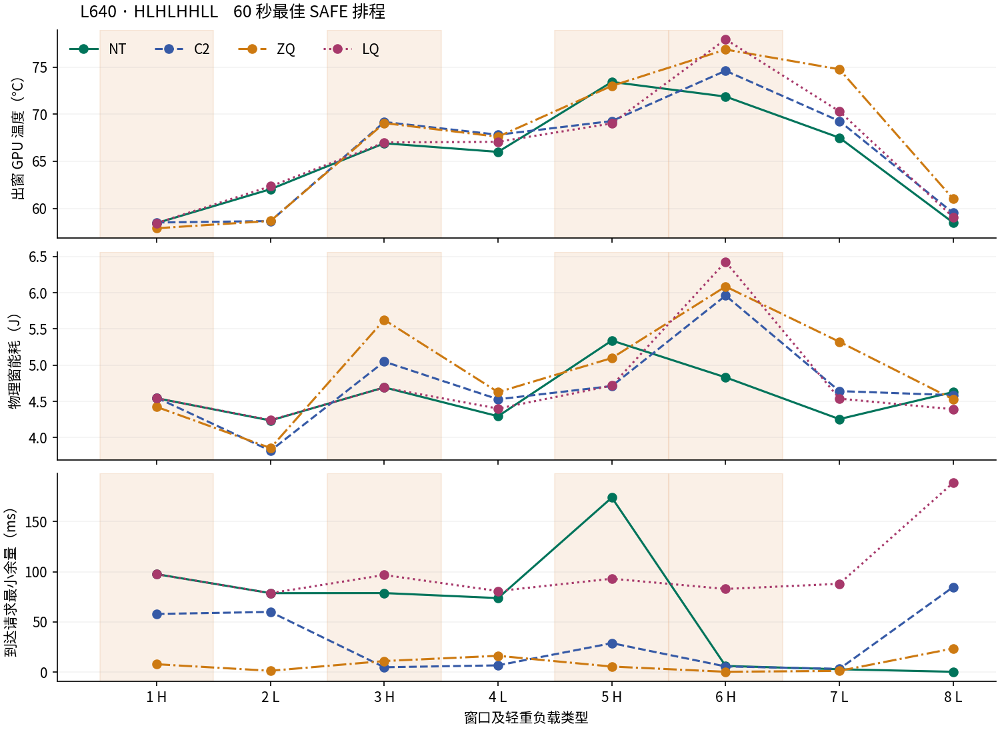

# M1-g 主动热感知调度的文献近邻对照

**建议保留 NT 作为独立研究候选。证据最充分的贡献，是它能在连续热状态、多请求期限和共享设备容量之间找到低能耗的完整排程。** 在这 14 条已公开次序上，NT 全部获得 SAFE；60 秒对原始 C2 为 11 胜 3 负，配对平均节能 1.292%。按原文帧内优先级实现的逐任务 Zhou-P1 和 Li-P1 均在完整构造前失败，因此主试验支持可行覆盖优势，缺少与这两个主版本比较能耗的共同 SAFE 工况。窗口适配和按释放分组诊断有单独身份。

[14 条逐工况表与能耗曲线](results.md) · [两篇原文的步骤、可分离性及适配改动](adaptation.md) · [主比较预登记](https://github.com/YBEMR/paper/blob/48d44aa0736560807f6f7701e50448088b72f99b/research/m1g_literature_comparison/PROTOCOL.md) · [主批次锁定及事后诊断登记](https://github.com/YBEMR/paper/blob/dea3a067f979efd9cbf220b0a5af3ba623054ff1/research/m1g_literature_comparison/RELEASE_CONTROL.md)

## 文献算法的独立构造

主域允许逐阶段设备选择、频档选择、共享 CPU 频域下的并行、空档插入及 Li 的逆序降频移时。所有方法使用相同冻结 P1、完整任务服务、逐请求 300 ms 期限、80°C 上界、初温和尾段。ZQ/LQ 是辅助的同配额适配，另从空构造；NT 与 C2 本轮均重新计时。七条绑核单线程通道并行处理不同工况，每工况每方法各一次，同工况共享同一逻辑核。模型初始化和通用编译预热在计时外，算法专用工作、认证与物理证据写盘在计时内。

| 独立构造 | 自然终点，14 条 | 实际结束时间中位数（范围），s | 终点解释 |
|---|---|---:|---|
| Zhou-P1，逐任务 | 14 条未构成 | 0.402（0.149–0.938） | 完成所有前处理；在主任务层遍历虚拟核后仍有请求未放置 |
| Li-P1，逐任务 | 14 条未构成 | 0.098（0.036–0.227） | 热映射出现无法满足期限的主任务，未进入全程 LFT |
| ZQ，同配额辅助 | 12 SAFE、1 HOT、1 未构成 | 0.690（0.395–1.414） | L480 · HLHHLL 的完整峰温上界为 80.312°C；L640 · LHLLHHHL 未构成 |
| LQ，同配额辅助 | 14 SAFE | 0.995（0.509–1.788） | 14 条的整窗逆序步骤均未取得额外降档，终点等于映射输出 |

小规模先行核验中，两种逐任务方法在 S32 都有完整 SAFE。Zhou 为 2.1321 J，Li 为 2.2280 J；另一个完整高频夹具上，Li 的逆序 LFT 有 67 次实际降频移时，前后均独立认证。另建的 160 请求样本上，两个窗口适配均 SAFE。补验及复算保留相同物理计划；小规模耗时只用于功能记录。[小规模证据](data/pilot.json) · [正式自然终点和失败统计](data/runs.csv)

## 10、30、60 秒累计质量

节能率为共同 SAFE 工况逐条计算的 (对照能耗 − NT 能耗) / 对照能耗，再取算术平均；用完整能量区间判断胜平负。所有观察点只计到点前已完成认证且写盘的解。独立文献方法完成后保持其已得解；没有额外搜索、共同修复、重启或空转计费。

| 预算 | SAFE 数 NT / C2 / Zhou / Li / ZQ / LQ | NT 对 C2，胜/平/负；均值 | NT 对 ZQ，胜/平/负；均值 | NT 对 LQ，胜/平/负；均值 |
|---|---|---|---|---|
| 10 s | 14 / 13 / 0 / 0 / 12 / 14 | 7/0/6；−0.174% | 10/0/2；+1.784% | 13/0/1；+4.173% |
| 30 s | 14 / 14 / 0 / 0 / 12 / 14 | 11/0/3；+0.967% | 12/0/0；+3.321% | 14/0/0；+5.628% |
| 60 s | 14 / 14 / 0 / 0 / 12 / 14 | 11/0/3；+1.292% | 12/0/0；+3.813% | 14/0/0；+6.113% |

NT 对 Zhou、Li 两个主版本在三个截面均有 14 条仅 NT SAFE。对 ZQ 各截面另有两条仅 NT SAFE；对 C2 在 10 秒另有一条仅 NT SAFE。60 秒对 C2、ZQ、LQ 的配对节能中位数分别为 1.382%、3.346%、5.994%。NT、C2 的首次 SAFE 中位时间为 2.800、0.656 s。10 秒时 C2 的配对均值领先，60 秒时 C2 仍在 L320 · HLLH、L480 · HHLLLH、L800 · HHLHHLLHLL 三条上能耗更低，均来自原八条开发次序。六条原留出本轮也是公开样本。M1-f 的 60 秒 NT–C2 也是 11 胜 3 负，但 10 秒配对均值方向与本次不同；两个批次的实际耗时和到点解必须分开解读。[完整配对](data/paired.csv) · [分层及中位数](data/summary.csv) · [M1-f 结果](../m1f_trace_energy_quality/README.md)

## 为什么逐任务主方法没有排全

1. **方法有权限找到解。** 把 14 条 NT 最佳排程逐任务、逐时刻载入两文献主方法所用的宽域日历，从空重建空闲切换并重新连续认证。14 条的物理计划哈希与能耗全部相同。主方法失败不能归咎于其合法域不含可行解。[逐任务域物理见证](data/native_domain_witness.csv)
2. **已承诺的设备时间阻断后续请求。** Zhou 的全帧主任务因子 A=0.04387、B=0.03822，Li 的主任务 upward rank 为 A=224、B=209 tick，使 A 在该适配下优先占位。Zhou 留下 1,945 个 B 主任务；Li 的 14 个首个失败也都是 B。冻结各自失败时的全部已放时段，逐个枚举未放任务的全部合法模式与最早插入位置，1,959 项均超出其最晚主任务完成时刻。仅清空资源占用、沿用原前驱完成时刻，则 1,959 项各自均有可行时段。这是单任务条件检验，没有把这些缺位一起重排成新解。[完整失败日历与物理证据](data/certificates) · [逐项阻塞诊断](data/blocked_tasks.csv)
3. **热拒绝没有解释主构造失败。** 全帧 Zhou 作了 14,695 次热试放，探针没有拒绝一次；已有 31,021 次时序试放被拒。Li 已使用 3,122 次最早完成回退。原文的帧内优先级、适配后的任务画像和不可回退的设备承诺共同影响结果。N 生成器与窗内配额使单束辅助组恢复了大量 SAFE，说明对负载进行联合分配有实践作用。辅助组还改变了 CPU 位置、FIFO 与频率自由度，不能从这一对比估出配额机制的纯效应。

### 已登记的事后适配诊断

为检验全帧优先级的影响，另跑两种以精确释放时刻分组的逐任务实现，只改变构造队列的准入顺序。两组各 14 次独立运行，未重试。Z-release 仍为 0/14，首个阻塞变为 A 主任务。Li-release 恢复 1/14；其余 13 条中，7 条先阻塞于 A，6 条于 B。释放准入直接改变了阻塞对象，并不足以普遍恢复覆盖。这里仍有低档选择、实际功率表与局部承诺等影响，现有试验未把其因果份额逐一分离。

L320 · HLLH 上，Li-release 的独立热映射为 22.2581 J、75.482°C；原逆序 LFT 实际降低并延后 25 个阶段，得到 **22.0997 J、75.418°C**，自然结束时间 **0.140 s**。该例直接观察到 LFT 少用 0.1584 J。NT 的三个截面均为 18.1501 J，相对该事后适配节能 17.872%，共同 SAFE 样本仅此一条。该组在单独批次运行，时间分列。[事后登记](RELEASE_CONTROL.md) · [自然结果](data/release_runs.csv) · [全部截面](data/release_checkpoints.csv) · [两次实际证书调用](data/release_calls.csv) · [完整计划、事件与失败部分排程](data/release_evidence.tar.gz)



## 跨场景热继承



在 L640 · HLHLHHLL 的 60 秒最佳排程中，NT 在第 5 重载窗消耗 5.340 J，多于 LQ 的 4.717 J。第 6 重载窗则为 4.831 对 6.428 J，NT 的出窗 GPU/NPU 温度为 71.882/57.411°C，LQ 为 77.974/65.433°C。下一轻载窗继承各自边界温度，窗能耗分别为 4.255 和 4.538 J；NT 当窗到达请求的最小期限余量为 2.8 ms，LQ 为 87.9 ms。全程 NT、C2、ZQ、LQ 为 36.8224、37.8463、39.5683、37.9486 J。10 秒时 NT 尚只有 39.8750 J，两个窗口文献对照当时均优于它。这里的配置、余量、温度和能耗来自实际证书；本轮没有单独替换初温，轨迹差额包含配置与时序变化。[全部工况逐窗轨迹](data/thermal_windows.csv) · [M1-f 同事件初温干预](../m1f_trace_energy_quality/mechanism.md)

在唯一具有逐任务文献 SAFE 的 L320 · HLLH 上，Li-release/LFT 第三窗末的 GPU/NPU 为 63.185/57.012°C，NT 为 60.292/54.441°C。随后的末个重载窗（含尾段）分别耗费 7.768、5.851 J，最小期限余量分别为 0.1、8.7 ms。这个案例解释已认证差额出现的阶段；设备序列、频率与初温同时不同。[逐任务文献跨窗回放](data/release_windows.csv)

## 研究判断和复算

| 设计问题 | Zhou / Li 原文已有的机制 | NT 在本比较中的区别与证据 |
|---|---|---|
| 哪些请求共享设备及频档 | 两者都将物理处理器的离散档位虚拟化，按任务逐一装填或选核。 | NT 为同一窗口的 A/B 请求联合生成多组设备配额，可在重载到来前保留不同负载分配。物理见证和失败日历表明完整分配的价值。 |
| 温度何时影响选择 | Zhou 在 first-fit 中检查温限；Li 用热耗散因子安排任务，再以 LFT 调整频率和时序。 | NT 携带上一窗的四节点预测温度，用已达峰温及延拓风险参与中间束保留。M1-f 同池换序和固定事件初温替换提供直接的模型内证据。 |
| 如何得到低系统能耗 | 逐任务文献法由自然构造给出终点；Li 还有一次原生逆序优化。 | NT 继续扩束并保留最佳已认证排程。本轮质量曲线可量化这套整体搜索，但不能将相对 ZQ/LQ 的全部差额归给热排序。 |

可以主张的独立价值是，在异步释放与多场景连续温度条件下，用非热几何配额联合分配容量，以主动热风险保留不同前缀，并在同一实际预算内降低已认证系统能耗。热排序的独立归因依赖 M1-f 的 NC–NT 同池干预；M1-g 提供两种文献近邻的构造、覆盖和质量证据。该样本上的适配失败不足以推出对原论文的普遍支配、全球首次或数学最优。对首解速度敏感时，C2 和窗口文献适配的实测优势应保留。当前证据支持继续使用冻结 NT，没有依据为它追加模块。

主批次 84 条运行、252 个截面、11,094 次物理认证，11,067 次在 60 秒内完成，按工况和计划去重为 11,067 个物理计划；两项计数含义不同。共 124 次最优更新。每份去重证书均核查完整三阶段服务、计划哈希、事件连续性、峰温上界、能耗分解和能量区间。每工况 JSONL 包含完整物理证书、紧凑配置或完整排程、事件数组哈希及形状；文献与配额对照的原始逐事件数组及失败部分计划另存于同目录的 TAR 包。NT/C2 的逐事件数组可由配置无损重建。额外的 28 条事后诊断有独立账本与原始证据。所有数据、脚本和报告均位于本目录，基础为 4c34ae42。[审计计数](data/audit.json) · [全部调用](data/calls.csv.gz) · [完整证书](data/certificates) · [运行环境](data/environment.json) · [文件 SHA-256](SHA256SUMS)

在完整仓库的本目录执行，依赖 Python、NumPy、SciPy、Numba、psutil、Matplotlib，实测版本见环境文件。正式批次需要七个可绑定的逻辑核。复算既有单份证书无需重跑墙钟批次。

```sh
export OPENBLAS_NUM_THREADS=1 MKL_NUM_THREADS=1 OMP_NUM_THREADS=1 NUMBA_NUM_THREADS=1
python -B pilot.py
python -B batch.py
python -B audit.py
python -B m1g_diagnostics.py
python -B release_control.py
python -B release_audit.py
python -B figures.py
python -B tables.py
python -B replay.py V640_HLHLHHLL 853adbe775026e944d2a2679129a81ef8c9a48f1ecbbbb14e7c4e6745076bfee /tmp/m1g-single-plan
```
