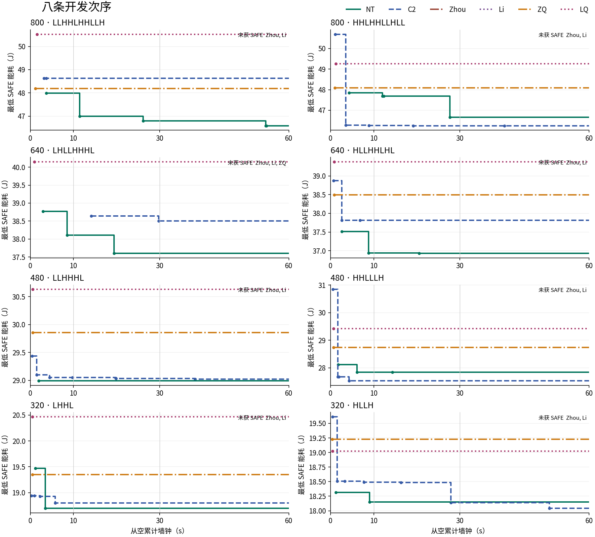
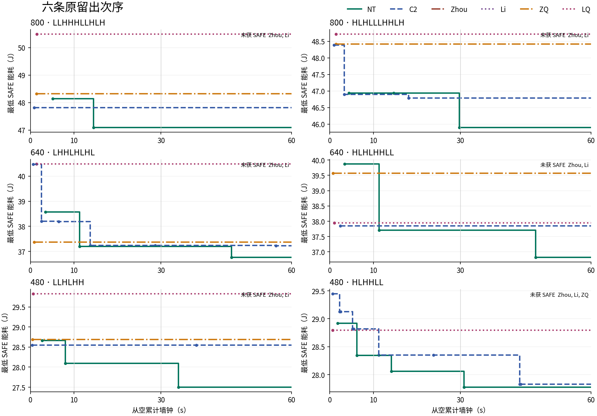

# 独立构造终点与公开工况质量曲线

每格给出从空运行得到的结果。独立算法一旦结束即停止；预算曲线在之后保持已认证最低值。NC、OT 等 M1-f 方法不计入本轮六组。

## 文献适配各自运行到自然终点

Zhou、Li 的格子为未构造成功时已放主任务数 / 应放主任务数，以及实际秒数。ZQ、LQ 的格子为自然输出（SAFE 能耗 J 或状态），以及包含物理证书写盘的实际秒数。LQ 表示逆序窗口阶段后的输出。

| 请求与轻重次序 | Zhou（已放/应放；s） | Li（已放/应放；s） | ZQ（终点；s） | LQ（终点；s） |
|---|---:|---:|---:|---:|
| 800 · LLHHLHHLLH | 607/800；0.938 | 455/800；0.227 | 48.1858；1.200 | 50.5248；1.788 |
| 800 · HHLHHLLHLL | 613/800；0.574 | 415/800；0.148 | 48.0918；1.018 | 49.2561；1.363 |
| 640 · LHLLHHHL | 481/640；0.405 | 355/640；0.098 | 未构成；0.637 | 40.1497；1.034 |
| 640 · HLLHHLHL | 493/640；0.454 | 335/640；0.098 | 38.4912；0.817 | 39.3762；0.955 |
| 480 · LLHHHL | 360/480；0.361 | 295/480；0.105 | 29.8573；0.540 | 30.6311；0.685 |
| 480 · HHLLLH | 380/480；0.398 | 255/480；0.076 | 28.7422；0.655 | 29.4245；0.771 |
| 320 · LHHL | 241/320；0.151 | 195/320；0.058 | 19.3510；0.451 | 20.4664；0.508 |
| 320 · HLLH | 259/320；0.149 | 175/320；0.036 | 19.2264；0.395 | 19.0230；0.519 |
| 800 · LLHHHLLHLH | 607/800；0.814 | 455/800；0.163 | 48.3168；1.376 | 50.4877；1.726 |
| 800 · HLHLLLHHLH | 620/800；0.614 | 415/800；0.158 | 48.4139；1.414 | 48.7183；1.522 |
| 640 · LHHLHLHL | 481/640；0.412 | 355/640；0.100 | 37.3710；0.891 | 40.4879；1.482 |
| 640 · HLHLHHLL | 493/640；0.375 | 335/640；0.096 | 39.5683；0.724 | 37.9486；1.182 |
| 480 · LLHLHH | 367/480；0.218 | 295/480；0.058 | 28.6852；0.513 | 29.8287；0.721 |
| 480 · HLHHLL | 373/480；0.219 | 255/480；0.081 | HOT；0.587 | 28.7955；0.742 |

## 八条开发次序

每格为 10 / 30 / 60 秒的最低 SAFE 能耗（J）。— 表示该时刻无 SAFE。Zhou 和 Li 在全部截面均无完整证书，在图中标明。每个点是一次真实认证后的改善，首解前留白。

| 工况 | NT | 原始 C2 | ZQ | LQ |
|---|---:|---:|---:|---:|
| 800 · LLHHLHHLLH | 47.9948 / 46.7953 / 46.5862 | 48.6229 / 48.6229 / 48.6229 | 48.1858 / 48.1858 / 48.1858 | 50.5248 / 50.5248 / 50.5248 |
| 800 · HHLHHLLHLL | 47.8494 / 46.6585 / 46.6585 | 46.2545 / 46.2522 / 46.2517 | 48.0918 / 48.0918 / 48.0918 | 49.2561 / 49.2561 / 49.2561 |
| 640 · LHLLHHHL | 38.1039 / 37.6046 / 37.6046 | — / 38.4991 / 38.4991 | — / — / — | 40.1497 / 40.1497 / 40.1497 |
| 640 · HLLHHLHL | 36.9413 / 36.9345 / 36.9345 | 37.8182 / 37.8182 / 37.8182 | 38.4912 / 38.4912 / 38.4912 | 39.3762 / 39.3762 / 39.3762 |
| 480 · LLHHHL | 28.9938 / 28.9938 / 28.9938 | 29.0494 / 29.0367 / 29.0241 | 29.8573 / 29.8573 / 29.8573 | 30.6311 / 30.6311 / 30.6311 |
| 480 · HHLLLH | 27.8431 / 27.8424 / 27.8424 | 27.5321 / 27.5321 / 27.5321 | 28.7422 / 28.7422 / 28.7422 | 29.4245 / 29.4245 / 29.4245 |
| 320 · LHHL | 18.6985 / 18.6985 / 18.6985 | 18.7987 / 18.7987 / 18.7987 | 19.3510 / 19.3510 / 19.3510 | 20.4664 / 20.4664 / 20.4664 |
| 320 · HLLH | 18.1501 / 18.1501 / 18.1501 | 18.4923 / 18.1388 / 18.0431 | 19.2264 / 19.2264 / 19.2264 | 19.0230 / 19.0230 / 19.0230 |

## 六条原留出次序

每格为 10 / 30 / 60 秒的最低 SAFE 能耗（J）。— 表示该时刻无 SAFE。Zhou 和 Li 在全部截面均无完整证书，在图中标明。每个点是一次真实认证后的改善，首解前留白。

| 工况 | NT | 原始 C2 | ZQ | LQ |
|---|---:|---:|---:|---:|
| 800 · LLHHHLLHLH | 48.1439 / 47.0899 / 47.0899 | 47.8169 / 47.8169 / 47.8169 | 48.3168 / 48.3168 / 48.3168 | 50.4877 / 50.4877 / 50.4877 |
| 800 · HLHLLLHHLH | 46.9425 / 45.8989 / 45.8989 | 46.8996 / 46.7910 / 46.7910 | 48.4139 / 48.4139 / 48.4139 | 48.7183 / 48.7183 / 48.7183 |
| 640 · LHHLHLHL | 38.5667 / 37.2023 / 36.7646 | 38.1953 / 37.2379 / 37.2274 | 37.3710 / 37.3710 / 37.3710 | 40.4879 / 40.4879 / 40.4879 |
| 640 · HLHLHHLL | 39.8750 / 37.7093 / 36.8224 | 37.8463 / 37.8463 / 37.8463 | 39.5683 / 39.5683 / 39.5683 | 37.9486 / 37.9486 / 37.9486 |
| 480 · LLHLHH | 28.0931 / 28.0931 / 27.5031 | 28.5519 / 28.5519 / 28.5440 | 28.6852 / 28.6852 / 28.6852 | 29.8287 / 29.8287 / 29.8287 |
| 480 · HLHHLL | 28.3461 / 28.0583 / 27.7761 | 28.8172 / 28.3475 / 27.8273 | — / — / — | 28.7955 / 28.7955 / 28.7955 |

各截面的首次 SAFE、峰温、期限、能量上下界、认证次数和计划哈希见[截面数据](data/checkpoints.csv)。每次调用见[认证账本](data/calls.csv.gz)，逐工况配对见[配对表](data/paired.csv)。
