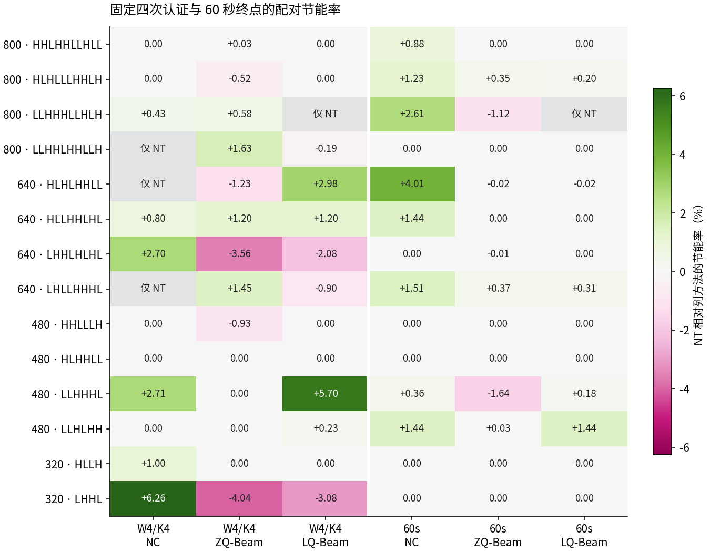

# M1-h　统一多路径搜索下的热感知决策机制

**保留 NT 作为主动热感知调度候选；同一框架下，ZQ-Beam 是有竞争力的近邻。** 在 14 条公开次序上，60 秒时 NT 对相同生成器、普通负载风险的 NC 为 **8 胜 6 平**，平均节能 **0.963%**；对 ZQ-Beam 为 **3 胜 7 平 4 负**，平均 **−0.145%**。两种方法均 14/14 SAFE。此前 NT 对单束 ZQ 的优势不能直接归到 NT 特有的一秒热延拓评分上。NT 相对原始 C2 仍有 10 胜 4 负，平均节能 0.756%。

[逐工况能耗、首解、开销和完整曲线](results.md) · [风险键、审计及证据说明](methods.md) · [全部十种配对](data/paired.csv) · [实验开始前冻结的协议及实现](https://github.com/YBEMR/paper/commit/f10a3da3ca0b35e796611254f49698d931833be8)

## 固定搜索规模与等实际时间

冻结基础为 c014113e。所有方法服务完整请求，逐请求期限 300 ms、温限 80°C，窗口之间继承连续热状态。同核四组使用相同的 N 配额生成、FIFO、前四席结构、扩束规则、超四席能耗回填、终端热安全能耗序和连续 P1 认证。ZQ-Beam 以“是否超过预测热限、虚拟核名次和”排序，LQ-Beam 以“主阶段子期限违反数、热耗散模式名次和”排序。风险二元组的字典序及并列原样保留。C2 是原始普通效率基线。W4/K4 固定在首个宽四池的前四次认证结束，三个时间截面均取自本轮同一次 60 秒运行，没有附加固定预算运行或 LFT。

每格为 **NT 胜/平/负；共同 SAFE 工况的平均节能率**。节能分母为列中的对照方法。覆盖不同的工况单列；区间相叠记平。

| 截面 | SAFE 数 NT / NC / ZQ-Beam / LQ-Beam / C2 | 对 NC | 对 ZQ-Beam | 对 LQ-Beam | 对 C2 |
|---|---|---|---|---|---|
| W4/K4 | 14 / 11 / 14 / 13 / 11 | 6/5/0；+1.264% | 5/4/5；−0.384% | 4/5/4；+0.297% | 8/0/3；+2.883% |
| 10 s | 14 / 13 / 14 / 13 / 14 | 6/6/1；+0.743% | 4/5/5；−0.125% | 6/4/3；+0.029% | 11/0/3；+0.708% |
| 30 s | 14 / 14 / 14 / 13 / 14 | 10/4/0；+1.103% | 3/5/6；−0.083% | 5/6/2；+0.174% | 11/0/3；+1.305% |
| 60 s | 14 / 14 / 14 / 13 / 14 | 8/6/0；+0.963% | 3/7/4；−0.145% | 4/8/1；+0.162% | 10/0/4；+0.756% |



## 为什么同核对照改变了文献比较的解释

在固定 W4 的 945 个不同父前缀窗口中，258 个由至少两种方法实际到达。冻结生成器重建了 207,300 个提案，其中 108,853 个合法、96,526 个未通过时序检查、1,921 个重复。对 765 个非空单父池和 308 个实际参与选择的不同合并池逐一替换风险键后，所有配对的前两席身份均相同。下表只计实际合并池，每列分母均为 308。

| 与 NT 比较 | 第三席改变 | 第四席改变 | 四席保留集合改变 |
|---|---:|---:|---:|
| NC | 308 | 268 | 308 |
| ZQ-Beam | 250 | 84 | 266 |
| LQ-Beam | 300 | 99 | 303 |

以 NT 为起点，只替换第三席的排除项时，这三组的第四席都保持原身份。继续替换综合名次中的风险项，第四席才分别改变 268、84、99 次。ZQ-Beam 的 90 个实际非终端 W4 窗口中，有 61 窗保留了预测超过 80°C 的候选，共计 63 席，均在能耗席或排空席；最终能否 SAFE 仍以连续认证为准。计入较大束宽后，审计覆盖 8,742 个不同父前缀窗口、1,666 个已完成的非终端池和 270 个终端池。冻结 NT、NC 在 14 个工况的 28 条 W4/K4 结果与旧记录的代表计划身份、状态及其能耗一致。[席位汇总](data/seat_summary.csv) · [软排序的实际保留](data/ZQ_soft_retention.csv) · [固定规模溯源](data/fixed_frozen_check.csv)

M1-g 的 60 秒结果中，NT 相对原单束 ZQ、LQ 的共同 SAFE 平均节能分别为 3.813% 和 6.113%。本轮让文献键也能选择多个互补前缀、继续扩束，并获得相同的终端排序和认证机会。ZQ 的硬热筛同时改为软排序，LQ 的原逆序步骤不进入主比较。结果支持把 M1-g 的优势解释为整套构造与搜索差异；跨批次变化同时涉及这些设计和实测时钟，不能把百分点差额精确分摊给某一项。M1-g 的逐任务原生适配及其独立结果仍可查阅。[M1-g 原报告](../m1g_literature_comparison/README.md)

## 胜例、反例与适用范围

- **评分有实际收益，也会错过更省能的前缀。** L800 · HLHLLLHHLH 上，NT 的 60 秒最佳为 45.8989 J，优于 ZQ-Beam 的 46.0607 J 和 LQ-Beam 的 45.9890 J；但固定 W4/K4 时 ZQ-Beam 先取得比 NT 更低的能耗。L480 · LLHHHL 上，ZQ-Beam 与 NT 固定规模均为 28.9938 J，扩束后 ZQ-Beam 降至 28.5259 J，NT 的最佳值仍为 28.9938 J。
- **子期限满足与热可行性不能互换。** 在 L800 · LLHHHLLHLH 上，LQ-Beam 在 60 秒内完成 316 次认证，全部 HOT，其中最低连续峰温上界为 80.8026°C。NT 的 369 份到点证书中有 83 份 SAFE，ZQ-Beam 的 396 份中有 346 份 SAFE；二者最低 SAFE 能耗分别为 47.0899 和 46.5706 J。没有给 LQ-Beam 折算节能率。该现象说明这个评分在该次序把预算引向了热不可行候选，并不能证明其终端池其余计划都不可行。
- **加宽会让不同前缀重新汇合。** L320 · LHHL 的 W4/K4 能耗依次为 NT 19.4694 J、NC 20.7701 J、ZQ-Beam 18.7140 J、LQ-Beam 18.8885 J；60 秒时四组均为 18.6985 J。C2 也保有实用胜例，例如 L800 · HHLHHLLHLL 为 46.2517 J，低于 NT 的 46.6585 J。[逐工况物理计划身份](data/checkpoints.csv) · [实际前缀分叉与计划重合](data/actual_path_divergence.csv)

**研究判断。** 对这些异步请求、轻重载交替、300 ms 期限和 80°C 温限的冻结 P1 工况，主动热风险比普通负载风险更稳健，并可获得额外节能。ZQ-Beam 同样利用累计热状态和预测温限，在相同多路径框架下足以与 NT 竞争。证据支持将研究贡献写为“在共同配额生成下，跨窗热状态参与前缀保留，在有限预算内获得低能耗 SAFE 排程”。它不足以证明 NT 的特定风险公式普遍优于其他热感知评分。14 条都是公开样本，各方法每工况一次计时，不据小幅均值差异宣称总体显著性或判定未见负载的最优评分。本轮据此结束文献同核消融。

## 计算开销及原始证据

70 条单核单线程轨迹各计 60 秒，进入比较的总预算为 4,200 核秒。各轨迹实测停止墙钟之和为 4,202.738 秒，差额来自最后一次认证及写盘跨过截止。31,818 次认证中，31,748 次在截止内完成；其余 70 次保留原始证书，未用于提升 60 秒成绩。整个批次得到 19,768 个不同的工况内物理计划和 259 次到点前的最佳 SAFE 更新。

| 方法 | W4/K4 总耗时中位数（s） | 首次 SAFE 中位数（s） | 60 s 内构造及排序（s） | 60 s 内认证及写盘（s） | 到点认证总数 |
|---|---:|---:|---:|---:|---:|
| NT | 1.87 | 1.66 | 34.80 | 25.20 | 5,624 |
| NC | 1.84 | 1.89 | 34.90 | 25.10 | 5,499 |
| ZQ-Beam | 1.87 | 1.70 | 34.47 | 25.52 | 5,553 |
| LQ-Beam | 1.87 | 1.69 | 36.18 | 23.81 | 5,897 |
| C2 | 0.64 | 0.45 | 24.43 | 35.56 | 9,175 |

时间列为各工况中位数，首次 SAFE 仅统计取得 SAFE 的工况。C2 的构造较快，因而能在同一墙钟内完成更多认证；能耗表保留了其四个实际胜例。完整的 280 个截面和 560 行配对附有工况、计划身份、能耗区间和开销。[截面与开销](data/checkpoints.csv) · [逐次认证](data/calls.csv.gz) · [逐次改善](data/improvements.csv)

原始运行记录、每次认证当时的完整 cert、逐物理计划原版 certificate.json 和 plan.json 均已归档。各工况同时提供全部固定四份及所有最优改善的原始 NPZ 和每份物理计划的原始 NPZ 校验值。另附完整逐事件包，包含 19,768 份原始 NPZ，逐文件核对 SHA-256，全包通过 ZIP 完整性检查。独立重放 L800 · LLHHHLLHLH 的 ZQ-Beam 解和 L640 · HLHLHHLL 的 NT 解时，完整物理指标、事件数组及压缩文件字节均与原件吻合。[完整事件包校验值](data/full_event_archive.json)。研究结果位于本目录，冻结算法、P1、第三章和第四章没有改动。[证书和原始记录](data/evidence) · [分工况候选池证据](data/pools) · [核查回执](data/audit.json) · [源文件与数据校验单](SHA256SUMS)

完整仓库检出后，在本目录使用实测环境所列版本运行。首次计时批次需要至少七个可绑定逻辑核及新的 raw 目录，事后审计与绘图均在计时外。

```sh
python -Bu batch.py
python -Bu postprocess.py
python -B lineage.py
python -B mechanism_cases.py
python -B present.py
# 从归档的原始计划重建某份证书，输出路径应为新目录
python -B replay.py CASE PLAN_SHA256 OUTPUT_DIRECTORY
# 原始事件仍在本机时，生成完整的逐文件校验 ZIP64 包
python -B pack_events.py M1-h-all-original-events.zip
```
