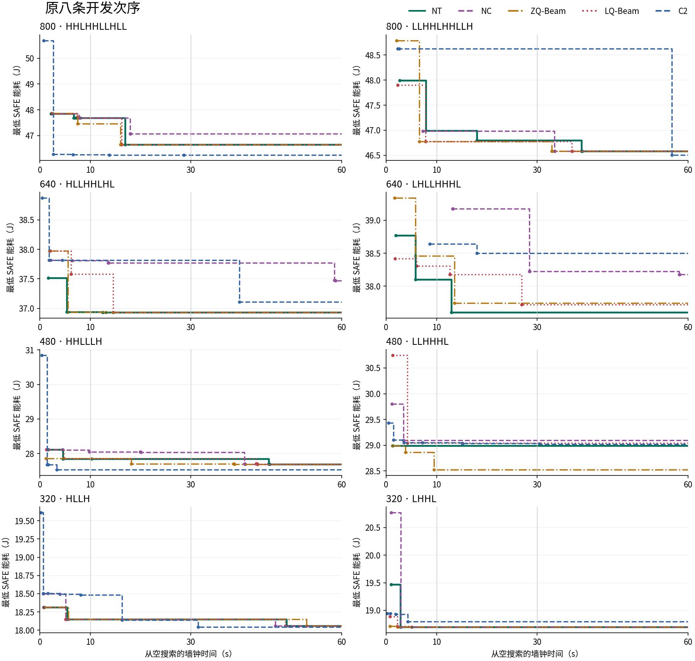
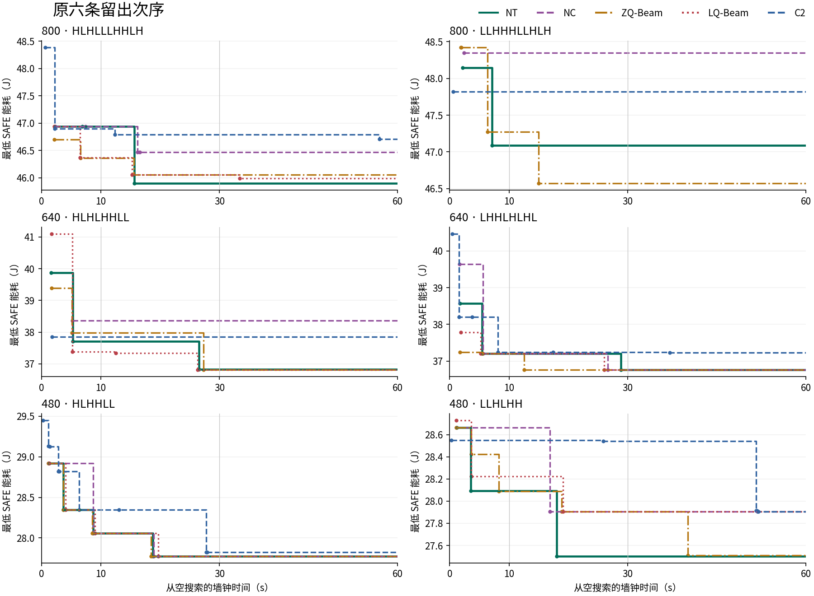

# 逐工况结果

每格均来自本轮实测。能耗用 J，固定规模只认首个宽四池的前四份连续证书。普通 C2 为实际效率基线。W4/K4 的结束时刻依方法与工况而异，10/30/60 秒为同一条 60 秒策略上的实时时钟截面。

## 原八条开发次序

各格依次给出 **W4/K4 · 10 s · 30 s · 60 s** 的最低 SAFE 能耗。— 表示到点未取得 SAFE。

| 请求数 · 负载次序 | NT | NC | ZQ-Beam | LQ-Beam | C2 |
|---|---:|---:|---:|---:|---:|
| 800 · HHLHHLLHLL | 47.8494 · 47.6851 · 46.6585 · 46.6585 | 47.8494 · 47.6851 · 47.0738 · 47.0738 | 47.8645 · 47.4580 · 46.6585 · 46.6585 | 47.8494 · 47.6859 · 46.6585 · 46.6585 | 50.6918 · 46.2545 · 46.2517 · 46.2517 |
| 800 · LLHHLHHLLH | 47.9948 · 46.9906 · 46.7953 · 46.5862 | — · 46.9819 · 46.9819 · 46.5862 | 48.7896 · 46.7789 · 46.7789 · 46.5862 | 47.9018 · 46.7789 · 46.7789 · 46.5862 | — · 48.6229 · 48.6229 · 46.5084 |
| 640 · HLLHHLHL | 37.5167 · 36.9413 · 36.9345 · 36.9345 | 37.8187 · 37.8094 · 37.7709 · 37.4732 | 37.9735 · 36.9413 · 36.9345 · 36.9345 | 37.9735 · 37.5824 · 36.9345 · 36.9345 | 38.8738 · 37.8182 · 37.8182 · 37.1080 |
| 640 · LHLLHHHL | 38.7683 · 38.1039 · 37.6046 · 37.6046 | — · — · 38.2259 · 38.1793 | 39.3402 · 38.4623 · 37.7437 · 37.7437 | 38.4213 · 38.3059 · 37.7223 · 37.7223 | — · 38.6394 · 38.4991 · 38.4991 |
| 480 · HHLLLH | 28.1152 · 27.8431 · 27.8424 · 27.6849 | 28.1152 · 28.0463 · 28.0313 · 27.6849 | 27.8555 · 27.8555 · 27.7024 · 27.6849 | 28.1152 · 27.8548 · 27.8548 · 27.6849 | 30.8460 · 27.5321 · 27.5321 · 27.5321 |
| 480 · LLHHHL | 28.9938 · 28.9938 · 28.9938 · 28.9938 | 29.8025 · 29.0977 · 29.0977 · 29.0977 | 28.9938 · 28.5259 · 28.5259 · 28.5259 | 30.7472 · 29.0455 · 29.0455 · 29.0455 | 29.4366 · 29.0494 · 29.0367 · 29.0241 |
| 320 · HLLH | 18.3129 · 18.1501 · 18.1501 · 18.0582 | 18.4986 · 18.1501 · 18.1501 · 18.0582 | 18.3129 · 18.1501 · 18.1501 · 18.0582 | 18.3129 · 18.1501 · 18.1501 · 18.0582 | 19.6124 · 18.4854 · 18.1388 · 18.0431 |
| 320 · LHHL | 19.4694 · 18.6985 · 18.6985 · 18.6985 | 20.7701 · 18.6985 · 18.6985 · 18.6985 | 18.7140 · 18.6985 · 18.6985 · 18.6985 | 18.8885 · 18.6985 · 18.6985 · 18.6985 | 18.9433 · 18.7987 · 18.7987 · 18.7987 |

## 原六条留出次序

各格依次给出 **W4/K4 · 10 s · 30 s · 60 s** 的最低 SAFE 能耗。— 表示到点未取得 SAFE。

| 请求数 · 负载次序 | NT | NC | ZQ-Beam | LQ-Beam | C2 |
|---|---:|---:|---:|---:|---:|
| 800 · HLHLLLHHLH | 46.9425 · 46.9422 · 45.8989 · 45.8989 | 46.9425 · 46.9422 · 46.4724 · 46.4724 | 46.7010 · 46.3624 · 46.0607 · 46.0607 | 46.9425 · 46.3674 · 46.0583 · 45.9890 | 48.3874 · 46.8996 · 46.7910 · 46.7122 |
| 800 · LLHHHLLHLH | 48.1439 · 47.0899 · 47.0899 · 47.0899 | 48.3514 · 48.3514 · 48.3514 · 48.3514 | 48.4225 · 47.2744 · 46.5706 · 46.5706 | — · — · — · — | 47.8169 · 47.8169 · 47.8169 · 47.8169 |
| 640 · HLHLHHLL | 39.8750 · 37.7093 · 36.8224 · 36.8224 | — · 38.3618 · 38.3618 · 38.3618 | 39.3923 · 37.9846 · 36.8150 · 36.8150 | 41.0980 · 37.3899 · 36.8150 · 36.8150 | — · 37.8463 · 37.8463 · 37.8463 |
| 640 · LHHLHLHL | 38.5667 · 37.2023 · 36.7646 · 36.7646 | 39.6362 · 37.2023 · 36.7646 · 36.7646 | 37.2396 · 37.2023 · 36.7617 · 36.7617 | 37.7805 · 37.2023 · 36.7646 · 36.7646 | 40.4691 · 37.2439 · 37.2379 · 37.2274 |
| 480 · HLHHLL | 28.9181 · 28.0583 · 27.7761 · 27.7761 | 28.9181 · 28.0583 · 27.7761 · 27.7761 | 28.9181 · 28.0583 · 27.7761 · 27.7761 | 28.9181 · 28.0583 · 27.7761 · 27.7761 | 29.4496 · 28.3479 · 27.8273 · 27.8273 |
| 480 · LLHLHH | 28.6653 · 28.0931 · 27.5031 · 27.5031 | 28.6653 · 28.6653 · 27.9050 · 27.9050 | 28.6653 · 28.0889 · 27.9050 · 27.5116 | 28.7313 · 28.2243 · 27.9050 · 27.9050 | 28.5519 · 28.5519 · 28.5440 · 27.9072 |

## 首解和构造开销

每格依次为 **首次 SAFE 秒数 / 60 秒内构造及排序秒数 / 60 秒最佳解的峰温上界 °C**。各截面的相应数值、实际停止秒数、认证时间、已完成/已认证 SAFE 数及最优解哈希见[完整截面](data/checkpoints.csv)。

| 工况 | NT | NC | ZQ-Beam | LQ-Beam | C2 |
|---|---:|---:|---:|---:|---:|
| 800 · HHLHHLLHLL | 2.22 / 34.66 / 76.90 | 2.60 / 33.49 / 76.90 | 2.36 / 30.31 / 76.90 | 2.30 / 30.87 / 76.90 | 0.71 / 37.08 / 74.67 |
| 800 · HLHLLLHHLH | 2.25 / 30.93 / 74.68 | 2.29 / 29.84 / 79.49 | 2.15 / 29.52 / 72.78 | 2.18 / 29.29 / 74.62 | 0.61 / 34.36 / 76.37 |
| 800 · LLHHHLLHLH | 2.17 / 30.30 / 75.97 | 2.39 / 29.42 / 79.15 | 1.91 / 27.70 / 77.25 | — / 32.27 / — | 0.57 / 32.77 / 78.50 |
| 800 · LLHHLHHLLH | 2.64 / 33.48 / 77.40 | 7.24 / 29.06 / 77.40 | 2.05 / 28.73 / 77.40 | 2.28 / 32.28 / 77.40 | 2.30 / 35.36 / 79.26 |
| 640 · HLHLHHLL | 1.64 / 49.22 / 73.91 | 5.19 / 51.52 / 77.54 | 1.69 / 48.75 / 75.05 | 1.69 / 48.70 / 75.05 | 1.79 / 24.37 / 75.79 |
| 640 · HLLHHLHL | 1.69 / 48.77 / 72.32 | 2.11 / 50.58 / 74.73 | 1.93 / 51.62 / 72.32 | 2.02 / 27.15 / 72.32 | 0.43 / 24.49 / 77.79 |
| 640 · LHHLHLHL | 1.73 / 25.05 / 72.85 | 1.68 / 46.99 / 72.85 | 1.73 / 46.63 / 72.85 | 1.84 / 47.33 / 72.85 | 0.43 / 22.51 / 72.97 |
| 640 · LHLLHHHL | 1.90 / 49.50 / 77.75 | 13.20 / 50.16 / 78.26 | 1.70 / 49.87 / 77.73 | 1.72 / 48.06 / 77.74 | 8.65 / 23.28 / 77.98 |
| 480 · HHLLLH | 1.64 / 39.64 / 67.97 | 1.27 / 35.55 / 67.97 | 1.24 / 33.59 / 67.97 | 1.36 / 36.99 / 67.97 | 0.34 / 17.84 / 68.27 |
| 480 · HLHHLL | 1.26 / 34.93 / 74.44 | 1.21 / 34.24 / 74.44 | 1.15 / 32.85 / 74.44 | 1.33 / 37.52 / 74.44 | 0.30 / 31.97 / 74.43 |
| 480 · LLHHHL | 1.30 / 33.18 / 75.94 | 1.13 / 31.33 / 78.48 | 1.22 / 34.12 / 77.25 | 1.26 / 35.38 / 75.97 | 0.46 / 17.54 / 78.51 |
| 480 · LLHLHH | 1.17 / 32.85 / 74.85 | 1.12 / 30.64 / 76.40 | 1.13 / 34.83 / 74.87 | 1.14 / 33.41 / 76.40 | 0.29 / 29.12 / 76.39 |
| 320 · HLLH | 0.75 / 42.28 / 64.94 | 0.70 / 40.37 / 64.94 | 0.91 / 45.23 / 64.94 | 0.76 / 41.35 / 64.94 | 0.17 / 17.20 / 64.91 |
| 320 · LHHL | 0.96 / 44.62 / 72.82 | 0.97 / 44.01 / 72.82 | 0.74 / 41.22 / 72.82 | 0.75 / 39.71 / 72.82 | 0.20 / 18.42 / 72.92 |

[全部十对方法的逐工况胜负和节能率](data/paired.csv) · [逐次改善](data/improvements.csv) · [每次送验及原计划身份](data/calls.csv.gz) · [各级束宽与终端池规模](data/stages.csv)
