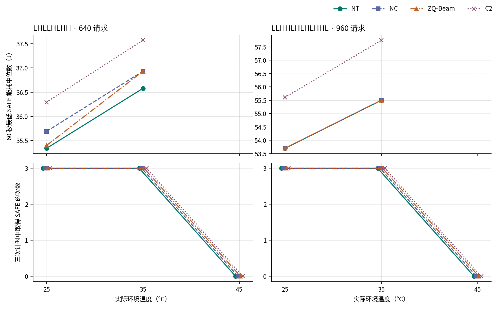

# 分组成功率、成对能耗及热压力响应

覆盖表以工况为分母。每格三个数依次为至少一次、至少两次、全部三次取得 SAFE 的工况数。配对表只在两方均至少两次 SAFE 的工况上统计胜平负及平均节能。仅 NT 和仅对照两列保留不能计算节能率的工况。

## 35°C 的 12 条新流

| 截面 | 工况数 | NT | NC | ZQ-Beam | C2 |
|---|---:|---:|---:|---:|---:|
| W4/K4 | 12 | 11/11/11 | 7/7/7 | 12/12/12 | 4/4/4 |
| 10s | 12 | 12/12/12 | 10/10/10 | 12/12/12 | 9/9/9 |
| 30s | 12 | 12/12/12 | 10/10/10 | 12/12/12 | 11/11/11 |
| 60s | 12 | 12/12/12 | 10/10/10 | 12/12/12 | 11/11/11 |

| 截面 | NT 对照 | 共同 SAFE | NT 胜/平/负 | 平均节能率 | 中位节能率 | 仅 NT | 仅对照 | 均不足 |
|---|---|---:|---:|---:|---:|---:|---:|---:|
| W4/K4 | NC | 7 | 5/1/1 | +1.609% | +1.696% | 4 | 0 | 1 |
| W4/K4 | ZQ-Beam | 11 | 3/2/6 | -0.289% | -0.982% | 0 | 1 | 0 |
| W4/K4 | C2 | 3 | 1/0/2 | -0.523% | -2.037% | 8 | 1 | 0 |
| 10s | NC | 10 | 6/2/2 | +1.325% | +1.563% | 2 | 0 | 0 |
| 10s | ZQ-Beam | 12 | 3/1/8 | +0.028% | -0.272% | 0 | 0 | 0 |
| 10s | C2 | 9 | 8/0/1 | +1.860% | +2.662% | 3 | 0 | 0 |
| 30s | NC | 10 | 7/3/0 | +1.066% | +0.915% | 2 | 0 | 0 |
| 30s | ZQ-Beam | 12 | 7/3/2 | +0.216% | +0.084% | 0 | 0 | 0 |
| 30s | C2 | 11 | 11/0/0 | +2.080% | +1.885% | 1 | 0 | 0 |
| 60s | NC | 10 | 6/4/0 | +0.960% | +0.879% | 2 | 0 | 0 |
| 60s | ZQ-Beam | 12 | 6/4/2 | +0.131% | +0.004% | 0 | 0 | 0 |
| 60s | C2 | 11 | 11/0/0 | +2.127% | +2.149% | 1 | 0 | 0 |

## A · 等量新次序

| 截面 | 工况数 | NT | NC | ZQ-Beam | C2 |
|---|---:|---:|---:|---:|---:|
| W4/K4 | 6 | 5/5/5 | 4/4/4 | 6/6/6 | 4/4/4 |
| 10s | 6 | 6/6/6 | 6/6/6 | 6/6/6 | 5/5/5 |
| 30s | 6 | 6/6/6 | 6/6/6 | 6/6/6 | 6/6/6 |
| 60s | 6 | 6/6/6 | 6/6/6 | 6/6/6 | 6/6/6 |

| 截面 | NT 对照 | 共同 SAFE | NT 胜/平/负 | 平均节能率 | 中位节能率 | 仅 NT | 仅对照 | 均不足 |
|---|---|---:|---:|---:|---:|---:|---:|---:|
| W4/K4 | NC | 4 | 4/0/0 | +2.582% | +2.402% | 1 | 0 | 1 |
| W4/K4 | ZQ-Beam | 5 | 0/2/3 | -1.259% | -0.982% | 0 | 1 | 0 |
| W4/K4 | C2 | 3 | 1/0/2 | -0.523% | -2.037% | 2 | 1 | 0 |
| 10s | NC | 6 | 6/0/0 | +2.295% | +1.922% | 0 | 0 | 0 |
| 10s | ZQ-Beam | 6 | 2/1/3 | +0.215% | -0.044% | 0 | 0 | 0 |
| 10s | C2 | 5 | 5/0/0 | +2.474% | +2.713% | 1 | 0 | 0 |
| 30s | NC | 6 | 5/1/0 | +1.495% | +1.496% | 0 | 0 | 0 |
| 30s | ZQ-Beam | 6 | 4/2/0 | +0.403% | +0.427% | 0 | 0 | 0 |
| 30s | C2 | 6 | 6/0/0 | +2.057% | +1.774% | 0 | 0 | 0 |
| 60s | NC | 6 | 4/2/0 | +1.154% | +1.194% | 0 | 0 | 0 |
| 60s | ZQ-Beam | 6 | 3/2/1 | +0.211% | +0.004% | 0 | 0 | 0 |
| 60s | C2 | 6 | 6/0/0 | +1.699% | +1.573% | 0 | 0 | 0 |

## B · 非等量负载

| 截面 | 工况数 | NT | NC | ZQ-Beam | C2 |
|---|---:|---:|---:|---:|---:|
| W4/K4 | 2 | 2/2/2 | 1/1/1 | 2/2/2 | 0/0/0 |
| 10s | 2 | 2/2/2 | 2/2/2 | 2/2/2 | 2/2/2 |
| 30s | 2 | 2/2/2 | 2/2/2 | 2/2/2 | 2/2/2 |
| 60s | 2 | 2/2/2 | 2/2/2 | 2/2/2 | 2/2/2 |

| 截面 | NT 对照 | 共同 SAFE | NT 胜/平/负 | 平均节能率 | 中位节能率 | 仅 NT | 仅对照 | 均不足 |
|---|---|---:|---:|---:|---:|---:|---:|---:|
| W4/K4 | NC | 1 | 1/0/0 | +1.351% | +1.351% | 1 | 0 | 0 |
| W4/K4 | ZQ-Beam | 2 | 1/0/1 | -0.153% | -0.153% | 0 | 0 | 0 |
| W4/K4 | C2 | 0 | 0/0/0 | — | — | 2 | 0 | 0 |
| 10s | NC | 2 | 0/1/1 | -0.247% | -0.247% | 0 | 0 | 0 |
| 10s | ZQ-Beam | 2 | 0/0/2 | -0.805% | -0.805% | 0 | 0 | 0 |
| 10s | C2 | 2 | 2/0/0 | +1.212% | +1.212% | 0 | 0 | 0 |
| 30s | NC | 2 | 1/1/0 | +0.408% | +0.408% | 0 | 0 | 0 |
| 30s | ZQ-Beam | 2 | 1/1/0 | +0.030% | +0.030% | 0 | 0 | 0 |
| 30s | C2 | 2 | 2/0/0 | +2.669% | +2.669% | 0 | 0 | 0 |
| 60s | NC | 2 | 1/1/0 | +0.401% | +0.401% | 0 | 0 | 0 |
| 60s | ZQ-Beam | 2 | 1/1/0 | +0.030% | +0.030% | 0 | 0 | 0 |
| 60s | C2 | 2 | 2/0/0 | +2.657% | +2.657% | 0 | 0 | 0 |

## C · 960/1280 请求

| 截面 | 工况数 | NT | NC | ZQ-Beam | C2 |
|---|---:|---:|---:|---:|---:|
| W4/K4 | 4 | 4/4/4 | 2/2/2 | 4/4/4 | 0/0/0 |
| 10s | 4 | 4/4/4 | 2/2/2 | 4/4/4 | 2/2/2 |
| 30s | 4 | 4/4/4 | 2/2/2 | 4/4/4 | 3/3/3 |
| 60s | 4 | 4/4/4 | 2/2/2 | 4/4/4 | 3/3/3 |

| 截面 | NT 对照 | 共同 SAFE | NT 胜/平/负 | 平均节能率 | 中位节能率 | 仅 NT | 仅对照 | 均不足 |
|---|---|---:|---:|---:|---:|---:|---:|---:|
| W4/K4 | NC | 2 | 0/1/1 | -0.209% | -0.209% | 2 | 0 | 0 |
| W4/K4 | ZQ-Beam | 4 | 2/0/2 | +0.855% | +0.747% | 0 | 0 | 0 |
| W4/K4 | C2 | 0 | 0/0/0 | — | — | 4 | 0 | 0 |
| 10s | NC | 2 | 0/1/1 | -0.013% | -0.013% | 2 | 0 | 0 |
| 10s | ZQ-Beam | 4 | 1/0/3 | +0.164% | -0.636% | 0 | 0 | 0 |
| 10s | C2 | 2 | 1/0/1 | +0.974% | +0.974% | 2 | 0 | 0 |
| 30s | NC | 2 | 1/1/0 | +0.437% | +0.437% | 2 | 0 | 0 |
| 30s | ZQ-Beam | 4 | 2/0/2 | +0.030% | +0.047% | 0 | 0 | 0 |
| 30s | C2 | 3 | 3/0/0 | +1.734% | +1.885% | 1 | 0 | 0 |
| 60s | NC | 2 | 1/1/0 | +0.940% | +0.940% | 2 | 0 | 0 |
| 60s | ZQ-Beam | 4 | 2/1/1 | +0.062% | +0.199% | 0 | 0 | 0 |
| 60s | C2 | 3 | 3/0/0 | +2.627% | +2.149% | 1 | 0 | 0 |

## D · 同两条流在 25°C

| 截面 | 工况数 | NT | NC | ZQ-Beam | C2 |
|---|---:|---:|---:|---:|---:|
| W4/K4 | 2 | 2/2/2 | 2/2/2 | 2/2/2 | 2/2/2 |
| 10s | 2 | 2/2/2 | 2/2/2 | 2/2/2 | 2/2/2 |
| 30s | 2 | 2/2/2 | 2/2/2 | 2/2/2 | 2/2/2 |
| 60s | 2 | 2/2/2 | 2/2/2 | 2/2/2 | 2/2/2 |

| 截面 | NT 对照 | 共同 SAFE | NT 胜/平/负 | 平均节能率 | 中位节能率 | 仅 NT | 仅对照 | 均不足 |
|---|---|---:|---:|---:|---:|---:|---:|---:|
| W4/K4 | NC | 2 | 1/0/1 | +1.437% | +1.437% | 0 | 0 | 0 |
| W4/K4 | ZQ-Beam | 2 | 1/0/1 | +0.317% | +0.317% | 0 | 0 | 0 |
| W4/K4 | C2 | 2 | 1/0/1 | +10.263% | +10.263% | 0 | 0 | 0 |
| 10s | NC | 2 | 1/0/1 | +0.980% | +0.980% | 0 | 0 | 0 |
| 10s | ZQ-Beam | 2 | 1/0/1 | +0.980% | +0.980% | 0 | 0 | 0 |
| 10s | C2 | 2 | 2/0/0 | +2.761% | +2.761% | 0 | 0 | 0 |
| 30s | NC | 2 | 1/1/0 | +0.490% | +0.490% | 0 | 0 | 0 |
| 30s | ZQ-Beam | 2 | 1/0/1 | +0.077% | +0.077% | 0 | 0 | 0 |
| 30s | C2 | 2 | 2/0/0 | +2.774% | +2.774% | 0 | 0 | 0 |
| 60s | NC | 2 | 1/1/0 | +0.490% | +0.490% | 0 | 0 | 0 |
| 60s | ZQ-Beam | 2 | 1/1/0 | +0.084% | +0.084% | 0 | 0 | 0 |
| 60s | C2 | 2 | 2/0/0 | +3.027% | +3.027% | 0 | 0 | 0 |

## D · 同两条流在 45°C

| 截面 | 工况数 | NT | NC | ZQ-Beam | C2 |
|---|---:|---:|---:|---:|---:|
| W4/K4 | 2 | 0/0/0 | 0/0/0 | 0/0/0 | 0/0/0 |
| 10s | 2 | 0/0/0 | 0/0/0 | 0/0/0 | 0/0/0 |
| 30s | 2 | 0/0/0 | 0/0/0 | 0/0/0 | 0/0/0 |
| 60s | 2 | 0/0/0 | 0/0/0 | 0/0/0 | 0/0/0 |

| 截面 | NT 对照 | 共同 SAFE | NT 胜/平/负 | 平均节能率 | 中位节能率 | 仅 NT | 仅对照 | 均不足 |
|---|---|---:|---:|---:|---:|---:|---:|---:|
| W4/K4 | NC | 0 | 0/0/0 | — | — | 0 | 0 | 2 |
| W4/K4 | ZQ-Beam | 0 | 0/0/0 | — | — | 0 | 0 | 2 |
| W4/K4 | C2 | 0 | 0/0/0 | — | — | 0 | 0 | 2 |
| 10s | NC | 0 | 0/0/0 | — | — | 0 | 0 | 2 |
| 10s | ZQ-Beam | 0 | 0/0/0 | — | — | 0 | 0 | 2 |
| 10s | C2 | 0 | 0/0/0 | — | — | 0 | 0 | 2 |
| 30s | NC | 0 | 0/0/0 | — | — | 0 | 0 | 2 |
| 30s | ZQ-Beam | 0 | 0/0/0 | — | — | 0 | 0 | 2 |
| 30s | C2 | 0 | 0/0/0 | — | — | 0 | 0 | 2 |
| 60s | NC | 0 | 0/0/0 | — | — | 0 | 0 | 2 |
| 60s | ZQ-Beam | 0 | 0/0/0 | — | — | 0 | 0 | 2 |
| 60s | C2 | 0 | 0/0/0 | — | — | 0 | 0 | 2 |

## 同一流在三个环境下的变化

表内为 60 秒时三次的成功数和完整 SAFE 能耗中位数（J）。能耗变化只在该温度和 35°C 同时至少两次成功时给出，差值为当前环境减去 35°C。

| 次序 | 方法 | 25°C 成功数 / 能耗 | 35°C 成功数 / 能耗 | 45°C 成功数 / 能耗 | 25−35 （J） | 45−35 （J） |
|---|---|---:|---:|---:|---:|---:|
| LHLLHLHH | NT | 3/3 · 35.3422 | 3/3 · 36.5764 | 0/3 · — | -1.2342 | — |
| LHLLHLHH | NC | 3/3 · 35.6917 | 3/3 · 36.9294 | 0/3 · — | -1.2377 | — |
| LHLLHLHH | ZQ-Beam | 3/3 · 35.4019 | 3/3 · 36.9294 | 0/3 · — | -1.5275 | — |
| LHLLHLHH | C2 | 3/3 · 36.2936 | 3/3 · 37.5675 | 0/3 · — | -1.2739 | — |
| LLHHLHLHLHHL | NT | 3/3 · 53.7000 | 3/3 · 55.5000 | 0/3 · — | -1.8000 | — |
| LLHHLHLHLHHL | NC | 3/3 · 53.7000 | 3/3 · 55.5000 | 0/3 · — | -1.8000 | — |
| LLHHLHLHLHHL | ZQ-Beam | 3/3 · 53.7000 | 3/3 · 55.5000 | 0/3 · — | -1.8000 | — |
| LLHHLHLHLHHL | C2 | 3/3 · 55.6088 | 3/3 · 57.7437 | 0/3 · — | -2.1348 | — |

[所有六种方法配对](data/group_pairs.csv) · [每方法中位开销](data/group_coverage.csv) · [各工况与重复](results.md)
