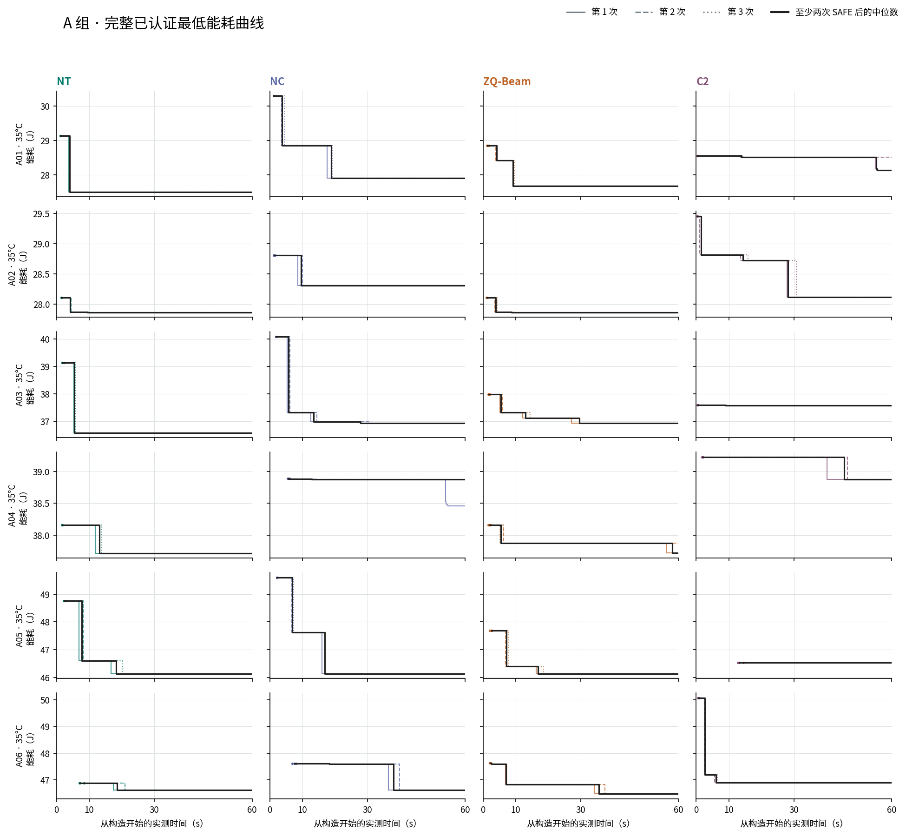
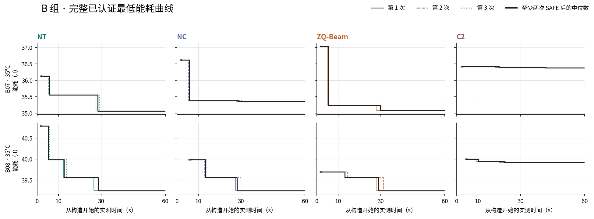
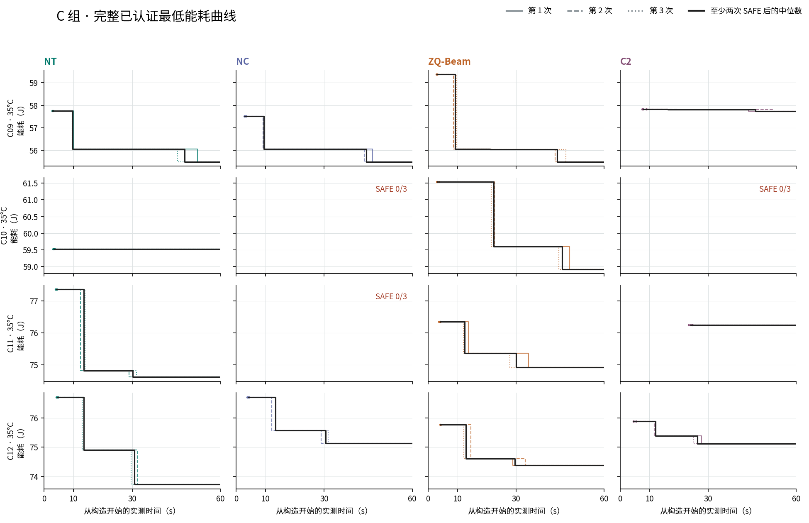
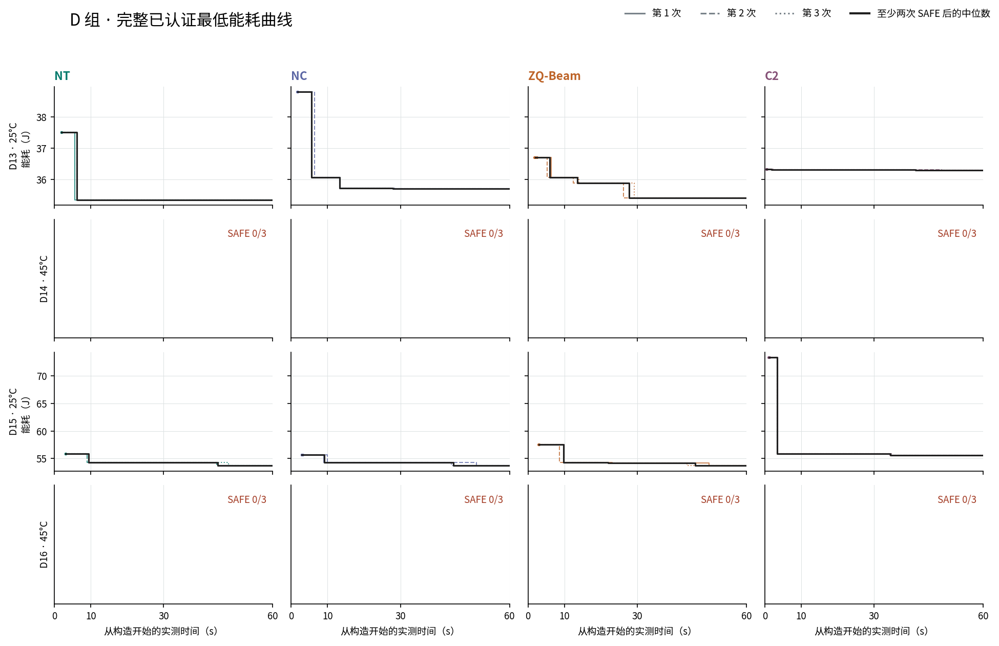

# M1-i 逐工况结果与全部曲线

每格报告成功重复的最低 SAFE 能耗中位数（J），括号给出三次中成功的次数。只有一次成功时仍显示该实测值，主配对统计要求至少两次成功。— 表示该截面三次都没有 SAFE。峰温是最低能耗 SAFE 排程的连续峰温上界，期限余量取其最紧请求。原始三次的证书、首解时间与开销均可按编号追溯。[每次重复](data/repetitions.csv) · [逐次成对比较](data/paired_repeats.csv)

## A 组

| 工况 · 次序 | 环境 | 请求 | 截面 | NT | NC | ZQ-Beam | C2 |
|---|---:|---:|---|---:|---:|---:|---:|
| A01 · LHLLHH | 35°C | 480 | W4/K4 | 29.1383（3/3） | 30.2983（3/3） | 28.8550（3/3） | 28.5567（3/3） |
|  |  |  | 10s | 27.5108（3/3） | 28.8513（3/3） | 27.6791（3/3） | 28.5565（3/3） |
|  |  |  | 30s | 27.5108（3/3） | 27.9106（3/3） | 27.6791（3/3） | 28.5132（3/3） |
|  |  |  | 60s | 27.5108（3/3） | 27.9106（3/3） | 27.6791（3/3） | 28.1468（3/3） |
| A02 · HLLHHL | 35°C | 480 | W4/K4 | 28.1097（3/3） | 28.8097（3/3） | 28.1097（3/3） | 29.4530（3/3） |
|  |  |  | 10s | 27.8662（3/3） | 28.3079（3/3） | 27.8662（3/3） | 28.8126（3/3） |
|  |  |  | 30s | 27.8662（3/3） | 28.3079（3/3） | 27.8662（3/3） | 28.1163（3/3） |
|  |  |  | 60s | 27.8662（3/3） | 28.3079（3/3） | 27.8662（3/3） | 28.1155（3/3） |
| A03 · LHLLHLHH | 35°C | 640 | W4/K4 | 39.1328（3/3） | 40.0849（3/3） | 37.9767（3/3） | 37.5936（3/3） |
|  |  |  | 10s | 36.5764（3/3） | 37.3163（3/3） | 37.3163（3/3） | 37.5767（3/3） |
|  |  |  | 30s | 36.5764（3/3） | 36.9294（3/3） | 36.9294（3/3） | 37.5754（3/3） |
|  |  |  | 60s | 36.5764（3/3） | 36.9294（3/3） | 36.9294（3/3） | 37.5675（3/3） |
| A04 · HLLLHHHL | 35°C | 640 | W4/K4 | 38.1609（3/3） | —（0/3） | 38.1609（3/3） | —（0/3） |
|  |  |  | 10s | 38.1609（3/3） | 38.8849（3/3） | 37.8731（3/3） | 39.2251（3/3） |
|  |  |  | 30s | 37.7150（3/3） | 38.8704（3/3） | 37.8731（3/3） | 39.2251（3/3） |
|  |  |  | 60s | 37.7150（3/3） | 38.8704（3/3） | 37.7179（3/3） | 38.8705（3/3） |
| A05 · LHHLLHHLLH | 35°C | 800 | W4/K4 | 48.7672（3/3） | 49.6088（3/3） | 47.6857（3/3） | —（0/3） |
|  |  |  | 10s | 46.6036（3/3） | 47.6285（3/3） | 46.3918（3/3） | —（0/3） |
|  |  |  | 30s | 46.1361（3/3） | 46.1361（3/3） | 46.1361（3/3） | 46.5368（3/3） |
|  |  |  | 60s | 46.1361（3/3） | 46.1361（3/3） | 46.1361（3/3） | 46.5253（3/3） |
| A06 · HHLLHHLLLH | 35°C | 800 | W4/K4 | —（0/3） | —（0/3） | 47.6243（3/3） | 50.0751（3/3） |
|  |  |  | 10s | 46.8711（3/3） | 47.6163（3/3） | 46.8303（3/3） | 46.8933（3/3） |
|  |  |  | 30s | 46.6258（3/3） | 47.6014（3/3） | 46.8302（3/3） | 46.8933（3/3） |
|  |  |  | 60s | 46.6105（3/3） | 46.6105（3/3） | 46.4691（3/3） | 46.8933（3/3） |

下表为 60 秒时的分项中位数。构造时间含排序，认证时间含物理证据写盘。未取得 SAFE 的工况仍报告实际最冷认证峰温。

| 工况 | 方法 | 首次 SAFE（s） | SAFE 峰温（°C） | SAFE 期限余量（ms） | 最冷认证峰温（°C） | 构造（s） | 认证（s） | 认证数 |
|---|---|---:|---:|---:|---:|---:|---:|---:|
| A01 | NT | 1.19 | 74.581 | 5.20 | 70.384 | 37.01 | 22.98 | 470 |
| A01 | NC | 1.22 | 76.020 | 0.30 | 71.426 | 34.39 | 25.61 | 558 |
| A01 | ZQ-Beam | 1.36 | 74.557 | 5.20 | 70.360 | 34.99 | 25.00 | 513 |
| A01 | C2 | 0.39 | 74.889 | 0.30 | 72.554 | 31.11 | 28.89 | 609 |
| A02 | NT | 1.48 | 74.442 | 4.80 | 72.255 | 36.90 | 23.10 | 481 |
| A02 | NC | 1.28 | 74.727 | 0.30 | 74.422 | 35.99 | 24.01 | 485 |
| A02 | ZQ-Beam | 1.20 | 74.442 | 4.80 | 72.325 | 34.97 | 25.03 | 547 |
| A02 | C2 | 0.39 | 77.919 | 2.00 | 74.514 | 30.91 | 29.08 | 626 |
| A03 | NT | 1.81 | 74.007 | 6.10 | 71.113 | 51.90 | 8.10 | 120 |
| A03 | NC | 1.89 | 78.860 | 0.30 | 71.113 | 48.54 | 11.46 | 167 |
| A03 | ZQ-Beam | 1.73 | 78.860 | 0.30 | 71.113 | 46.50 | 13.50 | 218 |
| A03 | C2 | 0.46 | 75.882 | 0.30 | 75.677 | 24.57 | 35.42 | 544 |
| A04 | NT | 1.70 | 77.655 | 1.60 | 76.017 | 49.91 | 10.08 | 156 |
| A04 | NC | 5.57 | 78.964 | 0.00 | 78.373 | 51.72 | 8.28 | 120 |
| A04 | ZQ-Beam | 1.86 | 77.653 | 3.50 | 76.048 | 48.38 | 11.62 | 181 |
| A04 | C2 | 1.88 | 78.987 | 0.00 | 78.937 | 25.97 | 34.03 | 472 |
| A05 | NT | 2.36 | 74.789 | 0.80 | 74.789 | 34.86 | 25.14 | 276 |
| A05 | NC | 2.18 | 74.789 | 0.80 | 74.789 | 30.94 | 29.05 | 353 |
| A05 | ZQ-Beam | 2.63 | 74.789 | 0.80 | 74.789 | 32.35 | 27.65 | 300 |
| A05 | C2 | 13.24 | 78.205 | 0.50 | 78.169 | 35.27 | 24.73 | 291 |
| A06 | NT | 7.14 | 78.369 | 2.30 | 74.936 | 33.54 | 26.45 | 306 |
| A06 | NC | 7.61 | 78.369 | 2.30 | 76.715 | 33.08 | 26.92 | 309 |
| A06 | ZQ-Beam | 2.27 | 73.704 | 11.50 | 73.704 | 30.77 | 29.22 | 342 |
| A06 | C2 | 0.75 | 78.180 | 0.50 | 78.090 | 38.17 | 21.83 | 251 |

## B 组

| 工况 · 次序 | 环境 | 请求 | 截面 | NT | NC | ZQ-Beam | C2 |
|---|---:|---:|---|---:|---:|---:|---:|
| B07 · LLLHLHHL | 35°C | 600 | W4/K4 | 36.1288（3/3） | 36.6236（3/3） | 37.0377（3/3） | —（0/3） |
|  |  |  | 10s | 35.5518（3/3） | 35.3773（3/3） | 35.2433（3/3） | 36.4219（3/3） |
|  |  |  | 30s | 35.0624（3/3） | 35.3505（3/3） | 35.0833（3/3） | 36.3876（3/3） |
|  |  |  | 60s | 35.0624（3/3） | 35.3458（3/3） | 35.0833（3/3） | 36.3787（3/3） |
| B08 · HHLHLHHL | 35°C | 680 | W4/K4 | 40.7914（3/3） | —（0/3） | 39.6955（3/3） | —（0/3） |
|  |  |  | 10s | 39.9867（3/3） | 39.9867（3/3） | 39.6955（3/3） | 40.0008（3/3） |
|  |  |  | 30s | 39.2405（3/3） | 39.2405（3/3） | 39.2405（3/3） | 39.9174（3/3） |
|  |  |  | 60s | 39.2405（3/3） | 39.2405（3/3） | 39.2405（3/3） | 39.9174（3/3） |

下表为 60 秒时的分项中位数。构造时间含排序，认证时间含物理证据写盘。未取得 SAFE 的工况仍报告实际最冷认证峰温。

| 工况 | 方法 | 首次 SAFE（s） | SAFE 峰温（°C） | SAFE 期限余量（ms） | 最冷认证峰温（°C） | 构造（s） | 认证（s） | 认证数 |
|---|---|---:|---:|---:|---:|---:|---:|---:|
| B07 | NT | 2.00 | 74.919 | 5.20 | 73.540 | 52.42 | 7.58 | 120 |
| B07 | NC | 1.91 | 76.467 | 0.30 | 76.397 | 49.48 | 10.52 | 170 |
| B07 | ZQ-Beam | 1.78 | 73.618 | 4.20 | 73.618 | 26.92 | 33.08 | 497 |
| B07 | C2 | 2.49 | 78.041 | 2.20 | 77.192 | 24.90 | 35.09 | 563 |
| B08 | NT | 1.73 | 79.026 | 0.30 | 75.566 | 49.67 | 10.33 | 155 |
| B08 | NC | 6.21 | 79.026 | 0.30 | 75.687 | 48.01 | 11.99 | 178 |
| B08 | ZQ-Beam | 1.87 | 79.026 | 0.30 | 75.687 | 26.33 | 33.66 | 428 |
| B08 | C2 | 4.57 | 77.243 | 0.00 | 77.024 | 26.11 | 33.88 | 435 |

## C 组

| 工况 · 次序 | 环境 | 请求 | 截面 | NT | NC | ZQ-Beam | C2 |
|---|---:|---:|---|---:|---:|---:|---:|
| C09 · LLHHLHLHLHHL | 35°C | 960 | W4/K4 | 57.7478（3/3） | 57.5077（3/3） | 59.3732（3/3） | —（0/3） |
|  |  |  | 10s | 56.0709（3/3） | 56.0558（3/3） | 56.0558（3/3） | 57.8228（3/3） |
|  |  |  | 30s | 56.0558（3/3） | 56.0558（3/3） | 56.0484（3/3） | 57.8180（3/3） |
|  |  |  | 60s | 55.5000（3/3） | 55.5000（3/3） | 55.5000（3/3） | 57.7437（3/3） |
| C10 · HHHHLLHHLLLL | 35°C | 960 | W4/K4 | 59.5315（3/3） | —（0/3） | 61.5345（3/3） | —（0/3） |
|  |  |  | 10s | 59.5315（3/3） | —（0/3） | 61.5345（3/3） | —（0/3） |
|  |  |  | 30s | 59.5315（3/3） | —（0/3） | 59.5957（3/3） | —（0/3） |
|  |  |  | 60s | 59.5315（3/3） | —（0/3） | 58.9204（3/3） | —（0/3） |
| C11 · LHLLHLLHLHHHLHLH | 35°C | 1280 | W4/K4 | 77.3654（3/3） | —（0/3） | 76.3524（3/3） | —（0/3） |
|  |  |  | 10s | 77.3654（3/3） | —（0/3） | 76.3524（3/3） | —（0/3） |
|  |  |  | 30s | 74.8180（3/3） | —（0/3） | 75.3679（3/3） | 76.2551（3/3） |
|  |  |  | 60s | 74.6167（3/3） | —（0/3） | 74.9143（3/3） | 76.2551（3/3） |
| C12 · HHLHLHLHLHLLLLHH | 35°C | 1280 | W4/K4 | 76.7074（3/3） | 76.7074（3/3） | 75.7647（3/3） | —（0/3） |
|  |  |  | 10s | 76.7074（3/3） | 76.7074（3/3） | 75.7647（3/3） | 75.8857（3/3） |
|  |  |  | 30s | 74.9060（3/3） | 75.5669（3/3） | 74.3815（3/3） | 75.1082（3/3） |
|  |  |  | 60s | 73.7209（3/3） | 75.1329（3/3） | 74.3815（3/3） | 75.1082（3/3） |

下表为 60 秒时的分项中位数。构造时间含排序，认证时间含物理证据写盘。未取得 SAFE 的工况仍报告实际最冷认证峰温。

| 工况 | 方法 | 首次 SAFE（s） | SAFE 峰温（°C） | SAFE 期限余量（ms） | 最冷认证峰温（°C） | 构造（s） | 认证（s） | 认证数 |
|---|---|---:|---:|---:|---:|---:|---:|---:|
| C09 | NT | 2.98 | 75.533 | 2.70 | 73.481 | 42.00 | 18.00 | 165 |
| C09 | NC | 2.98 | 75.533 | 2.70 | 75.527 | 38.93 | 21.07 | 207 |
| C09 | ZQ-Beam | 3.02 | 75.533 | 2.70 | 75.209 | 38.05 | 21.95 | 199 |
| C09 | C2 | 7.80 | 77.802 | 0.70 | 77.745 | 21.88 | 38.12 | 361 |
| C10 | NT | 3.34 | 76.861 | 3.20 | 76.861 | 40.78 | 19.22 | 183 |
| C10 | NC | — | — | — | 80.431 | 42.12 | 17.88 | 153 |
| C10 | ZQ-Beam | 3.19 | 79.914 | 4.80 | 79.385 | 39.56 | 20.43 | 190 |
| C10 | C2 | — | — | — | 80.347 | 24.00 | 36.00 | 318 |
| C11 | NT | 4.17 | 76.728 | 2.00 | 76.585 | 26.75 | 33.25 | 234 |
| C11 | NC | — | — | — | 80.587 | 25.80 | 34.20 | 245 |
| C11 | ZQ-Beam | 4.09 | 77.784 | 1.10 | 76.589 | 26.51 | 33.49 | 225 |
| C11 | C2 | 24.08 | 78.641 | 0.30 | 78.626 | 33.10 | 26.90 | 192 |
| C12 | NT | 4.54 | 74.949 | 0.30 | 70.752 | 27.44 | 32.55 | 229 |
| C12 | NC | 4.21 | 79.472 | 0.30 | 77.052 | 26.64 | 33.35 | 232 |
| C12 | ZQ-Beam | 4.30 | 76.029 | 0.30 | 74.447 | 26.13 | 33.87 | 249 |
| C12 | C2 | 4.64 | 74.602 | 0.00 | 74.602 | 35.54 | 24.46 | 158 |

## D 组

| 工况 · 次序 | 环境 | 请求 | 截面 | NT | NC | ZQ-Beam | C2 |
|---|---:|---:|---|---:|---:|---:|---:|
| D13 · LHLLHLHH | 25°C | 640 | W4/K4 | 37.5071（3/3） | 38.8074（3/3） | 36.7090（3/3） | 36.3213（3/3） |
|  |  |  | 10s | 35.3422（3/3） | 36.0595（3/3） | 36.0595（3/3） | 36.3031（3/3） |
|  |  |  | 30s | 35.3422（3/3） | 35.6917（3/3） | 35.4019（3/3） | 36.3024（3/3） |
|  |  |  | 60s | 35.3422（3/3） | 35.6917（3/3） | 35.4019（3/3） | 36.2936（3/3） |
| D14 · LHLLHLHH | 45°C | 640 | W4/K4 | —（0/3） | —（0/3） | —（0/3） | —（0/3） |
|  |  |  | 10s | —（0/3） | —（0/3） | —（0/3） | —（0/3） |
|  |  |  | 30s | —（0/3） | —（0/3） | —（0/3） | —（0/3） |
|  |  |  | 60s | —（0/3） | —（0/3） | —（0/3） | —（0/3） |
| D15 · LLHHLHLHLHHL | 25°C | 960 | W4/K4 | 55.8923（3/3） | 55.6271（3/3） | 57.5067（3/3） | 73.3410（3/3） |
|  |  |  | 10s | 54.2429（3/3） | 54.2273（3/3） | 54.2273（3/3） | 55.8491（3/3） |
|  |  |  | 30s | 54.2273（3/3） | 54.2273（3/3） | 54.2198（3/3） | 55.8491（3/3） |
|  |  |  | 60s | 53.7000（3/3） | 53.7000（3/3） | 53.7000（3/3） | 55.6088（3/3） |
| D16 · LLHHLHLHLHHL | 45°C | 960 | W4/K4 | —（0/3） | —（0/3） | —（0/3） | —（0/3） |
|  |  |  | 10s | —（0/3） | —（0/3） | —（0/3） | —（0/3） |
|  |  |  | 30s | —（0/3） | —（0/3） | —（0/3） | —（0/3） |
|  |  |  | 60s | —（0/3） | —（0/3） | —（0/3） | —（0/3） |

下表为 60 秒时的分项中位数。构造时间含排序，认证时间含物理证据写盘。未取得 SAFE 的工况仍报告实际最冷认证峰温。

| 工况 | 方法 | 首次 SAFE（s） | SAFE 峰温（°C） | SAFE 期限余量（ms） | 最冷认证峰温（°C） | 构造（s） | 认证（s） | 认证数 |
|---|---|---:|---:|---:|---:|---:|---:|---:|
| D13 | NT | 1.98 | 62.882 | 6.10 | 60.065 | 27.86 | 32.14 | 443 |
| D13 | NC | 1.82 | 67.748 | 0.30 | 60.065 | 48.82 | 11.18 | 172 |
| D13 | ZQ-Beam | 1.99 | 63.446 | 1.10 | 60.065 | 47.24 | 12.75 | 185 |
| D13 | C2 | 0.48 | 64.718 | 0.30 | 64.530 | 24.80 | 35.19 | 517 |
| D14 | NT | — | — | — | 82.162 | 49.51 | 10.49 | 156 |
| D14 | NC | — | — | — | 82.162 | 27.57 | 32.42 | 448 |
| D14 | ZQ-Beam | — | — | — | 82.162 | 48.22 | 11.78 | 177 |
| D14 | C2 | — | — | — | 86.822 | 24.06 | 35.93 | 511 |
| D15 | NT | 3.10 | 64.398 | 2.70 | 62.338 | 38.79 | 21.21 | 188 |
| D15 | NC | 2.96 | 64.398 | 2.70 | 64.393 | 38.53 | 21.47 | 199 |
| D15 | ZQ-Beam | 2.93 | 64.398 | 2.70 | 64.090 | 39.98 | 20.02 | 189 |
| D15 | C2 | 1.11 | 69.787 | 3.10 | 66.541 | 22.05 | 37.95 | 360 |
| D16 | NT | — | — | — | 84.625 | 40.59 | 19.41 | 182 |
| D16 | NC | — | — | — | 86.662 | 38.99 | 21.00 | 204 |
| D16 | ZQ-Beam | — | — | — | 86.308 | 38.66 | 21.34 | 201 |
| D16 | C2 | — | — | — | 88.950 | 23.25 | 36.75 | 313 |

## 各工况对 NT 的 60 秒配对

正值表示 NT 节能，分母是表头对照方法的工况中位能耗。不同时满足可靠 SAFE 条件时只写覆盖方向。

| 工况 | 任务流 | 环境 | 对 NC | 对 ZQ-Beam | 对 C2 |
|---|---|---:|---:|---:|---:|
| A01 | LHLLHH | 35°C | +1.432% | +0.608% | +2.259% |
| A02 | HLLHHL | 35°C | +1.560% | +0.000% | +0.887% |
| A03 | LHLLHLHH | 35°C | +0.956% | +0.956% | +2.638% |
| A04 | HLLLHHHL | 35°C | +2.973% | +0.008% | +2.973% |
| A05 | LHHLLHHLLH | 35°C | +0.000% | +0.000% | +0.837% |
| A06 | HHLLHHLLLH | 35°C | +0.000% | -0.304% | +0.603% |
| B07 | LLLHLHHL | 35°C | +0.802% | +0.060% | +3.618% |
| B08 | HHLHLHHL | 35°C | +0.000% | +0.000% | +1.696% |
| C09 | LLHHLHLHLHHL | 35°C | +0.000% | +0.000% | +3.886% |
| C10 | HHHHLLHHLLLL | 35°C | 仅 NT | -1.037% | 仅 NT |
| C11 | LHLLHLLHLHHHLHLH | 35°C | 仅 NT | +0.397% | +2.149% |
| C12 | HHLHLHLHLHLLLLHH | 35°C | +1.879% | +0.888% | +1.847% |
| D13 | LHLLHLHH | 25°C | +0.979% | +0.169% | +2.621% |
| D14 | LHLLHLHH | 45°C | 双方均未达 2/3 | 双方均未达 2/3 | 双方均未达 2/3 |
| D15 | LLHHLHLHLHHL | 25°C | +0.000% | +0.000% | +3.433% |
| D16 | LLHHLHLHLHHL | 45°C | 双方均未达 2/3 | 双方均未达 2/3 | 双方均未达 2/3 |

[全部时间截面的六种配对](data/paired_cases.csv) · [全部能耗改善时刻](data/improvements.csv) · [同一流三温度变化](data/ambient_paired.csv)
