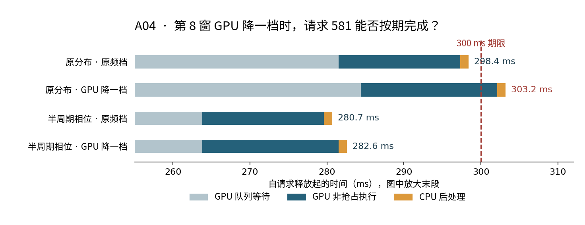

# M3-a 独立诊断 · 热感知配额内任务分布

**固定 NT 的窗口配额和设备频档后，请求分布足以改变实际排程。直接节能很小，最清楚的机制是分布改变后，一次原先会超期的 GPU 降档变得可行。** 在 M1-i 的 12 条 35°C 公开流上，固定频档时，普通参考能耗与时序引导平均节能 **0.000937%**，热感知能耗与风险引导平均节能 **0.001469%**。热引导对普通引导为 **7 胜 5 平**。公平开放单窗单设备降一档后，只有 A04 的新收益需要先改变分布。此次穷尽的有限邻域中，观察到 **1 个期限约束释放、0 个热约束释放**。

| 比较阶段 | 原分布 | 普通引导 | 热引导 |
|---|---:|---:|---:|
| 固定频档，平均节能率 | 0 | 0.000937% | 0.001469% |
| 固定频档，严格省于 NT 的工况 | 0/12 | 10/12 | 12/12 |
| 开放相同降频动作后，平均累计节能率 | 0.028884% | 0.029821% | 0.044668% |
| 降频本身进一步改善的工况 | 1/12 | 1/12 | 2/12 |
| 最终 SAFE 工况 | 12/12 | 12/12 | 12/12 |

节能率均以本流已认证的原 NT 为分母，再对 12 条流等权平均。各组从同一个可行解出发，拥有回退权，所以最终覆盖率包含继承的原解。主表取第一次重复；三次独立计时产生完全相同的固定预算胜出排程。这里的“胜”要求连续认证能耗区间严格分离。[逐工况 CSV](tables/cases.csv) · [逐阶段胜出计划、能耗分项与占用](tables/endpoints.csv)

## 1. 固定了哪些决策

基线为 [85969e8](https://github.com/YBEMR/paper/commit/85969e8ed78cbab4d693122819ebe866e0721bb7)。固定 M1-i 第一次重复、60 秒截面的 NT 已认证计划。逐工况读取原始请求 CSV、计划与完整证书，重新计算全部 12 份种子计划。请求文件哈希、排程身份、精确参考能耗、切换表、全部证书指标和原始事件数组哈希均一致。热模型始于 35°C 环境对应的空闲平衡，沿四节点状态跨窗传播，计入 301 ms 尾段、各节点全时域功耗和 0.3 W 外部常耗。[原始任务流登记](../m1i_generalization/registration/cases.json) · [逐工况复核回执](data/verification.json)

- **分布。** NT 的 `extension()` 对同窗同类的第 j 个请求取前后两个累积整数商之差，为 1 时送 NPU。M3-a 给商的分子加一个共同相位，或在一个混合单元内交换一条 GPU 请求和一条 NPU 请求。对每个候选逐窗、逐类型核对设备及频档的计数。纯设备单元在该类动作下只有原分布。[冻结分配与认证入口](../m1_transient_thermal_quota_20261126/mechanism.py) · [本轮动作实现](core.py)
- **执行。** 从释放时刻重建 CPU 前处理、设备 FIFO 主阶段和 CPU 后处理。主阶段非抢占；后处理按主阶段完成时刻、请求 ID 排队。因果空闲策略受本窗决策时刻约束，已开始的历史空闲段无法事后改作提前降档。每次切换占用 5 tick（0.5 ms）；完整重放包括尾端复位。时序失败时保存全流的实际完成时刻和超期请求清单。[冻结 FIFO](../m1_transient_thermal_quota_20261126/ledger.py)
- **热与能耗。** 热引导在同一 FIFO 轨迹上按 250 ms 箱计算平均功率矩，复用矩阵指数传播，在每箱始末温度间以梯形公式估算温度相关能耗。排序后，原认证器独立重建事件并逐事件连续积分；所有请求期限满足、完整证书为 SAFE 的解才参与节能比较。参考能耗为 35°C 参考功率基值下的完整积分，认证总能耗等于参考能耗加温度相关项。[原事件重建](../m1_transient_thermal_quota_20261126/frozen/p1/model.py) · [原连续认证](../m1_transient_thermal_quota_20261126/frozen/p1/heat.py)
- **文献对应。** Jayaseelan 与 Mitra 利用热特性不同的前驱、后继影响峰温，并联动调压；此处可观察的对应量是每个设备实际执行的请求序列。Bao 等通过重新分配静态或动态空闲时间来改变温度相关泄漏；此处的空闲段由请求映射、FIFO 和原因果控制自然产生。两篇论文分别给出机制动机，本轮数值来自 P1 重放。[Jayaseelan 与 Mitra，ICCAD 2008](https://websrv.cecs.uci.edu/~papers/iccad08/PDFs/Papers/08B.3.pdf) · [Bao 等，IEEE TVLSI 2012](https://www.ida.liu.se/labs/eslab/publications/pap/db/minba_VLSI12.pdf)

[预登记提交](https://github.com/YBEMR/paper/commit/a4f052ca5008d655363cfb918dd4901658af80a7) 冻结了输入选法、动作上限、评分、时间截面和第二阶段门槛。每条流 16 个均匀相位加 16 个同类换位，两引导组各最多认证前 4 个时序可行变体。普通组按参考能耗、期限余量和排空时刻排序，热组优先按预测超温量、预测全能耗和峰温排序。单组单阶段上限 30 秒。补充穷举审计在在线搜索完成后运行，单独保存。[预登记全文](PROTOCOL.md) · [计时运行器](run.py)

## 2. 固定频档的逐工况结果

每行都实际生成并重放了 32 个变体。“变体 SAFE”排除种子。所有时序可行的变体均完成原连续热认证。

| 工况 | 原 NT（J） | 变体 SAFE / 32 | 普通节能率 | 热引导节能率 | 开放降频后热引导累计节能率 |
|---|---:|---:|---:|---:|---:|
| A01 | 27.51084 | 19 | 0.001519% | 0.001519% | 0.001519% |
| A02 | 27.86619 | 26 | 0.000462% | 0.002522% | 0.002522% |
| A03 | 36.57643 | 19 | 0.000461% | 0.000461% | 0.000461% |
| A04 | 37.71501 | 29 | 0.000257% | 0.002358% | 0.174136% |
| A05 | 46.13613 | 13 | 0.000021% | 0.000374% | 0.000374% |
| A06 | 46.61049 | 23 | 0.000086% | 0.000885% | 0.000885% |
| B07 | 35.06237 | 14 | 0.006101% | 0.006101% | 0.006101% |
| B08 | 39.24052 | 18 | 0.000000% | 0.000206% | 0.000206% |
| C09 | 55.49998 | 17 | 0.000014% | 0.000450% | 0.000450% |
| C10 | 59.53147 | 19 | 0.000957% | 0.000957% | 0.347564% |
| C11 | 74.61670 | 22 | 0.000000% | 0.000427% | 0.000427% |
| C12 | 73.72090 | 28 | 0.001368% | 0.001368% | 0.001368% |

384 个固定频档变体中，247 个 SAFE，137 个违反时序。其中相位变体 116/192 SAFE，成对交换 131/192 SAFE。SAFE 变体相对各自原分布，最小期限余量变化范围为 −5.6 至 +9.3 ms，连续峰温上界变化范围为 −0.1482 至 +0.0208°C。GPU 空闲段数可减少 1 段或增加最多 4 段，全系统切换次数可增加最多 2 次。七条流在在线入选证书中达到第二阶段门槛，七条均由至少 1 ms 的期限余量改善触发；在线入选证书中，0.05°C 的降温门槛未触发。[动作族逐工况结果](tables/families.csv) · [触发证据](data/gate.json)

**直接节能的来源。** 热引导的 12 个固定频档胜出解相对各自原点，共省 7.130 mJ，其中参考能耗下降 2.093 mJ，温度相关项下降 5.037 mJ。普通引导也获得 4.587 mJ，其中两项分别为 2.311 和 2.276 mJ。由普通引导切换到热引导，温度项再省约 2.760 mJ，参考项合计增加约 0.217 mJ。该分解以实际焦耳计，和等权百分比表使用不同的汇总方式。峰值温度相同或极接近的排程也可能有不同的累计温度相关能耗。[逐解能耗分项](tables/endpoints.csv)

有限候选的离线连续审计表明，热引导在 12 条流都取得各自这 32 个变体与种子中的最低 SAFE 能耗，工况节能率中位数 **0.000921%**。最大改善为 B07 的 **0.006101%**，两种引导选中了同一相位。热组参与排序的时序可行候选中，两个阶段的最高预测温度仅 78.698°C，预测超温排序键全为零。预测峰温比连续上界低约 0.025–0.484°C。当前结果支持温度相关能耗对细粒度排序的作用；对超温风险排序的独立收益仍缺少证据。[全部候选](tables/candidates.csv) · [在线逐候选预测和认证次序](data)

## 3. 降频释放发生在哪里

每组均对相同的 101 个“工况、窗口、设备”组合试降一档。原分布组和普通组各有 1 个动作 SAFE，热组有 2 个。其余动作均在 FIFO 时序检验失败。全部 637 个工况内去重的物理配置，包括 12 个原点、384 个第一阶段配置、241 个新增第二阶段配置。262 个时序可行配置均获连续 SAFE，375 个时序失败。认证峰温上界最高 79.0363°C。[逐动作反事实](tables/paired_lower.csv) · [所有物理结果](tables/candidates.csv)

### A04 · 相位改变释放了末窗 GPU 降档

热组选择各个混合单元的半周期相位。640 个请求中，192 个改变目标设备，引起 627 个主阶段开始时刻和 630 个后处理开始时刻变化。固定频档时 GPU 忙时均为 7.8613 s，空闲段由 10 变为 11 段，最长空闲段由 328.9 ms 缩为 311.2 ms；NPU 空闲段由 14 变为 17 段，最长由 36.0 ms 增至 50.6 ms。全系统切换从 9 次增到 11 次。参考能耗增加 0.217 mJ，而温度项减少 1.107 mJ，净省 0.890 mJ。[请求与设备占用轨迹](data/A04_HLLLHHHL_T35/traces.zip) · [受影响的请求数](tables/trajectory_changes.csv)

| A04 的匹配干预 | 请求 581 响应时间 | 全流最小期限余量 | 连续峰温上界 | 完整能耗 |
|---|---:|---:|---:|---:|
| 原分布、原频档 | 298.4 ms | 1.6 ms | 77.6551°C | 37.715009 J |
| 原分布、第 8 窗 GPU 3→2 | 303.2 ms | −3.2 ms | 时序失败 | — |
| 半周期相位、原频档 | 280.7 ms | 10.9 ms | 77.6221°C | 37.714119 J |
| 半周期相位、第 8 窗 GPU 3→2 | 282.6 ms | 10.9 ms | 77.6221°C | 37.649333 J |

请求 581 属于 B1，在 7.0000 s 释放，期限为 7.3000 s。两种分布下该请求都留在 GPU。相同降档时，它在原分布下于 7.2844 s 开始主阶段，在新分布下于 7.2638 s 开始，早了 20.6 ms。降档相对新分布自己的第一阶段起点额外省 **0.064786 J**，相对原 NT 累计省 **0.17414%**。普通组选择的局部相位仍使该请求迟到。这里实际跨过的是请求期限；原分布降频方案已经违反时序，没有合法的 P1 热证书。[失败与成功的原始逐请求记录](data/A04_HLLLHHHL_T35/audit.json.gz)

### C10 · 原分布本来就能降档

第 6 窗 GPU 降一档在三个组中都通过认证。即使保持原分布，能耗也从 59.53147 J 降到 59.32513 J，节能 **0.34660%**。两个引导组选择同一个分布，降频后为 59.32456 J，累计节能 **0.34756%**，最小期限余量均为 3.2 ms。约 0.20634 J 的降档收益在原 NT 上已经存在。其余 10 条流的已测降频动作全部因时序失败。[C10 原始轨迹](data/C10_HHHHLLHHLLLL_T35/traces.zip)

## 4. 相同实际时间的比较

每次独立生成候选、执行全流重放、完成各自排序，并用原认证器写完原生排程、证书和事件文件后才计作可用。每一工况内使用同一核，按登记顺序轮换，三条工况分占三个核并行。所有组在时刻零已有相同的 NT 证书。下表先在每条流取三次重复的节能率中位数，再跨流平均。累计时间合并同一重复的两个搜索阶段；公共输入读取与复核、跨工况触发判断、批后审计均在钟外。

| 截止 | 固频普通 | 固频热引导 | 两阶段原分布 | 两阶段普通 | 两阶段热引导 |
|---|---:|---:|---:|---:|---:|
| 0.25 s | 0.000889% | 0.001411% | 0.028884% | 0.000889% | 0.001411% |
| 0.5 s | 0.000937% | 0.001469% | 0.028884% | 0.000937% | 0.015784% |
| 1 s | 0.000937% | 0.001469% | 0.028884% | 0.029821% | 0.044668% |
| 2 s | 0.000937% | 0.001469% | 0.028884% | 0.029821% | 0.044668% |
| 5 s | 0.000937% | 0.001469% | 0.028884% | 0.029821% | 0.044668% |
| 10 s | 0.000937% | 0.001469% | 0.028884% | 0.029821% | 0.044668% |
| 30 s | 0.000937% | 0.001469% | 0.028884% | 0.029821% | 0.044668% |

0.25 s 时，原分布组可以立即搜索降频，已获得 C10 的收益。两个引导组还在进行分布筛选和认证。1 s 时，全部重复已用尽有限邻域。第一阶段普通组与热组建池及排序中位耗时分别为 7.7 和 30.8 ms，含认证写盘的总耗时中位数分别为 410.0 和 416.6 ms；两组每条每次均认证 4 个变体。第二阶段两组常在完整重放后用尽时序可行候选。全批 180 次计时运行，在线连续认证 300 次。各阶段实际耗时、每次认证结束时刻和完整原始计时均留存。[2,268 条截面](tables/wallclock.csv) · [时间汇总](tables/wallclock_summary.csv)

## 5. 结论边界与复核入口

固定配额的分布是一个有物理意义的调度变量。就这些公开流而言，其固定频档直接节能处于万分之一百分点至千分之几百分点量级。A04 给出了更有研究价值的路径，即先改变设备排队及空闲段位置，再利用释放的期限余量降频。当前只有一个独立工况出现该路径；每个引导组仅从自己第一阶段最低 SAFE 能耗解继续，各试一次单窗单设备降一档。结果限于 35°C、这些 P1 画像、12 个已知种子及这批有限动作，不能据此估计新任务流上的发生率或更广邻域的上限。

[数据字典与重放方法](EVIDENCE.md) · [全套物理证据目录](data) · [逐工况汇总](tables/cases.csv) · [校验清单](SHA256SUMS)
