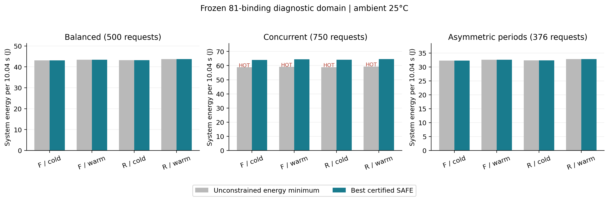
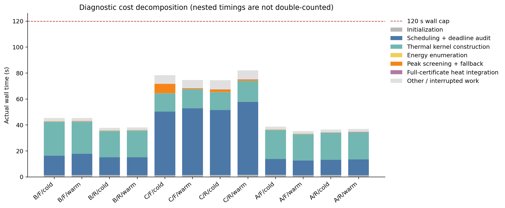

# 十二组问题诊断：接口适配与精确结果

## Material Passport

- 日期：2026-11-23；来源：冻结合成平台、已批准输入及本轮实际运行。
- 输入提交：[3db685b](https://github.com/YBEMR/paper/commit/3db685b74773c8e029881e459de72a0c4e8e41ee)。
- 执行冻结：[5002101](https://github.com/YBEMR/paper/commit/5002101d3f550083ace9d7e24f67a7d0ee6398a2)；[执行协议](PROTOCOL.md)、[实际配置](protocol.json)、[环境](environment.json)。
- 结果范围：81 个具体切点/物理绑定、每场景27个频率组合、四场景完整连续热。未执行 Kim、Energy-Only、新网络或新启发式实验。
- 验证：四个固定见证回归；772 张完整物理证书及对应逐请求记录通过归档核验。无预算外重放认证。

## 结论

**新问题值得继续研究，证据来自预定高并发负载，而不是调高环境温度。** 在固定25°C环境下，高并发四组的最低无温限连续能耗方案均超温，同时存在其他SAFE部署；安全约束使同域最优能耗增加 8.82%–8.97%。均衡与非对称周期的八组均为“无温限最优本身SAFE”，这些负结果完整保留。

12/12 工况均在120s内取得有限域最优性证书，实际墙钟 35.32–82.08s，合计 623.66s；无超时、无全域最优性未决。两个均衡逆序工况仍有13个部署的“是否存在SAFE频率”未逐一判完，所以可行部署数报告68–81；这不影响全域最优性证明，不追加运行填齐计数。

这批结果**没有证明 Kim 存在明显差距，也没有证明需要新热修复算法**。高并发四组首次得到的SAFE方案已经是最终最优；后续计算完成分类和证书，未进一步降低该SAFE能耗。

## 全部结果

E₀取消80°C可行性限制，但保留请求期限、连续热传播和温度相关漏电。冷态为四节点30°C，预热态来自批准的旧C部署10.04s终温；环境始终25°C。三种负载分别500、750、376请求，每个请求期限40ms，完整计能窗10.04s。

|负载|顺序/初态|E₀ J|E₀ 峰温 °C|最低 SAFE J|SAFE 部署|SAFE 峰温 °C|可行部署数|墙钟 s|
|---|---|---:|---:|---:|---|---:|---:|---:|
|均衡|正序/冷态|43.110688|76.504|43.110688|D005|76.504|81|45.33|
|均衡|正序/预热|43.399105|76.565|43.399105|D005|76.565|81|45.40|
|均衡|逆序/冷态|43.250300|79.210|43.250300|D000|79.210|68–81|37.84|
|均衡|逆序/预热|43.725717|79.728|43.725717|D000|79.728|68–81|38.13|
|高并发|正序/冷态|58.801204|87.166|64.073766|D017|77.115|6|78.29|
|高并发|正序/预热|59.106591|87.233|64.389252|D017|77.184|6|74.68|
|高并发|逆序/冷态|58.905263|87.549|64.098505|D017|77.500|6|74.52|
|高并发|逆序/预热|59.383044|87.619|64.629171|D017|77.573|5|82.08|
|非对称周期|正序/冷态|32.321430|59.207|32.321430|D005|59.207|81|38.69|
|非对称周期|正序/预热|32.609847|73.829|32.609847|D005|73.829|81|35.32|
|非对称周期|逆序/冷态|32.388486|60.758|32.388486|D000|60.758|81|36.43|
|非对称周期|逆序/预热|32.863903|74.279|32.863903|D000|74.279|81|36.93|

以上12个最低SAFE能耗均已证；不能用不同负载的绝对焦耳直接计算节能率。[完整汇总 CSV](summary.csv)包含期限余量、热裕量、有效下界、首次SAFE、最佳SAFE首次出现、最终认证和停止时间。



## 热约束带来了什么

高并发正序冷态中，E₀=58.801204J，D004，GPU峰温87.165788°C；最低SAFE为64.073766J，D017，GPU峰温77.114986°C、期限余量1.178985ms。其他三个高并发工况的E₀峰温为87.23–87.62°C，SAFE峰温为77.18–77.57°C。

D004/D000/D005采用相同切分结构：YOLOv2的两段占两个DLA名额，两个tiny各占一个，YOLOv3全部在GPU。D017将两个tiny移回GPU，用空出的两个名额给YOLOv3的0–36、37–78前缀，后缀79–178仍在GPU；YOLOv2切点保持29/40。高并发正序的频率从LLL/LHL/LHL/LHL变为LLL/LHH/LHH/LHH，提高DLA频率以满足期限。这是部署、名额与场景频率共同决定的可行性变化，不能单凭此对照给每个动作分配独立因果收益。

以该冷态实例计，SAFE最优相对E₀增加5.272562J：空闲项+2.646J、活动项+2.292864J、漏电项+0.312977J、传输项+0.020721J，板级项不变。GPU峰温下降约10.05°C，同时DLA承担更多热负载。**这是保证安全的能耗代价，不是算法节能率。** 不能把不安全的低能耗候选作为可部署节能方案。[能耗与温度分项](energy_components.csv)、[获胜部署实体](winning_deployments.json)。

高并发正序冷/热态和逆序冷态各有6个SAFE可行部署，逆序预热只有5个。所有81部署及全部合法频率已完成相应分类，排除范围不是从单条超温见证推断。[逐部署覆盖](deployment_coverage.csv)

## 最优部署是否改变

负载变化带来了实质差异：D017用于均衡负载时，其同部署最低SAFE能耗比该工况最优高3.92%–4.08%；均衡最优D000/D005用于高并发时，完整分类证明它们没有SAFE频率序列。因此不存在一个这两类负载都最优的共同部署，不只是ID换名。[同工况部署替换代价](deployment_transfer.csv)

场景顺序在均衡/非对称周期中使最优ID从D005换为D000，但两者切点相同，仅两个tiny的物理DLA绑定不同；均衡下两者差距仅约0.00009%–0.00045%，不应包装为重大能耗收益。

**预热本身没有改变任何一对冷/热态工况的最优部署。** 它增加温度相关漏电、降低热裕量，并在高并发逆序中减少一个SAFE可行部署。均衡逆序预热的最优峰温79.728054°C，距80°C仅约0.272°C，仍经完整连续峰温认证。非对称周期降低大网络请求频率，在这四组中反而缓解热压力；不能声称异构周期必然造成优化困难。[容差1e-7J下的最优部署集合](optimal_deployment_sets.json)

## 到解时间与求证成本

高并发四组首次SAFE即最终最优，出现于 12.62–14.44s；全域认证完成于 74.35–81.89s。不能把最终结束时间写成“首次获得优质解时间”。[SAFE改进轨迹](safe_progress.csv)

主要成本仍为事件调度和热核构建；高并发还需要全域热分类，部分候选触发原积分回退。日志逐次记录SetFreq（本方法为0次）、调度、期限检查、构核、峰温批量查询、回退和完整认证。原M2包含式时间与细分计时嵌套，绘图按不重叠项归并；完整认证中的调度计入调度项，认证热积分单列。



[成本 CSV](costs.csv)保留实际调用数量。单次确定性运行、顺序执行、数值库单线程，使用已有Numba代码缓存且加载/缺失编译计时；候选与场景缓存每工况为空。没有安排M0/旧M2同机匹配对照，不能把本次耗时差异解释为算法加速证据。额外“逐部署最低解认证”属于问题诊断开销，全部纳入预算。

## 正确性、限制与下一步

原正序C、逆序C、正序D005的能耗、峰温上界、终温和期限余量与旧归档差为0；预热入口逐节点复现。额外固定C预热见证的仿射传播与原完整评价器一致。[回归记录](regression.json)

[归档核验](verification.json)检查请求ID、逐请求释放/期限/完成时刻、全部请求覆盖、连续热入口继承、全窗能耗分项、峰温SAFE条件，以及已保存完整分类数组的摘要与分类计数；未为改善结果重新评价候选。原输入和旧源码均保持不变，绑定源码和105项依赖摘要见 [执行清单](execution_manifest.json)。

证书仅覆盖冻结81个具体绑定。预热后的两个DLA温度不同，不能把81域最优外推为161种物理绑定或4,319,803扩展域最优。物理模型仍为合成模型；峰温采用原binary64数值保护，不是硬件实测或有向舍入形式化证明。预热是共同外生初态，部署迁移/加载成本不在模型内。高并发同时改变共现和请求总量，不能分离两者的单独因果贡献。

建议保留当前问题定义：它已展示“能耗最低但超温、存在另一安全部署”的真实模型内矛盾，也保留热约束不活跃的条件。下一阶段若获批准，应先在这些相同输入下公平适配Kim＋SAFE和Energy-Only，检验算法缺口；目前不增加网络、负载、温度、种子或新启发式。不因本轮结果直接决定第三、四章主算法。

## 文件及复算

原始运行在 [raw/](raw/)，每工况有job、控制台、退出状态、完整JSONL压缩日志；高并发还保存81份频率分类数组。可编辑图为 [energy_diagnosis.svg](figures/energy_diagnosis.svg)、[wall_cost.svg](figures/wall_cost.svg)。

只从归档复算（不启动实验）：

```text
python -B research/multidnn_diagnostics/analyze.py
python -B research/multidnn_diagnostics/mechanisms.py
python -B research/multidnn_diagnostics/plot.py
python -B research/multidnn_diagnostics/report.py
```

如需独立复现实验，应使用执行冻结提交的全新checkout，保留原文件字节和依赖，再运行launch.py；它会核验该提交中已通过的回归凭证。若先独立重跑regression.py，须另存新生成的回归记录，再从执行提交恢复regression.json后启动（该文件含实际耗时，重跑会改变哈希；恢复的是输入凭证，不覆盖新复验记录）。已有raw目录会被拒绝覆盖；本次授权的十二次运行已完成，复现不是自动追加的实验。结果提交仅增加归档、分析与图表，不修改执行冻结代码。
