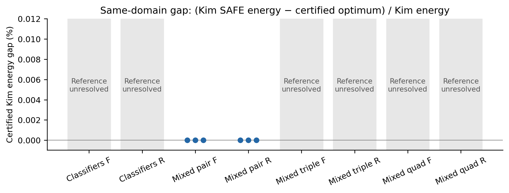
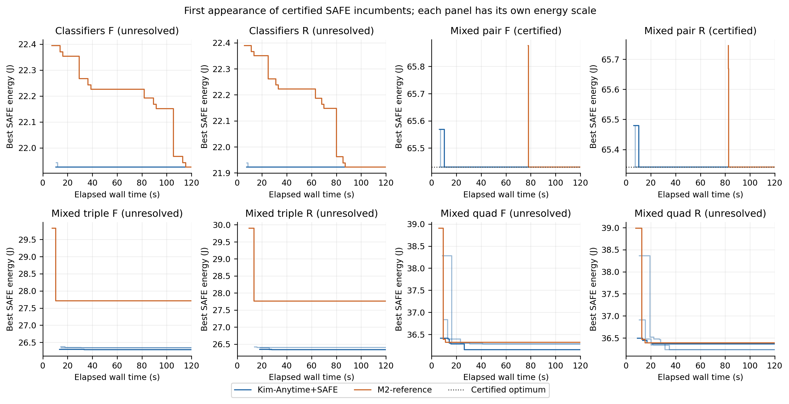
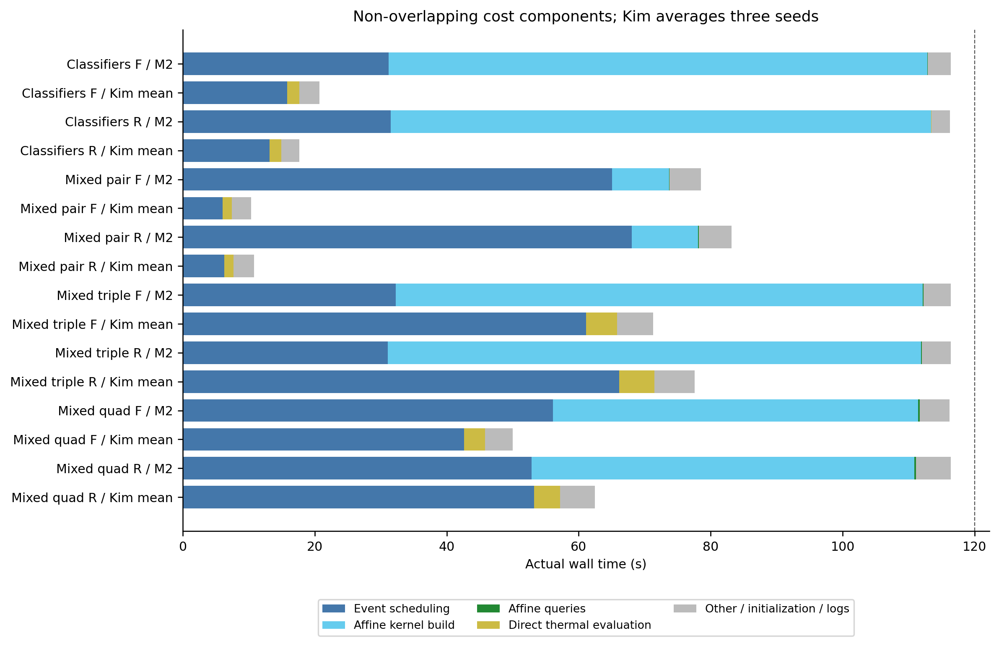

# 多DNN结构泛化与 Kim 同域最优性差距

**结论：本轮完成了模型、来源审查与一次固定批次，但尚未证明存在值得开发新算法的显著节能空间。** 两个取得同域最优证书的混合双网工况中，Kim六次均达到安全最优，Gap=0；另外六个工况的精确参照在120秒上限内未闭合，真实Gap未知。不能据此说“Kim对一般多DNN始终最优”，也不能说“新模型已暴露3%–5%节能空间”。

分支 `codex/multidnn-structure-gap`，基于上一阶段结果 `f4a0a081d90eae8f219f4638acac80b6dbd233e7`。执行冻结提交：[fd2c3f39bbf56253bcd138cdfa8a43ce5b7ea240](https://github.com/YBEMR/paper/commit/fd2c3f39bbf56253bcd138cdfa8a43ce5b7ea240)。先推送冻结版本，再运行；本结果提交只增加后处理、原始记录和结论，没有改变执行文件、输入或旧成果。

## 做了什么，哪些还没验证

新增ResNet-18、MobileNetV2静态计算图，与原YOLO混合；保留残差投影、深度卷积分组、ReLU6、线性瓶颈及分类头。参数量分别核对为11,689,512和3,504,872；MAC分别为1.814073344 G和0.300774272 G。来源、版本、许可证及权重地址见[来源审查](sources.md)、[模型清单](model_inventory.csv)。

当前机器为GTX 1650 Ti，无DLA或trtexec；Torch导入失败，未建设新环境。没有加载权重、导出图、编译引擎、检查实际放置、核对输出或实测FP16精度。图按锁定官方源码静态重建，参数数量和依赖核验不等于端到端执行验证。

**这是结构多样化的合成DNN实验。** 新图进入旧算术量/流量服务公式，CPU、GPU、双DLA功耗与执行率、27频点、RC、漏电、80°C温限、10.04秒全窗计能和原事件调度器保持不变。真实深度卷积利用率、融合、带宽和功耗没有测量保证；静态DLA算子必要条件不是实际可构建证明。分类任务输出logits，仅用旧CPU固定setup，不虚构检测框后处理。

一般生成器支持GPU前缀/中间段、两个DLA连续段及物理绑定。精确诊断只使用预先声明的小域：每网取首个DLA兼容前缀的完整模块边界中点与末点，两块全部3²设备标签、末段GPU、全局不超过四个DLA常驻段。两个切点只由拓扑确定，没有按能耗或Kim表现选择。双网81、三网649、四网3441具体部署；**此81不是旧YOLO的81域**，也不是一般全边界域，更不是全部真实硬件合法域。

完整定义及新旧差异见[模型](MODEL.md)、[执行协议](PROTOCOL.md)。旧四网27频点阶段时延/功率逐项回归，旧500请求完整能耗/温度/期限相等；新图8个固定微型仿射/标量对照通过。无新的启发式算法，无结果驱动调参。

## 固定实例与方法

|族|模型|周期ms|期限ms|请求数|场景/部署数|
|---|---|---|---|---:|---:|
|分类双网|ResNet-18、MobileNetV2|20/40|20/30|625|2 / 81|
|混合双网|ResNet-18、YOLOv3|20/40|20/40|500|2 / 81|
|混合三网|ResNet-18、MobileNetV2、YOLOv2|20/40/40|15/30/40|760|3 / 649|
|混合四网|ResNet-18、MobileNetV2、YOLOv2tiny、YOLOv3|20/40/40/80|20/30/40/60|846|4 / 3441|

每族正/逆序，共8个主实例；相同族正逆序总工作量相同。主实例统一环境25°C、初温四节点30°C，后续连续继承。另4个更紧期限/既定预热入口的留出输入已冻结，**没有运行**。本轮不推断其他环境温度或热启动结论。

精确参照沿用M2仿射核和连续峰温认证，只适配网络/场景数、图与请求；核缓存4096项。Kim采用已有Anytime＋SAFE机制：24个体×64代、3种子、原SetFreq/Lexicase/交叉/变异，每代一次独立热认证，热结果不进入遗传选择。两方法使用相同原始部署域、完整频率集合和请求输入。没有向Kim注入精确赢家。

32次正式运行：精确参照8次、Kim24次；每次120秒完整墙钟，116秒停止接纳，Kim生成窗口95秒。初始化、调度、构核、查询、峰温回退、认证与日志全部计时。四个固定逻辑核，同一工况同一核，库单线程，运行次序事前冻结。没有补跑、增加种子或延时。24次Kim均完成64代并认证完已生成的期限可行候选池；并不代表访问了整个合法部署域。

## 同域结果

Gap严格按 `100×(Kim_SAFE−E*_SAFE)/Kim_SAFE`，只对已证最优计算。下表能耗单位J；未决栏的数值仅为最好已见，不是最优值。

|工况|精确能耗扫描覆盖|同域已证最优|Kim三种子SAFE能耗范围|真实Gap|
|---|---:|---:|---:|---:|
|分类双网·正|41/81|未决|21.926296|未知|
|分类双网·逆|55/81|未决|21.922558|未知|
|混合双网·正|81/81；热分类81/81|65.430505|65.430505|0%|
|混合双网·逆|81/81；热分类81/81|65.341796|65.341796|0%|
|混合三网·正|37/649|未决|26.285988–26.346666|未知|
|混合三网·逆|28/649|未决|26.333790–26.398930|未知|
|混合四网·正|76/3441|未决|36.153933–36.287827|未知|
|混合四网·逆|47/3441|未决|36.234195–36.365525|未知|

Kim 24/24 SAFE，最终峰温36.099–65.910°C；最小期限裕量0.002242 ms，这只是冻结合成模型内的期限证书，不能外推到真实设备抖动。首份完整SAFE证书时间中位数10.02秒，最终最好SAFE首次出现中位数14.64秒，进程结束中位数35.24秒；三个时间不混用。逐运行值见[结果表](run_results.csv)。

分类双网中Kim与精确法预算内最好已见值相同，但精确扫描未完成，仍不能报告Gap=0。三网/四网的Kim种子间能耗差为0.2303%–0.3690%，证明搜索结果不是完全稳定；这不等于真实最优性差距，更不支持几个百分点的节能潜力。六个未决实例目前仅有15.562 J的松下界，无法判断Kim还离最优多远。

## 热约束与代理偏差实际证据

混合双网正/逆序的全域无温限最低能耗分别为63.081568/62.963142 J，GPU连续峰温至少86.440172/86.959763°C，确实违反80°C。全域81部署中37个存在期限可行频率序列，共317条；其中36部署、236条序列SAFE。完整热约束将最优从全GPU部署改为ResNet-18的0–45段上DLA、YOLOv3的0–69段上另一DLA，频率LHH/LHH；安全峰温为65.405317/65.910024°C，期限裕量1.960445 ms。详见[热决策表](thermal_decisions.csv)。

精确参照保存S00042，Kim保存S00075，两者只是双DLA物理标签交换，已归档能耗相同。机制表里“没有访问参考部署S00042”不能解释为漏掉最优：`obtained_certified_optimum`明确记录Kim已经得到等能耗最优。

三网/四网正式候选日志中发现独立场景代理与全窗SAFE能耗的排序反转，最大已观察两候选连续能耗差约0.09248 J。**这证明代理排序并不完全等价，但尚未证明它造成最终能耗损失。** 反转候选都已完整认证，Kim也已检查完生成池；没有这些工况的全域最优证书，无法把其种子差异归因于热代理、联合交换不足或SetFreq遗漏。两个已证工况中未观察到此类SAFE候选排序反转。

因此，已经证明的是“新增结构下仍可出现热约束改变部署”和“某些候选存在跨场景排序偏差”；尚未证明的是“此偏差使Kim损失显著最终能耗”。本轮没有开发新算法来填补未经证实的缺口。

## 精确参照为什么未闭合

两个成功工况分别耗时78.53/83.15秒；事件调度占82.82%/81.82%，期限筛掉大量频率组合后，实际可行频率序列很少。分类双网和三网的构核约占墙钟69%–70%；四网主要由事件调度与构核共同占用。核查询占比很小。分类双网尽管只有81个部署，也未在预算内完成：部署数量不能单独代表求解成本。

这是**本轮M2场景数量适配实现及缓存配置**的实测限制，不是证明所有精确方法都无法在120秒解决这些实例，也不推翻旧M2成果。它说明本轮“测量真实Gap”的证据收集能力不够，不能把更慢的部分扫描当作Kim优于精确最优的证据。

曲线在方法结束后延续其已得解至120秒，仅表示预算内可用解，不能读作该方法一直运行到120秒。各面板独立能耗刻度，不比较不同任务量的绝对焦耳。

## 决策与交付

**第一关：部分完成；第二关：暂不进入。** 新网络、异构周期/期限与一般分区接口已经建立，但新增三网/四网及分类双网的真实最优性差距仍未测得。现在不应增加热权重、资源交换启发式、遗传代数或定向“难例”。也不应仅凭这两个证书认定研究空间不存在。

“Kim足够优秀，还是原模型让它容易接近最优？”本轮仍不能二选一。两个热约束起作用的已证实例支持强基线判断；六个未决实例和共享合成吞吐/功耗假设使更一般结论没有证据。若继续，优先补齐已有冻结实例的可信同域参照与新网络参数/可构建性证据；不能用新增工况或新算法绕过这个缺口。本轮到此停止，没有执行留出集或启动下一轮研究。

归档核验通过：32个进程正常结束，其中6个精确任务按预算未决；2169条完整物理评价记录（2161 SAFE、8超温），107份SAFE逐请求账本、74270条完成记录；140份执行清单文件和旧来源哈希保持一致。可审查入口：

- [配置](formal_experiment_config.csv)、[冻结协议](PROTOCOL.md)、[模型定义](MODEL.md)、[源文件/输入清单](execution_manifest.json)。
- [逐工况汇总](case_summary.csv)、[逐运行结果](run_results.csv)、[机制记录](mechanism_evidence.csv)、[SAFE进程](safe_progress.csv)、[原始数据](raw/)。
- [必要正确性检查](checks.json)、[归档核验](verification.json)、[复算说明](REPRODUCE.md)。
- [绘图脚本](plot_gap.py)、[SVG/PNG图](figures/)；原始CSV与可编辑SVG均保留，PDF按仓库规则本地重建。
