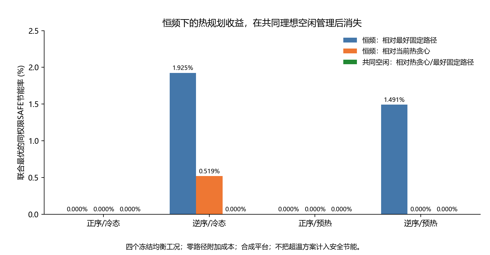

# 有限常驻双路径的热感知调度价值

**不建议基于本双路径、四工况独立立项。** 恒频模型确实展示了热状态判断和未来规划价值；但共同零开销GPU空闲管理后，固定D040、负载感知、当前热贪心与联合最优在四组中全部SAFE且能耗完全一致。收益缺乏独立于普通空闲管理的证据，按冻结门槛停止，不再开展非零开销回放或新算法。

## Material Passport

执行冻结：[9f7970f](https://github.com/YBEMR/paper/commit/9f7970f55ea00301de0c283b2c46cddb5d6cfaac)；历史输入与固定见证45b14f9，基线分支保留全部旧成果。来源为冻结合成四节点模型；不代表真实引擎、输出一致性或硬件测量。四工况各运行一次恒频＋idle_zero，实际24.22–35.49秒，无超时、追加运行或参数修改。8条旧完整见证回归通过；38份完整新见证、19000条请求记录核验通过，其中36份SAFE。

## 同权限能耗结果

单位J，10.04秒完整系统能耗；†表示超温，不计SAFE节能率。固定路径分别完整优化27⁴频序，“无SAFE”已排除全部59,049条期限可行序列。联合域覆盖两路径×27频率的四场景选择，经期限筛选有419,904条序列。精确方法均按原数值连续热标准完成有限域证书，容差1e-7 J。

|工况/权限|固定D038|固定D040|负载感知|当前热贪心|全窗联合|
|---|---:|---:|---:|---:|---:|
|正序/冷态/恒频|44.897730|43.366317|43.366317|43.366317|43.366317|
|正序/冷态/共同空闲|42.917670|42.469102|42.469102|42.469102|42.469102|
|逆序/冷态/恒频|44.973063|无SAFE（已证）|43.493091†|44.337229|44.107332|
|逆序/冷态/共同空闲|43.039472|42.639146|42.639146|42.639146|42.639146|
|正序/预热/恒频|45.187526|43.654733|43.654733|43.654733|43.654733|
|正序/预热/共同空闲|43.206193|42.757054|42.757054|42.757054|42.757054|
|逆序/预热/恒频|45.499880|无SAFE（已证）|43.968509†|44.821381|44.821381|
|逆序/预热/共同空闲|43.446032|43.060773|43.060773|43.060773|43.060773|

“共同空闲”指GPU空闲即时L、任务就绪即时恢复原计算L/M/H，时延、能量、等待均为0的统一理想响应式管理，不需要未来时间轴。CPU/DLA原频率保留，所有方法温度连续，不免费重置温度。完整四方法（固定路径分两行）的路径、频序、峰温、期限余量与状态见[all_methods.md](all_methods.md)及[comparison.csv](comparison.csv)。

## 五个研究问题

**1．同一负载，入口温度是否改变最优路径？恒频下会。** 对逆序sc2的同一当前候选表，四节点30°C参考入口下，最低SAFE配置是D040/LHL；实际继承热贪心上一场景的入口[37.896,71.231,35.151,35.151]°C后，当前最低SAFE改为D038/LHH。预热组也发生这一变化。这是四节点入口向量的配对比较，不能归因为仅GPU单点温度。

全窗最优也随外生初态改变：逆序冷态的前两场景用D038→D040，逆序预热改为D040→D038；负载、时长、频率集合相同。共同空闲管理后两组均在YOLOv3活跃场景使用D040，当前热状态未再改变所选路径。[决策日志汇总](decisions.csv)保存实际入口与共同参考入口选择。

**2．热贪心是否因过去选择而陷入后续无SAFE？本轮没有。** 它在两权限组、全部四工况都完成500请求并SAFE。恒频逆序中，它需在第二个活跃场景换路径；“换路后更耗能”不等于“后续不可行”。负载感知在恒频两个逆序工况超温，说明忽略真实热历史会失去安全性；这不能写成热贪心失败。

**3．未来规划是否更省能？只在恒频逆序冷态观察到。** 联合44.107332 J，当前热贪心44.337229 J，净省0.229897 J（0.518519%）；相对最好固定D038省1.924997%。联合在sc3先多付0.666512 J，把GPU出口压到58.205°C，随后sc2可用D040，比贪心的sc2少付0.906307 J，后两场景差异抵消约0.009897 J。不是仅换算法名称，而是当前成本与后续热可行配置的取舍。

|策略/场景|路径/频率|入口 CPU/GPU/DLA0/DLA1 °C|出口 CPU/GPU/DLA0/DLA1 °C|场景能耗 J|
|---|---|---|---|---:|
|热贪心/sc3|D040/LHL|30.000/30.000/30.000/30.000|37.896/71.231/35.151/35.151|14.176232|
|热贪心/sc2|D038/LHH|37.896/71.231/35.151/35.151|41.254/67.130/48.284/50.010|16.678602|
|联合/sc3|D038/LHH|30.000/30.000/30.000/30.000|38.168/58.205/45.143/45.543|14.842744|
|联合/sc2|D040/LHL|38.168/58.205/45.143/45.543|40.888/79.704/38.378/39.015|15.772295|

联合峰温79.959383°C，仅余约0.041°C模型内热裕量；热贪心峰温71.593820°C。能耗优势没有同时提高热裕量，不能外推为对平台误差更稳健。逆序预热中联合与热贪心相同；正序两组也相同。全部方法各场景四节点入口/出口见[scene_states.csv](scene_states.csv)。

**4．共同空闲管理后上述优势是否存在？没有观察到。** 固定D040在原恒频逆序全频率域无SAFE，但在idle_zero中四组均SAFE，并达到联合域最优值；两种动态贪心也达到相同值。因而恒频下的0.519%未来规划增量、1.491%–1.925%相对固定路径增量均消失。不能用共同空闲管理本身的节能来证明动态路径算法贡献。

**5．收益来源是什么？** 恒频逆序中，负载适配本身不足以保证安全，当前热状态判断提供了SAFE路径切换；冷态还有0.519%的未来规划增量。共同空闲管理后，一条固定D040已足够，无需用动态路径解释结果。部分输出在YOLOv3不活跃的sc0/sc1显示D038，是等价动作的固定ID裁决；两路径在这些场景的有效阶段相同，不应将名义路径切换计为实际工作负载适配收益。

## 工程条件、成本边界与取舍

DLA常驻并集4阶段，每个DLA2个：YOLOv2 DLA0[0–29]、YOLOv2tiny DLA1[0–16]、YOLOv3 DLA1[0–36]与DLA0[37–78]。D040的YOLOv3全GPU，D038另有GPU后缀[79–178]；这些GPU引擎同时常驻的容量、静态功耗、设备放置与输出一致性未验证。所有策略统一忽略额外引擎成本与路径选择开销，阶段/请求必须在场景边界完成后才换路径，不重载引擎。

恒频逆序冷态相对最好固定路径的理论全窗额外成本余量0.865730 J（等效平均功率约86.23 mW），逆序预热为0.678499 J（67.58 mW）；冷态相对热贪心的未来规划净余量仅0.229897 J。这只是净能量差，额外开销还可能改变时间轴和热安全，不能直接视为可接受的真实硬件开销上限。共同空闲管理后，这个增量余量为0 J：动态方案没有证实能支付相对固定D040的额外常驻或选择成本。

冻结后续门槛：共同空闲下，联合相对当前热贪心或最好固定路径节能≥0.5%，或联合避免热贪心无SAFE，才补100 µs/10 µJ响应式回放。[门槛结果](followup_gate.json)四组均未触发。因此**没有非零切换开销的本轮结果**，不能断言真实开销下也完全打平；但本轮不为寻找正结果追加实验。

建议保留“恒频下存在热规划机制、共同理想空闲管理使其失去增量”的正负证据，结束当前范围的独立算法立项。此结论限于两路径、原均衡四工况与冻结模型，不证明所有有限常驻多路径问题都无价值，不改变第三、四章既有安排。

## 证书与复算

固定路径的全频序最优是利用预先声明场景计划的离线静态参照，不能同时称为不知道未来输入的在线算法。两种贪心的函数只接收当前场景及入口；固定、联合精确结果没有传给贪心。所有模型均从真实入口传播，热核30°C只是仿射展开锚点。

恒频复用原M2核；idle_zero按实际忙闲分段，复合原核的出口矩阵与能耗系数，连续峰温仍由原评价器及其回退处理。安全证书是冻结binary64数值标准，不是硬件验证或有向舍入形式化证明。能量最优性来自完整期限可行域的有效能量排序与低能候选排除，未将末温检查冒充连续SAFE。

交付：[协议](PROTOCOL.md)、[配置](config.json)、[热核适配](model.py)、[精确枚举与因果选择](search.py)、[原始证书/选择日志/完整轨迹](raw/)、[核验](verification.json)、[可编辑图](mechanism.svg)。

仅离线复核/重绘：`python -B research/resident_multipath/archive.py` 验交付哈希，再运行 `analyze.py`、`report.py`（同目录），不触发新实验。正式运行命令为该目录`launch.py`，只用于另行独立复现的全新执行冻结checkout，不覆盖本次raw。依赖沿用既有numpy/scipy/numba/matplotlib，环境与执行SHA见[environment.json](environment.json)。
