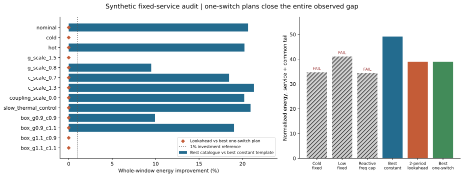
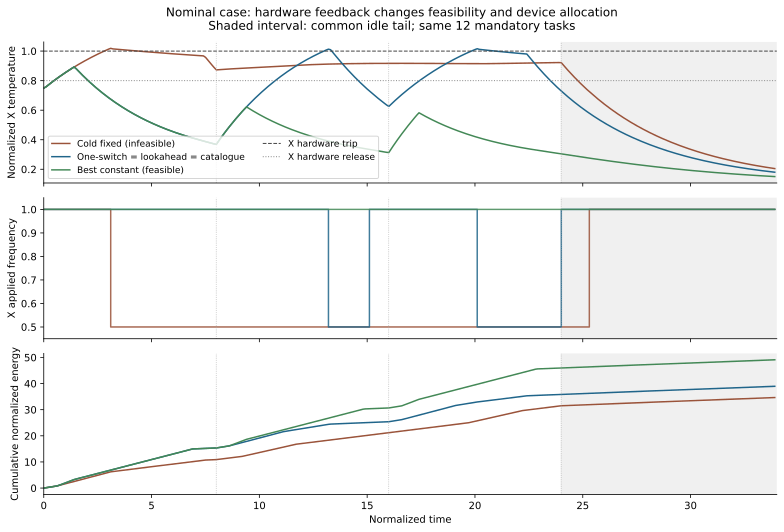

# 固定服务量下的热降频反馈：有限机制验证

**结论：热反馈能改变合成实例中的最低能耗可行安排；本轮没有继续开发复杂算法的必要证据。** 名义情景相对“每次重复使用同一个模板”的最佳固定安排节能20.6395%，但一个离线预排、至多切换一次模板的简单方案已达到相同质量。两周期前瞻相对该强简单类额外节能为0%。这些数值不是硬件实测。

真实数据方面，已核查6项近邻并复算公开Pi日志；有效频率、同步全窗功率、双资源执行支持与热参数未闭合。因此交付的是**未标定的条件机制实验及可辨识性报告**，不能称为真实SoC验证或已成立论文创新。

## 文献与数据结论

OPTiC已显式处理热降频下CPU/GPU共同执行时间；F-DTM有热预测、异构分配与实际速度反馈；Phoenix存在关闭早退出的完整骨干分配消融。目标不同不等于这些方法不能适配固定工作量能耗问题。HBTASP仅取得出版商预览，结论保留覆盖限制。[完整近邻对照与来源](EVIDENCE.md)。

Sustainable Edge Vision公开S0日志出现1910个节流标志样本，频率列却始终2400MHz；实现优先读取可能只代表请求P-state的scaling_cur_freq。原始外部功率也未公开。不能用单CPU数据拼接Jetson功率或假设NPU。真实未知量保持null，[可辨识性表](parameter_identifiability.csv)。

## 冻结实验口径

两条二节点链、两种抽象资源X/Y，每资源两档，固定三次重复、12任务、6完整服务；到达0/8/16，期限8/16/24；统一计费至34，含共同10单位尾段。非抢占、不迁移，实际频率随同一硬件迟滞、确认延迟和切换暂停改变，执行进度按实际处理率积分。13情景首次运行前冻结，全部保留；参数均无量纲合成。完整参数、动作、事件顺序、能量组成及解析条件见[MODEL.md](MODEL.md)、[PROTOCOL.md](PROTOCOL.md)、[design.json](design.json)。

主扫描61440条目录评价耗时40.313秒；另冷表和阈值执行。未开发MILP或新启发式，未扩大情景。无额外控制计算能量，因此任何收益首先是理想上界。

## 名义情景：变化在哪里

|方法|三次模板|完成任务/12|期限违约数|全窗能量|可行|
|---|---|---:|---:|---:|---|
|冷态最优固定+硬件管理|10,10,10|11|2|34.672882（失败）|否|
|固定最低频（非期限安全）|4,4,4|10|3|41.081828（失败）|否|
|简单反应式频率阈值|10,10,10|11|3|34.393417（失败）|否|
|两周期前瞻|15,10,10|12|0|38.987072|是|
|4096目录最佳|15,10,10|12|0|38.987072|是|
|实际反馈下最佳共同固定|15,15,15|12|0|49.126544|是|
|事后最佳一次切换预排|15,10,10|12|0|38.987072|是|

模板10把A2交Y低档、B2交X高档；模板15把A2/B2都交Y高档，A1/B1仍在X。热反馈下，最佳序列从冷态10,10,10变成**15,10,10**：首周期把B2移到Y并提高Y请求频率，减轻X的连续忙负载；后两周期恢复能效较好的分配。任务执行中不迁移，也没有主动插空或改变优先级。

冷态固定在名义热模型中只完成11任务，第二周期B2结束于18.492>16；其低能耗不可作为节能分母。两周期前瞻完成12任务且满足期限，能量38.987072；每次同模板的最佳固定为49.126544。最优预排仍发生2次X硬件cap进入，受限忙时2.384615，说明最优并不等于完全避免节流。

关闭cap而保留温度、功率、到达与窗口的反事实：名义目录最佳回到10,10,10，能量33.181207且可行；15,10,10在同一反事实中能量38.501579。再打开cap，10,10,10违约。这支持“实际能力反馈改变安排”的条件机制，不是仅报告温度下降，也不是可部署的无热管理基线。





## 全部冻结情景与负结果

|冻结情景|目录可行数/4096|至少一次硬件trip的候选数|最佳序列|相对最佳共同固定节能%|前瞻相对一次切换节能%|
|---|---:|---:|---|---:|---:|
|nominal|48|2746|15,10,10|20.639|0.000|
|cold|64|2065|10,10,10|0.000|0.000|
|hot|32|3121|15,10,10|20.226|0.000|
|g_scale_1.5|216|0|10,10,10|0.000|0.000|
|g_scale_0.8|24|4002|15,15,10|9.493|0.000|
|c_scale_0.7|28|2979|15,10,10|18.452|0.000|
|c_scale_1.3|48|2286|15,10,10|21.320|0.000|
|coupling_scale_0.0|48|3368|15,10,10|20.197|0.000|
|slow_thermal_control|48|2677|15,10,10|20.930|0.000|
|box_g0.9_c0.9|24|3638|15,15,10|9.929|0.000|
|box_g0.9_c1.1|44|3489|15,10,10|19.024|0.000|
|box_g1.1_c0.9|64|2600|10,10,10|0.000|0.000|
|box_g1.1_c1.1|68|2160|10,10,10|0.000|0.000|

G×1.5时整个4096目录无硬件trip，保留该负结果；冷入口时最佳固定实际触发节流，但额外前瞻仍无收益。其余两个零收益情景为G×1.1的两个角点。9/13相对共同固定有收益只是已选情景计数，不代表真实设备发生概率。

**±10% G/C角点同时包含正收益与零收益；名义15,10,10原样迁移还会在G×.8及(.9,.9)角点违约。** 因而没有证明参数误差下统一有效，更没有实测不确定性下≥1%保证。逐情景最佳只是知道真实参数的参照。

## 强简单方法是否已经足够

事后从既有目录提取全部496种“至多一次模板切换”方案，13情景的最佳值全部等于4096目录最佳，也等于两周期前瞻。该检查未增加轨迹，但在看到结果后提出，不能冒充事先冻结验证。它证明当前有限实例不需要复杂在线算法；选择哪种预排仍依赖初始状态和参数，不是一个已部署的鲁棒策略。

本轮反应式只控制频率，不包含温度到设备映射；它的失败不能用于否定所有阈值方法。最低频也不自动满足期限，故保留失败。最强简单类的0%额外差距才是投资判断，20.64%不能写成“优于所有简单方法”。

## A/B/C/D判定与停止

- **A 参与性：是，但有完整无触发区域。** 名义2746/4096候选发生硬件trip；G×1.5全部不触发。
- **B 安排改变：是，条件成立。** 名义首周期改变B2设备和Y频率，实际能力积分造成可行性翻转；仅在合成三周期目录成立。
- **C 简单充分性：本轮是。** 一次切换预排已同等质量，复杂前瞻额外0%，未达到1%投入参考。
- **D 区域证据：不足以支持鲁棒部署。** 正例不止一个点，但±10%角点含零收益和冻结策略失效；该范围没有实测依据。

决定：停止本轮复杂算法投入；保留机制正例、零收益和失败区域，不恢复B或旧R1/ON-P。下一轮若另行授权，应先研究有效频率/功率可辨识性、简单设备映射阈值和多周期稳态是否仍有机会。没有新数据也可继续条件理论，但不能声称真实平台收益。

## 数值验证与复算

前置23检查、75项数值检查通过；7条独立标量实现轨迹一致。已选78策略在.01/.005步长下可行性不变，能量差最大0.217007%；未重扫细网格全目录，不声称连续最优。完整范围与11项推断风险检查见[REVIEW.md](REVIEW.md)。

复算需Python 3.12及requirements.txt依赖。先保留已发布results，再在副本目录执行：

```text
python preflight.py
python run_experiment.py
python validate_results.py
python structural_analysis.py
python build_report.py
```

主程序预算240秒、验证90秒，超时不自动扩预算。原始公开数据复核为可选独立步骤：`python download_sources.py`后`python audit_public_data.py`；下载固定作者工件，仅读取不执行作者控制代码。离线合成复算无需联网。`build_report.py`在无原始来源缓存时使用已归档来源清单和结果，图表不触发仿真。

GitHub以`results/candidates/`按情景分片保存全部61440行，`python assemble_candidates.py`可按索引与SHA256重建all_candidates.csv；本地复现ZIP同时提供聚合CSV与NPZ。NPZ也可由主程序生成。PDF、外部原始数据不重新分发。第三、四章和前三轮研究目录不改；本轮为独立`research/thermal_feedback_20261114/`。
