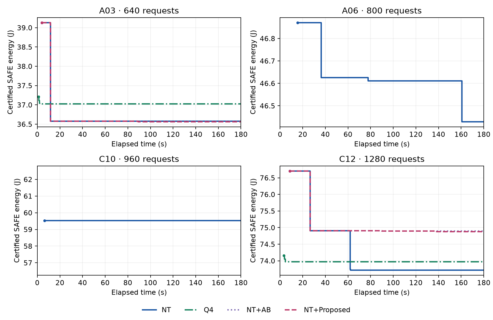

# U1　NT 与原第三、第四章的统一评价及技术路线诊断

**章节定位建议：NT 独立承担长任务流的热安全排程构造；第三章保留为可接强初解的细粒度配置优化；第四章 Q4+ThermalUnion 保留为低时延求解路线。** 在四条公开流的单次诊断中，NT 从空开始取得 4/4 SAFE。Q4+ThermalUnion 取得 2/4 SAFE，在这两条流上均最早交付 SAFE。第三章 Proposed 从空开始时有 0/4 条流得到完整初解。接入同批 NT 初解后，第三章反馈邻域在两条预选流上都优于普通邻域；相同总预算下，融合路线在 A03 胜出，继续 NT 在 C12 胜出。

## 1　比较对象和预算

| 方法 | 调用的冻结入口 | 原生决策范围 |
|---|---|---|
| NT | M1-i `runner.timed_run`，固定调用 NT | 每秒窗口由 N 生成器提出设备频点和两类配额，FIFO 落地，因果处理空闲降频；按原规则扩束、排序并认证终端 |
| 第三章 Proposed | `evaluation.make_pool`、`trial.trial(..., "Proposed", "T3")` | 原 G1/G2 非热候选池，逐请求主段有 10 个 GPU 和 3 个 NPU 档位；保留原反馈邻域、局部时序和空闲后处理 |
| 第四章 Q4+ThermalUnion | `Engine.construct("quota",4)`，Q4 得到 SAFE 后调用 `optimize(...,"adaptive","union")` | Q4 先构造；按原规则对设备上的连续请求组降档，每轮检查参考能耗首选和热估计首选的并集，最多三轮 |

分别锁定 [NT 源码](https://github.com/YBEMR/paper/blob/b95570f9ae5b0cdb26abcdf78701e12f1c644f40/research/m1i_generalization/runner.py)、[第三章正式源码](https://github.com/YBEMR/paper/blob/c585f3461378c3188b4a032991cd875fa5fa4aa4/research/chapter3_final_evaluation/trial.py) 和[第四章冻结源码](https://github.com/YBEMR/paper/blob/96a13920a46f01b6a9710b88275d0ac08763db4b/research/chapter4_cross_analysis_v5/formal_runner/v1/preflight.py)。

全批共用一台 AMD EPYC 7763 GitHub 托管虚拟机，所有单元串行，固定逻辑核 0，BLAS、Numba、CP-SAT 使用单线程。Python 3.12.16，NumPy 2.3.5，SciPy 1.17.0，Numba 0.63.1，OR-Tools 9.11.4210。每个工况、每个方法从空独立运行一次。计时包含目标实例初始化、请求校验、初解、优化、连续认证及在线证据写入。解释器、库导入和不接触目标流的设备模板预热在表外。第三章沿用正式批次的候选池占比 1/5，在 180 秒窗口内给候选池 36 秒，保留原内部预留时间；使用种子 101。原有停止规则生效后允许自然结束。[协议](PROTOCOL.md) · [实际环境](results/environment.json)

12 个主单元名义上限共 2,160 核秒，实际记账 799.426 秒。4 条组合路线各扣足 60 秒共享前缀，名义共 720 核秒，实际记账 688.899 秒，其中 240 秒为复用的 NT 成本。去重后的单核计时约 1,248.325 秒，不含审计、归档及离线复核。四个 NT 单元均触及 180 秒上限，父进程收回子进程另耗约 17–22 毫秒，截止外计分证书为零。其余 12 个单元自然结束。300 秒超出本轮上限，原 900 秒观察点按用户修订替换为 180 秒。[单元回执汇总](results/routes.csv)

## 2　零搜索接口核验

采用 M1-i 每条流第 1 次 NT 运行的首份既有排程作为见证，预检搜索调用为零。三个原生入口按同一工况规则实例化；将各自实际请求表按注册 CSV 的列序、分数表示和 LF 换行序列化，要求与同一个冻结文件逐字节相等。设备画像、模型、热认证器及两张功耗表的五份源码或数据哈希均相等。统一 300 ms 相对期限、CPU 前后处理、GPU/NPU 互斥与切换约束。每流从刻度 0 一直计能到末窗结束后 301 ms，含公共功耗。35°C 为环境温度；四节点初始空闲稳态依次为 42.545582、42.545582、42.054698、40.988780°C。连续认证沿窗传热，以区间上界判定 80°C 安全线。[物理源哈希](results/source_hashes.json) · [12 份接口记录](results/interfaces.csv)

| 流 | 请求数 | 完整时域（s） | 连续事件段 | 切换次数 | 三端一致的见证能耗（J） | 三端判定 |
|---|---:|---:|---:|---:|---:|---|
| A03 | 640 | 8.301 | 2,391 | 12 | 38.776327 | HOT |
| A06 | 800 | 10.301 | 2,985 | 10 | 46.990882 | HOT |
| C10 | 960 | 12.301 | 3,587 | 14 | 59.531472 | SAFE |
| C12 | 1,280 | 16.301 | 4,757 | 16 | 76.708051 | SAFE |

对每份窗口见证，从逐请求配置反解每窗的 GPU/NPU 档位和 A/B 两类配额，再用冻结展开规则逐字节重建主段配置。三端交接完整三阶段开始刻度、逐请求设备档位和显式空闲降频集。在 A03、C10，若仅传主段配置并采用接收方默认降频，各会改变一项空闲决定。保留原降频集后，逐段执行、切换、空闲、全时域 31 列轨迹、能耗区间和判定全部一致，两个 HOT 见证也保持 HOT。第三章自行优化出的逐请求细粒度配置和局部时序直接按完整事件表认证；窗口内出现多个同设备档位时，允许结果留在原生表示。四次强初解交接还逐一比对了实际 NT60 胜者的全排程、整条轨迹哈希和全部证书指标。[准入回执](results/gate.json) · [同批强初解身份](results/seeds.csv)

## 3　从空出发的能耗质量曲线

表内为截止时已认证的最佳 SAFE 总能耗（J）。“—”表示尚无 SAFE。首次 SAFE 单位为秒。自然结束后沿用其最后持有的认证结果。完整阶梯图在每一份严格改善的证书完成时更新。[逐工况同预算配对及能耗差](results/paired_cases.csv) · [64 个逐工况观察点](results/curves.csv) · [47 条路线改善记录，含复用前缀](results/improvements.csv)

| 流 | 方法 | 10 s | 30 s | 60 s | 180 s | 首次 SAFE |
|---|---|---:|---:|---:|---:|---:|
| A03 | NT | 39.132802 | 36.576428 | 36.576428 | 36.576428 | 3.959 |
| A03 | 第三章 Proposed | — | — | — | — | — |
| A03 | 第四章 Q4+ThermalUnion | 37.025137 | 37.025137 | 37.025137 | 37.025137 | 1.143 |
| A06 | NT | — | 46.871091 | 46.625754 | 46.428495 | 15.548 |
| A06 | 第三章 Proposed | — | — | — | — | — |
| A06 | 第四章 Q4+ThermalUnion | — | — | — | — | — |
| C10 | NT | 59.531472 | 59.531472 | 59.531472 | 59.531472 | 6.319 |
| C10 | 第三章 Proposed | — | — | — | — | — |
| C10 | 第四章 Q4+ThermalUnion | — | — | — | — | — |
| C12 | NT | 76.707385 | 74.905976 | 74.905976 | 73.716422 | 8.670 |
| C12 | 第三章 Proposed | — | — | — | — | — |
| C12 | 第四章 Q4+ThermalUnion | 73.966130 | 73.966130 | 73.966130 | 73.966130 | 3.203 |

- **A03、C12 的速度与能耗出现交叉。** Q4+ThermalUnion 分别在 1.143、3.203 秒给出首个 SAFE，在 2.369、5.124 秒自然结束。NT 分别到 11.659、62.006 秒才首次低于第四章的最终能耗。180 秒时 NT 分别再低 0.448709、0.249708 J。A03 第一轮热估计还选入参考排名第二的候选，两个候选均通过认证，最终接纳参考排名第一；C12 三轮中两个首选均重合。[第四章逐轮实际候选](results/q4_rounds.csv)
- **A06、C10 的覆盖差距出现在初解。** 两条流的 Q4 初解都实际认证为 HOT，原入口在这里结束。NT 在 A06 的 15.548 秒首次取得 SAFE，160.776 秒达到本次最低能耗。C10 的 645 次认证中只有 8 次 SAFE，首个 SAFE 在 6.319 秒出现，此后没有更低的 SAFE 能耗。[状态、耗时与证书计数](results/routes.csv)
- **第三章从空运行的直接阻塞是完整候选缺失。** 原 G1 和五个 G2 宽度均实际尝试；最深构造进度依次为 324/640、141/800、141/960、141/1280 个请求。四个候选池均未提交一条完整排程供 T3 认证，后续邻域和时序后处理均无初解可用。实际自然结束时间依次为 32.077、11.436、12.094、12.290 秒。这里能够定位长流构造的困难，第三章邻域的效果则由下一节的同初解配对检验。[逐次候选池进度](results/pools.csv)

## 4　同一 NT60 强初解的互补性

A03 与 C12 的共同种子分别在 11.659、27.040 秒完成认证。两种邻域共享该流同一份 NT60 胜者，并各计入完整 60 秒前缀；所有 10、30、60 秒曲线点直接继承同批 NT。AB 与 Proposed 均执行三轮配置搜索，依次开放 12、24、32 个请求位置，再执行相同的两轮 CP-SAT 时序后处理。四次后处理均得到 FEASIBLE 回执，最终最佳能耗均在配置阶段已经取得。[逐轮搜索回执](results/rounds.csv)

| 流 | 60 s 种子（J） | 总预算内路线 | 最终 SAFE（J） | 相对种子节能（J） | 实际总记账（s） |
|---|---:|---|---:|---:|---:|
| A03 | 36.576428 | NT 继续 | 36.576428 | 0 | 180.000 |
| A03 | 36.576428 | NT+AB | 36.565789 | 0.010638 | 172.135 |
| A03 | 36.576428 | NT+Proposed | **36.560548** | **0.015880** | 172.081 |
| C12 | 74.905976 | NT 继续 | **73.716422** | **1.189554** | 180.000 |
| C12 | 74.905976 | NT+AB | 74.894735 | 0.011241 | 172.110 |
| C12 | 74.905976 | NT+Proposed | 74.875541 | 0.030435 | 172.573 |

A03 的反馈邻域相对普通邻域再省 0.005241 J，C12 再省 0.019194 J。相对种子，两个反馈收益约为 0.0434%、0.0406%。C12 的 NT 继续扩束则节省 1.189554 J，最终比 NT+Proposed 低 1.159119 J。两次比较均计入了初解成本。[逐工况能耗与最小期限余量](results/routes.csv)

**实际配置改动与跨场景补偿。** 以下请求号、窗口号均从 0 起。记录中的“虚拟频点”用于反馈选择开放位置，联合求解器自行决定最终设备和频点。六次反馈都选到了目标窗外的位置，其中三次被接纳的排程实际改动了该位置。

| 流／轮 | 反馈定位 | 接纳排程中的实际结果 |
|---|---|---|
| A03／0 | 目标请求 455 在窗 6（H），选出窗 7（H）的 633，虚拟违约总量由 113 tick 降为 0 | 455 由 GPU4 转 NPU0，456、457 由 GPU4 降到 GPU3；633 由 NPU0 转 GPU3。反馈虚拟配置为 GPU2。此例跨窗口，两窗均为高负载 |
| A03／1、2 | 两轮均选中窗 7 的 634 | 两轮均无接纳配置改动 |
| C12／0 | 从窗 15（H）的目标 1200 追溯到窗 11（L）的 958 | 958 的实际配置保留原值；接纳的变化发生在 1201、1202、1204 |
| C12／1 | 窗 9（H）目标 785，选中窗 11（L）的 900 | 900 由 GPU0 升到 GPU1，同时改变 785、793、795 的配置 |
| C12／2 | 窗 0（H）目标 59–62，选中窗 4（L）的 360 | 59–62 均由 GPU4 降至 GPU3，360 由 GPU1 升至 GPU3。反馈虚拟升至 GPU9，联合求解接纳了较小的实际升档 |

相对 NT60，A03 的 AB／Proposed 最终分别改变 3／4 个请求配置、277／366 个阶段起始时刻；C12 分别改变 5／12 个配置、125／1,423 个阶段起始时刻。四条组合的显式空闲降频集均保留种子值。起始时刻计数也包含上游配置变动沿 FIFO 传播的后果。[实际配置差分](results/changes.csv) · [含未落实选择的反馈记录](results/feedback.csv)

## 5　论文章节定位

| 安排 | 本轮支持的主张 | 证据边界 |
|---|---|---|
| **NT 独立成章，作为主线** | 在这组 640–1,280 请求的长流上，统一认证下从空构造的覆盖最好；C12 在 60 秒后继续扩束取得最大收益，A06 也有后期改善 | C10 后续计算未降低最佳能耗。四条公开流各一次，完整算法比较不能分解各机制的独立贡献 |
| **第三章与 NT 作为可选精修接口** | 对同一强初解，关键执行区间反馈两次都优于普通邻域，有三次跨窗位置确实改变；可作为第三章与 NT 之间的机制联系 | 端到端收益取决于放弃继续 NT 的机会成本。A03 精修获益；C12 继续 NT 明显占优，现有数据不足以把固定 60 秒交接写成默认路线 |
| **第四章快速求解机制作为独立工作点复用** | A03、C12 都在约 5 秒内完成；C12 的第四章结果优于同批 NT60。适合作为强调首解时间的章节对照 | A06、C10 的 Q4 初解为 HOT，未进入 ThermalUnion。本轮只检验已冻结完整路线，不能据此推定改变入口或与 NT 组合后的收益 |

本轮仅支持诊断和章节组织。四条公开流形成一组配对案例，每格一次，无法估计重复运行变异或推广到未见任务流。第三章保留原生细粒度子域，三种完整算法的差异还含构造域、停止条件和优化成本。本轮交付限于 U1 分支；原第三、第四章正式版本与 A—E 交叉验证均使用各自原有工作区。

## 6　证书、复核和完整归档

主比较 2,057 次、组合后段 32 次，共记录 2,089 次在线认证返回。按单元内方案去重，离线程序逐份核对了 2,081 份计时证书；连同接口证据，共重建 2,093 份完整的 31 列连续轨迹、4,787 个唯一事件块，残缺轨迹为 0。还从原始证书日志独立重算并比对 64 个预算观察点。预检使用的历史见证、同批种子和正式输出分别归档，HOT、无完整构造、未接纳反馈及自然停止均可核查。[离线复核回执](results/review.json) · [在线运行](https://github.com/YBEMR/paper/actions/runs/45933317076) · [离线复核运行](https://github.com/YBEMR/paper/actions/runs/45935640699)

完整物理归档共 115,653,326 字节。按清单顺序拼接七个分卷，整体 SHA-256 为 `1055cfd2a47e13d3a3224213d5fa0a8682712af69a850a93392d1f494164be4b`。其中包括逐次认证、排程、开停时钟、原生搜索日志、事件索引和压缩事件块；按索引顺序解压可恢复逐元素相同的原轨迹。复核程序同时校验分卷、总包、事件块、完整数组、证书及阶段曲线。[分卷清单](results/archive.json) · [完整归档和可下载结果](https://github.com/YBEMR/paper/tree/c8d4feb4b8113b971786eccbe0bdc14abab89b53/research/u1_unified_diagnostic/results) · [复核代码](review.py)
