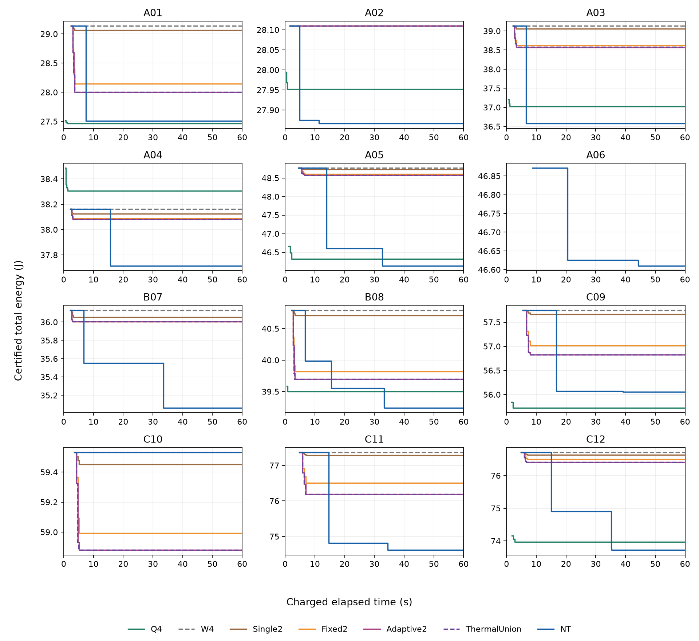

# U2　强初解条件下自适应成组降频的独立贡献验证

**建议将自适应成组降频保留为第四章的独立机制候选，定位为已有 SAFE 排程上的快速能耗优化。** 使用同一份 NT 小束宽初解、同一候选池上限和同一参考前二认证规则，开放连续整数长度比固定长度集合在 11 个可配对工况中取得 **10 胜、1 平**；这 10 个工况在三次重复中均胜。自适应方法相对小束宽 NT 平均节能 **1.2332%**。等到完整 NT 用足 60 秒，同一方法只在 C10 继续领先。双排序的主要贡献是少做候选认证，最终能耗为 0 胜、10 平、1 负。

## 1　冻结、交接与计时

U1 冻结于 `44e99658159ded9042fd47a5c448b5be5868bcdb`，NT 冻结于 `b95570f9ae5b0cdb26abcdf78701e12f1c644f40`。第四章使用 `96a13920a46f01b6a9710b88275d0ac08763db4b` 的原实现与协议。先登记 12 流、3 次重复、6 个实际调用位置及执行次序，再启动四台隔离的托管机。每流的全部方法和三个重复在同机同核串行运行，数值库单线程。跨方法时间比较均在同流内进行。请求 CSV、P1 画像、服务量、期限、初温、温限及全时域计能沿用冻结实现。[预登记](PROTOCOL.md) · [216 个预登记位置](registration/roster.csv) · [第四章原协议](https://github.com/YBEMR/paper/blob/96a13920a46f01b6a9710b88275d0ac08763db4b/research/chapter4_cross_analysis_v5/formal_runner/v1/PROTOCOL.md)

- **共同初解。** 每个流、每个重复只运行一次 60 秒 NT。36 条轨迹均取得 W4 阶段前四份实际按时完成的证书，第 4 份的完成时间为 1.748–5.970 秒。固定参照取其中最佳 SAFE，组合路线各扣到第 4 份完成时刻，再计接入、重认证和优化成本。A06 三次均为连续四份 HOT，跳过 12 个依赖初解的位置；继续 NT 三次均取得 SAFE。其余 33 个种子均可用。[逐种子证书及成本](tables/seeds.csv)
- **无损交接。** 零搜索预检用 A03 的 HOT 和 C10 的 SAFE 见证。正式组合又完成 132 次同批种子交接。排程身份、设备频档、三阶段时刻、显式空闲降频集、切换、31 列逐段电热轨迹、精确参考能耗及全部连续认证指标逐项相等。每个局部动作保持请求设备映射，对变动配置从释放时刻完整执行冻结 FIFO 与因果空闲控制。[预检回执](results/gate/gate.json) · [132 次交接](tables/handoffs.csv)
- **控制条件。** Single2 只接纳长度 1；Fixed2 允许 1、4、8、16、32、64；Adaptive2 与 ThermalUnion 允许 1–64。前三者认证相同参考能耗排序的前两项；双排序认证参考首选与温度轨迹修正首选的去重并集。均沿用每起点选择、每轮最多八份完整试排、严格 SAFE 改善、最多三轮和自然停止。Single2、Fixed2 仍沿用原扫描循环，所以耗时反映真实实现。[实际候选池](tables/pools.csv) · [逐轮回执](tables/rounds.csv)
- **预算实耗。** 216 个位置中实际运行 204 个，另 36 个 W4 读数直接复用。36 次完整 NT 均到上限，其余已调用路线均按原规则结束。剔除重复记入各路线的初解成本，实际新运行单元的父进程实测墙钟合计 2,394.020 秒，其中含收回进程的毫秒级开销。截止外计分为零。归档、物理复核和示例回放另计。[三次重复及分项开销](tables/runs.csv)

## 2　从同一初解逐项增加机制

差值取“右侧参照能耗减左侧方法能耗”；正值表示左侧节能。先算同流、同重复的差值与相对节能率，再取流内中位数；下表均值对 11 条可配对流等权。只有严格分离的连续能耗区间计作胜负。A06 的覆盖缺口另列。

| 方法／参照 | 60 秒工况胜／平／负 | 平均节能（J） | 平均相对节能 |
|---|---:|---:|---:|
| Fixed2／Single2 | 10／1／0 | 0.406728 | 0.9124% |
| Adaptive2／Fixed2 | 10／1／0 | 0.095696 | 0.1865% |
| ThermalUnion／Adaptive2 | 0／10／1 | −0.000718 | −0.0019% |
| Adaptive2／固定 W4/K4 | 10／1／0 | 0.566944 | 1.2332% |
| ThermalUnion／固定 W4/K4 | 10／1／0 | 0.566226 | 1.2314% |
| Adaptive2／完整 NT | 1／0／10 | −1.028404 | −2.2048% |
| ThermalUnion／完整 NT | 1／0／10 | −1.029122 | −2.2068% |

A02 的自适应扫描在首轮记录 10,336 次长度试探，进入完整合法候选池的数量为零，因而保留原 SAFE。A06 则没有可供局部优化使用的 SAFE 种子。两种原因分别保留。[逐工况三次配对](tables/pairs.csv) · [各流中位数与分母](tables/case_pairs.csv) · [总体对照](tables/contrast_summary.csv)

**固定轮数与固定认证数都支持自适应长度的独立贡献。** 只比较完成第一轮后的在位解，Adaptive2 比 Fixed2 平均省 0.061501 J，33 对均已走到这一轮。允许三轮后平均省 0.095696 J，其中 30 对两边均走到第 3 轮。按每臂最多新增 1、3、6 份候选认证对齐，平均分别省 0.064694、0.097750、0.095696 J，两边实际达到对应认证数的分别是 30、30、27 对。自然结束的臂沿用最后持有解，表中另列实际达到数。Fixed2 相对 Single2 在第一轮和第三轮分别平均省 0.193358、0.406728 J。[轮数与认证数逐次对齐](tables/mechanism_axes.csv) · [对齐汇总](tables/axis_summary.csv)

## 3　付出多少时间，能得到什么质量

下表列出三次重复的 60 秒 SAFE 能耗中位数（J）。末列是 Adaptive2 含共同初解、接入、优化及认证的自然结束时间中位数。原 Q4 一列使用原第四章入口。空格“—”表示没有取得 SAFE。

| 流 | 原 Q4+ThermalUnion | NT W4/K4 | NT+Single2 | NT+Fixed2 | NT+Adaptive2 | NT+ThermalUnion | 完整 NT | Adaptive2 耗时（s） |
|---|---:|---:|---:|---:|---:|---:|---:|---:|
| A01 | 27.46315 | 29.13831 | 29.06094 | 28.14281 | 28.00008 | 28.00008 | 27.51084 | 3.95 |
| A02 | 27.95199 | 28.10970 | 28.10970 | 28.10970 | 28.10970 | 28.10970 | 27.86619 | 1.96 |
| A03 | 37.02514 | 39.13280 | 39.05595 | 38.61563 | 38.57390 | 38.58180 | 36.57643 | 3.39 |
| A04 | 38.30559 | 38.16092 | 38.12434 | 38.08618 | 38.08150 | 38.08150 | 37.71501 | 3.36 |
| A05 | 46.31901 | 48.76721 | 48.72772 | 48.60506 | 48.57786 | 48.57786 | 46.13613 | 6.78 |
| A06 | — | — | — | — | — | — | 46.61049 | — |
| B07 | — | 36.12881 | 36.05213 | 36.00487 | 36.00406 | 36.00406 | 35.06237 | 3.12 |
| B08 | 39.49914 | 40.79139 | 40.71065 | 39.81650 | 39.69667 | 39.69667 | 39.24052 | 3.44 |
| C09 | 55.72260 | 57.74781 | 57.66122 | 57.01435 | 56.82244 | 56.82244 | 56.05577 | 8.12 |
| C10 | — | 59.53147 | 59.45254 | 58.99143 | 58.87944 | 58.87944 | 59.53147 | 5.37 |
| C11 | — | 77.36535 | 77.28443 | 76.50897 | 76.18529 | 76.18529 | 74.61670 | 7.24 |
| C12 | 73.96613 | 76.70738 | 76.63181 | 76.50194 | 76.41383 | 76.41383 | 73.72090 | 6.89 |

在 33 个有初解的单元中，Adaptive2 的总记账耗时中位数为 **3.949 秒**。在各局部路线自己的自然结束时刻，Adaptive2 和 ThermalUnion 对当时的继续 NT 各取得 **10 胜、1 平**。统一到 10 秒时各为 7 胜、4 负，30 秒及 60 秒均为 1 胜、10 负。C10 是 60 秒时仍胜出的工况，Adaptive2 在约 5.37 秒得到 58.879445 J，完整 NT 到 60 秒为 59.531472 J。A01 则展示了机会成本，Adaptive2 在约 3.95 秒达到 28.000081 J，随后完整 NT 在本轮降至 27.51084 J。[等实际耗时配对](tables/equal_time.csv) · [10／30／60 秒全部读数](tables/curves.csv)

图中每条曲线取同一时刻已有 SAFE 的重复中位数，至少两个重复取得 SAFE 才绘制。单元内以证书返回时刻更新，全部 795 条路线改善记录保留原时间；多条路线复用的初解前缀在各自曲线中出现。原 Q4 在 8/12 条流取得 SAFE，A06、C10、C11 的 Q4 初解为 HOT，B07 未完成构造。[完整阶梯曲线数据](tables/improvements.csv) · [各方法逐流结果](tables/case_methods.csv)

## 4　分组为什么省能，双排序为什么可能吃亏

**A04 给出了单项降频通常亏、成组后获益的实证。** 从同一个 38.160915 J 的 W4 种子，Fixed2 首轮把 GPU 上连续的 16 个请求由 OPP3 调为 OPP2。完整系统能耗降为 38.129362 J，净省 **0.031554 J**。单独回放这 16 个成员时全部 SAFE，其中 15 个反而耗能增加，只有请求 0 省了 0.000146 J。父排程有 11 次切换，15 个亏损的单项动作各产生 13 次，整组只有 12 次。实际主设备忙态积分合计减少 0.010965 J，温度相关项减少 0.001199 J；峰温由 76.2862 升至 76.3035°C，最小期限余量均为 2.8333 ms。参考边界估计给 16 个单项的净收益均不大于零，完整物理回放还识别出了那个微弱正例。[单项回放及失败记录](tables/witness_singletons.csv) · [整组证书、逐项证书与归档](results/mechanism_witness/manifest.json)

**C11 说明固定长度集合会漏掉有价值的组。** 首轮接纳 NPU 的 21 个相邻执行请求由 OPP1 降到 OPP0，21 超出原固定集合。种子由 77.365355 降至 76.788508 J，单轮净省 **0.576847 J**。切换仍为 38 次，主设备实际忙态能耗减少 0.482681 J，峰温由 76.8488 降至 76.7099°C，最小期限余量保持 1.1 ms。21 个成员单独降频均有效，个别节能为 0.023834–0.029140 J；这里的价值在于同轮兑现整组收益。三轮之后 Adaptive2 比 Fixed2 低 0.323680 J。[真实请求号和两组身份](tables/witness_groups.csv) · [所有实际候选的能耗分项](tables/candidate_effects.csv)

**双排序减少了认证工作，但有一次改变了后续搜索路径。** 在 33 组共同初解上，Adaptive2 共新增 174 份候选认证，ThermalUnion 为 99 份，减少 **43.1%**；各自还有 33 次接入重认证。含接入的认证与归档墙钟累积由 15.336 降为 10.895 秒，总路线耗时中位数由 3.949 降为 3.858 秒。第 1 轮结束时两者的在位能耗逐流相同。A03 第 2 轮，热排序补进参考第 8 名的 27 请求组，当轮省 0.150749 J，略优于 Adaptive2 接纳的 18 请求组的 0.150586 J；到第 3 轮结束，前者为 38.581802 J，后者为 38.573903 J。热排序在这条流上发现了当轮有用的候选，三轮终值仍多耗 0.007899 J。[逐轮认证排名与接纳](tables/rounds.csv) · [逐重复开销](tables/runs.csv)

忙态实测值在主设备实际执行区间内对连续证书的节点能量积分。它与温度相关项属于不同的分项口径，不能直接相加推算总节能。逐候选表同时保存 35°C 忙态参考值、实测忙态、切换量、温度项、期限余量、峰温、全系统能耗及认证开销。成组“连续”指该设备上的执行顺序，原请求编号可以间隔。[候选与分项定义](review_u2.py)

## 5　章节路线与证据边界

第四章可以把研究问题明确为“给定一个已认证排程，如何在数秒内挑出可兑现系统节能的设备连续降频区间”。相同 W4 输入、相同认证规则下，从单请求到固定组、再到自适应长度的两段对照都产生稳定增益；A04 与 C11 又提供了不同的物理解释。这支撑独立机制候选的定位。温度轨迹双排序宜定位为认证开销与终值之间的选择。对于追求 60 秒终值的论文主张，继续 NT 在本组大部分可配对工况上占优。

M3-a 已有归档。它固定窗口配额与频档时，热引导重新分布的平均直接节能为 0.001469%；A04 出现重新分布后原先会超期的降档变得可行。M3-a 使用历史 NT60 种子，U2 使用同批 W4/K4，两者的百分比具有不同分母。若今后需要衔接，现有证据指向“分布改变能否释放原来不可行的降频区间”。本轮按停止规则收束于机制证据与章节定位，保留原第三、第四章正式成果。[M3-a 已提交报告](https://github.com/YBEMR/paper/blob/1bdb3e0671b6f2ad56aefe9d5b3652ff25b314b0/research/m3a_quota_distribution/README.md)

这些结果来自 12 条公开诊断流；三次重复检验计时与结果的稳定性，同一条流仅作为一个工况参与总体比较。尤其要区分取得种子的 11 条流与完整 NT 的 12/12 覆盖，也要区分 W4 种子的局部可改进性与已经运行 60 秒的 NT 解仍有多少改善空间。

## 6　物理归档与复核

离线复核检查了 **12,274 份已返回的在线认证**及全部 756 个时间截面读数。12 个工况分卷共 289,270,191 字节，重建 **12,370 份完整的 31 列数组**（含 96 次 Q4 因果复核），使用 9,925 个按工况归档的事件块。另保留 9 个硬截止时中断写入的数组，均未进入成绩。37 个组内单请求反事实另存于机制见证归档，未计入运行单元和方法认证开销。[复核回执](tables/verification.json) · [逐工况完整证书、排程和索引](results/) · [正式运行](https://github.com/YBEMR/paper/actions/runs/45941593095) · [离线证书复核](https://github.com/YBEMR/paper/actions/runs/45942930362)

**原 Q4 的空闲策略另作了完整核验。** 96 个实际认证位置按统一因果规则完整重放，其中 39 个改变了显式空闲决定，单份总能耗最大差为 0.012094 J，SAFE/HOT 判定改变 0 次。进一步固定原构造器输出，在 66 个实际优化轮次中，重新计算整份已记录短名单的因果参考能耗和热排序；双排序选中的请求组及最终接纳动作全部一致。8 条取得 SAFE 的流，三次重复的最终能耗在两种口径下逐份完全一致。C10、C11 的 HOT 终点能耗略有变化，均仍为 HOT。因果校验采用离线回放，速度表使用原始实测时间。[96 次逐份物理重放](tables/q4_causal.csv) · [66 轮选择核对](tables/q4_choice_audit.csv) · [逐工况因果终点](tables/q4_causal_endpoints.csv) · [核验回执](results/mechanism_witness/q4_audit.json)
