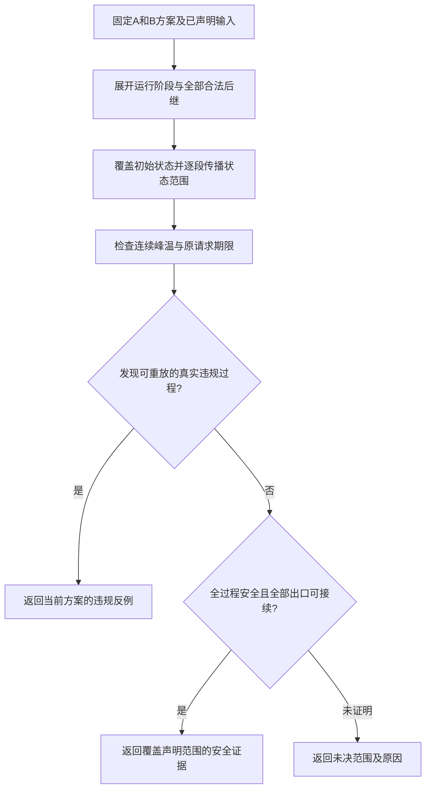

# 多模式热状态与节能联合规划：方案讨论稿

初稿：2026-10-06；收拢更新：2026-10-07。用途：我们当前的研究讨论；尚未与导师讨论，不是论文正文或已完成的研究结论。

## 当前一页问题定义：多模式端侧推理的热约束节能联合规划

**研究问题。** 各应用模式的局部节能方案可能留下不同的热状态，并占用后继请求的可用时间。我们离线共同选择各模式的执行设备、工作点和Stage时序，使方案在声明的重复／转换范围内满足期限和温限，并降低给定使用条件下的平均能耗。实际切换序列不必提前知道，运行时执行预定方案。

| 环节 | 当前定义 |
|---|---|
| 输入 | 各模式固定请求DAG、Stage合法设备／工作点及响应；CPU／GPU／NPU执行单元与频率域；周期、期限、允许转换及最小请求间隔；初始状态范围、功耗／RC参数、准备过程；共同能耗窗口W及使用统计。具体数值和统计表达待填 |
| 共同决策 | 每模式方案π_m中的Stage设备、合法工作点、相对启动时刻，汇总为Π。实际起止、工作点保持、温度与能耗由Π和外部过程导出；不优化外部工作量、周期或切换请求 |
| 执行规则 | 固定周期提出工作，轮内期限不超过周期，最小切换间隔不短于当前模式周期；不跨轮／跨模式重叠。切换请求同时提出新模式首轮工作，等待旧工作及准备计入新期限；不丢弃已释放工作 |
| 节能目标 | 对同一使用分布中的过程h，积分完整窗口工作、准备、空闲及温度漏电功耗，再求平均。统计没有实测依据时，结果限定为声明的抽象使用条件 |
| 原问题安全要求 | 给定初始范围及全部允许重复／转换下，遵守依赖、资源、频率域、所有请求期限及连续温度上限。允许集合先给定，不因候选失败而缩小 |
| 输出 | 各模式执行方案、平均能耗及评价条件、已证明的安全覆盖范围、具体违规反例或未决范围，以及计算成本。持续安全、最优性和数值可信性分别报告 |

用一个表达概括：

\[
\min_{\Pi\in\mathcal F}J(\Pi),\qquad
J(\Pi)=\mathbb E_{h\sim\mathcal D}\!\left[\int_0^W P_{\rm sys}(t;\Pi,h)\,dt\right].
\]

**使用信息更新（D17）：** 采用U1，D由给定使用路径及权重表示；各路径使用同一套方案Π。入口采用I1直接给定（D19）；具体数值尚未确认。

其中\(\mathcal F\)由上述原问题要求定义，包含对声明初始范围和所有合法持续过程的约束。\(\mathcal D\)只描述平均用能的使用条件，其支持须落在允许范围内；安全不随统计权重放宽。一般启动时刻保持连续，未选新网格或预算。

**拟采用的求解分工，而非已完成的精确编码：**

| 部分 | 承担什么 | 能声称什么 |
|---|---|---|
| MILP候选层 | 拟表达有限合法模式选择、Stage时序、依赖、资源及共享域冲突等可线性化关系，生成方案；具体编码仍需核对 | 解得的是所编码的候选问题。若用能量代理排序，代理最优不等于完整平均能耗最优；内部界也不自动是原问题下界 |
| 外部分析／评价层 | 按工作点分段计算温度与漏电能量，检查期限及入口、切换相位、多次重复的安全覆盖，返回证据 | 单条轨迹通过仅支持该轨迹；可靠的全范围充分证明才支持持续安全。真实合法过程的违规可否定当前完整方案，不能自动删除其整个映射组合 |
| 协调及启发式 | 根据完整能量评价与核查结果搜索、比较候选，复用同一动作域和安全标准 | 候选不足或核查未完成保留未决。安全反馈约束只有证明有效才可用于原问题排除；暂不承诺完整搜索、全局最优或MILP有限收敛 |

**保守检查的位置。** 共同温度盒只定义可认证子集\(\mathcal F_{\rm cert}\subseteq\mathcal F\)，不是原可行域。未通过可能只是证明不足。即使在该子集上以真实目标求得最优，也只是受限最优；MILP若使用代理目标，连这一结论也不能直接套用。

**形成研究闭环还需完成两项实质工作。** 一是可计算的安全核查方法，说明怎样联合覆盖入口温度、切换相位和重复转换，及保守性会遗漏什么；二是MILP候选层与完整能量／安全评价的有效接口。前者尚有方法工作，不能仅归为实现与精度测试。最低验证应分别检查核查正确性／保守性、共同规划与逐模式方案的有效能量差异，以及MILP候选组织与启发式的同条件表现。若只能验证有限轨迹，就按有限证据报告，不能自行降低已选持续保证目标。

**当前判断：** 问题、决策和评价可以收拢为同一任务；完整求解闭环尚未完成。本页作为当前阅读入口，以下正文与附录保留动机、例子和推导。2026-10-07用户要求恢复逐项协作，未确定内容不自行补成假设；当前已选U1路径加权评价及I1直接给定入口（附录H.4）；窗口末端已确认W1条件性优先，具体路径需先核查共同边界，不满足再讨论W2；不自动推进方法接口。

## 一、总的想法：让各模式的节能方案能够连续运行

**我们拟研究：端侧设备在多个应用模式之间运行时，怎样离线共同选择各模式的设备、频率和执行安排，降低使用条件下的平均能耗，同时保证声明范围内的期限与热安全。**

这里有三个关键词：

1. **多模式：** 不同模式对应不同任务需求，例如启用不同的推理工作流，而不是把两个频率档称为两种应用模式。
2. **热状态延续：** 前一模式结束后，设备不会立刻恢复初始温度；下一模式从已有温度继续运行。
3. **共同节能：** 各模式方案一起选择，既看本模式的耗电，也看它留下的热状态对后续运行的影响。

研究重心是热状态与节能。转换流程作为给定规则，不单独研究切换等待策略，也不把吞吐、精度或峰温最小化增加为新的优化目标。

## 二、用一个例子理解：为什么各模式不能只分别算一次

设一台端侧设备有两种应用模式。A执行常规识别，B执行识别及另一条分析工作流。以下只是解释关系的例子，不指定实际模型或设备支持。

### 1．分别看，每个模式都能找到自己的节能方案

假设A、B各有部分Stage可选择CPU或NPU。单独从较冷状态运行时，二者都可能偏好NPU，因为在相应工作点下，其执行时间与活动能量较低。

### 2．连续运行后，B的起点发生了变化

A连续执行若干轮，可能使NPU升温。进入B时，即使没有旧任务占用资源，B仍继承较热的NPU。原先单独评价得到的B方案可能漏电更多，或者不能满足温度上限。

**资源已经空闲，不代表热状态已经恢复。** 这正是首版不研究跨轮重叠，也仍然值得共同规划的原因。

### 3．共同设计比较的是不同方案组合

| 组合 | A怎样运行 | B怎样运行 | 需要评价什么 |
|---|---|---|---|
| 组合一 | 保留偏重NPU的方案 | 采用能适应较热入口的方案 | A节省的能量，能否抵消B可能增加的能量？ |
| 组合二 | 部分Stage改用CPU或调整工作点／时序 | 保留较高效的NPU方案 | A可能增加的能量，能否换来整体更低能耗？ |

调整A并不必然使NPU更冷：CPU也会发热并通过热耦合影响NPU。因此，两组都需要评价完整功率与温度轨迹，不能按“换到CPU”直接判好坏。

这些选择在离线设计时共同完成。运行时按各模式预定方案执行，不是遇到热状态后再运行一次优化器。若热影响较弱，独立选择与共同选择也可能相同。

## 三、问题比原来改变在哪里，文献怎样支撑

**原来主要问：这一组已知请求怎样安排更省电？现在问：为会重复出现、可能相互转换的多种任务需求，怎样设计一组能承接热状态的节能方案？**

实际模式顺序不必提前知道，但各模式任务、允许转换及支撑保证的运行条件必须已知。设计时可以使用运行记录或统计描述节能评价条件；不能为每条评价轨迹分别选择一套“知道未来”的方案。

| 已有研究 | 可继承的具体内容 | 我们准备完成的适配 |
|---|---|---|
| Schmitz等，TCAD 2005 [1] | 模式使用概率、共同映射／调度与DVS、满足实时要求的平均功耗优化 | 把使用条件与完整热历史下的系统能量联系起来 |
| Huang／Xu，DATE 2010 [2] | 保留单模式候选，再按使用份额共同选择，满足系统级要求 | 候选评价需保留入口／出口状态，不能只用单个能耗标量代表 |
| Jung，TODAES 2017 [3] | 已知模式与转换图、重复执行、模式方案之间的衔接 | 采用旧工作完成后转换；重点评价热状态传递，不移植其重叠和迁移优化 |
| Schor等，RTAS 2012 [4] | 对声明的不确定负载范围分析最坏温度，区别于只模拟几条轨迹 | 借鉴保证范围的组织；其work-conserving执行条件需适配本题静态安排 |

这几篇分别提供多模式共同设计、节能目标和热保证的依据。**我们的拟研究内容，是把模式方案之间的热状态联系纳入平均节能设计，并建立相应的可行性评价与求解方法。** 这是一项待实现、待验证的研究构想，尚不能据这些文献宣布组合本身具有新颖性。

任务相关频率响应仍保留：不同Stage的降频代价进入合法模式表，影响设备与频率选择；它是联合问题的组成，不再独自承担整个研究动机。

## 四、具体准备做什么

### 1．建立共同问题：输入是什么，决定什么

- **给定输入：** 各模式的固定请求DAG、合法设备与工作点、时长／功耗响应、周期和期限；允许转换、驻留条件、入口状态与使用统计。
- **共同决策：** 各模式中Stage的设备、工作点和相对执行时序。模式需求由应用决定，不通过少执行任务或少进入耗电模式节能。
- **输出结果：** 一组离线执行方案、适用运行范围、平均能耗评价及期限／热安全证据。

平台、共享频率域、温度漏电及耦合RC沿用已有基础设定。Stage执行中不可抢占、迁移或改频。首版轮内允许并发，轮次间及前后模式间不重叠；若选定应用必须跨轮重叠才能满足既定服务需求，就重新审查这一限制。

### 2．分开定义“省多少电”和“必须在哪些情况下安全”

**平均能耗看使用统计，安全约束看允许运行范围。**

例如，A常用、B少用，目标可以更重视A的节能；但只要A→B被允许，就不能因B权重低而接受超温或超期。

同一观察时长内，按完整轨迹累加工作、空闲、温度漏电及已声明转换成本，再对使用过程求平均。温度和空闲工作点连续衔接。没有真实统计时，结果称为给定权重下的条件性评价，不写成实际用户节能收益。

安全评价还要覆盖同模式重复与允许转换。只算一次A→B安全，不足以说明反复A→B→A都安全；如果要作后者保证，就要检查前段可达出口能否继续落入后段安全入口范围。

### 3．建立参照和实用方法，服务同一个问题

| 工作 | 准备回答的问题 | 当前不提前确定的内容 |
|---|---|---|
| 联合模型与MILP参照 | 小规模情况下，哪些模式方案组合可行，能量评价是否正确？ | 温度漏电与状态衔接如何进入求解，哪些界和结论能够认证 |
| 启发式协调求解 | 在相同问题和预算下，能否更快得到较好的安全方案？ | 算法名称、候选筛选和反馈规则，由模型结构决定 |

这两项可分别构成第三、第四章的核心工作。已有MILP与连续热检查经验可以复用，但新问题的温度相关功率和跨模式状态会改变接口，不能直接宣布旧热反馈约束全部有效。

## 五、怎样证明这些工作有价值

最低必要验证分为三组，不先扩规模或扫描大量参数。

1. **验证问题关系。** 比较逐模式设计与共同设计，统一使用连续热历史重新评价。分别看选择是否改变、能耗是否下降及安全性；旧方案失效时与有效方案能量差分开报告，不只和“每模式重置冷态”的弱对照比较。
2. **验证方法效果。** 以同问题的MILP参照核对小规模结果，再与简单完整复核／回补及启发式比较安全解质量、求解时间和证据范围。能耗权重、服务要求及计算预算一致。
3. **验证适用范围。** 检查温度压力、驻留和使用分布变化时，收益是否保持。保留热影响弱、独立方法已足够、共同设计没有收益的情况；同时报告统计使用条件变化对能耗的影响。

旧实验可作为评价工具与局部关系的基础，不作为新多模式问题的验证结果。

## 六、当前认可与后续落实

**用户已认可这一主线：共同建模模式间热状态、按使用条件评价节能、构造离线求解方法，再用公平对照验证。** 当前先采用有文献依据的抽象任务模型，不要求先确定实际应用或设备。

模型实例需要三组输入：①各模式包含哪些工作流及服务要求；②允许转换和驻留条件；③响应／功耗／热参数，以及使用统计或明确的抽象分布。它们可以先作为符号输入定义，不必立即填写实测数值。用户已确认声明条件下持续安全为目标，保证尚待建立，不能用有限实验代替。

下一步将已确认的构想落实为一致的模型定义，区分输入、决策、派生状态与约束。定义不是继续缩小范围；确需排除某类执行行为时，才作为新增限制另行讨论。真实应用用于后续解释与验证，不作为建模前置条件。

## 附录A：模型定义整理——输入、决策与运行结果

本附录保留E407阶段的定义整理，不增加数值、算法或执行限制；其中当时待定的安全范围已在附录B确认，其他待定接口仍未冻结。

### A.1 先区分四类对象

| 对象 | 含义 | 例子 |
|---|---|---|
| 应用模式m | 当前要完成哪类任务与服务要求 | A包含G₁、G₂；B包含G₁、G₃ |
| Stage合法执行模式o | 一个Stage可用的执行单元与工作点，附响应参数 | CPU单元u的合法频点，或NPU设备v的合法工作点 |
| 模式执行方案π_m | 模式m的一轮工作怎样执行 | 各Stage选择o，并确定相对启动时刻 |
| 使用过程h | 外部任务／模式需求及初始条件如何出现 | A保持若干轮后请求B；不是优化器选择少运行B |

G₁在两个模式中出现，不强制其采用相同设备或频率；所有合法选择由输入支持集合决定。模式数、DAG大小、设备数、频档数均未固定成示例数目。

### A.2 已知输入、决策变量与派生量

| 类别 | 内容 | 在问题中的职责 |
|---|---|---|
| 已知任务输入 | 各模式请求DAG、Stage划分、轮内释放与期限、重复／驻留规则 | 规定必须完成的工作，不由节能目标改变 |
| 已知平台输入 | 固定执行单元、共享频率域、合法工作点、Stage支持与响应、功耗／RC参数 | 规定每种选择的代价及相容关系；非统一1/f由响应表保留 |
| 已知使用与范围输入 | 使用过程分布D、允许运行集合H_allow、初始温度与工作点、评价时长和保证范围 | D决定平均能耗；H_allow决定必须满足哪些安全和实时条件 |
| 离线决策 | Π={π_m}：各模式Stage的执行单元、工作点、相对启动时刻 | 同一组方案服务全部纳入评价／保证的过程，不按已知未来逐轨迹重选 |
| 派生运行量 | 实际轮次起点、Stage绝对起止时刻、资源顺序、工作点状态、功率、温度、能量 | 根据Π、h及给定转换协议计算，不把温度当自由调节变量 |

本阶段未引入按入口温度在线选候选或重新搜索，也未引入每次实际出现都可独立重选的变量。转换协议给定，其中未定义的字段保留待填，不由求解器自行决定。

### A.3 目标与必要约束的对应

对同一给定观察时长W，能量E_W(Π,h)按完整功率轨迹积分。共同目标为min_Π E_{h∼D}[E_W(Π,h)]；分布无实测依据时明确标为抽象使用设定。对H_allow内的每个过程，要求：

1. **任务合法：** 每Stage选择一个支持的执行模式，遵守释放、依赖、不可抢占／迁移／执行中改频规则。
2. **资源相容：** 同执行单元互斥，共享频率域满足既有运行与换点规则。
3. **时限满足：** 完整请求按输入规定的释放和期限完成；各轮及模式转换遵守已确认的不重叠规则。
4. **状态连续：** 温度与空闲工作点按实际执行延续，轮末及转换过程不能重置温度。
5. **热安全：** 声明时间与初始状态范围内连续温度不越限；安全范围不随能耗优化结果缩小。

其中1—2沿用原调度基础，3采用已确认的轮次／转换边界，4—5把不同模式方案关联起来。平均节能目标不允许用另一个过程的节能或低温抵消当前过程的违规。

### A.4 一致性核查：三处不能混写

- **切换请求与实际进入时刻。** h描述应用要求及其统计；实际何时进入下一模式，要经过旧工作完成及给定衔接规则才能得到。Jung§4也区分mode change requested与执行衔接。我们的统计不能把由方案决定的实际切换时刻误作与方案无关的外部输入；更不能推迟请求释放来掩盖阻塞。若驻留按轮数定义，也须标明相应服务量及转换响应要求。
- **原有零开销与待定转换成本。** R86的Stage交接／搬运／调频零额外开销假设保持历史含义。多模式状态准备成本尚未选定，前述“计入已声明转换成本”不等于已经加入非零成本，也不等于自动批准其为零。本轮不新增传输资源或迁移机制。
- **有限评价与持续保证。** W用于平均能耗计量；安全覆盖时长单独声明。有限窗口安全与任意重复／转换安全是不同保证；这里只列出输入接口，不默认选择无限保证或用有限抽样替代证明。

**本轮结论：** 抽象研究问题的输入、决策和关系已经能够一致表达，不必先锁定真实应用。尚待明确的是转换请求／释放协议、使用过程统计的具体表示和安全覆盖范围；这些改变问题含义的选择需讨论，具体数字可以后填。不再默认新增马尔可夫过程、稳态假设或冷却等待策略。

## 附录B：热安全覆盖范围——2026-10-06用户已确认

**采用“满足声明运行条件时，可以持续重复和转换”为安全目标。** 实际模式序列不必提前知道，但初始状态、任务释放、驻留及允许转换必须满足给定规则。用户已确认这一强于有限时段安全的目标；目前尚未完成保证构造。选择路径见[研究状态的选择路径与变更记录](../RESEARCH_BRIEF.md#选择路径与变更记录唯一维护入口)D08，原建议与核查过程保留在E408，本次确认记入E409。

### B.1 两种范围分别回答什么

| 范围 | 要回答的问题 | 适合的对象 |
|---|---|---|
| 有限时段安全 | 从给定初始状态出发，所有纳入保证的过程在指定时段内是否安全？ | 有明确结束时间的任务或有限任务批次；时段内也可以包含多次转换 |
| 声明条件下持续安全 | 从给定初始状态集合出发，只要执行过程遵守声明规则，重复多少轮、发生多少次合法转换都能否保持安全？ | 预先设计一组可反复使用的模式方案，实际运行时长和转换序列未完全预知 |

两者都能采用离线规划。区别是保证覆盖到哪里，不是是否使用在线算法。持续保证也不等于允许任意温度、任意转换或任意服务负载。

### B.2 用A、B模式理解区别

设A、B都有各自的离线执行方案。A从冷态运行一轮安全，下一轮却继承了前一轮留下的温度；多轮后的入口可能与第一次不同。类似地，单独验证A→B安全，也不能直接推出A→B→A→B持续安全。

因此，持续运行需要回答两个问题：**当前这一轮能否安全完成；完成后的状态能否继续交给下一轮或下一模式。** 如果某组合不能满足要求，离线设计需要调整模式方案，或判定该输入要求下未找到可行方案；不能在验证后擅自删去原本要求支持的转换。

### B.3 可利用的论证方式与文献依据

一种充分条件是为各模式边界声明可接受状态范围，并核查：①实际初始状态被覆盖；②从范围内任一允许状态出发，执行及给定衔接过程均满足温限与时限；③执行后状态仍落入所有适用后继的允许入口范围。后继包括规则允许的同模式重复和跨模式转换。由逐段衔接可归纳覆盖任意有限次合法执行，从而得到持续运行保证。这是待构造和验证的论证方式，不是已取得的证书。

“状态”不能只保留温度：本题空闲保持工作点，还需保留工作点及转换协议所需的驻留／释放信息。入口范围也不能单独随意扩大；必须覆盖真实可达状态，并与后继相容。本轮不选择具体集合形状、求解算法或温度相关的运行时选配。

Wang等的*Energy-Efficient Speed Scheduling for Real-Time Tasks under Thermal Constraints*（RTCSA 2009）§III-A、Lemma 1援引Chen、Wang、Thiele的结果：若单周期调速方案可行，且周期首尾温度相同，则可以重复使用。其对象是单处理器周期任务、速度调度与收敛周期能耗。本题可借鉴首尾衔接的论证思路，但多模式、多热节点和保留工作点的适配尚需完成；不能把单模式周期结果直接作为本题证明。[已下载全文](extracted/Wang_RTCSA2009_author.pdf)

### B.4 与平均节能目标的关系及本轮停止点

平均能耗仍按共同观察时长W及给定使用分布评价，不把目标改为无穷时间总能耗，也不自动引入稳态分布。持续安全约束用于筛选可反复部署的方案；平均能耗在这些合格方案中比较日常使用代价。有限仿真能检查具体轨迹，不能单独证明持续安全。

用户已选择上述持续安全目标，有限时段安全不作为当前最终保证目标。本轮登记确认与选择路径；下一项只落实释放／转换协议，不同时展开算法、统计分布与数值实例。

## 附录C：切换请求、任务释放与期限——P1已于2026-10-07确认

**已确认：B切换请求同时提出首轮工作，从该外部请求计时，等待旧工作结束也占用B的期限。** 这让模式方案的快慢、功率和遗留温度接受同一服务要求评价。该选择见研究状态D11；此前P1／P2对照保留，只有首轮计时原则获确认，不代表下列全部协议字段均已冻结。

### C.1 原文实际规定了什么

| 已核正文 | 原文规则 | 可借鉴部分与适配边界 |
|---|---|---|
| Jung、Oh、Ha，TODAES 2017，§4，印刷页37:9—37:10；§7.1的Blocked对照 | 模式决策任务可在迭代中产生决定；未指定该任务时，在迭代开始前决定。旧迭代继续完成，原主方法可跨模式重叠；Blocked则按旧模式延迟加迁移成本确定后继起点 | 可区分决定发生时刻与执行衔接；借用Blocked的不重叠边界。原目标是处理器数／吞吐，不能据此声称原文已规定本题请求期限从切换请求计时 |
| Gifford、Phan，Omni，RTSS 2022，§III，PDF第2—3页，Mode-change protocol | 新增任务在MCR到来时立即释放；不变任务保持原释放；参数变化任务首个新job按旧周期释放、后续按新周期；仍保留的existing job维持原期限。原协议同时会丢弃不再需要的old task，并允许迁移及新旧工作并存 | 直接表明“释放规则”和“处理器何时执行”须分开。本文只借鉴显式定义释放与期限，不移植丢弃、迁移、新旧重叠或运行时拒绝MCR |

来源：[Jung本地全文](../papers/2017_Multiprocessor_Scheduling_of_a_Multi-Mode_Dataflow_Graph_Considering_Mode_Transition_Delay.pdf)；[Omni本地全文](../papers/2022_Multi-mode_on_Multi-core_Making-the_best_of_both_worlds_with_Omni.pdf)。本轮只定向复核上述正文，不新增文献检索。

### C.2 两种可以成立的服务约定

| 候选 | B首轮释放与期限 | 等待如何约束 | 适用含义 |
|---|---|---|---|
| P1 请求到来即提出工作（已选） | 切换请求时刻τ同时提出首轮工作，首轮服务期限为τ+D | 即使暂不能执行，期限也不后移；等待自然占用服务时间 | 外部提出“现在开始需要B的结果”；Stage实际启动仍受依赖与数据就绪约束 |
| P2 先请求启用模式，再按协议产生工作 | B实际进入时刻b后才释放首轮任务，任务期限按该释放计算 | 必须另给从τ到模式启用或首个结果的响应上限；不能只限制进入后的执行时间 | 外部请求的是功能启用，数据采集／工作产生确实在启用后开始 |

两者不是同一工作负载的两种计时技巧。P2在其应用语义下可以合理，但不能用来改写P1已经提出的工作。若采用P2，以相同窗口比较能耗还须核对服务量，不能让较慢启用仅靠少做工作获得节能优势。

### C.3 P1的建议规则及一个例子

以下只说明一次满足允许转换、驻留条件的A→B请求；未确定驻留数值或连续转换请求的排队规则。

| 对象 | 建议规则 |
|---|---|
| A已承担的工作 | 按原期限完成，不因转换而丢弃或重设期限；遵守已确认的不跨模式重叠 |
| B切换请求τ | 外部输入；若同时提出首轮工作，则该工作从τ或给定固定偏移释放，不由优化器随实际进入时刻修改 |
| B实际进入b | 由旧工作完成、给定衔接过程及就绪条件导出；不作为独立冷却等待决策 |
| B首轮完成c | 在实际进入后按离线方案执行，但仍满足c≤τ+D（零释放偏移的单请求示例） |
| 后续轮次 | 释放由声明周期／外部需求确定，不因上一轮晚完成而自动顺延期限；若无法满足不交叠约束，按D04重议适用性 |
| 热与能量 | 从τ前的真实状态继续推进，等待和准备按实际功率计入；进入B不重置温度 |

纯解释例子：τ=10 ms，A于12 ms完成，声明的准备过程耗时1 ms，因此B于13 ms进入；B首轮17 ms完成。若相对期限D=8 ms，则绝对期限为18 ms，方案合格，8 ms额度中包含了3 ms衔接等待。若B到19 ms才完成，则超期；不能把期限改为13+8=21 ms。例中数值与1 ms准备时间均非冻结输入，不改变R86原开销假设，也不是仿真结果。

这一约定允许检验真正的共同取舍：A降低工作点可能省电并改变出口温度，但若推迟B进入，也会压缩B可用时间；是否值得需共同评价。等待在这里是执行后果及约束的一部分，不是新增优化目标。

**确认记录（2026-10-07）：** 用户选择P1，P2保留为未采用方案。首轮工作在τ提出，输入分步就绪也不能自动重置其服务期限。转换处理中又出现请求的处理、驻留规则、准备成本及后续轮次释放仍需协议输入，不能默认取消请求、在线拒绝或设为零。本轮只登记选择，不实现机制或冻结参数。

## 附录D：重复节奏与切换频率——R1已于2026-10-07确认

**已选择R1：固定周期提出各轮工作，各轮期限不晚于下一周期边界，切换请求之间满足给定最小间隔。** 周期与最小间隔是外部服务输入，不由优化器拉长。R2事件驱动轮次保留为未采用的备选；确认记录见研究状态D13，原比较保留于D12及E412。具体参数未填写。

### D.1 文献依据与本题适配

| 原文定位 | 已核事实 | 本题借鉴及差异 |
|---|---|---|
| Dziurzanski等，2017，§3.1，PDF第4—5页；[已存正文](extracted/Modal2017.txt) | 每模式的runnable周期及WCET预先已知，相对期限等于周期；允许模式转换及转换期限也需提供 | 借鉴周期服务与期限作为输入。本题对象是每轮请求DAG，不是照搬其各runnable独立周期与迁移机制 |
| Jung、Oh、Ha，TODAES 2017，§4，印刷页37:9—37:10；[已存正文](extracted/Jung_TODAES2017.txt) | 给定每模式最少重复次数MRC；次数越小，转换越频繁；决定可在迭代中作出 | 借鉴限制模式变化频率的输入思想。本题推荐用外部请求间的时间下限，不把它冒称原文MRC，也不以实际完成轮数触发外部请求 |
| Omni，RTSS 2022，§III，PDF第2—3页；[已存正文](extracted/Omni2022.txt) | 任务有模式相关周期／期限；协议限定转换不重叠，并在转换过程中拒绝新的MCR | 提醒必须交代连续转换。本题不采用其拒绝策略，而拟通过输入最小间隔及首轮期限限制合法过程；违反输入范围的请求不获保证，不等于已定义运行时丢弃行为 |

### D.2 推荐R1：从外部请求起算的周期规则

设一次模式m的外部请求时刻为τ，下一次切换请求时刻为τ′。初始模式也有输入给定的首轮释放基准。

| 字段／规则 | 推荐含义 |
|---|---|
| 周期P_m | 每P_m提出一轮工作；模式内各轮释放r_k=τ+kP_m，k≥0，且r_k<τ′。B首轮仍在切换请求τ提出，符合D11 |
| 轮内期限 | 每轮各完整请求的相对期限D_m,j满足0<D_m,j≤P_m，绝对期限为r_k+D_m,j；周期与期限均是输入 |
| 实际执行 | 继续遵守各轮不重叠、旧模式完成后进入新模式；释放不等于实际启动，晚启动不移动下一轮释放或当前期限 |
| 最小切换请求间隔L_m | 要求τ′−τ≥L_m，且首版L_m≥P_m。从上一次请求计时，不从实际进入／完成计时；保证不同方案面对同一允许过程集合 |
| 切换时的工作归属 | τ′前已释放的旧轮工作全部完成并保留期限；τ′起不再释放旧模式的新轮。若切换恰与旧模式下一释放同刻，先应用模式更新，该时刻只释放新模式首轮，不重复计工作 |
| 转换时机 | 满足间隔及允许转换图后，外部请求仍可落在旧模式某轮执行中，不要求只能在轮末提出；新模式等待计入其首轮期限 |
| 长驻留 | 不默认最长驻留。没有新切换请求时，当前模式按原周期持续重复，属于持续安全目标需要覆盖的情况 |
| 温度与计量 | 轮末空闲、旧工作排空和声明的准备过程均延续热状态并计能量；周期、使用过程及窗口在各比较方法间一致 |

**为何附带D_m,j≤P_m及L_m≥P_m？** 这是已选择R1的首版适用条件。若所有期限都满足，则进入某模式后的首轮全部工作应在τ+P_m前完成，下一次切换不会赶在该首轮及其前置转换尚未结束时到来；同模式也不会跨多个释放周期积累未完成轮次。因此无需同时引入重叠转换请求的排队策略。这是以可调度为前提的结果，不是仅凭这两个不等式就能保证可调度或热安全。

最小请求间隔不是强迫旧模式等待到某时刻再执行新模式，也不是优化冷却时间。它声明环境允许多快改变需求；如果应用必须在更短间隔切换、跨周期完成工作或维持跨模式连续的数据流，这套输入语义需重新审查。不能以软件拒绝、推迟时间戳或取消已释放工作伪装满足输入条件。

### D.3 同一例子说明节奏与等待

以下均为解释数值，不是研究实例：B请求在10 ms到来，周期20 ms，相对期限8 ms。则B各轮在10、30、50 ms提出，期限为18、38、58 ms。即使B因等待A而到13 ms才开始，后续释放也不改成33、53 ms。

再假设L_B=40 ms，下次切换最早可以在50 ms请求。若正好在50 ms请求C，则按同刻规则释放C首轮，不再产生50 ms的B新轮；若在55 ms请求C，则50 ms已提出的B工作必须完成，C首轮在55 ms提出并开始计算期限。是否存在满足这些要求的方案仍需后续规划与热验证。

### D.4 备选、当前判断与停止点

| 方案 | 轮次释放 | 优点／适用对象 | 额外需求 |
|---|---|---|---|
| R1 固定周期（推荐） | 在模式请求基准上按P_m重复 | 固定帧率／周期批次；可直接解释服务量、空闲和热积累，适合当前抽象首版 | 需给周期、轮内期限、最小切换间隔；不能覆盖必须跨周期积压的工作 |
| R2 事件驱动且限制最小间隔（备选） | 具体到达不固定，只约束相邻轮次最小间隔 | 外部事件驱动推理，释放时间有变化 | 需覆盖更多到达过程并给出能耗使用统计；不能只验证最密到达就自动声称所有热轨迹安全 |

两者都保留离线方案、平均节能与持续硬安全。R1不是“完成一轮再决定何时释放下一轮”，也不要求所有模式周期相同。最小切换间隔不提供概率或保证热安全；使用分布与安全证明仍需分别落实。

**确认记录：** 用户选择R1及本节所列首版规则；D13记录确认，D12保留提案。附录E将选择串成完整运行例子。尚未冻结任何周期、间隔、开销、算法或实验。

## 附录E：把已选规则串成一次A→B→A运行

**目的：** 看清外部工作需求、离线候选方案和实际状态怎样连接。本例全部数字仅用于手算说明，不是冻结参数、求解结果或热安全见证。每轮用一个完整请求DAG代表；下表只展示轮级起止，不替代Stage资源／频率域合法性核查。

### E.1 外部需求与待评价的候选方案

解释输入：A、B周期均为20 ms，完整请求相对期限均为12 ms，最小切换请求间隔均为40 ms。初始A从0 ms提出首轮，45 ms请求B，88 ms请求A；两次间隔分别45、43 ms，满足示例范围。相同周期仅为讲解方便，一般模型不要求相同。

假定已有一组离线候选：A每轮执行跨度8 ms，B每轮6 ms，跨模式准备跨度1 ms；模式内设备、工作点及Stage相对时序已包含在各自候选中。准备时长只用于例子，未授权将真实准备成本定为1 ms或零。运行时照该候选执行，不提前读取下一次切换时刻。

| 轮次 | 提出时刻 | 绝对期限 | 本例实际执行 | 等待／衔接原因 |
|---|---:|---:|---|---|
| A第1轮 | 0 | 12 | 0—8 | 初始直接运行 |
| A第2轮 | 20 | 32 | 20—28 | 按周期提出 |
| A第3轮 | 40 | 52 | 40—48 | 45 ms收到B请求仍完成本轮 |
| B第1轮 | 45 | 57 | 49—55 | 等A到48，准备48—49；4 ms等待包含在期限内 |
| B第2轮 | 65 | 77 | 65—71 | 从请求45起算周期，不从实际开始49起算 |
| B第3轮 | 85 | 97 | 85—91 | 88 ms收到A请求仍完成本轮 |
| A再次进入的第1轮 | 88 | 100 | 92—100 | 等B到91，准备91—92；恰好按期完成 |
| A再次进入的第2轮 | 108 | 120 | 108—116 | 从新请求88起算周期 |

全部时间单位ms。45 ms后不再产生原A过程的60 ms新轮；88 ms后不再产生B的105 ms新轮。两者是输入规定的模式需求变更，不是优化器删除已提出工作。若未收到相应切换，原模式必须继续按原周期工作。

### E.2 温度、能量和持续保证在哪里使用

1. **温度由实际执行推进。** 45—48 ms虽然外部已经要求B，设备仍在执行A；功耗不能提前替换为B。A出口温度经过准备过程成为B入口，返回A时也继承B留下的状态。保留工作点按既有规则传递，切换请求不是温度或空闲功率的重置点。
2. **平均能耗按共同时间和工作需求比较。** 若本例观察窗口取0—120 ms，积分包括8轮工作、两次准备及所有空闲，特别包括116—120 ms尾段。各候选使用相同请求过程、服务要求和窗口；实际起止可以不同。温度漏电存在时必须按各自轨迹评价，不能直接将两种模式的孤立能量相加。多个使用过程按给定统计加权，单条路径没有代表全部平均使用情况。
3. **持续保证覆盖更多允许过程。** 这条表的期限均满足，但没有温度参数，不能宣称热安全，更不能证明持续安全。比如保持同一候选，将B请求提前到41 ms，仍满足从0起至少40 ms的切换间隔；A要执行到48 ms，B49—55 ms执行，但期限为53 ms，出现超期。此为纯计时反例，说明不能仅凭一条通过的路径接受候选；也不能事后将41 ms请求从允许集合删除来保留它。

### E.3 本轮检查结果与离线规划的实际任务

已确认规则可以一致生成任务需求、期限和衔接时间；“请求所指模式”和“当前实际执行的旧工作”必须分开保存。周期及最小请求间隔限定外部负载，不自动产生安全方案。上面的示意候选甚至不能满足全部合法切换时刻，因此只用于解释流程。

离线规划要共同选择A、B的设备、工作点和Stage时序，在声明初始状态、全部允许重复／转换下满足温限和期限，并按使用条件降低平均能耗。候选失败后可重新选择模式方案；不需要把等待优化、任务丢弃或在线重求解加入当前对象。若没有可行方案，应报告问题或讨论范围，不自动降低服务要求。

**下一小目标：明确离线方案需要输出哪些安全适用条件及如何衔接。** 重点区分给定初始范围、运行中可达状态和可接续保证，结合本例解释；先确定输出含义，不预定集合算法或追加实验。准备开销和使用统计继续作为待落实输入，不在本轮默认设定。

## 附录F：离线方案的适用条件与持续衔接输出

**本轮结论：** 离线结果应包含“怎么执行＋适用于什么状态和请求范围＋已核查到什么保证”。运行时照预定方案执行；适用条件用于离线核查，不自动引入按温度在线选配、拒绝请求或延迟转换。

### F.1 先分开输入要求与输出保证

| 层次 | 内容 | 谁决定 |
|---|---|---|
| 必须服务的范围 | 初始温度／工作点范围、允许转换图、周期、期限、最小切换间隔、准备过程及参数有效范围 | 问题输入；具体值后续落实，不能随候选好坏删减 |
| 待评价方案 | 各模式的Stage设备、工作点、相对时序及按已定协议进行的衔接 | 离线规划共同选择，原优化变量不变 |
| 方案适用范围及保证 | 哪些入口和运行状态下可完成工作、全过程不过温，且能继续衔接所有合法后继 | 分析所得结果，需覆盖输入要求及其后续可达状态，不能反过来代替输入要求 |

例如，方案只适用于较冷入口，但给定初始范围还包含较热状态，则只能报告条件性适用，不能把初始范围缩小后宣布完成原任务。对原本允许的41 ms切换也一样，不能因候选超期而直接删去该时刻。

### F.2 每组离线方案至少应输出什么

| 输出 | 必须说明的问题 |
|---|---|
| 执行方案与运行规则 | 每模式如何选择设备／工作点／Stage相对时序；晚进入时如何沿固定方案执行，释放与期限保持外部基准 |
| 初始覆盖 | 给定初始状态是否全部纳入已验证范围；R86的初始无未完成任务，不等于每次切换也无旧工作 |
| 当前过程保证 | 模式内、旧工作排空、准备和空闲全过程是否满足资源、频率域、期限与连续温限 |
| 后继衔接保证 | 输出状态能否支持同模式下一轮及每个合法后继；覆盖允许的切换相位和无限长驻留，不只验证冷态首轮或一对模式 |
| 能耗评价与证据状态 | 同一使用条件下的完整平均能量；哪些范围已证、哪些仅有轨迹检查、哪些仍未决；缺保证不自动等于不可行 |

能耗统计和安全范围仍分开：罕见但允许的过程必须安全，不能靠统计权重忽略；安全适用条件本身也不能给出平均能量，需要给定使用分布或明确的加权评价条件。

### F.3 为什么不能只交接温度

附录E中，B在49 ms实际开始、执行6 ms。若请求在45 ms提出，期限57 ms，尚余8 ms；若请求在41 ms提出，期限53 ms，尚余4 ms。即使两者49 ms入口温度完全相同，后者仍然超期。

因此，检查时需保留或由已有信息推导：各节点温度、保留的工作点、当前实际执行的模式及进度、外部请求指向的模式、到下一释放／期限的时间，以及距上次模式请求的时间。相同温度不代表相同可接续能力。旧工作全部完成后的边界可省去其执行进度；检查任意切换请求时则不能漏掉未完成旧工作。这些是状态与时钟，不是新增自由决策变量，也不要求采用某种固定维数的数据结构。

### F.4 怎样从逐段安全得到持续安全

一种充分的证明组织是：①给定初始状态全部被覆盖；②从所覆盖状态出发，每种允许的执行／等待／转换过程始终满足温限与期限；③过程结束仍落入可继续验证的状态范围。于是可以逐段衔接，覆盖任意次数合法重复与转换。连续段内部也要检查，不能只看首尾；没有后续请求时的持续同模式运行也须纳入。

这说明需要建立什么保证，尚未指定怎样求范围、如何编码或采用何种算法。分析范围可以保守，但若保守分析失败，应标未决或尝试加强核查，不能直接判原问题无解。

文献依据限于已核范围：Wang等RTCSA 2009 §III-A、Lemma 1给出单周期首尾温度一致时可重复使用的条件；本题借鉴闭合衔接思路，不移植其单处理器速度控制结果。工作点保留依据R86 R6，状态相关功耗依据P3／H3，期限及释放基准依据用户D11／D13。多模式全过程保证仍是本题要完成的工作。

**本轮完成与下一项：** 输出契约已明确，不新增用户选择，也未取得安全证明。下一小目标是把这一保证任务整理成一条可借鉴的离线分析路线：先查已有方法如何覆盖周期内任意切换时刻与入口状态，明确可直接继承和必须适配的环节；不重新扩展研究方向或直接运行实验。

## 附录G：一条可继承的离线安全分析路线

**建议路线：固定一组模式候选 → 检查转换期限上界 → 按实际工作点分段传播温度 → 检查重复与转换的安全闭合。** 这是一条分析路线，不是已经实现的新算法；不改变已确认的运行规则，也不同时展开多个求解方向。

### G.1 三篇文献分别提供什么

| 原文定位 | 继承内容 | 必须适配 |
|---|---|---|
| Jung，TODAES 2017，§5定义5.4—5.6、式(7)—(9)，§7.1 Blocked | 将转换起始偏移分解，并汇总合法前驱造成的影响 | 原文评价吞吐／输出间隔，本题应从外部切换请求计算完整请求期限；不照搬允许模式重叠的偏移公式 |
| Wang等，RTCSA 2009，§III-A、Lemma 1 | 通过周期首尾热状态关系支持重复运行 | 原单节点周期结论要扩展为多节点、多工作点及允许转换的共同覆盖；每个模式各自稳态安全不证明相互切换安全 |
| Schor等，RTAS 2012，§III-A/B、式(1)—(11)，§IV | 到达范围与温度上界、耦合RC及线性漏电的分析表达 | 原文采用work-conserving执行与固定热系统矩阵；本题允许静态等待且漏电系数随工作点变化，须按候选实际分段传播；不能直接继承其固定卷积核或响应形状结论 |

第三篇本轮通过[作者全文](https://tik-old.ee.ethz.ch/file/ba8d087358c30d40a407128b8987b80d/sbyt2012a.pdf)定向重读，并非新扩展检索。前两篇使用已有本地正文。

### G.2 期限部分已有一个可直接说明的充分检查

固定候选后，记模式m一轮从执行基准到全部完成的跨度为C_m，模式n中请求j相对执行基准的完成偏移为c_n,j，m→n准备时长的有效上界为κ_mn。它们由候选和输入导出，不是外部周期。

在各轮按期完成、首轮之后恢复固定周期执行的前提下，任意合法切换请求到来时，旧模式剩余执行跨度不超过C_m。因此，对每条允许边m→n，检查

\[
C_m+\kappa_{mn}+c_{n,j}\le D_{n,j}\qquad\text{对所有后继请求 }j
\]

可作为转换首轮期限的充分条件；各模式自身的c_m,j≤D_m,j及资源／依赖／频率域合法性同时要满足。理由是从请求起，到新请求完成最多经历旧工作排空、准备和后继完成偏移三段。D≤P和L≥P使上一转换首轮应先于下一合法转换完成；从初始无旧工作状态逐次检查，可支撑此处的前提。

这个上界可能将并不同时出现的最坏情况组合，失败不能直接判原问题不可行。需要更精细核查时，可按周期相位φ求实际剩余跨度R_m(φ)，检查R_m(φ)+κ_mn(φ)+c_n,j；同刻切换优先于旧轮释放的边界须单独保留。不能以几个采样相位代表连续相位全覆盖。若准备还受额外资源／数据条件影响，κ必须覆盖这些条件，否则本式尚不可使用。

附录E示意候选的粗检查为8+1+6=15 ms，大于B的12 ms期限；这只使充分检查失败。但已给出的合法41 ms请求确实导致55 ms完成、超过53 ms期限，所以该具体候选另有真实时序反例。上述是手算逻辑，不是研究实验。

### G.3 热部分采用分段状态传播，入口不必逐条抽样

R86的时长在合法模式确定后不随温度变化。故固定执行路径的功率结构及工作点变化时刻可以先确定，再在每个结构不变的片段r内写成

\[
\dot T=A_rT+b_r,\qquad
T(t+\ell)=e^{A_r\ell}T(t)+\int_0^\ell e^{A_ru}b_r\,du.
\]

这里A_r包含导热和该工作点的漏电反馈，b_r包含环境及相应活动／空闲注热，ℓ是片段持续时间。使用积分形式不要求A_r可逆；空闲和准备也须有明确功率表达。不同工作点一般对应不同A_r，不能在全程固定一套响应系数。

若输入满足协作型热系统条件，即每段A_r的非对角元非负，则e^{A_rℓ}逐项非负。对**同一执行路径和工作点序列**，较高入口温度向量产生不低的后续温度；可据此从覆盖真实入口的逐节点上界传播安全上界。该条件要核对注热和漏电映射，不仅凭“被动RC”四字认定；工作点改变了矩阵后也不能用一个模式的稳态代替全部转换分析。

不同切换相位会改变片段顺序或长度，仍须覆盖。固定结构区间内可使用有依据的范围界；仅在几个相位计算精确轨迹不能证明其余相位安全。传播时检查连续段内峰温，而不只检查出口。R86局部线性功率的有效温区也必须覆盖所证明范围。

### G.4 从传播到持续保证：一个保守但清楚的起点

优先保留“共同温度包络”的简单充分核查作为参照，而不是先要求精确计算所有可达状态。例如，若在每种可能出现的功率／工作点片段下，同一个温度区间盒[l,u]的边界向量场都指向盒内，且初始温度被包含、u不超过温限，则连续切换也不会离开该盒。对上述协作型仿射系统，逐项条件为A_r l+b_r≥0、A_r u+b_r≤0；所有可能片段都要覆盖，包括保持工作点的空闲与准备，温度在切换时连续。其依据是向量场的边界方向和比较性质，是本题条件推导，不归为Schor原文定理。

这个条件很保守：短时间高功率虽然实际安全，也可能无法满足“该片段始终将盒内状态留在盒内”。如果失败，只说明此充分证明不足；利用周期／转换次序形成更紧状态包络仍是一项待完成的方法工作。未求出包络时记未决，不宣布无解。若简单包络已经足够，就保留这个结果，不为构造方法贡献而强行复杂化。通过这一检查的方案只构成原可行域的可认证子集，不能据此改写原问题全部可行方案的定义。

更紧的包络须覆盖完整状态中的工作点、周期相位、剩余期限及执行进度，并满足附录F的初始覆盖、段内安全、后继闭合。温度上界可以保守，不用于替代平均能耗的实际使用轨迹评价。热保证与期限检查服务同一候选，仍由共同优化选择候选；将二者分开分析不等于分开优化设备、工作点和时序。

**修正后的判断（2026-10-07，E416）：** 已有简单充分条件及分析起点，但更紧的持续保证仍需解决入口温度、连续切换相位与多次重复／转换的联合覆盖，不能仅概括为实现和精度验证。独立周期稳态、Schor的特定工作量界及旧固定RC程序不能直接作为整体证书。工作点相关热传播与温度漏电能量如何接入MILP也未闭合；当前不称“完整MILP精确求解”。原表述的问题及用户修正依据保留在E416。

**下一项：** 将已确认输入、模式决策、平均能耗目标和本轮安全分析接口合并成一页问题定义，明确哪些量由MILP／启发式选择、哪些由分析器验证；不再追加运行规则选择，不自动启动实验。

## 来源与记录入口

1. Schmitz, Al-Hashimi, Eles. *Cosynthesis of Energy-Efficient Multimode Embedded Systems With Consideration of Mode-Execution Probabilities*. TCAD, 2005。§V—VI、§VII-D；[作者全文](https://www.ida.liu.se/labs/eslab/publications/pap/db/ieee_cad05.pdf)。
2. Huang, Xu. *Energy-Efficient Task Allocation and Scheduling for Multi-Mode MPSoCs under Lifetime Reliability Constraint*. DATE, 2010。§2.3、§3.4；[本地全文](../papers/2010_Energy-Efficient_Task_Allocation_and_Scheduling_for_Multi-Mode_MPSoCs_under_Lifetime_Reliability_Constraint.pdf)。
3. Jung, Oh, Ha. *Multiprocessor Scheduling of a Multi-Mode Dataflow Graph Considering Mode Transition Delay*. TODAES, 2017。§4—5、§7.1；[本地全文](../papers/2017_Multiprocessor_Scheduling_of_a_Multi-Mode_Dataflow_Graph_Considering_Mode_Transition_Delay.pdf)。
4. Schor, Bacivarov, Yang, Thiele. *Worst-Case Temperature Guarantees for Real-Time Applications on Multi-Core Systems*. RTAS, 2012。§III—IV、§V-C；[作者全文](https://tik-old.ee.ethz.ch/file/ba8d087358c30d40a407128b8987b80d/sbyt2012a.pdf)。

已确认选择及评价定义见[研究状态S1—S3](../RESEARCH_BRIEF.md)，出处核查见[证据记录E399—E405](03_证据与检索记录.md)。本稿是S4讨论入口，不替代R86历史版本或论文正文；具体假设与当前进度继续以研究状态为维护入口。

## 附录H：平均能耗需要怎样的使用信息（2026-10-07，E417提案／E418确认U1）

**本轮结论：** 模式占比、转换概率、完整使用过程是不同信息。当前功耗包含温度漏电，不能只凭模式占比唯一确定平均能耗。建议先比较两种表达：U1直接给完整使用路径及权重；U2给生成使用路径的统计规律。以下保留E417的比较提案；用户随后确认U1（D17、E418），使用分布D采用路径及权重表达，具体输入尚未填写。

### H.1 已有文献分别提供什么

| 已核正文 | 原文处理 | 对本题的用途 |
|---|---|---|
| Huang／Xu，*Energy-Efficient Task Allocation and Scheduling for Multi-Mode MPSoCs under Lifetime Reliability Constraint*，DATE 2010，§2.3式(1)、§3.4式(3)及后续期望表达 | 先得到各模式方案的单位时间能耗，再按模式使用份额组合；进一步考虑份额的联合分布 | 支持使用统计参与共同选择；其份额加权式不能直接替代本题的跨模式瞬态能量积分 |
| Dziurzanski等，*Multi-criteria resource allocation in modal hard real-time systems*，2017，§3.3、§4.2 | 能耗与迁移量共同考虑；转换概率组织最大生成树及优先处理顺序 | 支持提供转换使用信息；并非已经给出本题所需的驻留时间、入口热状态与完整路径分布 |
| Higle，*Stochastic Programming: Optimization When Uncertainty Matters*，2005，§2.4、§3.1、§3.6式(8) | 将不确定过程的完整实现作为情景，以概率加权成本；明确决策必须符合可用信息 | 借用完整过程加权的评价表达。本题不继承其运行后补救决策或情景独立重优化；所有路径使用同一套离线模式方案 |

本轮定向重读已有提取正文：[Huang](extracted/HuangDATE2010.txt)、[Dziurzanski](extracted/Modal2017.txt)、[Higle](extracted/2005_Julia_higle-2014-stochastic-programming-optimization-when-uncertainty-matters.txt)。Higle正文版权年为2005，下载封面另标2014年上线；采用章节／公式定位，不把文件名中的上线年当研究年份。

### H.2 两种待选输入方式

| 方式 | 离线提供什么 | 评价怎样完成 | 主要适用条件 |
|---|---|---|---|
| **U1：完整使用路径及权重（推荐）** | 共同窗口W内的若干模式请求路径、各次请求时间、初始状态及路径权重；包含必要的窗口起始上下文 | 同一方案逐条重放，计算完整热轨迹和能量，再加权 | 适合已有日志或明确的抽象使用测试集；结论限于声明路径分布，代表性须交代 |
| **U2：使用过程的统计规律** | 初始状态规律，以及决定下一模式、请求间隔／驻留时间和必要历史依赖的联合或条件规律 | 对该过程求期望，通常另需积分、采样或可证明的分析 | 适合确有统计模型依据、希望研究一族使用过程；只有转换概率矩阵不足以确定驻留与热历史 |

U2不等于必须使用马尔可夫链，更不默认无记忆、独立驻留或稳态。U1也不表示实际运行顺序事先确定：离线只知道若干可能使用过程及其权重，各模式仍只设计一套共同方案，实际运行不按未来路径另选一套计划。两种方式都不能根据优化结果修改外部请求，以少做工作获取节能。

**贯穿例子。** 在同一观察长度内，一类使用先长时间处于A、再处于B；另一类在满足最小间隔的条件下较频繁交替A、B。二者可以具有相同模式占比，却留下不同的转换次数和温度历史。U1直接给这两类具体请求路径及权重；U2给产生这些路径的规律。仅给A／B各占一半不能区分二者。这里只说明信息差异，不预判谁更耗电，不冻结数值。

已选择U1，其评价表达为：

\[
J_{U1}(\Pi)=\sum_{k=1}^{K}w_k E(\Pi;h_k,z_k^0),\qquad
w_k\ge0,\quad\sum_k w_k=1.
\]

其中h_k是外部使用路径，z_k^0是其初始状态，E按同一窗口积分工作、准备、空闲和温度漏电功耗；所有候选使用相同路径和权重。若该有限分布本身就是声明输入，上式是该分布的期望；若路径只是更大实际分布的样本，它只是估计，不能自动声称代表真实平均能耗。z_k^0可固定或按声明分布变化，尚未选择；不能默认为每次模式切换都恢复冷态。W长度、窗口起始／末端口径、权重来源及具体路径待后续共同确认。

### H.3 推荐理由与完成边界

推荐U1是因为每条路径的工作量、热历史和计量过程可以直接核对，便于抽象论文实验，也能以后接入测量日志；不是因为U2无效。使用路径只服务于平均能耗目标，持续安全仍覆盖已声明的全部允许过程，未进入评价路径或权重为零的允许转换不会因此免于安全要求。

模式占比加权仍保留为适用条件明确的简单方案：如果每模式单位时间成本独立于入口／前驱，且转换成本可忽略或已另行准确计入，则份额可能足够。当前模型尚未证明满足这些条件。

**选择更新（E418）：** 用户已确认U1“路径＋权重”，U2保留未采用。E417提案及取舍保留；不同时确认初始分布、准备代价或安全证明方法。未运行仿真、未改论文正文及程序。

### H.4 评价路径从什么入口状态开始（E418提案／E419确认I1）

**已有边界。** R86 R6、H3及“入口与限制”规定入口温度、工作点给定，首版入口无未完成任务；附录F已区分初始入口与运行中转换。无未完成任务不等于温度为环境温度，也不等于每次切换重新开始。

| 选项 | 怎样得到计量起点的状态 | 评价含义 |
|---|---|---|
| **I1直接给定（推荐）** | 各路径附给定节点温度和合法入口工作点；同一路径对各候选使用相同入口 | 比较从同样起点出发的方案。可包含温热入口，不要求所有路径相同；具体取值与权重待定 |
| **I2由给定前史传播取得** | 从更早的已知状态出发，按相同外部前史分别执行每套候选，得到计量起点状态 | 可以保留候选在前期运行中造成的差异；同一前史不必得到同一入口温度。需明确前史长度、计量边界及是否计入前史能量，不能自动当稳态 |

推荐I1，因为它沿用已有给定入口边界，首先能核对候选在同一起点下的差别。I2若作为以后持续使用的评价，需要另行确定前史及观察口径；未选之前不加预热段、不忽略其能耗。若前史结束时仍有未完成工作，还涉及对当前入口边界的调整，不能静默引入。

**例子。** 路径为A→B→A。I1只在整条路径最开始给定一次入口温度和工作点；第一次A运行后实际留下的温度进入B，B留下的温度再进入A。没有任何一次模式切换会恢复到给定初温。I2则在这条路径之前再放一段明确历史，计算它留下的入口；这一补充尚未获准。

本次只选择入口来源，不填写温度值、不决定所有路径共用入口或入口分布，不将能耗测试入口代替持续安全须覆盖的初始范围。权重、窗口末端和持续认证仍待后续讨论。

**选择更新（2026-10-07，E419）：** 用户已确认I1直接给定入口，I2不采用；原比较及推荐理由保留。每条路径给定节点初温和合法初始工作点，同一路径对不同候选保持一致；之后由实际执行连续传播状态。初始无未完成任务沿用R86，不新增冷启动、稳态、预热或模式切换重置假设。入口具体值、不同路径入口是否相同、窗口末端口径及安全初始范围仍未确定。

### H.5 窗口结束时未完成工作怎样处理（E420提案／E421确认W1条件性优先）

**先区分目标。** 固定时段内能量与完成该时段所释放工作的全部能量不是同一指标。任意截窗并非错误，但截窗后还要完成的工作不能消失，也不能把窗内节省全部解释成完成同一工作量后的节能。以下只讨论U1能耗评价边界，持续安全要求保持。

| 选项 | 计量及期限处理 | 代价／范围 |
|---|---|---|
| **W1完整工作窗口（推荐）** | 在求解前为所有评价路径选定共同W；各路径中释放时刻r<W的每个请求，其绝对期限d均不晚于W。合法方案全部按原期限完成；完成较早的方案仍计至W，包含真实空闲与漏电 | 能量覆盖同一路径全部窗内工作；要求选取的路径及窗口相容，可能限制评价样本的终止相位，不宣称适用任意截取的日志 |
| **W2任意固定时段观察** | 共同W可截在工作中间；只累计[0,W]能量，保留剩余工作，并依据声明后续过程继续核查其原期限及温度 | 保留任意边界；结论是该时段的用电量，不能称窗内释放工作全部完成的能量。延后执行可能产生边界收益，需单列期末剩余工作和热状态 |

W1的输入检查为：对每条h_k，所有r_j<W的工作满足d_j≤W。它依据D11／D13固定释放与期限进行检查，不由优化器提前期限或推迟请求。r=W的新工作属于下一时段；温度连续，设备不会在W停机、归零或停止正常周期释放。W1没有要求温度恢复初始值，因此即便没有剩余工作，窗口结束温度仍可能不同；W外能耗影响不能据此声称已经全部计入。

**说明例子（非实验参数）。** 最后一轮在90 ms释放，原期限98 ms，下轮100 ms释放，若其他工作也满足期限覆盖，可用W=100 ms。候选在96 ms完成时，96—100 ms仍计空闲能量；另一候选在98 ms完成，计98—100 ms尾段，二者做同样工作。若某路径95 ms释放且期限105 ms，则W=100 ms不满足W1。不能把它删掉或强制改为100 ms截止；应先核查这些既定路径有无相容的共同窗口；没有时再讨论W2，不改动路径来满足W1。延长窗口时要重新检查新进入窗口的周期工作，不能只加上原来最后一个期限。

推荐W1作为抽象首版的工作量闭合口径。是否存在所有路径共用的相容W，需要未来输入核查，不预设所有周期相同或存在公倍数；已固定真实日志若不满足，不暗中筛掉不利片段。选择W1也不意味着运行系统增加“停止接收—排空”的机制。另一种按每个候选实际完成时刻结束计量的方式，会改变观察长度，本轮不建议直接采用。

**用户确认（2026-10-07，D21／E421）：** W1作为首版抽象实验的条件性优先口径。先对既定评价路径核查共同边界，满足才采用；不能满足时列明冲突，再讨论W2，不自动切换。不得为迁就W1删选路径、改变权重或调整周期、切换请求、释放及期限；也不添加停止接收／排空的运行规则。窗口一经按输入确定，各候选共同使用，不能随实际完成时间改变。具体路径和数值尚未提供，本轮没有证实存在这样的W；持续安全范围与真实长期能耗的证据边界保持。

## 附录I：固定模式方案的持续热安全检查（2026-10-07，E422，分析草案）

**结论。** 可沿“按运行阶段区分入口范围—按真实时长传播—检查全过程—验证所有后继衔接”的路线深化。它保留短时高功率与随后空闲的顺序，有机会比共同温度盒更少保守；本轮给出充分证明的条件和说明例子，尚未构造可执行的全相位分析器，不新增用户模型选择。

### I.1 原文依据与借用边界

| 已核正文 | 可借用内容 | 本题仍需完成的适配 |
|---|---|---|
| Wang等，RTCSA 2009，§II-C、§III-A Lemma 1（原文归于Chen／Wang／Thiele [8]） | 原单处理器共同周期下，周期内可行且首尾温度相同的速度计划可重复运行 | 借鉴“出口支持下一轮”的证明组织；不能以各模式独立周期解证明任意转换安全，也不要求本题每次回到相同温度 |
| Schor等，RTAS 2012，§III-B式(4)—(11)、§IV Theorem 8 | 耦合RC、温度相关漏电及温度上界；非负热响应支持比较 | 原文work-conserving、固定泄漏系数／系统矩阵，并采用特定响应形状；Theorem 8还有入口不高于空闲平衡温度的条件。本题静态等待、工作点相关矩阵和可能热入口不能直接套用其最终上界 |
| Pourmohseni博士论文§4.2.1（第74篇材料） | 把映射热安全分析结果变为可组合的适用条件 | 原文以峰值功率密度和同时活动核数形成TSPD／TSU，服务在线准入；本轮不采用该接口替代有序瞬态分析，也不引入在线准入 |

出处：[Wang作者全文](https://tik-old.ee.ethz.ch/file/fafe69ae22a30a51a4d1a83cc55a24cf/RTCSA09-heat.pdf)、[Schor作者全文](https://tik-old.ee.ethz.ch/file/ba8d087358c30d40a407128b8987b80d/sbyt2012a.pdf)、[Pourmohseni已读正文](extracted/Pourmohseni_thesis_thermal_composability_web.txt)。下述阶段衔接判据是本题条件推导，不冒称上述论文已经实现当前多模式组合。

### I.2 检查流程：固定方案，不修改任务

这里的“阶段”是分析所用的运行位置，如A某工作片段开始、轮末空闲、收到B请求后旧工作排空、准备以及B首轮；不改变原Stage划分。状态仍包含温度、实际工作点、执行进度和释放／期限／切换时钟。

不能只建A→B与B→A两条边。A持续重复、B持续重复也必须覆盖；切换允许在周期内发生，就须包含全部合法相位。外部请求到来可作为分析分段点，但旧Stage仍按原规则完成，不变成抢占。切换正好与释放同刻时保持D13优先规则。

### I.3 为什么持续时间和次序能减少保守性

固定工作点及活动集合的一段仍按附录G的仿射热方程传播。对一条给定阶段转移e及其时钟参数ξ，逐段组合得到：

\[
T_{\mathrm{out}}=\Phi_e(\xi)T_{\mathrm{in}}+\psi_e(\xi).
\]

每段持续多久、先工作还是先空闲都进入系数。若各段矩阵非对角元非负，则入口温度的逐节点上界可传播为温度上界；这只适用于同一给定时序结构，不允许把其他时序的温度结果直接比较。全过程仍需检查段内峰值，不能以出口不过温替代，且须留在功耗模型有效温区。

对运行位置q可使用不同的状态覆盖集合S_q。充分证书需要同时满足：

1. 给定安全初始范围被相应S_q覆盖，而非只覆盖U1能耗样本入口。
2. 从S_q沿每个合法后继e的全部允许时钟参数出发，全过程符合温限和原期限。
3. 每个出口均包含于相应S_q′；所有合法执行分支及同模式长期重复均在检查内。

**证明理由：** 初始状态在覆盖中；一次转移全过程安全，出口又落入下一覆盖；逐次归纳即可覆盖任意次数允许转换与重复。周期为正且无事件遗漏等执行完备性条件须成立。与共同温度盒不同，中间温度可以上升，不要求每个工作片段在同一个上边界处都向内冷却。

这些条件允许用外包络代替精确可达集，但外包络超温只是证明不足。忽略温度与相位、工作点之间的关联可能仍然很保守。尚未证明能用有限个易计算集合覆盖本题全部情况。

### I.4 A/B说明例子：允许短时升温，不允许漏掉切换

设A已定方案包含一个高功率短片段，后面有原方案自带的空闲。为解释持续时间，仅看一个稳定标量热片段：起始温度上界为u，高功率平衡温度H高于温限T_max，且u<T_max<H，衰减率a>0。运行d后的上界是

\[
T_d=H+(u-H)e^{-ad}.
\]

只要d≤a^{-1} ln[(H-u)/(H-T_max)]，该升温片段仍不超限。虽然在T_max处继续运行会升温，共同盒的向内条件可能不通过，但实际片段足够短。这是条件代数说明，不是数值实验，也不假设所有多节点片段都稳定或单调升温。

若随后已有空闲持续c、平衡温度C<T_d、衰减率b>0，出口为C+(T_d-C)e^{-bc}。出口若进入B对应阶段允许的范围，就能支持该次衔接；若下一步继续A，则还需进入A下一轮对应范围。实际多节点情况保留耦合与内部峰值。

**关键限制：** B请求可能在A空闲结束前到来，因此不能总把完整c的降温算给A→B。必须按实际相位计算剩余旧工作、准备及后继执行；不能为了通过证明强制等完空闲、只准轮末切换或增加冷却等待。同样，检查一轮A和一轮B的某一入口并不覆盖A长驻留或交替累积。

### I.5 输出与尚缺的一个关键接口

| 输出 | 成立依据 | 不能据此做什么 |
|---|---|---|
| 安全认证 | 初始覆盖、全参数段内安全及后继闭合均有可靠依据，连续数值误差也被覆盖 | 不代表能量最优；不替代U1实际路径的平均能耗评价 |
| 当前方案违规 | 从声明初始范围出发，存在满足外部规则的完整可重放过程，确切违反温限或期限 | 不能只凭外包络中的不可达高温点；不能删除整个映射家族 |
| 未决 | 覆盖不足、外包络过宽、相位／时钟关联未处理、缺准备参数或数值边界未分辨 | 不能标成不可行，也不能默认通过 |

**本轮推进到哪里：** 已明确怎样利用时长／次序，以及什么条件足以支持无限重复的归纳；共同盒仍保留简单参照。剩余关键接口是如何以可计算且保守有效的方式联合覆盖连续切换相位和入口状态。可进一步核查按事件关系分段、对连续参数做有界外包络的处理；这是分析精度组织，不是将实际切换限制在网格，但本轮未选具体集合表示、分段算法或求解器。

不新增运行规则、输入数值或优化算法，不运行仿真；不能把这份充分判据称为已经完成的持续安全分析器。下一步仅核查上述相位覆盖接口，不同时扩展MILP和实验。
