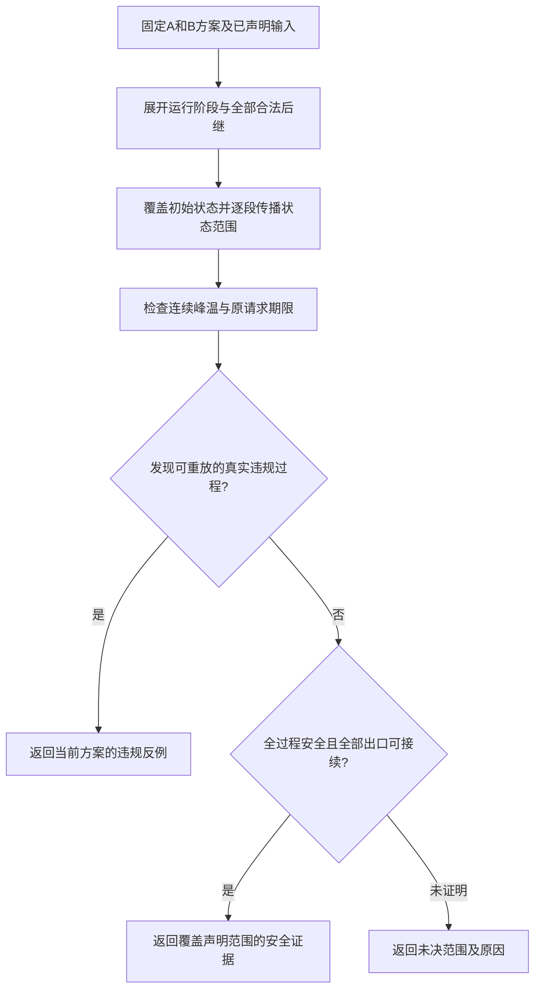

# 多模式热状态与节能联合规划：方案讨论稿

初稿：2026-10-06；收拢更新：2026-10-07。用途：我们当前的研究讨论；尚未与导师讨论，不是论文正文或已完成的研究结论。

## 当前一页方案：多模式端侧推理的热约束节能联合规划

**阶段判断。** 问题、目标和执行边界已经能连成一条研究主线，值得进入实现准备；持续安全分析与真实能耗反馈尚未完成，不能称完整求解闭环已成立。当前最大风险是专用检查器的保守性与计算成本，不是再缺一个算法组件。本页于2026-10-07依据附录J.6收拢；方法安排仍是建议，用户尚未确认具体实现方案。

**1．研究什么，为什么要共同设计。** 各应用模式给定固定请求DAG，但实际模式切换序列不必提前知道。离线共同选择各模式的Stage执行设备、合法工作点和相对时序，运行时按已定协议执行。前一模式留下的温度和未完成工作，会改变后一模式的漏电、可用执行时间及安全性，因此不能只按各模式从同一冷态出发的孤立能耗选择方案。例如A与B单独都偏好NPU，连续运行时可比较“保留A、调整B”和“调整A、保留B”的完整代价；共同选择也可能与独立选择相同。

**2．已确认边界和评价。** 固定周期释放，轮内相对期限不超过周期、最小切换间隔不短于当前模式周期；原期限不随实际启动推迟，不跨轮／跨模式重叠，切换时完成已释放旧工作，等待与准备计入新模式首轮期限。设备／频率域及功耗／热关系沿用R86，输入数值未冻结。平均能耗采用U1路径及权重，各路径入口采用I1直接给定；W1只在既定路径存在相容共同边界时采用，不为迁就窗口改动工作负载。

\[
\min_{\Pi\in\mathcal F}J(\Pi),\qquad
J(\Pi)=\sum_k w_k\int_0^W P_{\rm sys}(t;\Pi,h_k,z_k^0)\,dt.
\]

Π包含各模式各自的离线方案，各使用路径共用同一个Π；h_k、z_k^0、w_k分别为允许范围内给定使用路径、入口状态和权重，w_k≥0且和为1。功耗计入工作、准备、空闲及温度漏电。\(\mathcal F\)要求对声明安全初态及**全部允许重复／转换**满足依赖、资源、频率域、期限和连续温限，不只检查加权路径。一般启动时间仍连续，未沿用旧实验网格或预算。

**3．已有基础与必须完成的工作。**

| 实质工作 | 已有基础 | 最低交付 |
|---|---|---|
| 多模式共同问题与执行模型 | Jung的模式衔接、Schmitz／Huang的使用加权共同设计；已确认协议及热状态联系 | 可执行的释放／排空／转换语义，与原期限、工作点保持和功率事件一致；小例子可独立核对 |
| 固定方案安全及能耗评价 | 旧单轨迹检查和流程；附录I—J的集合传播、时钟压缩及后继闭合条件 | U1路径能耗评价；专用持续检查返回安全证据、真实反例或未决，报告保守性与成本。仅有若干安全轨迹不算完成持续保证 |
| 候选规划与反馈 | 旧MILP结构表达、独立检查与日志组织 | 明确哪些变量／约束进入MILP，真实能耗怎样评价候选，反例能排除什么、未决怎样保留；代理目标及其界不冒充原目标 |
| 方法比较与复现 | 旧实验的公平比较和消融经验 | MILP参照与启发式使用同一工作负载、评价器和保证口径；记录有效能耗、安全输出、未决与计算成本，无收益结果保留 |

研究工作主要在这些部分的具体适配与协调。旧两节点固定RC包络、线性热切面及配置能量下界不能直接沿用到工作点相关漏电模型；采用通用搜索或可达性工具也不单独构成创新。文献出处见正文第三节、附录I／J.1，源码盘点见J.6。

**4．首版路线与最低验证。** 拟采用“生成模式方案→按完整运行过程评价→依据有效证据保留或调整”的离线流程。MILP先承担可明确表达的候选规划，启发式改变候选组织；两者复用同一评价器，暂不称完整MILP精确求解。持续分析的候选路线是事件分组、状态外包络与后继闭合，只服务本协议，不开发通用验证平台。安全方案完成能耗评价后可用于比较；真实反例首先否定完整固定方案；未决可暂缓，但保留在原域中。

最低验证分三类：①协议、功耗和热传播与独立例子一致，安全证据成立，真实反例可重放；②共同设计与逐模式选择在同一完整评价下的差异，区分可行性变化、有效能耗差异与无变化；③相同问题下候选组织的解质量与成本。持续保证须有全范围证据；有限仿真只用于核对与展示。对照若不安全，应单报违规，不能当作有效节能方案比较。

**5．最大风险与停止边界。** 核心风险有两项：持续覆盖可能过宽或不能在可接受成本内闭合；真实能耗依赖时序及温度，尚未确定有效的MILP目标／反馈表达。前者不是数值精度一项工作，后者不是照搬旧切面。允许诚实输出未决，但如果代表性声明条件下始终不能取得可复核安全方案，就尚未完成所承诺的闭环。此时集中讨论具体瓶颈与范围调整，不自行缩小安全初态、删除转换或退回有限时段保证。

**当前完成边界与下一项。** 本页收拢方案，不承诺新颖性、节能收益、全局最优或完成时长。安全初态、物理参数、U1路径与权重等仍待落实，首版V1已明确零额外准备（D25）；旧L3结果不作为新模型的实验结果。下一小目标只制定**固定方案评价器的最小实现与预检任务书**：列清必需输入、可复用模块、首个可核查交付及失败／未决处理，缺失设定交由用户确认；本轮不开始编码或冻结数据。先落实这项公共基础，再展开两种求解方法。

## 一、总的想法：让各模式的节能方案能够连续运行

**我们拟研究：端侧设备在多个应用模式之间运行时，怎样离线共同选择各模式的设备、频率和执行安排，降低使用条件下的平均能耗，同时保证声明范围内的期限与热安全。**

这里有三个关键词：

1. **多模式：** 不同模式对应不同任务需求，例如启用不同的推理工作流，而不是把两个频率档称为两种应用模式。
2. **热状态延续：** 前一模式结束后，设备不会立刻恢复初始温度；下一模式从已有温度继续运行。
3. **共同节能：** 各模式方案一起选择，既看本模式的耗电，也看它留下的热状态对后续运行的影响。

研究重心是热状态与节能。转换流程作为给定规则，不单独研究切换等待策略，也不把吞吐、精度或峰温最小化增加为新的优化目标。

## 二、用一个例子理解：为什么各模式不能只分别算一次

设一台端侧设备有两种应用模式。A执行常规识别，B执行识别及另一条分析工作流。以下只是解释关系的例子，不指定实际模型或设备支持。

### 1．分别看，每个模式都能找到自己的节能方案

假设A、B各有部分Stage可选择CPU或NPU。单独从较冷状态运行时，二者都可能偏好NPU，因为在相应工作点下，其执行时间与活动能量较低。

### 2．连续运行后，B的起点发生了变化

A连续执行若干轮，可能使NPU升温。进入B时，即使没有旧任务占用资源，B仍继承较热的NPU。原先单独评价得到的B方案可能漏电更多，或者不能满足温度上限。

**资源已经空闲，不代表热状态已经恢复。** 这正是首版不研究跨轮重叠，也仍然值得共同规划的原因。

### 3．共同设计比较的是不同方案组合

| 组合 | A怎样运行 | B怎样运行 | 需要评价什么 |
|---|---|---|---|
| 组合一 | 保留偏重NPU的方案 | 采用能适应较热入口的方案 | A节省的能量，能否抵消B可能增加的能量？ |
| 组合二 | 部分Stage改用CPU或调整工作点／时序 | 保留较高效的NPU方案 | A可能增加的能量，能否换来整体更低能耗？ |

调整A并不必然使NPU更冷：CPU也会发热并通过热耦合影响NPU。因此，两组都需要评价完整功率与温度轨迹，不能按“换到CPU”直接判好坏。

这些选择在离线设计时共同完成。运行时按各模式预定方案执行，不是遇到热状态后再运行一次优化器。若热影响较弱，独立选择与共同选择也可能相同。

## 三、问题比原来改变在哪里，文献怎样支撑

**原来主要问：这一组已知请求怎样安排更省电？现在问：为会重复出现、可能相互转换的多种任务需求，怎样设计一组能承接热状态的节能方案？**

实际模式顺序不必提前知道，但各模式任务、允许转换及支撑保证的运行条件必须已知。设计时可以使用运行记录或统计描述节能评价条件；不能为每条评价轨迹分别选择一套“知道未来”的方案。

| 已有研究 | 可继承的具体内容 | 我们准备完成的适配 |
|---|---|---|
| Schmitz等，TCAD 2005 [1] | 模式使用概率、共同映射／调度与DVS、满足实时要求的平均功耗优化 | 把使用条件与完整热历史下的系统能量联系起来 |
| Huang／Xu，DATE 2010 [2] | 保留单模式候选，再按使用份额共同选择，满足系统级要求 | 候选评价需保留入口／出口状态，不能只用单个能耗标量代表 |
| Jung，TODAES 2017 [3] | 已知模式与转换图、重复执行、模式方案之间的衔接 | 采用旧工作完成后转换；重点评价热状态传递，不移植其重叠和迁移优化 |
| Schor等，RTAS 2012 [4] | 对声明的不确定负载范围分析最坏温度，区别于只模拟几条轨迹 | 借鉴保证范围的组织；其work-conserving执行条件需适配本题静态安排 |

这几篇分别提供多模式共同设计、节能目标和热保证的依据。**我们的拟研究内容，是把模式方案之间的热状态联系纳入平均节能设计，并建立相应的可行性评价与求解方法。** 这是一项待实现、待验证的研究构想，尚不能据这些文献宣布组合本身具有新颖性。

任务相关频率响应仍保留：不同Stage的降频代价进入合法模式表，影响设备与频率选择；它是联合问题的组成，不再独自承担整个研究动机。

## 四、具体准备做什么

### 1．建立共同问题：输入是什么，决定什么

- **给定输入：** 各模式的固定请求DAG、合法设备与工作点、时长／功耗响应、周期和期限；允许转换、驻留条件、入口状态与使用统计。
- **共同决策：** 各模式中Stage的设备、工作点和相对执行时序。模式需求由应用决定，不通过少执行任务或少进入耗电模式节能。
- **输出结果：** 一组离线执行方案、适用运行范围、平均能耗评价及期限／热安全证据。

平台、共享频率域、温度漏电及耦合RC沿用已有基础设定。Stage执行中不可抢占、迁移或改频。首版轮内允许并发，轮次间及前后模式间不重叠；若选定应用必须跨轮重叠才能满足既定服务需求，就重新审查这一限制。

### 2．分开定义“省多少电”和“必须在哪些情况下安全”

**平均能耗看使用统计，安全约束看允许运行范围。**

例如，A常用、B少用，目标可以更重视A的节能；但只要A→B被允许，就不能因B权重低而接受超温或超期。

同一观察时长内，按完整轨迹累加工作、空闲、温度漏电及已声明转换成本，再对使用过程求平均。温度和空闲工作点连续衔接。没有真实统计时，结果称为给定权重下的条件性评价，不写成实际用户节能收益。

安全评价还要覆盖同模式重复与允许转换。只算一次A→B安全，不足以说明反复A→B→A都安全；如果要作后者保证，就要检查前段可达出口能否继续落入后段安全入口范围。

### 3．建立参照和实用方法，服务同一个问题

| 工作 | 准备回答的问题 | 当前不提前确定的内容 |
|---|---|---|
| 联合模型与MILP参照 | 小规模情况下，哪些模式方案组合可行，能量评价是否正确？ | 温度漏电与状态衔接如何进入求解，哪些界和结论能够认证 |
| 启发式协调求解 | 在相同问题和预算下，能否更快得到较好的安全方案？ | 算法名称、候选筛选和反馈规则，由模型结构决定 |

这两项可分别构成第三、第四章的核心工作。已有MILP与连续热检查经验可以复用，但新问题的温度相关功率和跨模式状态会改变接口，不能直接宣布旧热反馈约束全部有效。

## 五、怎样证明这些工作有价值

最低必要验证分为三组，不先扩规模或扫描大量参数。

1. **验证问题关系。** 比较逐模式设计与共同设计，统一使用连续热历史重新评价。分别看选择是否改变、能耗是否下降及安全性；旧方案失效时与有效方案能量差分开报告，不只和“每模式重置冷态”的弱对照比较。
2. **验证方法效果。** 以同问题的MILP参照核对小规模结果，再与简单完整复核／回补及启发式比较安全解质量、求解时间和证据范围。能耗权重、服务要求及计算预算一致。
3. **验证适用范围。** 检查温度压力、驻留和使用分布变化时，收益是否保持。保留热影响弱、独立方法已足够、共同设计没有收益的情况；同时报告统计使用条件变化对能耗的影响。

旧实验可作为评价工具与局部关系的基础，不作为新多模式问题的验证结果。

## 六、当前认可与后续落实

**用户已认可这一主线：共同建模模式间热状态、按使用条件评价节能、构造离线求解方法，再用公平对照验证。** 当前先采用有文献依据的抽象任务模型，不要求先确定实际应用或设备。

模型实例需要三组输入：①各模式包含哪些工作流及服务要求；②允许转换和驻留条件；③响应／功耗／热参数，以及使用统计或明确的抽象分布。它们可以先作为符号输入定义，不必立即填写实测数值。用户已确认声明条件下持续安全为目标，保证尚待建立，不能用有限实验代替。

下一步将已确认的构想落实为一致的模型定义，区分输入、决策、派生状态与约束。定义不是继续缩小范围；确需排除某类执行行为时，才作为新增限制另行讨论。真实应用用于后续解释与验证，不作为建模前置条件。

## 附录A：模型定义整理——输入、决策与运行结果

本附录保留E407阶段的定义整理，不增加数值、算法或执行限制；其中当时待定的安全范围已在附录B确认，其他待定接口仍未冻结。

### A.1 先区分四类对象

| 对象 | 含义 | 例子 |
|---|---|---|
| 应用模式m | 当前要完成哪类任务与服务要求 | A包含G₁、G₂；B包含G₁、G₃ |
| Stage合法执行模式o | 一个Stage可用的执行单元与工作点，附响应参数 | CPU单元u的合法频点，或NPU设备v的合法工作点 |
| 模式执行方案π_m | 模式m的一轮工作怎样执行 | 各Stage选择o，并确定相对启动时刻 |
| 使用过程h | 外部任务／模式需求及初始条件如何出现 | A保持若干轮后请求B；不是优化器选择少运行B |

G₁在两个模式中出现，不强制其采用相同设备或频率；所有合法选择由输入支持集合决定。模式数、DAG大小、设备数、频档数均未固定成示例数目。

### A.2 已知输入、决策变量与派生量

| 类别 | 内容 | 在问题中的职责 |
|---|---|---|
| 已知任务输入 | 各模式请求DAG、Stage划分、轮内释放与期限、重复／驻留规则 | 规定必须完成的工作，不由节能目标改变 |
| 已知平台输入 | 固定执行单元、共享频率域、合法工作点、Stage支持与响应、功耗／RC参数 | 规定每种选择的代价及相容关系；非统一1/f由响应表保留 |
| 已知使用与范围输入 | 使用过程分布D、允许运行集合H_allow、初始温度与工作点、评价时长和保证范围 | D决定平均能耗；H_allow决定必须满足哪些安全和实时条件 |
| 离线决策 | Π={π_m}：各模式Stage的执行单元、工作点、相对启动时刻 | 同一组方案服务全部纳入评价／保证的过程，不按已知未来逐轨迹重选 |
| 派生运行量 | 实际轮次起点、Stage绝对起止时刻、资源顺序、工作点状态、功率、温度、能量 | 根据Π、h及给定转换协议计算，不把温度当自由调节变量 |

本阶段未引入按入口温度在线选候选或重新搜索，也未引入每次实际出现都可独立重选的变量。转换协议给定，其中未定义的字段保留待填，不由求解器自行决定。

### A.3 目标与必要约束的对应

对同一给定观察时长W，能量E_W(Π,h)按完整功率轨迹积分。共同目标为min_Π E_{h∼D}[E_W(Π,h)]；分布无实测依据时明确标为抽象使用设定。对H_allow内的每个过程，要求：

1. **任务合法：** 每Stage选择一个支持的执行模式，遵守释放、依赖、不可抢占／迁移／执行中改频规则。
2. **资源相容：** 同执行单元互斥，共享频率域满足既有运行与换点规则。
3. **时限满足：** 完整请求按输入规定的释放和期限完成；各轮及模式转换遵守已确认的不重叠规则。
4. **状态连续：** 温度与空闲工作点按实际执行延续，轮末及转换过程不能重置温度。
5. **热安全：** 声明时间与初始状态范围内连续温度不越限；安全范围不随能耗优化结果缩小。

其中1—2沿用原调度基础，3采用已确认的轮次／转换边界，4—5把不同模式方案关联起来。平均节能目标不允许用另一个过程的节能或低温抵消当前过程的违规。

### A.4 一致性核查：三处不能混写

- **切换请求与实际进入时刻。** h描述应用要求及其统计；实际何时进入下一模式，要经过旧工作完成及给定衔接规则才能得到。Jung§4也区分mode change requested与执行衔接。我们的统计不能把由方案决定的实际切换时刻误作与方案无关的外部输入；更不能推迟请求释放来掩盖阻塞。若驻留按轮数定义，也须标明相应服务量及转换响应要求。
- **原有零开销与待定转换成本。** R86的Stage交接／搬运／调频零额外开销假设保持历史含义。多模式状态准备成本尚未选定，前述“计入已声明转换成本”不等于已经加入非零成本，也不等于自动批准其为零。本轮不新增传输资源或迁移机制。
- **有限评价与持续保证。** W用于平均能耗计量；安全覆盖时长单独声明。有限窗口安全与任意重复／转换安全是不同保证；这里只列出输入接口，不默认选择无限保证或用有限抽样替代证明。

**本轮结论：** 抽象研究问题的输入、决策和关系已经能够一致表达，不必先锁定真实应用。尚待明确的是转换请求／释放协议、使用过程统计的具体表示和安全覆盖范围；这些改变问题含义的选择需讨论，具体数字可以后填。不再默认新增马尔可夫过程、稳态假设或冷却等待策略。

## 附录B：热安全覆盖范围——2026-10-06用户已确认

**采用“满足声明运行条件时，可以持续重复和转换”为安全目标。** 实际模式序列不必提前知道，但初始状态、任务释放、驻留及允许转换必须满足给定规则。用户已确认这一强于有限时段安全的目标；目前尚未完成保证构造。选择路径见[研究状态的选择路径与变更记录](../RESEARCH_BRIEF.md#选择路径与变更记录唯一维护入口)D08，原建议与核查过程保留在E408，本次确认记入E409。

### B.1 两种范围分别回答什么

| 范围 | 要回答的问题 | 适合的对象 |
|---|---|---|
| 有限时段安全 | 从给定初始状态出发，所有纳入保证的过程在指定时段内是否安全？ | 有明确结束时间的任务或有限任务批次；时段内也可以包含多次转换 |
| 声明条件下持续安全 | 从给定初始状态集合出发，只要执行过程遵守声明规则，重复多少轮、发生多少次合法转换都能否保持安全？ | 预先设计一组可反复使用的模式方案，实际运行时长和转换序列未完全预知 |

两者都能采用离线规划。区别是保证覆盖到哪里，不是是否使用在线算法。持续保证也不等于允许任意温度、任意转换或任意服务负载。

### B.2 用A、B模式理解区别

设A、B都有各自的离线执行方案。A从冷态运行一轮安全，下一轮却继承了前一轮留下的温度；多轮后的入口可能与第一次不同。类似地，单独验证A→B安全，也不能直接推出A→B→A→B持续安全。

因此，持续运行需要回答两个问题：**当前这一轮能否安全完成；完成后的状态能否继续交给下一轮或下一模式。** 如果某组合不能满足要求，离线设计需要调整模式方案，或判定该输入要求下未找到可行方案；不能在验证后擅自删去原本要求支持的转换。

### B.3 可利用的论证方式与文献依据

一种充分条件是为各模式边界声明可接受状态范围，并核查：①实际初始状态被覆盖；②从范围内任一允许状态出发，执行及给定衔接过程均满足温限与时限；③执行后状态仍落入所有适用后继的允许入口范围。后继包括规则允许的同模式重复和跨模式转换。由逐段衔接可归纳覆盖任意有限次合法执行，从而得到持续运行保证。这是待构造和验证的论证方式，不是已取得的证书。

“状态”不能只保留温度：本题空闲保持工作点，还需保留工作点及转换协议所需的驻留／释放信息。入口范围也不能单独随意扩大；必须覆盖真实可达状态，并与后继相容。本轮不选择具体集合形状、求解算法或温度相关的运行时选配。

Wang等的*Energy-Efficient Speed Scheduling for Real-Time Tasks under Thermal Constraints*（RTCSA 2009）§III-A、Lemma 1援引Chen、Wang、Thiele的结果：若单周期调速方案可行，且周期首尾温度相同，则可以重复使用。其对象是单处理器周期任务、速度调度与收敛周期能耗。本题可借鉴首尾衔接的论证思路，但多模式、多热节点和保留工作点的适配尚需完成；不能把单模式周期结果直接作为本题证明。[已下载全文](extracted/Wang_RTCSA2009_author.pdf)

### B.4 与平均节能目标的关系及本轮停止点

平均能耗仍按共同观察时长W及给定使用分布评价，不把目标改为无穷时间总能耗，也不自动引入稳态分布。持续安全约束用于筛选可反复部署的方案；平均能耗在这些合格方案中比较日常使用代价。有限仿真能检查具体轨迹，不能单独证明持续安全。

用户已选择上述持续安全目标，有限时段安全不作为当前最终保证目标。本轮登记确认与选择路径；下一项只落实释放／转换协议，不同时展开算法、统计分布与数值实例。

## 附录C：切换请求、任务释放与期限——P1已于2026-10-07确认

**已确认：B切换请求同时提出首轮工作，从该外部请求计时，等待旧工作结束也占用B的期限。** 这让模式方案的快慢、功率和遗留温度接受同一服务要求评价。该选择见研究状态D11；此前P1／P2对照保留，只有首轮计时原则获确认，不代表下列全部协议字段均已冻结。

### C.1 原文实际规定了什么

| 已核正文 | 原文规则 | 可借鉴部分与适配边界 |
|---|---|---|
| Jung、Oh、Ha，TODAES 2017，§4，印刷页37:9—37:10；§7.1的Blocked对照 | 模式决策任务可在迭代中产生决定；未指定该任务时，在迭代开始前决定。旧迭代继续完成，原主方法可跨模式重叠；Blocked则按旧模式延迟加迁移成本确定后继起点 | 可区分决定发生时刻与执行衔接；借用Blocked的不重叠边界。原目标是处理器数／吞吐，不能据此声称原文已规定本题请求期限从切换请求计时 |
| Gifford、Phan，Omni，RTSS 2022，§III，PDF第2—3页，Mode-change protocol | 新增任务在MCR到来时立即释放；不变任务保持原释放；参数变化任务首个新job按旧周期释放、后续按新周期；仍保留的existing job维持原期限。原协议同时会丢弃不再需要的old task，并允许迁移及新旧工作并存 | 直接表明“释放规则”和“处理器何时执行”须分开。本文只借鉴显式定义释放与期限，不移植丢弃、迁移、新旧重叠或运行时拒绝MCR |

来源：[Jung本地全文](../papers/2017_Multiprocessor_Scheduling_of_a_Multi-Mode_Dataflow_Graph_Considering_Mode_Transition_Delay.pdf)；[Omni本地全文](../papers/2022_Multi-mode_on_Multi-core_Making-the_best_of_both_worlds_with_Omni.pdf)。本轮只定向复核上述正文，不新增文献检索。

### C.2 两种可以成立的服务约定

| 候选 | B首轮释放与期限 | 等待如何约束 | 适用含义 |
|---|---|---|---|
| P1 请求到来即提出工作（已选） | 切换请求时刻τ同时提出首轮工作，首轮服务期限为τ+D | 即使暂不能执行，期限也不后移；等待自然占用服务时间 | 外部提出“现在开始需要B的结果”；Stage实际启动仍受依赖与数据就绪约束 |
| P2 先请求启用模式，再按协议产生工作 | B实际进入时刻b后才释放首轮任务，任务期限按该释放计算 | 必须另给从τ到模式启用或首个结果的响应上限；不能只限制进入后的执行时间 | 外部请求的是功能启用，数据采集／工作产生确实在启用后开始 |

两者不是同一工作负载的两种计时技巧。P2在其应用语义下可以合理，但不能用来改写P1已经提出的工作。若采用P2，以相同窗口比较能耗还须核对服务量，不能让较慢启用仅靠少做工作获得节能优势。

### C.3 P1的建议规则及一个例子

以下只说明一次满足允许转换、驻留条件的A→B请求；未确定驻留数值或连续转换请求的排队规则。

| 对象 | 建议规则 |
|---|---|
| A已承担的工作 | 按原期限完成，不因转换而丢弃或重设期限；遵守已确认的不跨模式重叠 |
| B切换请求τ | 外部输入；若同时提出首轮工作，则该工作从τ或给定固定偏移释放，不由优化器随实际进入时刻修改 |
| B实际进入b | 由旧工作完成、给定衔接过程及就绪条件导出；不作为独立冷却等待决策 |
| B首轮完成c | 在实际进入后按离线方案执行，但仍满足c≤τ+D（零释放偏移的单请求示例） |
| 后续轮次 | 释放由声明周期／外部需求确定，不因上一轮晚完成而自动顺延期限；若无法满足不交叠约束，按D04重议适用性 |
| 热与能量 | 从τ前的真实状态继续推进，等待和准备按实际功率计入；进入B不重置温度 |

纯解释例子：τ=10 ms，A于12 ms完成，声明的准备过程耗时1 ms，因此B于13 ms进入；B首轮17 ms完成。若相对期限D=8 ms，则绝对期限为18 ms，方案合格，8 ms额度中包含了3 ms衔接等待。若B到19 ms才完成，则超期；不能把期限改为13+8=21 ms。例中数值与1 ms准备时间均非冻结输入，不改变R86原开销假设，也不是仿真结果。

这一约定允许检验真正的共同取舍：A降低工作点可能省电并改变出口温度，但若推迟B进入，也会压缩B可用时间；是否值得需共同评价。等待在这里是执行后果及约束的一部分，不是新增优化目标。

**确认记录（2026-10-07）：** 用户选择P1，P2保留为未采用方案。首轮工作在τ提出，输入分步就绪也不能自动重置其服务期限。转换处理中又出现请求的处理、驻留规则、准备成本及后续轮次释放仍需协议输入，不能默认取消请求、在线拒绝或设为零。本轮只登记选择，不实现机制或冻结参数。

## 附录D：重复节奏与切换频率——R1已于2026-10-07确认

**已选择R1：固定周期提出各轮工作，各轮期限不晚于下一周期边界，切换请求之间满足给定最小间隔。** 周期与最小间隔是外部服务输入，不由优化器拉长。R2事件驱动轮次保留为未采用的备选；确认记录见研究状态D13，原比较保留于D12及E412。具体参数未填写。

### D.1 文献依据与本题适配

| 原文定位 | 已核事实 | 本题借鉴及差异 |
|---|---|---|
| Dziurzanski等，2017，§3.1，PDF第4—5页；[已存正文](extracted/Modal2017.txt) | 每模式的runnable周期及WCET预先已知，相对期限等于周期；允许模式转换及转换期限也需提供 | 借鉴周期服务与期限作为输入。本题对象是每轮请求DAG，不是照搬其各runnable独立周期与迁移机制 |
| Jung、Oh、Ha，TODAES 2017，§4，印刷页37:9—37:10；[已存正文](extracted/Jung_TODAES2017.txt) | 给定每模式最少重复次数MRC；次数越小，转换越频繁；决定可在迭代中作出 | 借鉴限制模式变化频率的输入思想。本题推荐用外部请求间的时间下限，不把它冒称原文MRC，也不以实际完成轮数触发外部请求 |
| Omni，RTSS 2022，§III，PDF第2—3页；[已存正文](extracted/Omni2022.txt) | 任务有模式相关周期／期限；协议限定转换不重叠，并在转换过程中拒绝新的MCR | 提醒必须交代连续转换。本题不采用其拒绝策略，而拟通过输入最小间隔及首轮期限限制合法过程；违反输入范围的请求不获保证，不等于已定义运行时丢弃行为 |

### D.2 推荐R1：从外部请求起算的周期规则

设一次模式m的外部请求时刻为τ，下一次切换请求时刻为τ′。初始模式也有输入给定的首轮释放基准。

| 字段／规则 | 推荐含义 |
|---|---|
| 周期P_m | 每P_m提出一轮工作；模式内各轮释放r_k=τ+kP_m，k≥0，且r_k<τ′。B首轮仍在切换请求τ提出，符合D11 |
| 轮内期限 | 每轮各完整请求的相对期限D_m,j满足0<D_m,j≤P_m，绝对期限为r_k+D_m,j；周期与期限均是输入 |
| 实际执行 | 继续遵守各轮不重叠、旧模式完成后进入新模式；释放不等于实际启动，晚启动不移动下一轮释放或当前期限 |
| 最小切换请求间隔L_m | 要求τ′−τ≥L_m，且首版L_m≥P_m。从上一次请求计时，不从实际进入／完成计时；保证不同方案面对同一允许过程集合 |
| 切换时的工作归属 | τ′前已释放的旧轮工作全部完成并保留期限；τ′起不再释放旧模式的新轮。若切换恰与旧模式下一释放同刻，先应用模式更新，该时刻只释放新模式首轮，不重复计工作 |
| 转换时机 | 满足间隔及允许转换图后，外部请求仍可落在旧模式某轮执行中，不要求只能在轮末提出；新模式等待计入其首轮期限 |
| 长驻留 | 不默认最长驻留。没有新切换请求时，当前模式按原周期持续重复，属于持续安全目标需要覆盖的情况 |
| 温度与计量 | 轮末空闲、旧工作排空和声明的准备过程均延续热状态并计能量；周期、使用过程及窗口在各比较方法间一致 |

**为何附带D_m,j≤P_m及L_m≥P_m？** 这是已选择R1的首版适用条件。若所有期限都满足，则进入某模式后的首轮全部工作应在τ+P_m前完成，下一次切换不会赶在该首轮及其前置转换尚未结束时到来；同模式也不会跨多个释放周期积累未完成轮次。因此无需同时引入重叠转换请求的排队策略。这是以可调度为前提的结果，不是仅凭这两个不等式就能保证可调度或热安全。

最小请求间隔不是强迫旧模式等待到某时刻再执行新模式，也不是优化冷却时间。它声明环境允许多快改变需求；如果应用必须在更短间隔切换、跨周期完成工作或维持跨模式连续的数据流，这套输入语义需重新审查。不能以软件拒绝、推迟时间戳或取消已释放工作伪装满足输入条件。

### D.3 同一例子说明节奏与等待

以下均为解释数值，不是研究实例：B请求在10 ms到来，周期20 ms，相对期限8 ms。则B各轮在10、30、50 ms提出，期限为18、38、58 ms。即使B因等待A而到13 ms才开始，后续释放也不改成33、53 ms。

再假设L_B=40 ms，下次切换最早可以在50 ms请求。若正好在50 ms请求C，则按同刻规则释放C首轮，不再产生50 ms的B新轮；若在55 ms请求C，则50 ms已提出的B工作必须完成，C首轮在55 ms提出并开始计算期限。是否存在满足这些要求的方案仍需后续规划与热验证。

### D.4 备选、当前判断与停止点

| 方案 | 轮次释放 | 优点／适用对象 | 额外需求 |
|---|---|---|---|
| R1 固定周期（推荐） | 在模式请求基准上按P_m重复 | 固定帧率／周期批次；可直接解释服务量、空闲和热积累，适合当前抽象首版 | 需给周期、轮内期限、最小切换间隔；不能覆盖必须跨周期积压的工作 |
| R2 事件驱动且限制最小间隔（备选） | 具体到达不固定，只约束相邻轮次最小间隔 | 外部事件驱动推理，释放时间有变化 | 需覆盖更多到达过程并给出能耗使用统计；不能只验证最密到达就自动声称所有热轨迹安全 |

两者都保留离线方案、平均节能与持续硬安全。R1不是“完成一轮再决定何时释放下一轮”，也不要求所有模式周期相同。最小切换间隔不提供概率或保证热安全；使用分布与安全证明仍需分别落实。

**确认记录：** 用户选择R1及本节所列首版规则；D13记录确认，D12保留提案。附录E将选择串成完整运行例子。尚未冻结任何周期、间隔、开销、算法或实验。

## 附录E：把已选规则串成一次A→B→A运行

**目的：** 看清外部工作需求、离线候选方案和实际状态怎样连接。本例全部数字仅用于手算说明，不是冻结参数、求解结果或热安全见证。每轮用一个完整请求DAG代表；下表只展示轮级起止，不替代Stage资源／频率域合法性核查。

### E.1 外部需求与待评价的候选方案

解释输入：A、B周期均为20 ms，完整请求相对期限均为12 ms，最小切换请求间隔均为40 ms。初始A从0 ms提出首轮，45 ms请求B，88 ms请求A；两次间隔分别45、43 ms，满足示例范围。相同周期仅为讲解方便，一般模型不要求相同。

假定已有一组离线候选：A每轮执行跨度8 ms，B每轮6 ms，跨模式准备跨度1 ms；模式内设备、工作点及Stage相对时序已包含在各自候选中。准备时长只用于例子，未授权将真实准备成本定为1 ms或零。运行时照该候选执行，不提前读取下一次切换时刻。

| 轮次 | 提出时刻 | 绝对期限 | 本例实际执行 | 等待／衔接原因 |
|---|---:|---:|---|---|
| A第1轮 | 0 | 12 | 0—8 | 初始直接运行 |
| A第2轮 | 20 | 32 | 20—28 | 按周期提出 |
| A第3轮 | 40 | 52 | 40—48 | 45 ms收到B请求仍完成本轮 |
| B第1轮 | 45 | 57 | 49—55 | 等A到48，准备48—49；4 ms等待包含在期限内 |
| B第2轮 | 65 | 77 | 65—71 | 从请求45起算周期，不从实际开始49起算 |
| B第3轮 | 85 | 97 | 85—91 | 88 ms收到A请求仍完成本轮 |
| A再次进入的第1轮 | 88 | 100 | 92—100 | 等B到91，准备91—92；恰好按期完成 |
| A再次进入的第2轮 | 108 | 120 | 108—116 | 从新请求88起算周期 |

全部时间单位ms。45 ms后不再产生原A过程的60 ms新轮；88 ms后不再产生B的105 ms新轮。两者是输入规定的模式需求变更，不是优化器删除已提出工作。若未收到相应切换，原模式必须继续按原周期工作。

### E.2 温度、能量和持续保证在哪里使用

1. **温度由实际执行推进。** 45—48 ms虽然外部已经要求B，设备仍在执行A；功耗不能提前替换为B。A出口温度经过准备过程成为B入口，返回A时也继承B留下的状态。保留工作点按既有规则传递，切换请求不是温度或空闲功率的重置点。
2. **平均能耗按共同时间和工作需求比较。** 若本例观察窗口取0—120 ms，积分包括8轮工作、两次准备及所有空闲，特别包括116—120 ms尾段。各候选使用相同请求过程、服务要求和窗口；实际起止可以不同。温度漏电存在时必须按各自轨迹评价，不能直接将两种模式的孤立能量相加。多个使用过程按给定统计加权，单条路径没有代表全部平均使用情况。
3. **持续保证覆盖更多允许过程。** 这条表的期限均满足，但没有温度参数，不能宣称热安全，更不能证明持续安全。比如保持同一候选，将B请求提前到41 ms，仍满足从0起至少40 ms的切换间隔；A要执行到48 ms，B49—55 ms执行，但期限为53 ms，出现超期。此为纯计时反例，说明不能仅凭一条通过的路径接受候选；也不能事后将41 ms请求从允许集合删除来保留它。

### E.3 本轮检查结果与离线规划的实际任务

已确认规则可以一致生成任务需求、期限和衔接时间；“请求所指模式”和“当前实际执行的旧工作”必须分开保存。周期及最小请求间隔限定外部负载，不自动产生安全方案。上面的示意候选甚至不能满足全部合法切换时刻，因此只用于解释流程。

离线规划要共同选择A、B的设备、工作点和Stage时序，在声明初始状态、全部允许重复／转换下满足温限和期限，并按使用条件降低平均能耗。候选失败后可重新选择模式方案；不需要把等待优化、任务丢弃或在线重求解加入当前对象。若没有可行方案，应报告问题或讨论范围，不自动降低服务要求。

**下一小目标：明确离线方案需要输出哪些安全适用条件及如何衔接。** 重点区分给定初始范围、运行中可达状态和可接续保证，结合本例解释；先确定输出含义，不预定集合算法或追加实验。准备开销和使用统计继续作为待落实输入，不在本轮默认设定。

## 附录F：离线方案的适用条件与持续衔接输出

**本轮结论：** 离线结果应包含“怎么执行＋适用于什么状态和请求范围＋已核查到什么保证”。运行时照预定方案执行；适用条件用于离线核查，不自动引入按温度在线选配、拒绝请求或延迟转换。

### F.1 先分开输入要求与输出保证

| 层次 | 内容 | 谁决定 |
|---|---|---|
| 必须服务的范围 | 初始温度／工作点范围、允许转换图、周期、期限、最小切换间隔、准备过程及参数有效范围 | 问题输入；具体值后续落实，不能随候选好坏删减 |
| 待评价方案 | 各模式的Stage设备、工作点、相对时序及按已定协议进行的衔接 | 离线规划共同选择，原优化变量不变 |
| 方案适用范围及保证 | 哪些入口和运行状态下可完成工作、全过程不过温，且能继续衔接所有合法后继 | 分析所得结果，需覆盖输入要求及其后续可达状态，不能反过来代替输入要求 |

例如，方案只适用于较冷入口，但给定初始范围还包含较热状态，则只能报告条件性适用，不能把初始范围缩小后宣布完成原任务。对原本允许的41 ms切换也一样，不能因候选超期而直接删去该时刻。

### F.2 每组离线方案至少应输出什么

| 输出 | 必须说明的问题 |
|---|---|
| 执行方案与运行规则 | 每模式如何选择设备／工作点／Stage相对时序；晚进入时如何沿固定方案执行，释放与期限保持外部基准 |
| 初始覆盖 | 给定初始状态是否全部纳入已验证范围；R86的初始无未完成任务，不等于每次切换也无旧工作 |
| 当前过程保证 | 模式内、旧工作排空、准备和空闲全过程是否满足资源、频率域、期限与连续温限 |
| 后继衔接保证 | 输出状态能否支持同模式下一轮及每个合法后继；覆盖允许的切换相位和无限长驻留，不只验证冷态首轮或一对模式 |
| 能耗评价与证据状态 | 同一使用条件下的完整平均能量；哪些范围已证、哪些仅有轨迹检查、哪些仍未决；缺保证不自动等于不可行 |

能耗统计和安全范围仍分开：罕见但允许的过程必须安全，不能靠统计权重忽略；安全适用条件本身也不能给出平均能量，需要给定使用分布或明确的加权评价条件。

### F.3 为什么不能只交接温度

附录E中，B在49 ms实际开始、执行6 ms。若请求在45 ms提出，期限57 ms，尚余8 ms；若请求在41 ms提出，期限53 ms，尚余4 ms。即使两者49 ms入口温度完全相同，后者仍然超期。

因此，检查时需保留或由已有信息推导：各节点温度、保留的工作点、当前实际执行的模式及进度、外部请求指向的模式、到下一释放／期限的时间，以及距上次模式请求的时间。相同温度不代表相同可接续能力。旧工作全部完成后的边界可省去其执行进度；检查任意切换请求时则不能漏掉未完成旧工作。这些是状态与时钟，不是新增自由决策变量，也不要求采用某种固定维数的数据结构。

### F.4 怎样从逐段安全得到持续安全

一种充分的证明组织是：①给定初始状态全部被覆盖；②从所覆盖状态出发，每种允许的执行／等待／转换过程始终满足温限与期限；③过程结束仍落入可继续验证的状态范围。于是可以逐段衔接，覆盖任意次数合法重复与转换。连续段内部也要检查，不能只看首尾；没有后续请求时的持续同模式运行也须纳入。

这说明需要建立什么保证，尚未指定怎样求范围、如何编码或采用何种算法。分析范围可以保守，但若保守分析失败，应标未决或尝试加强核查，不能直接判原问题无解。

文献依据限于已核范围：Wang等RTCSA 2009 §III-A、Lemma 1给出单周期首尾温度一致时可重复使用的条件；本题借鉴闭合衔接思路，不移植其单处理器速度控制结果。工作点保留依据R86 R6，状态相关功耗依据P3／H3，期限及释放基准依据用户D11／D13。多模式全过程保证仍是本题要完成的工作。

**本轮完成与下一项：** 输出契约已明确，不新增用户选择，也未取得安全证明。下一小目标是把这一保证任务整理成一条可借鉴的离线分析路线：先查已有方法如何覆盖周期内任意切换时刻与入口状态，明确可直接继承和必须适配的环节；不重新扩展研究方向或直接运行实验。

## 附录G：一条可继承的离线安全分析路线

**建议路线：固定一组模式候选 → 检查转换期限上界 → 按实际工作点分段传播温度 → 检查重复与转换的安全闭合。** 这是一条分析路线，不是已经实现的新算法；不改变已确认的运行规则，也不同时展开多个求解方向。

### G.1 三篇文献分别提供什么

| 原文定位 | 继承内容 | 必须适配 |
|---|---|---|
| Jung，TODAES 2017，§5定义5.4—5.6、式(7)—(9)，§7.1 Blocked | 将转换起始偏移分解，并汇总合法前驱造成的影响 | 原文评价吞吐／输出间隔，本题应从外部切换请求计算完整请求期限；不照搬允许模式重叠的偏移公式 |
| Wang等，RTCSA 2009，§III-A、Lemma 1 | 通过周期首尾热状态关系支持重复运行 | 原单节点周期结论要扩展为多节点、多工作点及允许转换的共同覆盖；每个模式各自稳态安全不证明相互切换安全 |
| Schor等，RTAS 2012，§III-A/B、式(1)—(11)，§IV | 到达范围与温度上界、耦合RC及线性漏电的分析表达 | 原文采用work-conserving执行与固定热系统矩阵；本题允许静态等待且漏电系数随工作点变化，须按候选实际分段传播；不能直接继承其固定卷积核或响应形状结论 |

第三篇本轮通过[作者全文](https://tik-old.ee.ethz.ch/file/ba8d087358c30d40a407128b8987b80d/sbyt2012a.pdf)定向重读，并非新扩展检索。前两篇使用已有本地正文。

### G.2 期限部分已有一个可直接说明的充分检查

固定候选后，记模式m一轮从执行基准到全部完成的跨度为C_m，模式n中请求j相对执行基准的完成偏移为c_n,j，m→n准备时长的有效上界为κ_mn。它们由候选和输入导出，不是外部周期。

在各轮按期完成、首轮之后恢复固定周期执行的前提下，任意合法切换请求到来时，旧模式剩余执行跨度不超过C_m。因此，对每条允许边m→n，检查

\[
C_m+\kappa_{mn}+c_{n,j}\le D_{n,j}\qquad\text{对所有后继请求 }j
\]

可作为转换首轮期限的充分条件；各模式自身的c_m,j≤D_m,j及资源／依赖／频率域合法性同时要满足。理由是从请求起，到新请求完成最多经历旧工作排空、准备和后继完成偏移三段。D≤P和L≥P使上一转换首轮应先于下一合法转换完成；从初始无旧工作状态逐次检查，可支撑此处的前提。

这个上界可能将并不同时出现的最坏情况组合，失败不能直接判原问题不可行。需要更精细核查时，可按周期相位φ求实际剩余跨度R_m(φ)，检查R_m(φ)+κ_mn(φ)+c_n,j；同刻切换优先于旧轮释放的边界须单独保留。不能以几个采样相位代表连续相位全覆盖。若准备还受额外资源／数据条件影响，κ必须覆盖这些条件，否则本式尚不可使用。

附录E示意候选的粗检查为8+1+6=15 ms，大于B的12 ms期限；这只使充分检查失败。但已给出的合法41 ms请求确实导致55 ms完成、超过53 ms期限，所以该具体候选另有真实时序反例。上述是手算逻辑，不是研究实验。

### G.3 热部分采用分段状态传播，入口不必逐条抽样

R86的时长在合法模式确定后不随温度变化。故固定执行路径的功率结构及工作点变化时刻可以先确定，再在每个结构不变的片段r内写成

\[
\dot T=A_rT+b_r,\qquad
T(t+\ell)=e^{A_r\ell}T(t)+\int_0^\ell e^{A_ru}b_r\,du.
\]

这里A_r包含导热和该工作点的漏电反馈，b_r包含环境及相应活动／空闲注热，ℓ是片段持续时间。使用积分形式不要求A_r可逆；空闲和准备也须有明确功率表达。不同工作点一般对应不同A_r，不能在全程固定一套响应系数。

若输入满足协作型热系统条件，即每段A_r的非对角元非负，则e^{A_rℓ}逐项非负。对**同一执行路径和工作点序列**，较高入口温度向量产生不低的后续温度；可据此从覆盖真实入口的逐节点上界传播安全上界。该条件要核对注热和漏电映射，不仅凭“被动RC”四字认定；工作点改变了矩阵后也不能用一个模式的稳态代替全部转换分析。

不同切换相位会改变片段顺序或长度，仍须覆盖。固定结构区间内可使用有依据的范围界；仅在几个相位计算精确轨迹不能证明其余相位安全。传播时检查连续段内峰温，而不只检查出口。R86局部线性功率的有效温区也必须覆盖所证明范围。

### G.4 从传播到持续保证：一个保守但清楚的起点

优先保留“共同温度包络”的简单充分核查作为参照，而不是先要求精确计算所有可达状态。例如，若在每种可能出现的功率／工作点片段下，同一个温度区间盒[l,u]的边界向量场都指向盒内，且初始温度被包含、u不超过温限，则连续切换也不会离开该盒。对上述协作型仿射系统，逐项条件为A_r l+b_r≥0、A_r u+b_r≤0；所有可能片段都要覆盖，包括保持工作点的空闲与准备，温度在切换时连续。其依据是向量场的边界方向和比较性质，是本题条件推导，不归为Schor原文定理。

这个条件很保守：短时间高功率虽然实际安全，也可能无法满足“该片段始终将盒内状态留在盒内”。如果失败，只说明此充分证明不足；利用周期／转换次序形成更紧状态包络仍是一项待完成的方法工作。未求出包络时记未决，不宣布无解。若简单包络已经足够，就保留这个结果，不为构造方法贡献而强行复杂化。通过这一检查的方案只构成原可行域的可认证子集，不能据此改写原问题全部可行方案的定义。

更紧的包络须覆盖完整状态中的工作点、周期相位、剩余期限及执行进度，并满足附录F的初始覆盖、段内安全、后继闭合。温度上界可以保守，不用于替代平均能耗的实际使用轨迹评价。热保证与期限检查服务同一候选，仍由共同优化选择候选；将二者分开分析不等于分开优化设备、工作点和时序。

**修正后的判断（2026-10-07，E416）：** 已有简单充分条件及分析起点，但更紧的持续保证仍需解决入口温度、连续切换相位与多次重复／转换的联合覆盖，不能仅概括为实现和精度验证。独立周期稳态、Schor的特定工作量界及旧固定RC程序不能直接作为整体证书。工作点相关热传播与温度漏电能量如何接入MILP也未闭合；当前不称“完整MILP精确求解”。原表述的问题及用户修正依据保留在E416。

**下一项：** 将已确认输入、模式决策、平均能耗目标和本轮安全分析接口合并成一页问题定义，明确哪些量由MILP／启发式选择、哪些由分析器验证；不再追加运行规则选择，不自动启动实验。

## 来源与记录入口

1. Schmitz, Al-Hashimi, Eles. *Cosynthesis of Energy-Efficient Multimode Embedded Systems With Consideration of Mode-Execution Probabilities*. TCAD, 2005。§V—VI、§VII-D；[作者全文](https://www.ida.liu.se/labs/eslab/publications/pap/db/ieee_cad05.pdf)。
2. Huang, Xu. *Energy-Efficient Task Allocation and Scheduling for Multi-Mode MPSoCs under Lifetime Reliability Constraint*. DATE, 2010。§2.3、§3.4；[本地全文](../papers/2010_Energy-Efficient_Task_Allocation_and_Scheduling_for_Multi-Mode_MPSoCs_under_Lifetime_Reliability_Constraint.pdf)。
3. Jung, Oh, Ha. *Multiprocessor Scheduling of a Multi-Mode Dataflow Graph Considering Mode Transition Delay*. TODAES, 2017。§4—5、§7.1；[本地全文](../papers/2017_Multiprocessor_Scheduling_of_a_Multi-Mode_Dataflow_Graph_Considering_Mode_Transition_Delay.pdf)。
4. Schor, Bacivarov, Yang, Thiele. *Worst-Case Temperature Guarantees for Real-Time Applications on Multi-Core Systems*. RTAS, 2012。§III—IV、§V-C；[作者全文](https://tik-old.ee.ethz.ch/file/ba8d087358c30d40a407128b8987b80d/sbyt2012a.pdf)。

已确认选择及评价定义见[研究状态S1—S3](../RESEARCH_BRIEF.md)，出处核查见[证据记录E399—E405](03_证据与检索记录.md)。本稿是S4讨论入口，不替代R86历史版本或论文正文；具体假设与当前进度继续以研究状态为维护入口。

## 附录H：平均能耗需要怎样的使用信息（2026-10-07，E417提案／E418确认U1）

**本轮结论：** 模式占比、转换概率、完整使用过程是不同信息。当前功耗包含温度漏电，不能只凭模式占比唯一确定平均能耗。建议先比较两种表达：U1直接给完整使用路径及权重；U2给生成使用路径的统计规律。以下保留E417的比较提案；用户随后确认U1（D17、E418），使用分布D采用路径及权重表达，具体输入尚未填写。

### H.1 已有文献分别提供什么

| 已核正文 | 原文处理 | 对本题的用途 |
|---|---|---|
| Huang／Xu，*Energy-Efficient Task Allocation and Scheduling for Multi-Mode MPSoCs under Lifetime Reliability Constraint*，DATE 2010，§2.3式(1)、§3.4式(3)及后续期望表达 | 先得到各模式方案的单位时间能耗，再按模式使用份额组合；进一步考虑份额的联合分布 | 支持使用统计参与共同选择；其份额加权式不能直接替代本题的跨模式瞬态能量积分 |
| Dziurzanski等，*Multi-criteria resource allocation in modal hard real-time systems*，2017，§3.3、§4.2 | 能耗与迁移量共同考虑；转换概率组织最大生成树及优先处理顺序 | 支持提供转换使用信息；并非已经给出本题所需的驻留时间、入口热状态与完整路径分布 |
| Higle，*Stochastic Programming: Optimization When Uncertainty Matters*，2005，§2.4、§3.1、§3.6式(8) | 将不确定过程的完整实现作为情景，以概率加权成本；明确决策必须符合可用信息 | 借用完整过程加权的评价表达。本题不继承其运行后补救决策或情景独立重优化；所有路径使用同一套离线模式方案 |

本轮定向重读已有提取正文：[Huang](extracted/HuangDATE2010.txt)、[Dziurzanski](extracted/Modal2017.txt)、[Higle](extracted/2005_Julia_higle-2014-stochastic-programming-optimization-when-uncertainty-matters.txt)。Higle正文版权年为2005，下载封面另标2014年上线；采用章节／公式定位，不把文件名中的上线年当研究年份。

### H.2 两种待选输入方式

| 方式 | 离线提供什么 | 评价怎样完成 | 主要适用条件 |
|---|---|---|---|
| **U1：完整使用路径及权重（推荐）** | 共同窗口W内的若干模式请求路径、各次请求时间、初始状态及路径权重；包含必要的窗口起始上下文 | 同一方案逐条重放，计算完整热轨迹和能量，再加权 | 适合已有日志或明确的抽象使用测试集；结论限于声明路径分布，代表性须交代 |
| **U2：使用过程的统计规律** | 初始状态规律，以及决定下一模式、请求间隔／驻留时间和必要历史依赖的联合或条件规律 | 对该过程求期望，通常另需积分、采样或可证明的分析 | 适合确有统计模型依据、希望研究一族使用过程；只有转换概率矩阵不足以确定驻留与热历史 |

U2不等于必须使用马尔可夫链，更不默认无记忆、独立驻留或稳态。U1也不表示实际运行顺序事先确定：离线只知道若干可能使用过程及其权重，各模式仍只设计一套共同方案，实际运行不按未来路径另选一套计划。两种方式都不能根据优化结果修改外部请求，以少做工作获取节能。

**贯穿例子。** 在同一观察长度内，一类使用先长时间处于A、再处于B；另一类在满足最小间隔的条件下较频繁交替A、B。二者可以具有相同模式占比，却留下不同的转换次数和温度历史。U1直接给这两类具体请求路径及权重；U2给产生这些路径的规律。仅给A／B各占一半不能区分二者。这里只说明信息差异，不预判谁更耗电，不冻结数值。

已选择U1，其评价表达为：

\[
J_{U1}(\Pi)=\sum_{k=1}^{K}w_k E(\Pi;h_k,z_k^0),\qquad
w_k\ge0,\quad\sum_k w_k=1.
\]

其中h_k是外部使用路径，z_k^0是其初始状态，E按同一窗口积分工作、准备、空闲和温度漏电功耗；所有候选使用相同路径和权重。若该有限分布本身就是声明输入，上式是该分布的期望；若路径只是更大实际分布的样本，它只是估计，不能自动声称代表真实平均能耗。z_k^0可固定或按声明分布变化，尚未选择；不能默认为每次模式切换都恢复冷态。W长度、窗口起始／末端口径、权重来源及具体路径待后续共同确认。

### H.3 推荐理由与完成边界

推荐U1是因为每条路径的工作量、热历史和计量过程可以直接核对，便于抽象论文实验，也能以后接入测量日志；不是因为U2无效。使用路径只服务于平均能耗目标，持续安全仍覆盖已声明的全部允许过程，未进入评价路径或权重为零的允许转换不会因此免于安全要求。

模式占比加权仍保留为适用条件明确的简单方案：如果每模式单位时间成本独立于入口／前驱，且转换成本可忽略或已另行准确计入，则份额可能足够。当前模型尚未证明满足这些条件。

**选择更新（E418）：** 用户已确认U1“路径＋权重”，U2保留未采用。E417提案及取舍保留；不同时确认初始分布、准备代价或安全证明方法。未运行仿真、未改论文正文及程序。

### H.4 评价路径从什么入口状态开始（E418提案／E419确认I1）

**已有边界。** R86 R6、H3及“入口与限制”规定入口温度、工作点给定，首版入口无未完成任务；附录F已区分初始入口与运行中转换。无未完成任务不等于温度为环境温度，也不等于每次切换重新开始。

| 选项 | 怎样得到计量起点的状态 | 评价含义 |
|---|---|---|
| **I1直接给定（推荐）** | 各路径附给定节点温度和合法入口工作点；同一路径对各候选使用相同入口 | 比较从同样起点出发的方案。可包含温热入口，不要求所有路径相同；具体取值与权重待定 |
| **I2由给定前史传播取得** | 从更早的已知状态出发，按相同外部前史分别执行每套候选，得到计量起点状态 | 可以保留候选在前期运行中造成的差异；同一前史不必得到同一入口温度。需明确前史长度、计量边界及是否计入前史能量，不能自动当稳态 |

推荐I1，因为它沿用已有给定入口边界，首先能核对候选在同一起点下的差别。I2若作为以后持续使用的评价，需要另行确定前史及观察口径；未选之前不加预热段、不忽略其能耗。若前史结束时仍有未完成工作，还涉及对当前入口边界的调整，不能静默引入。

**例子。** 路径为A→B→A。I1只在整条路径最开始给定一次入口温度和工作点；第一次A运行后实际留下的温度进入B，B留下的温度再进入A。没有任何一次模式切换会恢复到给定初温。I2则在这条路径之前再放一段明确历史，计算它留下的入口；这一补充尚未获准。

本次只选择入口来源，不填写温度值、不决定所有路径共用入口或入口分布，不将能耗测试入口代替持续安全须覆盖的初始范围。权重、窗口末端和持续认证仍待后续讨论。

**选择更新（2026-10-07，E419）：** 用户已确认I1直接给定入口，I2不采用；原比较及推荐理由保留。每条路径给定节点初温和合法初始工作点，同一路径对不同候选保持一致；之后由实际执行连续传播状态。初始无未完成任务沿用R86，不新增冷启动、稳态、预热或模式切换重置假设。入口具体值、不同路径入口是否相同、窗口末端口径及安全初始范围仍未确定。

### H.5 窗口结束时未完成工作怎样处理（E420提案／E421确认W1条件性优先）

**先区分目标。** 固定时段内能量与完成该时段所释放工作的全部能量不是同一指标。任意截窗并非错误，但截窗后还要完成的工作不能消失，也不能把窗内节省全部解释成完成同一工作量后的节能。以下只讨论U1能耗评价边界，持续安全要求保持。

| 选项 | 计量及期限处理 | 代价／范围 |
|---|---|---|
| **W1完整工作窗口（推荐）** | 在求解前为所有评价路径选定共同W；各路径中释放时刻r<W的每个请求，其绝对期限d均不晚于W。合法方案全部按原期限完成；完成较早的方案仍计至W，包含真实空闲与漏电 | 能量覆盖同一路径全部窗内工作；要求选取的路径及窗口相容，可能限制评价样本的终止相位，不宣称适用任意截取的日志 |
| **W2任意固定时段观察** | 共同W可截在工作中间；只累计[0,W]能量，保留剩余工作，并依据声明后续过程继续核查其原期限及温度 | 保留任意边界；结论是该时段的用电量，不能称窗内释放工作全部完成的能量。延后执行可能产生边界收益，需单列期末剩余工作和热状态 |

W1的输入检查为：对每条h_k，所有r_j<W的工作满足d_j≤W。它依据D11／D13固定释放与期限进行检查，不由优化器提前期限或推迟请求。r=W的新工作属于下一时段；温度连续，设备不会在W停机、归零或停止正常周期释放。W1没有要求温度恢复初始值，因此即便没有剩余工作，窗口结束温度仍可能不同；W外能耗影响不能据此声称已经全部计入。

**说明例子（非实验参数）。** 最后一轮在90 ms释放，原期限98 ms，下轮100 ms释放，若其他工作也满足期限覆盖，可用W=100 ms。候选在96 ms完成时，96—100 ms仍计空闲能量；另一候选在98 ms完成，计98—100 ms尾段，二者做同样工作。若某路径95 ms释放且期限105 ms，则W=100 ms不满足W1。不能把它删掉或强制改为100 ms截止；应先核查这些既定路径有无相容的共同窗口；没有时再讨论W2，不改动路径来满足W1。延长窗口时要重新检查新进入窗口的周期工作，不能只加上原来最后一个期限。

推荐W1作为抽象首版的工作量闭合口径。是否存在所有路径共用的相容W，需要未来输入核查，不预设所有周期相同或存在公倍数；已固定真实日志若不满足，不暗中筛掉不利片段。选择W1也不意味着运行系统增加“停止接收—排空”的机制。另一种按每个候选实际完成时刻结束计量的方式，会改变观察长度，本轮不建议直接采用。

**用户确认（2026-10-07，D21／E421）：** W1作为首版抽象实验的条件性优先口径。先对既定评价路径核查共同边界，满足才采用；不能满足时列明冲突，再讨论W2，不自动切换。不得为迁就W1删选路径、改变权重或调整周期、切换请求、释放及期限；也不添加停止接收／排空的运行规则。窗口一经按输入确定，各候选共同使用，不能随实际完成时间改变。具体路径和数值尚未提供，本轮没有证实存在这样的W；持续安全范围与真实长期能耗的证据边界保持。

## 附录I：固定模式方案的持续热安全检查（2026-10-07，E422，分析草案）

**结论。** 可沿“按运行阶段区分入口范围—按真实时长传播—检查全过程—验证所有后继衔接”的路线深化。它保留短时高功率与随后空闲的顺序，有机会比共同温度盒更少保守；本轮给出充分证明的条件和说明例子，尚未构造可执行的全相位分析器，不新增用户模型选择。

### I.1 原文依据与借用边界

| 已核正文 | 可借用内容 | 本题仍需完成的适配 |
|---|---|---|
| Wang等，RTCSA 2009，§II-C、§III-A Lemma 1（原文归于Chen／Wang／Thiele [8]） | 原单处理器共同周期下，周期内可行且首尾温度相同的速度计划可重复运行 | 借鉴“出口支持下一轮”的证明组织；不能以各模式独立周期解证明任意转换安全，也不要求本题每次回到相同温度 |
| Schor等，RTAS 2012，§III-B式(4)—(11)、§IV Theorem 8 | 耦合RC、温度相关漏电及温度上界；非负热响应支持比较 | 原文work-conserving、固定泄漏系数／系统矩阵，并采用特定响应形状；Theorem 8还有入口不高于空闲平衡温度的条件。本题静态等待、工作点相关矩阵和可能热入口不能直接套用其最终上界 |
| Pourmohseni博士论文§4.2.1（第74篇材料） | 把映射热安全分析结果变为可组合的适用条件 | 原文以峰值功率密度和同时活动核数形成TSPD／TSU，服务在线准入；本轮不采用该接口替代有序瞬态分析，也不引入在线准入 |

出处：[Wang作者全文](https://tik-old.ee.ethz.ch/file/fafe69ae22a30a51a4d1a83cc55a24cf/RTCSA09-heat.pdf)、[Schor作者全文](https://tik-old.ee.ethz.ch/file/ba8d087358c30d40a407128b8987b80d/sbyt2012a.pdf)、[Pourmohseni已读正文](extracted/Pourmohseni_thesis_thermal_composability_web.txt)。下述阶段衔接判据是本题条件推导，不冒称上述论文已经实现当前多模式组合。

### I.2 检查流程：固定方案，不修改任务

这里的“阶段”是分析所用的运行位置，如A某工作片段开始、轮末空闲、收到B请求后旧工作排空、准备以及B首轮；不改变原Stage划分。状态仍包含温度、实际工作点、执行进度和释放／期限／切换时钟。

不能只建A→B与B→A两条边。A持续重复、B持续重复也必须覆盖；切换允许在周期内发生，就须包含全部合法相位。外部请求到来可作为分析分段点，但旧Stage仍按原规则完成，不变成抢占。切换正好与释放同刻时保持D13优先规则。

### I.3 为什么持续时间和次序能减少保守性

固定工作点及活动集合的一段仍按附录G的仿射热方程传播。对一条给定阶段转移e及其时钟参数ξ，逐段组合得到：

\[
T_{\mathrm{out}}=\Phi_e(\xi)T_{\mathrm{in}}+\psi_e(\xi).
\]

每段持续多久、先工作还是先空闲都进入系数。若各段矩阵非对角元非负，则入口温度的逐节点上界可传播为温度上界；这只适用于同一给定时序结构，不允许把其他时序的温度结果直接比较。全过程仍需检查段内峰值，不能以出口不过温替代，且须留在功耗模型有效温区。

对运行位置q可使用不同的状态覆盖集合S_q。充分证书需要同时满足：

1. 给定安全初始范围被相应S_q覆盖，而非只覆盖U1能耗样本入口。
2. 从S_q沿每个合法后继e的全部允许时钟参数出发，全过程符合温限和原期限。
3. 每个出口均包含于相应S_q′；所有合法执行分支及同模式长期重复均在检查内。

**证明理由：** 初始状态在覆盖中；一次转移全过程安全，出口又落入下一覆盖；逐次归纳即可覆盖任意次数允许转换与重复。周期为正且无事件遗漏等执行完备性条件须成立。与共同温度盒不同，中间温度可以上升，不要求每个工作片段在同一个上边界处都向内冷却。

这些条件允许用外包络代替精确可达集，但外包络超温只是证明不足。忽略温度与相位、工作点之间的关联可能仍然很保守。尚未证明能用有限个易计算集合覆盖本题全部情况。

### I.4 A/B说明例子：允许短时升温，不允许漏掉切换

设A已定方案包含一个高功率短片段，后面有原方案自带的空闲。为解释持续时间，仅看一个稳定标量热片段：起始温度上界为u，高功率平衡温度H高于温限T_max，且u<T_max<H，衰减率a>0。运行d后的上界是

\[
T_d=H+(u-H)e^{-ad}.
\]

只要d≤a^{-1} ln[(H-u)/(H-T_max)]，该升温片段仍不超限。虽然在T_max处继续运行会升温，共同盒的向内条件可能不通过，但实际片段足够短。这是条件代数说明，不是数值实验，也不假设所有多节点片段都稳定或单调升温。

若随后已有空闲持续c、平衡温度C<T_d、衰减率b>0，出口为C+(T_d-C)e^{-bc}。出口若进入B对应阶段允许的范围，就能支持该次衔接；若下一步继续A，则还需进入A下一轮对应范围。实际多节点情况保留耦合与内部峰值。

**关键限制：** B请求可能在A空闲结束前到来，因此不能总把完整c的降温算给A→B。必须按实际相位计算剩余旧工作、准备及后继执行；不能为了通过证明强制等完空闲、只准轮末切换或增加冷却等待。同样，检查一轮A和一轮B的某一入口并不覆盖A长驻留或交替累积。

### I.5 输出与尚缺的一个关键接口

| 输出 | 成立依据 | 不能据此做什么 |
|---|---|---|
| 安全认证 | 初始覆盖、全参数段内安全及后继闭合均有可靠依据，连续数值误差也被覆盖 | 不代表能量最优；不替代U1实际路径的平均能耗评价 |
| 当前方案违规 | 从声明初始范围出发，存在满足外部规则的完整可重放过程，确切违反温限或期限 | 不能只凭外包络中的不可达高温点；不能删除整个映射家族 |
| 未决 | 覆盖不足、外包络过宽、相位／时钟关联未处理、缺准备参数或数值边界未分辨 | 不能标成不可行，也不能默认通过 |

**本轮推进到哪里：** 已明确怎样利用时长／次序，以及什么条件足以支持无限重复的归纳；共同盒仍保留简单参照。剩余关键接口是如何以可计算且保守有效的方式联合覆盖连续切换相位和入口状态。可进一步核查按事件关系分段、对连续参数做有界外包络的处理；这是分析精度组织，不是将实际切换限制在网格，但本轮未选具体集合表示、分段算法或求解器。

不新增运行规则、输入数值或优化算法，不运行仿真；不能把这份充分判据称为已经完成的持续安全分析器。下一步仅核查上述相位覆盖接口，不同时扩展MILP和实验。

## 附录J：连续切换相位与入口状态的可计算覆盖（2026-10-07，E423，方法建议）

**本轮结论。** 有一条可继续落实的充分检查路线：按事件关系区分运行位置，把连续时钟与温度表示为一组带范围的状态，传播整段可达状态的外包络，并验证重复／转换的后继包含关系。细分只提高分析精度，不限制真实切换时刻。该路线不是对所有安全方案都能有限完成的判定器；本轮不把它登记为用户已选方法，不安装工具或运行案例。

### J.1 方法依据与本题适配

定向补读Frehse等的 *SpaceEx: Scalable Verification of Hybrid Systems*，CAV 2011，[作者全文](https://www-verimag.imag.fr/~tdang/Papers/CAV2011.pdf)，DOI：10.1007/978-3-642-22110-1_30。§2.1—2.2给出仿射流、条件跳转与可达集迭代；§3式(4)—(7)及Proposition 1要求外包络覆盖整个时间区间；§4处理跳转条件与后继。借用这些分析原则，不直接采用工具，也不把其数学误差界当成本题已实现的浮点证书。

本题已有固定工作点下的仿射热方程，工作／空闲／转换会改变活动集合或工作点，因此可按这些事件分段；还须加入原请求时钟、期限及D13同刻优先规则。下面的区间表示与简易误差界是本题的候选实现推导，不是SpaceEx原算法复现。一般可达性工具提供分析基础，本题自主工作应落在调度语义的准确衔接、保守性控制及后续规划接口，不能把使用外包络单独称为创新。

### J.2 覆盖什么：运行位置＋时钟范围＋温度范围

将运行位置q理解为“当前执行哪些Stage、哪些工作待完成、正在排空还是准备、各域保持什么工作点”等离散信息；c记录距释放／模式请求的时间及执行进度所需时钟。分析单元可写成

\[
\mathcal B=(q,\;c\in I,\;T\in[\ell,u]).
\]

I是连续时钟的区间或带关系的区域。多个单元的并集覆盖允许状态，不把所有入口温度都与所有切换时刻混成一个大范围。矩形表示会丢失块内关联，因此是外包络；必要时细分时钟或温度范围，仍须保留全部子块。若关联损失严重，可再比较保留线性时钟关系的表示，不在本轮默认引入更复杂集合库。

**例如：** A的某Stage在相对时刻a结束，轮内工作在b结束，周期为P。B请求在Stage结束前、a与b之间、b与P之间到来，对应不同剩余工作／空闲时间，不能共用一条固定功率轨迹。分析先按这些事件区分情形；每种情形仍覆盖一整个连续区间。a、b、P处的同刻情形按执行规则单列，不用数值容差擅自选择事件次序。这里的划分仅作解释，实际须包含所有有关Stage、释放、准备和期限事件。

一个周期相位不能独自代表历史：同一相位下可能经历不同驻留时间及前序热历史。最小切换间隔的时钟、入口温度和保持工作点须一起保留。不能把所有长驻留都当成稳态，也不能未经证明将未到来的转换截断为有限次数。

### J.3 怎样保证区间里面也被检查

在活动集合及工作点不变的片段内，温度满足\(\dot T=A_qT+b_q\)，运行时钟按已知速率推进。把温度、时钟和常数1增广成经过固定尺度换算的无量纲状态z，可写成\(\dot z=B_qz\)。在下一个事件前，有

\[
z(h)=e^{B_qh}z(0).
\]

因此可以计算**一组入口、一个连续时长区间的整体外包络**，无需逐个枚举实数时刻。以下给出存在可计算上界的一个简单构造，不预定其为高效实现：对\(0\le h\le H\)，用N阶矩阵指数多项式作区间计算；若\(M\ge\|B_q\|\)、\(R\ge\sup\|z(0)\|\)，采用相容的无穷范数，则截断误差不超过

\[
\rho_N=R\,e^{MH}\frac{(MH)^{N+1}}{(N+1)!}.
\]

证明来自指数级数尾项：\(\sum_{k>N}x^k/k!\le e^x x^{N+1}/(N+1)!\)。对多项式的区间结果逐分量加上\([-\rho_N,\rho_N]\)，便覆盖整个时间片。误差单位通过前述尺度换算还原；实际程序还必须向外舍入所有输入、系数、矩阵运算及误差界，不能只给普通浮点结果加一个任意小常数。该构造在有限有界片段上成立，不要求A稳定，也不保证所得界足够紧。

**事件处的操作：** 从全过程包络中取满足事件条件的部分，更新释放／阶段／工作点状态，再沿后继传播。多种合法事件顺序均须保留；旧Stage不能被外部请求抢占。闭区间重叠可作为保守外包络，但不能漏掉边界，也不能将重复计算当成真实额外工作。温度在逻辑事件处连续，准备若耗时则有自己的功率片段。

热上限和期限是待检查性质，**不能先把超温或超期状态裁掉，再称剩下的集合全部安全**。温度包络的每一节点上界不高于相应温限，才支持该片段安全；有包络越界时先细分或核对可达性，不能只拿越界的包络角点充当实际反例。时钟关系丢失导致的期限失败同理。在事件次序尚不确定的区间内，不可擅自用一个固定B_q跨过真实功率变化。

### J.4 怎样从有限传播支持无限重复

有限片段包络只解决“一步怎么查”，持续保证还需附录I的闭合条件。设每个运行位置的候选覆盖为有限单元并集S_q；记Post_e为所有合法入口、等待时长和事件条件下的真实后继，检查器须给出可靠外包络\(\widehat{Post}_e\)。如果

\[
Init_q\subseteq S_q,\qquad
\widehat{Post}_e(S_q)\subseteq S_{q'}
\]

对全部允许重复和转换成立，且其全部连续片段及期限均已通过检查，就形成充分证书。不是只传播初始样本几轮后看温度“差不多不变”。重复边可以在图中表示，但图上有环本身不证明安全；集合包含关系必须可靠核查，普通浮点迭代的停止容差不替代包含证明。

**条件证明：** 真实入口属于覆盖集；可靠传播包含真实轨迹与出口；出口再次属于已核覆盖集。因此在原执行规则无时间遗漏且不发生有限时间内无限事件的条件下，归纳覆盖全部允许运行。正周期和正最小切换间隔支持外部事件的非聚集，内部零时刻逻辑链仍须有限处理。

构造这些S_q可能需要迭代、适当扩大和细分；扩大后的集合必须重查安全与全部后继。不能保证任意安全候选都存在本表示容易找到的有限证书，也不能保证细分必然终止。长驻留、保持工作点和时钟关联的有限表示仍须实现核对；没有闭合就输出未决，不把缺证书等同于不可行。

### J.5 本轮取得的接口与完成边界

| 环节 | 本轮已经明确 | 仍待落实 |
|---|---|---|
| 不同入口 | 用集合覆盖，保留节点与工作点身份 | 安全初始集合由研究输入给定，不能用U1样本替代 |
| 连续切换 | 按事件关系分组、整区间传播，保留同刻规则 | 固定候选的完整事件图及原时钟规则的编码核对 |
| 段内峰温 | 可靠全过程包络即可认证，不强求每条轨迹峰点 | 包络精度、向外舍入与实现预检；旧单轨迹极值器不能直接替代集合传播 |
| 长期反复 | 初始包含＋全过程安全＋全后继包含 | 寻找并验证有限闭合覆盖，不保证必成功或低成本 |
| 未通过 | 真实可重放违规／保守未决／数值未决分开 | 明确的违规才反馈方案失败；粗包络不能永久删配置 |

这已给出“可计算的充分分析”依据，尚未证明新模型已经具有可运行、可完成的持续安全检查器。平均能耗仍按U1路径和I1入口单独评价，W1仅条件性用于共同计量边界；不能把上述最坏覆盖温度直接当成每条使用路径的真实温度来算平均能耗。

**建议与停止点：** 将“事件分组＋状态外包络＋闭合复核”作为首版外部分析器的候选路线，优先尝试易核对的区间表示，不发展通用验证工具。尚未确认采用，也未选择步长、精度、迭代次数、库或新的运行假设。下一小目标只整理它与候选规划器的输入／输出及反馈契约：尤其说明未决怎样保留、有效反例能约束哪些选择；不继续扩展认证理论或开展实验。

### J.6 审查回应与实现工作量盘点（2026-10-07，E424）

**审查结论：三点均合理。** J.3的级数尾界在有界入口、有限时长、固定片段矩阵及相容范数下成立，尚不等于浮点实现证书。长期时钟和分析器工作量是具体未闭合项；不能以已有单轨迹程序代替新问题的集合检查。本节只盘点，不确认新的方法或运行规则。

**（1）长期时钟：先拆用途，才可压缩。** 令δ=t−τ为距当前模式请求的时间。D13中它至少承担两项用途：通过δ≥L_m判断下次转换是否允许；通过δ=kP_m确定周期工作释放。因此不能单独把δ改成min(δ,L_m)，否则会丢失之后的释放时刻。一个条件性表示是分别保留周期相位φ=δ mod P_m，以及间隔时钟a=min(δ,L_m)；a达到L_m后只表示“已满足”，不再增长。二者均从外部模式请求重置，不从实际开始执行重置；达到阈值只是允许转换，不强迫转换。

只有当δ的其余用途已由下列状态覆盖，且没有依赖绝对驻留时长或轮次编号的其他规则时，这一压缩才保持未来执行语义：未完成工作的原期限／年龄、执行进度、实际与请求模式、保持工作点、当前温度及同刻事件规则。各项温度继续传播，不能因时钟饱和而重置或假定稳态。U1具体路径的绝对时间与能耗累计另行保留，不用安全分析的时钟压缩改写评价路径。

**条件证明与反例。** 两个原状态若上述保留状态相同，且δ都已达到L_m，则最小间隔判定相同；周期相位相同使后续释放相同，其余执行与热演化也由保留状态决定，因而能匹配未来行为。反之，仅记录“已满足间隔”而丢弃φ，可能把距下次释放很近与很远的两个状态混为一谈。此推导解决的是这一个无界时钟的表示依据，不证明全部连续状态都有有限精确表示，也不证明整体检查会终止；后续新增规则若使用δ的精确值，必须重新审查。

**（2）现有代码到底能继承多少。** 本表依据源码静态核对，未执行测试。

| 环节与源码位置 | 能继承的部分 | 必须适配或新做 |
|---|---|---|
| `s55_validate.m` | 合法模式、依赖、资源互斥、同域异频冲突的检查组织 | 去除旧固定网格／窗口的默认前提，接入模式请求、周期、排空和首轮原期限；不能原样当新模型检查器 |
| `s55_thermal.m`、`thv_step.m`、`thv_build.m` | 按功率事件分段及两节点单轨迹校验参照 | 旧函数是固定两节点RC、恒定分段注热；工作点相关漏电、多节点、入口集合及持续覆盖均未实现 |
| `b64_thermal.m`、`t76_iv.m` | 安全／违规／未决分列、有限区间运算与独立核对经验 | 前者显式限制旧对称RC参数及20/40衰减率；后者指数函数限[0,1]。不能直接拿来认证一般矩阵指数／时长范围 |
| `s55_energy.m`、`b68_build.m` | 能耗双算、结构约束及候选解码的组织 | 旧目标为固定基准加Stage活动能量；须改为工作点保持与温度漏电下的U1逐路径积分，旧L₀不能无证明沿用 |
| `f77_method.m`、`f77_feedback.m` | 候选—独立检查—记录证据—反馈的流程与预算日志 | 旧温度切面依赖`t76_coefficients.m`的固定RC叠加。本题状态矩阵随工作点改变，不再默认存在跨配置有效的同一线性热切面 |
| 当前新增工作的主体 | 无可直接接入的现成模块 | 原协议事件／时钟状态展开；可靠集合传播；全后继闭合；真实违规过程的来源与重放；原模型下的目标与反馈有效性核查 |

代码均位于[matlab_config_value_src](matlab_config_value_src/)。这次可继承的主要是部分检查逻辑、单轨迹校验参照和流程骨架；核心持续分析需新做，不应写成“接上已有热检查器即可”。

**（3）规划器与检查器只交换可用证据。** 输入至少包含完整固定方案Π、原工作负载／协议、安全初态及物理参数；平均能耗另附U1路径、I1入口和经核查的评价窗口。未定义输入标为缺项，不由检查器补定。

| 检查结果 | 规划怎样继续 | 允许排除的范围 |
|---|---|---|
| 对声明范围已有安全证据，且U1能耗完成评价 | 保存可行方案及其平均能耗；能耗有可靠区间时用上端作可行目标上界 | 不排除其他方案，不意味着本配置已最节能 |
| 存在从合法初态出发的真实违规过程 | 保存原请求序列、时间、初态、执行轨迹和违规位置；换候选或重新规划 | 直接否定完整固定方案Π；同设备映射但不同工作点／时序可能仍安全。更大范围删项须另证 |
| 包络过宽、未闭合、数值边界不明或预算耗尽 | 保留未决候选及原因，允许先查其他候选；后续可有限细化，但本轮不定次数 | 不加入宣称原问题有效的永久排除约束，不把该候选计作已证不可行 |

例如，Π在某个合法A→B请求过程中过热，只能说明Π不满足全范围保证；不能直接禁止“A和B都用NPU”，因为时序或其他工作点可能改变结果。若规划器使用有限二元完整方案编码，可据真实反例只禁止该完整赋值；若含连续时序变量，不能直接套用旧二元no-good实现，编码仍待定。一个反例可作为后续候选必须重查的过程，但要形成通用MILP约束，须重新证明其对所有被约束候选有效。

为避免反复返回未决候选，可在方法内部登记暂缓状态；若临时屏蔽它以探索其他候选，必须保留原域未决清单。此时缩小后搜索域的最优／无解及下界，不能自动作为原问题的结论。所有候选暂缓或已查完仍有未决，只能报告当前安全解与未决范围；代理目标值也不能替代真实平均能耗界。

**（4）落实工作量边界。** 首版候选路线只面向本项目固定协议、固定方案和分段仿射热模型；不支持任意混合系统输入，不同时开发多种集合库，不将一般热切面或完整MILP精确认证列为先决交付。现有不足应集中为“协议编码＋专用持续检查＋平均能耗／反馈适配”，不继续分裂为新的认证研究方向。若专用检查仍无法以可接受成本闭合，先汇报具体阻塞与可收缩选项，由用户决定，不能自行缩小安全域或改成有限时段保证。

本轮没有编程、运行实验、选定数值精度或确认时钟压缩实现。下一步建议只将上述工作量并回一页方案，明确最低交付和最大风险，判断这条路线是否值得进入实现准备；不继续追加安全分析组件。

## 附录K：固定方案评价器的最小实现与预检任务书（2026-10-07，E426；T1已确认见E427）

### K.1 唯一目标与实现范围

给定一套完整模式方案Π，在同一执行语义下，产生两类独立结果：U1路径的实际执行／能耗记录，以及声明全范围的持续安全证据、真实反例或未决。评价器不搜索设备、工作点或时序，不修复候选、不调用MILP，不改变外部请求。本轮仅写任务书，不授权立即编程、选库、冻结数值或运行实验。

首个可核查交付是**固定方案的路径重放与单轨迹评价**：先证明事件、工作量、期限、功率和热传播一致；这个阶段不输出持续安全。完整评价器还必须完成下表第二阶段，不能用第一个交付替代D08。

### K.2 必需输入及缺项处理

| 输入包 | 必需字段 | 当前状态／缺项处理 |
|---|---|---|
| 工作与平台 | 逐模式DAG、释放单位、请求归属、合法单元／工作点、时长、活动增量；资源／频率域及注热映射 | 结构沿用R86；具体值与来源待给，不继承旧四Stage参数 |
| 固定方案 | 每模式逐Stage单元、工作点、相对起点；相对起点的基准及晚启动处理 | 后一项已确认T1，见K.5；具体方案及数值仍待给 |
| 运行协议 | 周期P、期限D、允许转换、最小间隔L、给定初始模式及释放基准、同刻规则 | 形式已确认，数值未给；保留D≤P、L≥P及原期限 |
| 转换准备 | 是否存在、适用转换、持续时间、资源与工作点、功率／注热描述 | 首版V1已明确选Z0零额外准备（D25）；以后改Z1需补齐输入，不新增未声明搬运资源 |
| 物理模型 | RC、环境、节点温限、逐工作点基准／漏电系数、有效温区、公共功耗边界 | 须单位、计量去重及有效范围检查；漏电后的矩阵按工作点建立 |
| 使用评价 | U1路径、权重、I1逐路径温度／工作点、共同W | W1逐路径核查期限覆盖；不相容则报告，不能自动改用W2 |
| 安全范围 | 声明初态集合、全部允许转换及长期重复条件 | 与U1样本分开；集合未定义时不得输出全范围安全 |
| 分析设置 | 数值误差要求、表示与细化限制、时间／内存限制及停止记录 | 属于实现任务待定项，不自动设旧60 s、1 ms或旧温度容差；不影响原合法运行域 |

每个数值同时登记来源／L3属性和单位。输入缺项返回`input_missing`；互相矛盾或超出模型适用域返回`input_invalid`／`out_of_scope`，均不等于原问题不可行。拟议字段名只用于明确结果含义，未冻结文件格式或程序接口。

### K.3 两阶段交付与可复用模块

| 阶段 | 必须交付 | 复用与新增 | 完成条件 |
|---|---|---|---|
| V1：固定路径评价 | 请求／事件清单、逐Stage起止、保持工作点、功率片段、温度轨迹与峰值范围、每请求完成／期限、分项及总能量 | 复用J.6已核的资源／依赖检查组织与单轨迹参照；新做模式协议展开、工作点相关漏电及能量积分 | 独立手算例／解析特例一致；相同Π与输入可重放。输出仅限已查路径 |
| V2：持续检查 | 初态覆盖、事件／相位覆盖、连续温度范围、后继包含记录，或可重放反例／未决原因 | 新做本协议专用状态表示和覆盖闭合；候选路线仍为J所述，未经确认不扩大为通用验证器 | 通过下列必要预检，取得可复核安全证书及真实违规测试的正确输出；计算未闭合保持未决，不以有限轨迹通过替代 |

V1固定片段的系统功耗可整理为\(p_0+v^TT(t)\)，由给定计量与漏电模型生成。按事件传播时同步积分能量，并保留公共功耗仅计能耗等边界；可用独立积分核对。此式是固定片段内的评价关系，不是对优化变量的全局线性目标，也不是确认采用某个积分软件。

先在原模型的可解析特例验证实现，再核查多节点／多工作点输入；特例只是预检夹具，不缩小研究对象。V2所需的矩阵区间运算和误差保证不能直接由旧两节点包络替代。两阶段实现均留在新文件，不覆盖旧程序、输入、结果或证书。

### K.4 必要预检：检查什么，怎样算通过

| 检查组 | 必须覆盖的情形 | 独立判断依据 |
|---|---|---|
| 请求与转换 | A→B→A、持续A、请求落在工作段／空闲段、请求与释放同刻 | 手工列出原释放／期限和工作计数；无重复、丢弃、期限后移或温度重置 |
| 固定方案执行 | 首轮被阻塞、后续按原周期释放、非抢占、同频并发／异频冲突、设备互斥 | 独立时间表检查；违反期限后形成合法历史的违规记录，不靠新增丢弃／排队规则继续掩盖 |
| 功耗与热轨迹 | 空闲保持工作点、并发基准去重、温度漏电、内部峰值与空闲尾段 | 单节点解析解／可独立求解的多节点特例、能量双算；ODE交叉核对不替代严格数值界 |
| 连续相位与时钟 | 事件前／同刻／事件后、达到L之前／恰好／之后、长期不切换 | 解析可判特例、覆盖分区与同刻规则核对；检查时钟压缩不丢周期释放，不能以有限采样证明全相位 |
| 初态及闭合 | 多个入口、全部重复／转换后继、包络过宽但轨迹可能安全 | 可手工核查的包含关系与安全／违规特例；不能裁掉越界状态后宣称通过 |
| 异常与中断 | 缺准备描述、W1不相容、数值未分辨、展开中断、资源不足 | 状态和未查范围保留；不产生伪安全、原问题无解或预算外证据 |

预检夹具与研究案例分开，允许为了核对某条规则构造说明输入，但参数及精度另行给出并记录。本轮没有冻结夹具数量或数值，没有执行上述检查。纯日志／接口正常不足以让V2过关；单轨迹一致也不足以证明集合覆盖正确。

### K.5 首轮受阻后的执行语义：T1已确认

本轮确认前，已有记录给出了“按离线相对时序执行”，尚未明确转换导致首轮晚启动后，相对时刻如何落实。附录E只列轮级跨度，没有逐Stage例子，不能将它当成用户已经选过整轮平移的证据。

| 选项 | 含义及影响 |
|---|---|
| T1 整轮平移（助手推荐） | 按原协议确定本轮可执行基准b后，固定Stage偏移α_i给出s_i=b+α_i；原相对间隔、依赖与并发结构保持。原释放r及期限r+D不变，阻塞占用期限；不加入新的调度搜索 |
| T2 保留释放锚点，另定延迟传播 | 原计划仍以r+α_i为锚，受阻Stage延后，未受阻部分尽量保留；必须另外定义冲突顺序和延迟传播，否则Π不能唯一决定时间表，可能改变重叠和温度 |

例如两个原偏移是0、5 ms，本轮可执行基准晚3 ms，T1使二者均晚3 ms。T2是否能保留后一个原时刻，取决于依赖和资源，不能直接承诺。T1的推荐依据是保留既定轮内方案及离线执行边界，不代表已经证明其更节能；本轮确认记录如下。

**用户确认（2026-10-07，D23／E427）：** 采用T1整轮平移，T2未采用。首轮等待导致本轮可执行基准晚移，各Stage固定偏移不变，原释放与期限不变；保留D22当时提案与理由。该选择只解决起点解释，准备描述、安全初态及所有数值仍待落实，不同时授权编码、确认分析器或扩大运行时决策。

### K.6 结果与停止边界

每次评价记录输入／方案／源码身份、评价范围及耗时，分别输出：输入状态、执行合法性、逐路径能耗及误差、连续热状态、持续覆盖状态、真实反例和未决范围。路径能耗完整不意味着全范围安全；只在安全证据与目标评价都成立时，将其作为原问题可行解比较。没有可靠能量误差界时保留数值估计标签，不升级为认证目标上界。

原协议允许过程上的确定违规可否定当前完整Π；输入越界不构成反例。包络越界、细化耗尽或缺参数均不永久排除Π。停止预算只限制分析努力，不改变原服务范围或要求运行时拒绝请求。

K.5执行含义已确认，下一步只列齐V1所需具体输入及最小预检夹具；尚未授权实现。V1之后是否进入V2、选哪种集合实现及使用何种可靠数值工具，需要在可复用代码与实际预检条件明确后决定，不由本任务书自动安装依赖。若V2始终不能得到有效安全证据，应集中报告瓶颈，不自动转成只查U1路径的研究问题。

### K.7 V1输入落地与最小预检例草案（2026-10-07，E428；Z0已确认见E429）

**本轮范围。** 将K.2拆成可独立核查的输入与预检例，尚不生成可运行实例。时序例是助手提出的程序校验夹具，不限定研究任务为两个Stage，也不冻结研究参数或方法预算。准备过程的提案与确认见下；符号κ保留用于说明，首版V1按已确认Z0取零。

**本轮确认：首版V1采用Z0零额外准备。** R86的零Stage交接／调频开销不能自动扩成模式准备开销。Jung§7.1的Blocked表达包含旧模式延迟与迁移成本，但并不要求本题引入迁移或某个非零准备值。首版建议采用Z0：模型／所需输入已就绪，模式转换无额外准备片段；仍完成旧工作、保持原期限，等待功率和热历史全部保留。这是聚焦热状态与节能的理想化输入条件，不是设备事实。备选Z1：逐转换提供给定准备片段的时长、工作点和功率／注热，计入评价但不优化它。没有配套描述时不能只填一个转换能量而无法构造热轨迹。

| V1输入部分 | 本轮可先落实 | 开始执行前还缺什么 |
|---|---|---|
| 需求与固定方案 | 下面的时序夹具及独立预期结果；T1已确认 | 是否采用该夹具；研究任务不由夹具替代 |
| 转换 | 首版V1已选Z0，κ=0，无额外准备片段 | 仅适用模型／数据已就绪的首版口径；以后若采用Z1另给参数 |
| 功耗与热 | 单片段解析核对关系及分项计量规则 | 节点、RC、合法工作点、基准／活动功率、漏电斜率、初温和温限的数值与来源 |
| 路径与窗口 | 事件测试使用单条明确路径，独立检查W1 | 正式U1路径和权重、各自I1入口；不因测试只用一条路径而改变U1 |
| 数值控制 | 秒／瓦／焦耳单位统一、误差与未分辨分开 | 精度要求与实现方法；不沿用旧峰温容差作新误差界 |

**时序夹具。** 沿用附录E的P_A=P_B=20 ms、D_A=D_B=12 ms、L_A=L_B=40 ms，初始A于0释放。展开为每轮两Stage链：A为CPU执行2 ms、NPU执行6 ms，相对偏移0／2 ms；B为CPU执行1 ms、NPU执行5 ms，相对偏移0／1 ms。设备与工作点在夹具中固定，响应不作频率拟合。该支持集合只是用于检查依赖和设备占用，不声称某实际模型可这样划分。

| 预检 | 外部路径与窗口 | 手算预期（时间单位ms） |
|---|---|---|
| F1 工作中请求＋整轮平移 | A于0启动，45请求B，W=80 | A各轮0—8、20—28、40—48。准备若存在，占48—48+κ；B首轮CPU在48+κ—49+κ，NPU在49+κ—54+κ，原期限57。因此κ≤3时本轮按期；后续B仍在65释放，正常轮为65—71，期限77，不改为68+κ释放 |
| F2 同刻切换优先 | A于0启动，40请求B，W=80 | A只释放0、20两轮；40不再释放A，B首轮40释放，原期限52。准备从40开始，B完成46+κ；κ≤6时首轮按期。B下一轮60释放；不重复释放旧工作 |
| F3 原期限违规 | A于0启动，41请求B，W=80 | A已在40释放并执行至48，B完成54+κ而原期限53。κ≥0均存在首轮超期；零准备也不能删除真实排空等待。不靠推迟B释放或改变其期限通过 |

这些结果由时序代数直接给出，未运行代码；F1/F2所述后续正常轮以首轮按期为条件。W1需检查全路径而不是只看上表首轮：F1最后B释放65、期限77、下次85；F2最后释放60、期限72、下次80；F3最后释放61、期限73、下次81，窗口均不遗漏窗内工作的原期限。F3若评价器在确定违规处停止，其能量仅是部分诊断，不能与完整有效方案排名。

**用户确认（2026-10-07，D25／E429）：** 首版V1采用Z0，统一零额外准备，按模型／数据已就绪解释。三项夹具取κ=0：F1的B首轮CPU为48—49、NPU为49—54，满足期限57；F2为40—41、41—46，满足期限52；F3与F1同为48—54，但原期限53，超期1 ms。均未运行代码。等待期间各设备按实际活动／空闲状态计功耗，不再额外加一次重复的“等待能量”。附录E原来κ=1 ms的讲解记录保持，不回写为新的选择。还应有一项负向输入检查：给定某路径在W前释放但期限在W后，返回W1不相容，不自动延长W或取消工作；无需因此新增研究案例。

**热与能耗解析核对。** 为验证温度漏电，采用单节点解析特例，考察工作点与活动状态固定的片段，\(P(T)=B+Q+\lambda(T-T_{ref})\)，\(C\dot T=-g(T-T_a)+P(T)\)。仅在此预检特例令C>0、g>λ≥0，得到

\[
a=(g-\lambda)/C,\quad
T_\infty=\frac{gT_a+B+Q-\lambda T_{ref}}{g-\lambda},\quad
T(t)=T_\infty+(T_0-T_\infty)e^{-at},
\]
\[
E(h)=[B+Q+\lambda(T_\infty-T_{ref})]h+
\lambda(T_0-T_\infty)\frac{1-e^{-ah}}{a}.
\]

h以秒计，功率瓦、能量焦耳；需保证片段在参数有效温区且总功率非负。λ=0时退化为(B+Q)h；Q=0检查空闲漏电仍计入；另加边界外公共功率P_ext时能量增加P_ext·h，不加入本节点热方程。该特例单调，不能用它替代多节点内部峰值预检；其稳定条件也不自动成为全部研究片段的新假设。数值未填，本轮只核公式与退化关系。

**停止点。** 首版V1的Z0已确认，Z1未采用；不外推为真实设备性质或永久删除一般模型的转换输入。当前夹具覆盖T1、同刻事件、真实违规和计量基本关系，尚不覆盖全部K.4，也不是持续安全验证。下一项统一列出V1物理参数、入口与精度的数值输入草案供核对，不同时设计求解器或运行案例。

### K.8 完整小型V1预检包草案1（2026-10-07，E430）

按本轮用户建议，将时序、物理参数、初温／温限、误差要求和预期一次写入[小型输入包](v1_precheck_draft/README.md)，不再逐参数拆分确认。输入与预期分别保存为JSON，并给出内容哈希；整体仍是可审阅的L3预检草案，不替换研究数据或历史实验。

沿用K.7三项时序例、T1整轮平移和已确认Z0。共同窗口80 ms、两模式周期20 ms／期限12 ms／最小间隔40 ms；新提数值为两节点C=0.02 J/K、各对环境g=0.1 W/K、耦合0.02 W/K，初温30°C、温限80°C，工作点依赖基准与温度漏电均已给出。F1/F2完整时间表及分项能量、F3真实超期、F4窗口不相容一起核对。U1等权仅用于检查加权算术，不当实际使用统计。

物理检查同时给出三项单节点解析特例和一项双节点段内超温：后者两端25／27.1061°C均低于27.5°C，内部峰约27.8877°C，能识别只查端点的错误。参考数字来自闭式公式直接求值；没有执行热仿真。温度／能量包络宽度目标分别为10⁻⁶°C／10⁻⁸ J，目标不是已取得的浮点误差保证；跨界应未分辨。

本轮28项静态／代数核对通过，具体见包内记录。F1/F2有[25,59]²的解析充分温度界，F3仍因期限失败；简单检查能够通过预检例是正确性锚点，不是研究收益。不声称全部K.4已覆盖，也未解决持续安全V2。下一项只整体审阅此包能否作为V1首批实现预检依据；不自动运行、优化或更改已确认规则。

**K.8审查补录（E431）：** K.7原“常功率片段”改为“工作点与活动状态固定的片段”；系数固定不意味着含温度漏电的总功率固定。已保存[静态检查入口](v1_precheck_draft/check_static.py)及[本次复跑记录](v1_precheck_draft/static_run_20261007.json)，28组通过；文件身份绑定输入、预期、脚本和清单，后续输入变更必须重新执行。历史通过清单保留，不随变更自动生效。四项负向核对验证错误输入／预期、清单不符和覆盖旧记录会被拒绝；未启动V1评价器实现或仿真。

### K.9 V1固定方案评价器首批实现与预检（2026-10-07，E432）

按用户“可以，继续吧”授权落实第1小目标。新增[独立V1入口与说明](v1_evaluator/README.md)，沿用输入包草案1的全部数值和独立预期，不修改历史MATLAB代码。Python标准库完成释放／转换展开、T1时序、空闲保持工作点、分项能量、线性温度漏电及连续峰值包络；SciPy仅作独立ODE排错，不提供安全证书。工作点与活动状态固定时，用常系数增广线性系统同时传播温度与漏电能量，定向舍入区间加显式Taylor余项覆盖完整时间片段。

最终run04的58项预检通过，输入与源码身份可复核：F1/F2完整80 ms路径按期且热安全，总能量178.087944／155.600387 mJ；F3在原期限53 ms停止，保留诊断前缀；F4输入不满足W1、不传播热；H4两端安全但内部NPU峰超过27.5°C，被正确判违规。F1/F2工作量不同，能量差不是节能收益。状态区分输入无效、执行违规、热违规、完整安全与数值／预算未决；中断前已有可靠违规见证的，保留该事实但不声称全过程完成。

另核有限重复转换、非整数结束、CPU共享域并发／冲突及中断等接口。run01—run04及各自源码保留；run02失败是旧中断断言与正确见证保留语义不一致，未改输入迎合测试。当前实现只接受每节点一个明确计量执行单元的口径；其他聚合功耗分摊不擅自补设。全部输出的持续安全字段仍为未评价。下一步先审阅V1结果，再确定V2首版持续安全检查，不自行转入MILP、启发式或节能收益实验。

**K.9审查补录（E433）：** 用户指出run_v1原先计算加权值后才检查路径有效性，即使检查失败仍写能量，确有误用风险。已改为先核全部声明路径，任何超期前缀、热未分辨／不完整、输入无效或缺失路径都输出not_aggregatable及原因，不写energy_J，不剔除路径或归一化；零权重也不掩盖声明路径违规。run05为63/63通过，原F1/F2加权数值与run04完全一致。

另明确首版期限接口的适用范围：每模式一整轮工作共用relative_deadline_us，按该轮最后Stage结束检查；request_id和requests目前是轮级实例。一般问题中若同一模式包含多个独立期限请求，尚需请求归属与逐请求期限接口，当前没有实现。比如某请求5 ms截止而6 ms完成，不能因整轮12 ms内完成就称其按期。本轮只补明限制，未把一般问题缩为共同期限，也未擅自扩展执行模型。

### K.10 V2首版范围与实现缺口（2026-10-07，E434）

**Material Passport：** ARS experiment-agent／plan；依据现有执行规则、V1源码及run05记录进行静态审查。没有执行V2、修改输入或新增实验结果。本节限定下一项实现工作，不新增论文运行规则。

**唯一目标：** 对一套固定模式方案，检查其在声明入口范围内，能否承受所有允许切换及任意长的重复运行。输出为持续安全证据、合法违规过程或未决；平均能耗继续交给V1按U1路径评价，不在V2中累计无限时间能量。

**用户已确认的首版范围（D28）：** 沿用V1共同轮级期限、Z0零额外准备及每节点一个明确计量单元的测试接口，保留T1整轮平移、任意合法切换相位及长期驻留。用户选择“先沿用V1预检范围……把持续检查做通，多请求不同期限以后单独扩展”。它是程序预检范围，不把一般多请求模型改成共同期限。以下分析组织属于实施建议，不因范围确认就成为已验证方法。尚未给定安全入口集合，不能直接拿F1/F2的30°C或U1样本代替。下一份预检包须统一列出安全入口温度范围、初始模式／工作点／时钟及解析预期，整体审阅，不逐参数拆轮。

**一、检查流程及输出依据**

1. **固定方案合法性与期限。** 复用模式、依赖、资源和共享域检查。对连续切换相位，先用G.2的充分期限界；未通过则检查能否给出从合法初态出发的具体违规过程，不能直接排除方案。共同轮级期限、Z0下，该界简化为自身C_m≤D_m及每条允许转换C_m+C_n≤D_n；证明前提仍是D≤P、L≥P、T1和初始无旧工作。通过可免去后续热检查中的重复期限证明；未通过且无真实反例则保留期限未决。
2. **持续热安全。** 基础层采用G.4共同温度盒：包含声明入口，在模型有效温区内覆盖全部可能工作／空闲片段，并可靠核对边界向内条件。与期限及执行合法性证明合并后，可以直接给出持续安全结论，无须先完成精细分析。基础条件未通过时，若无真实违规证据就返回未决；可另行采用J.2—J.4按运行位置、连续相位和入口范围传播并检查后继闭合的精细层。热状态与保持工作点不重置；两层分别验收，精细层尚未实现不妨碍基础层对其已认证方案出具结论。
3. **结果合并。** 全范围期限、热安全及覆盖均有证据才输出持续安全；一条合法真实违规过程即可否定当前完整固定方案；其余输出未决并列明卡在期限、相位覆盖、后继闭合还是数值预算。检查器不自行改方案、拒绝外部请求或增加冷却等待。

**二、现有代码能用到哪里**

| 环节 | 可复用 | 新做／改包装的内容及所属层 |
|---|---|---|
| 固定方案与单条过程 | `evaluate.validate_plans`、`expand`及原期限检查；用于静态合法性和反例重放 | 两层均需核清合法事件和同刻规则；基础层可用覆盖全部可能片段的保守清单及充分条件证明，不要求先构造精细可达事件图。`expand`只接受有限转换时刻，不能冒充全相位事件生成器 |
| 热传播 | `interval.I`定向舍入及`TaylorPanel.value`的可靠片段包络 | 基础层新做初态包含、片段清单覆盖及共同盒向内条件核查；精细层再做范围入口／时长传播及跨事件分段，不能用单一矩阵穿过未知功率变化 |
| 热判定 | 已有温度上界、安全／违规／未决分类与预算检查组织 | 集合真实温差不等于数值误差。不能要求整个入口集合传播后的温度宽度都压到V1的10⁻⁶°C；安全依据为覆盖上界，实际违规须给具体合法初态和可重放过程 |
| 长期运行 | G.4不变范围证明；J.6的周期相位与饱和间隔时钟推导 | 基础层凭全部片段的共同不变范围覆盖任意允许重复／转换；精细层实现φ=δ mod P与a=min(δ,L)，保留实际／请求模式、旧工作进度和保持工作点，检查全过程及后继包含。两层都不得用有限次重复或“接近稳态”代替证明 |
| 能量与反馈 | V1完整有限路径能量、U1有效性检查 | V2不将最坏温度包络当作U1真实温度。只有持续安全通过且U1有效，才可把方案作为声明全范围可行的节能候选；未决方案可以保留诊断能量，但不是已认证可行解 |

当前`TaylorPanel`的底层可以接收区间状态，不等于外层已支持未知切换时刻或闭合分析。V1的单轨迹峰值精度循环也不能不加区别地套到状态集合上。首版不开发通用混合系统语言、任意集合运算库或MILP认证工具。

**三、已有测试包对V2意味着什么**

F3已经提供一个有用的负例：A在40 ms释放、48 ms完成；41 ms请求B合法，B整轮平移后54 ms完成，超过原期限53 ms。切换间隔已满足40 ms，因此这不是非法输入导致的失败。

所以：**若安全入口包含现有初态、允许A→B在41 ms发生，则这套固定方案不满足全范围期限要求。** F1/F2通过，只说明两条指定路径有效；[25,59]²热充分界即使成立，也救不了期限违规。不必运行V2才能得出此逻辑结论，但未来V2程序必须识别它。原测试包不修改，也不强行用它充当持续安全正例。

**四、实现前后的完成边界**

按本轮审查意见（E435）分开验收，基础层完成不依赖精细层完成：

| 能力 | 验收内容 | 完成状态与成本 |
|---|---|---|
| 基础持续检查 | 至少一个独立可核对的期限充分证书＋共同温度范围安全正例；F3合法期限反例、可重放热反例；充分条件失败但无反例及预算／数值中断均正确保留未决 | 单独记录实现及通过情况、覆盖范围、检查时间；成立时直接输出该声明范围内持续安全，不要求调用精细层 |
| 更精细检查 | 若开展，另核基础方法不能认证而按执行顺序／相位可认证的夹具，检查全相位、入口及后继闭合；同时检查宽包络、不闭合和中断的未决处理 | 独立标记未实现／部分实现／已验证范围，并报告耗时、传播与细分规模、未决原因；不能用基础正例充作该层验收结果，也不要求本次基础预检包先解决这一层 |

当前优先整理基础层完整预检包；精细层在同一验收清单保留独立待办，不以“基础已完成”覆盖它。基础证明仍须覆盖任意合法相位、长期不切换与重复转换，但可以通过充分条件一次覆盖，不必逐条展开。测试轨迹用于检查程序和反例，不能代替这种证明。原输入和历史结果不修改，不通过调整研究负载或温限寻找收益。

通过标准是对应证据可复核，未决分类正确；不是所有输入都返回安全，也不是取得节能收益。预检步长、集合细分策略及资源上限属于待提交实现设计，不默认采用旧60 s比较协议。若较细覆盖构造超出可控工作量，应报告具体缺口并讨论，不继续无上限细化。

**五、安全入口必须作为完整状态输入（E435）**

| 字段 | 必须说明的内容 |
|---|---|
| 温度 | 各节点入口范围、节点对应及范围间关系；不能以U1路径初温替代 |
| 模式 | 初始实际模式、是否已有切换请求及其目标；不默认处于转换中 |
| 工作点 | 各设备／频率域当前保持的合法工作点，核对共享域一致性 |
| 周期相位 | 相对模式请求／释放基准的位置、下一释放时刻及入口与事件同刻时的处理；不能只给温度而遗漏释放语义 |
| 最小切换间隔状态 | 距上次外部模式请求的时间或J.6等价的饱和时钟；仅有周期相位不能判断当前是否允许切换 |
| 未完成工作 | 显式填写是否存在已释放未完成的工作；**首版仍按已有约定填无**。不据字段新增任意积压入口。未来若扩展，需同时记录Stage进度、原释放及期限并重核证明 |

这些字段共同定义允许入口，须核对相互一致，不能把互不相容的模式、相位和工作点任意组合。首版的初始无旧工作不表示后续切换时没有旧工作；入口时刻释放的新轮也不能被误删。具体温度范围、模式、工作点和时钟值仍留给整包草案，不在本轮自行填定。

**本轮停止点：** D28确定首版接口范围；E435／D29将基础与精细层分开验收并补全入口字段。下一小目标整理基础持续检查的完整预检输入与验收包，精细层单独记录状态；尚不直接启动V2代码、优化器或研究实验。

### K.11 基础持续检查完整预检包草案1（2026-10-07，E436）

新增[基础层预检包](v2_precheck_draft/README.md)，含完整输入、独立解析预期、可复跑静态检查和SHA256。它是本轮提出的L3程序夹具，不是研究参数确认。原V1输入、源码和运行记录均保留。

| 夹具 | 安排与入口 | 独立预期 |
|---|---|---|
| B1持续安全 | 另立14 ms期限正例，保留V1的Stage时长／平台及P=20 ms、L=40 ms；温度[30,35]²，初始模式A/B、CPU保持H/L、NPU保持H，构成4个入口块 | 转换充分界8+6=14 ms；[25,59]²共同范围全部片段向内，可支撑持续安全 |
| B2期限反例 | 原12 ms期限和F3初态、41 ms请求不变 | B于54 ms完成、原期限53 ms；拒绝全范围安全 |
| B3热反例 | 单CPU解析部件，200 ms活动、500 ms期限、P=L=1 s；入口[30,31]°C，上限35°C | 期限充分条件通过；具体30°C入口在200 ms温度严格大于425/11°C，真实超温 |
| B4证明不足 | 同B1问题，只将提交的证书范围改成[25,35]² | 该范围不能证不变，不能判方案违规；B1的范围仍可认证同一方案 |

每个入口均显式记录实际模式、温度范围、保持工作点、无待处理转换、相位0／下一释放0、模式请求年龄0／饱和切换时钟0、无已释放旧工作。时刻0处理首轮释放，未删除新工作；未来切换仍是满足最小间隔的任意实数时刻，不被输入微秒单位离散化。安全初始集合只覆盖这些声明状态，不能外推为任意运行中入口。

B1给出包含真实片段的8种工作点／活动量组合；下角点最小净注热[0.15,0.3] W，上角点最大净注热[−1.132,−0.032] W，精确有理数核对向内。B3用eˣ>1+x构造严格温度下界，不依靠浮点指数或ODE。B4专门验收给定证书的失败分类，不禁止其他方法找到更强证书；首版不要求自动合成温度范围。

本轮`check_static.py`的29组静态／有理数代数检查通过，记录在`static_result.json`；覆盖输入身份、入口、合法方案、片段清单、期限和解析温度证据。状态探针及事件边界的预期已保存，**尚未执行V2、反例重放、预算注入或精细分析**。新期限及入口是预检草案选择，不是调整研究服务要求获得收益。

下一小目标是整体审阅此包并明确基础实现任务：按给定范围验证充分证书、重放合法反例、正确保留未决。精细层独立待办，不作为基础交付门槛。

### K.12 V2基础持续检查实现与预检（2026-10-07，E437）

按用户授权新增[基础检查器](v2_evaluator/README.md)，不改原V1或预检包。核心独立核输入、期限充分条件和工作点／活动量片段覆盖，再用精确有理数检查共同范围的全部面条件。给定连续初温范围无需压缩为数值误差宽度；全部面条件成立即得原协议下的持续热保证，不依赖精细时序分析。输入初始时钟限本包的零相位、零年龄、无旧工作，运行中的转换相位保持连续，不是改为格点切换。

真实反例复用V1时序展开及可靠温度传播；核心不读取独立预期、历史答案或候选库。输出期限证书、热证书、具体见证、预算及覆盖状态。片段缺失、证书不成立和数值／资源不足不被当成物理不可行；基础证书通过也不代表精细层实现。

独立运行保留run01的47/47和run02的48/48。两轮四主夹具结论一致：B1得到持续安全证书；B2重现原F3的1 ms超期；B3在200 ms的可靠温度下界约40.90018°C>35°C，峰值区间包含独立80位解析值；B4未决，改用已有B1盒后同一方案可通过。run02补齐内层重放限额向顶层传递的partial／replay_limit_reached状态，未调整任何输入。

派生测试覆盖同刻、非整数切换／结束、同频并发、非法共享域、入口缺项、片段漏查、数值跨界、传播／内存／墙钟中断及已证违规保留。保存完整证书／轨迹JSON、源码和输入快照、哈希及逐项记录；耗时仅作诊断。**当前完成基础层首包验收；精细层未实现，没有节能或性能收益结论。** 下一项把V1能耗与V2持续安全整合为固定方案评价输出，不自动开始MILP或配置搜索。

### K.13 同一候选的能耗与持续安全整合（2026-10-07，E439）

用户指出V1原12 ms与V2正例14 ms不能混配，随后授权按共同输入规则继续。新增[joint_evaluator](joint_evaluator/README.md)，两侧共同读取平台、完整方案、期限／周期、物理参数和执行语义，禁止在分支输入中覆盖。分别绑定候选、安全入口、证书输入、U1评价及源码身份；入口离散状态、温度包含、合法转换、最小间隔和W1逐条核对。不导入历史结果生成联合结论。

输出区分有限路径平均能量与已认证候选能量。只有所有U1路径完整有效、身份一致、过程包含且持续证书通过，后者才含能量区间；安全未决、真实违规或计算中断均不发布已认证能量。数值有效的U1均值可保留作诊断，不能替代全范围安全。已有可靠证据在中断时单列保留，预算后结果不补记。

run01共69/69通过。J14用原B1的14 ms和F1/F2取得持续认证，U1均值约166.844166 mJ；J12用原B2的12 ms，F1/F2均值相同，但F3于54 ms完成而期限53 ms，故无已认证候选能量。J12_late的前缀能量不可汇总；J14_late的F3期限55 ms，完整能量约178.093710 mJ；J14_unresolved沿用B4给定盒，均值有效但安全未决。12／14 ms是不同服务输入，仅核接口，不能当成同一问题的收益对照。

另核两种期限记录交换、其他身份变化、错误／边界入口、非法／非整数转换、窗口不相容、权重、数值未分辨、证据冲突及中断。137个原输入、代码和历史工件哈希未变。本轮只完成固定候选评价整合，精细层及优化未做；下一项讨论候选规划的变量与评价反馈使用，不自动新增参数或算法组件。

**K.13修正补录（2026-10-08，E441）：** E440指出的返回边界问题已复现：内层提交超期反例后预算耗尽，外层先查预算导致反例未保存。现于预算检查前接收只含已确认反例的记录；V2与V1路径返回边界分别处理，能耗字段不随反例接纳。原五组正常结果不变；新增边界回归后run03为81/81。保留修前复现、run01／run02／run03源码和结果，原V1/V2代码与输入未改。本轮修正不改变安全目标、期限或研究范围，下一步仍是候选规划讨论。

### K.14 候选规划变量与评价反馈（2026-10-08，E443；A已确认，见节末）

**提案说明（用户确认见节末）。** 评价器已能回答“给定这一套模式方案，能耗和持续安全怎样”。下一步补“怎样产生不同方案”，不再扩展热分析组件。推荐直接共同选择各模式方案，不先锁定单模式候选库；这是方法组织建议，尚待用户选择。本节不实现优化器或冻结启动网格。

**1．什么可选，什么固定。** 令Π表示各应用模式的全部Stage方案。

| 内容 | 规划职责 | 固定边界 |
|---|---|---|
| Stage执行单元与工作点 | 从该Stage的合法模式表选一项 | 时长和活动功率由所选项给出，不独立调节或凭空补值 |
| 轮内相对起点 | 决定依赖允许的顺序、并发与等待 | 运行时仍按T1整轮平移，不因路径／温度重新选一套安排 |
| 周期、期限、最小切换间隔与允许转换 | 本阶段均为给定服务输入 | 不把12 ms改成14 ms来修复候选，不删转换或改请求序列 |
| 入口、平台／热参数、U1路径／权重／窗口 | 所有候选共用的评价条件 | 不缩小入口、重置温度、丢路径或改变权重以获得通过 |

一般起点域仍连续，首版求解是否限制为有限网格尚未选择；不自动恢复旧1 ms。各模式的方案可以不同，但同一模式在每次出现及每条U1路径上执行同一个预定方案。转换等待由已确认排空规则和方案共同导出，不新加在线等待优化。

当前固定方案输入只列被选中的设备／工作点／时长，不能反推出完整合法候选域。进入规划实现前，应新增独立的“逐Stage全部合法模式表”，并将固定工作负载／服务条件与Π分开绑定。运行记录另绑定Π；跨候选比较只允许共同问题和U1评价身份一致。原12／14 ms仍属不同问题。

**2．两种组织，推荐第一种。**

| 首版路径 | 候选怎样形成 | 取舍 |
|---|---|---|
| A：直接共同规划（推荐） | 同一规划问题中选择所有模式的逐Stage设备、工作点与相对起点，再输出完整Π | 更直接对应既定决策域；需落实生成目标、时域及继续搜索接口，不能预言耗时 |
| B：给定候选库再组合 | 先为每模式提供若干完整方案，共同选择每模式的一项 | 便于先做有限组合；库外方案可能有价值，最优与覆盖结论限库内。没有有效支配证明时不能声称局部删项无损 |

两者均使用同一评价器。A也可以后续采用缓存，B也可以回补候选；这些实现细节未定，不额外形成方法分支。推荐A是为了保留目前希望共同优化的变量，不代表已证明A更快或更节能。

**3．MILP先负责生成，评价器负责真实代价与保证。** 合法模式唯一选择、轮内依赖、单元互斥、共享域冲突和独立轮内期限可以形成候选层约束；仅满足轮内期限仍须核跨模式首轮等待。不得把V2期限充分条件或共同温度盒面条件未经说明就改成原问题的必要约束。

含温度漏电与空闲工作点保持时，J(Π)不是简单的逐Stage活动能量之和。一个可说明的候选排序量是

\[
L_{\rm act}(\Pi)=\sum_k w_k\sum_m N_{km}
                    \sum_{i\in V_m}q_{mi}(o_{mi})d_{mi}(o_{mi}),
\]

其中N_{km}是固定U1路径k在W内提出的模式m轮数，与设备选择无关；o_{mi}是合法模式；q以W、d以s计，L_act单位为J。对完成全部工作且设备基准与漏电之和、公共功率均非负的方案，实际总能量还包含这些非负部分，故J(Π)≥L_act(Π)。这里不要求漏电修正项单独非负；上述物理非负条件须核整个有效温区。若引入其他功率口径，应重查该界。

L_act可用于候选优先级或提供有依据的乐观信息；它忽略工作点保持和热历史，时序相异的方案可能有相同L_act而J不同。解到其最小值不等于解到真实平均能耗最小值；求解器的浮点内部界也不自动升级为可靠数学下界。此处仅给出可继承的代数关系，尚未确定MILP代理目标与同值候选的处理规则。

**4．评价反馈具体能做什么。**

| 返回情况 | 下一操作 | 不能扩大成的结论 |
|---|---|---|
| 持续认证通过，U1能耗完整且误差达标 | 保存Π和能量区间；上端可作原目标的可行上界 | 不能关闭具有同映射但不同工作点／时序的候选；尚未证明最优 |
| 合法过程有真实期限／热违规 | 保存过程，否定这一完整Π，换方案；也可将该过程留作后续候选的优先复核材料 | 不能直接禁用某设备、工作点或整组映射；旧反例在新候选上须重新评价 |
| 盒证书失败、数值未分辨或预算不足 | 登记未决和原因，允许先查其他方案 | 不永久排除；未决不能算整体不可行或丢出剩余域证明 |
| 输入身份／范围不相容或证据冲突 | 修输入接口或实现 | 不是原物理模型的不可行证明 |

反例若要转为MILP删除约束，须与候选编码匹配：完整有限二元赋值可只删该赋值；连续起点不能简单用这种删法，更不能擅自禁掉其整组设备选择。当前不沿用旧固定RC温度切面。两候选能量区间若重叠，先保留未分辨的排序关系，不靠显示小数宣布严格节能。

**贯穿例子。** A和B都选NPU是一套候选；将A中一个合法Stage改到CPU、调整其工作点或轮内偏移，是另一套候选。它们必须保持同样的期限、转换范围、入口与使用统计。第一套出现热违规，直接否定的是包含完整时序的这一套方案；第二套需重新评价。第一套仅共同盒检查不通过，则保留未决。第二套安全且能量有效，才能进入可行候选比较；不能据此认定CPU必然更好。

**停止点与一个选择。** 用户决定A／B生成方式。选定后再整包明确最小规划输入（合法模式表、服务身份、候选表示）、时域和继续搜索接口，不逐个参数拆轮，不直接开始编程。未获选择前，A仅为建议；连续时域、共同温度盒方法和MILP职责没有被悄然改成新的研究假设。

**用户确认（2026-10-08，D33，承接D32）：** 选择A直接共同规划，开放各模式Stage的合法设备、工作点和轮内时序，不先固定单模式候选库。上面的待选叙述保留为本轮提案过程；当前生成路线已定。尚未确认时间网格、代理目标、搜索规则或求解器实现；下一项仅整包明确最小规划输入与候选表示。

### K.15 最小规划输入与候选表示（2026-10-08，E445）

**本轮结论：** D33已确定直接共同规划。接口采用“共同问题输入＋候选方案＋证明辅助材料”三部分；本节整理字段和适配要求，不填新参数、不实现规划器。首版规划的时间表示仍待用户选择。

**1．共同输入是什么。** 这些内容在同一问题的所有候选之间保持不变。

| 输入块 | 必需内容 | 当前材料与缺口 |
|---|---|---|
| 工作与服务 | 应用模式、Stage ID、DAG依赖；周期、期限、最小切换间隔、允许转换、执行规则 | 现有夹具有这些信息，但与已选方案混存；首版继续共同轮级期限，不声称支持不同请求期限 |
| 合法选项表 | 每个“应用模式—Stage”的合法option_id、执行单元、OPP、时长d、活动增量q，以及支持依据、响应来源和适用条件 | 当前fixed_plans仅有已选行，尚无完整可选表；OPP中的电压／频率成对给定，不能独立随意组合 |
| 平台与物理 | 固定执行单元、频率域、合法OPP、计量组／注热映射、基准与漏电参数、RC、环境与物理温限 | 复用R86口径；现有实现只覆盖台账S01／S04范围，更一般平台不能仅靠改输入宣称支持 |
| 持续安全范围 | 完整初始状态集合及已确认的释放／转换规则 | 温度、模式、保持OPP、周期相位、切换年龄、未完成工作等共同定义入口；不以证书盒代替 |
| 平均能耗评价 | U1路径、权重、各路径I1入口、共同W1窗口与误差要求 | 各候选同条件评价；先核窗口覆盖，保持原释放及期限，12／14 ms不能混成同一问题 |

时间使用明确单位，功率用W，温度用°C，能量输出用J；只有单位换算，不因接口字段使用微秒就把真实时间取整。物理输入与响应均登记实测／文献／L3属性。合法选项表另声明覆盖范围，区分“已确认不支持”“支持但缺响应”“支持关系待核”，后两者不能静默当成非法选项删除。

例如，现有A0在C0-H下的时长和功率，只支持这一已给选项。平台存在C0-L，不等于已经知道A0在C0-L下的响应；B0的C0-L参数也不能直接复制给A0。若先做L3规划预检，应另交完整小型选项表供审阅，不拼入旧53号或擅自按统一1/f补值。本轮没有形成可运行的规划输入。

**2．候选只写决定，不重写问题。** 对每个应用模式m的Stage i，候选保存

\[
\Pi=\{(m,i,o_{mi},a_{mi})\},\qquad o_{mi}\in\mathcal O_{mi},\quad a_{mi}\ge0.
\]

其中o是合法选项ID，a是轮内相对起点；每个Stage恰有一行。执行单元、工作点、d和q由选项表解析，依赖从共同DAG读取。候选不能附带另一套期限、依赖或响应来覆盖输入。一个模式在不同出现次数和U1路径上复用同一方案。

运行时若这一轮的实际执行基点为b，T1给出Stage开始b+a、结束b+a+d；轮因旧工作而推迟时只改变b，原释放和期限不随之平移。资源顺序、并发和等待由这些区间导出；求解器可用辅助次序变量，但评价器以完整时间表复核。

例如，同一问题中Π₁可选A0的CPU选项，Π₂选其已确认合法的NPU选项；两者共用相同服务与物理条件。只改变相对起点也构成不同候选，不能因映射相同或活动能量相同而合并：保持工作点的时长、温度漏电和真实U1能量仍可能不同。

**3．证明材料随候选核对，不成为新限制。** 共同温度盒、工作／空闲片段超集和可选反例过程属于检查辅助材料。换映射或OPP后，应按新方案重新生成或核对片段覆盖；经证明覆盖全部候选的保守超集可以复用，但不能直接沿用旧清单。换相对时序后也须重新确认覆盖依据和期限证书，不能仅凭旧方案通过便复用其结论。

给定盒不能认证时仍记未决，不提高物理温限、不缩小安全入口；本节不要求自动合成盒或实现精细持续检查。共同问题／选项表、Π、证明材料、评价设置及源码分别绑定身份。这样既能比较同问题不同Π，也能识别“同Π换证明材料”。原联合接口的候选身份混含平台和fixed_plans，尚需在后续适配中拆分，当前代码未改。

**4．仅留一项选择：首版相对起点用什么域。**

| 方案 | 表达与下一候选接口 | 范围与代价 |
|---|---|---|
| 显式有限网格（建议首版采用，待确认） | a取非负整数倍Δ；在轮级期限必要界a+d≤D内构成有限选项。完整赋值可单独登记、重复识别；真实违规可只排除该完整赋值 | 仅覆盖该相对网格，Δ尚未选；不能据网格无解／最优外推连续域，也不保证计算快 |
| 连续相对起点 | 保持a为连续变量，资源与依赖可用连续时间调度表达 | 单个失败时序不能用删除离散完整赋值的办法处理；下一候选查询／有依据的区域排除仍需另定，不能直接删除整组映射 |

网格建议来自首版候选管理与有限覆盖的实现需要，不是硬件或MILP本身要求。网格只作用于a：即使a为Δ的整数倍，b也可由任意合法实数切换及旧工作结束决定，因此实际开始b+a不必落在全局网格。d、结束时刻、切换时刻及连续温度检查均不取整。一般研究模型不随首版选择而改成离散时间。

**5．接口核查与下一步边界。** 已逐项对照V1的validate_plans、V2的fragment_options／thermal_certificate和joint_evaluator共同输入检查：现有代码能检查已给设备／OPP、依赖及资源关系，尚没有独立Stage支持表来约束生成方案；也没有候选生成器。以上是静态审查与契约草案，不是新增可执行验收。

后续进入实现前，必须核对选项缺项、候选覆盖全部Stage、响应不可覆盖、相同问题身份、证明片段覆盖，以及T1平移不移动原期限。持续安全且U1有效的候选提供能量上界；未决仍保留，第一条安全方案不等于最优。当前活动能量代理不代替真实目标，下一候选、同值时序与停止规则留给下一份短协议统一处理。

**本轮停止点：** 已提出上述两种时间表示，记D34待选；没有默认启用网格或确定Δ。获得选择后，下一小目标一次写清“怎样得到下一候选、怎样处理评价反馈、何时停止”的首版协议，再准备完整规划预检包；不继续增加运行规则或开展热参数扫描。

### K.16 连续时间调度表达的适配可行性审查（2026-10-08，E447）

**结论：可继承连续时间MILP的候选调度表达；不能继承其完整热能耗最优保证。** E446所列论文提供了足够具体的调度基座。K.15优先推荐网格主要出于候选管理便利，尚不足以确定它更适合本题；本轮调整助手建议为优先沿连续表达落实工程候选搜索，有限网格保留备选。D34仍待用户确认，未修改模型或程序。

**1．原文核对。** 本轮重读本地全文并核对公开作者／机构版本，查看公式所在页面；没有只用E446转述作结论。

| 来源与定位 | 可继承内容 | 不能直接移入本题的内容 |
|---|---|---|
| Liu等，TCAD 2019，《Energy-Efficient Application Mapping and Scheduling for Lifetime Guaranteed MPSoCs》，作者版PDF第3、7—8页，§III-B、§VI表I—II及式(7)—(15) | 核／频率二元选择与起止时间变量联合表达，依赖、期限、同核互斥；时间变量没有预设等距启动网格 | 原处理器结构同构，时长按统一反比缩放；目标计执行及睡眠功耗。§VI-C令热容为零，使用稳态温度。不能替代异构合法选项表、空闲保持、温度漏电及持续安全 |
| Chantem、Hu、Dick，TVLSI 2011，《Temperature-Aware Scheduling and Assignment for Hard Real-Time Applications on MPSoCs》，作者版PDF第5—6页，§IV-A式(9)—(22)；第8—10页§V—VI算法1—2 | 按任务—处理器时长表关联映射与起止时间，用次序变量表达资源互斥；另有事件调度、瞬态预测及有限延迟尝试 | MILP温度部分同样令热容为零；瞬态TAB／DelayInsertion属于另一启发式，有限二分尝试不覆盖全部连续等待，不提供本题任意合法模式切换的持续认证 |

Liu：[本地全文](../papers/Liu_Energy_Efficient_Lifetime_MPSoCs_author.pdf)，[机构全文](https://dr.ntu.edu.sg/server/api/core/bitstreams/5c7a0789-4ab5-46c6-9633-c32eab963afb/content)，DOI 10.1109/TCAD.2018.2801242。Chantem：[本地全文](../papers/2011_Temperature-Aware_Scheduling_and_Assignment_for.pdf)，[作者全文](https://www.rtx.ece.vt.edu/resources/Files/chantem11oct.pdf)，DOI 10.1109/TVLSI.2010.2058873。原文温度近似的适用理由不等于本题也满足这些条件。

**2．怎样适配我们的轮内调度。** 以下为本题适配推导，不是两篇原文的原样公式。对每个应用模式，令x_io表示Stage i是否选择合法选项o，a_i、e_i为连续相对起止时间：

\[
\sum_{o\in\mathcal O_i}x_{io}=1,\qquad
 e_i=a_i+\sum_o d_{io}x_{io},\qquad
 a_i\ge0,\quad e_i\le D_m;
\qquad e_i\le a_j\quad((i,j)\in E_m).
\]

首版D_m仍是共同轮级期限，e_i≤D_m只是独立轮内必要约束，不认证转换等待后的期限。非统一1/f只改变合法表里的d，不破坏上述线性表达。

同模式内若两个选项占同一执行单元，或属于同一频率域但工作点不相容，选择这对选项时要求

\[
 e_i\le a_j\quad\text{或}\quad e_j\le a_i.
\]

为每一冲突选项对引入方向二元量z，以有效界M（上述起止界下可取D_m）表达为

\[
 e_i\le a_j+M(3-x_{io}-x_{jp}-z),\qquad
 e_j\le a_i+M(2-x_{io}-x_{jp}+z).
\]

两项均选中时恰激活一个方向，未同时选中时两式放松。不同执行单元同域同工作点无需互斥，仍保留并发；NPU/GPU按设备独占。半开区间允许前一Stage结束时后一Stage立即开始，无需另加最小间隔。同域异点所有活动区间均不交叠，结合执行时按域同步更新与空闲保持，可实现域清空后换点；没有活动的域工作点仍由入口和历史继承，不能免费另选。

**对应性：** 一个满足原轮内规则的连续安排，可按实际先后给每对冲突选项赋z，满足上述式子；反之，式子保证已选冲突活动不交叠，并保留依赖、时长和轮内期限。故这是轮内调度合法域的表达依据，既不要求枚举所有实数起点，也不证明全问题已可用MILP求解。

**原式的数值细节不能省略。** Liu式(10)—(11)用ε实现重叠标志：当O_ij=1时要求f_j−s_i≥ε。固定正ε会排除0<f_j−s_i<ε的关系，不能未经核查就声称与任意实数时间域完全一致。Chantem的热重叠判定也有ε约定。我们只需上述条件互斥表达即可处理调度，不必复制热重叠辅助变量；求解器容差另由解码和独立合法性复核处理，不能写成新的物理等待要求。

**3．现有评价器能接到哪里。** V1的validate_plans／expand以有理数处理offset_us、时长和事件，并非要求整数微秒；因此接口没有强制1 ms网格。后续可接收连续求解器导出的有限数值方案，但必须独立重核依赖、域冲突、期限和真实能量，不能靠四舍五入掩盖违规。接纳的是被明确导出并复核的那条数值方案，不是对理想实数最优值的认证。

V2给定共同盒与片段覆盖的充分认证也不要求起点取网格。它仍可能因保守而未决，改用网格不能自动解决这一问题。任意切换、反复运行的安全职责仍在外部检查器；只在U1路径上得到安全轨迹不等于持续安全。

**4．剩余缺口是什么。**

| 接口 | 审查判断 |
|---|---|
| 合法模式＋连续轮内时序 | 表达可行；需完成合法表与共享域适配及预检 |
| 输入到完整评价器 | 原数值时间接口相容；候选身份、解码与证明材料适配未实现 |
| 真实平均能耗直接成为MILP目标 | 未成立。保持工作点与温度漏电影响积分，传播含时间相关矩阵指数；原论文的执行＋睡眠目标不可替换本题U1目标 |
| 一条超温安排失败后继续求解 | 需要候选搜索协议；不能删整组设备／工作点，也不能照搬旧固定RC热切面 |
| 完整连续域全局最优／无解 | 当前没有闭合保证。MILP对子问题报告最优，不等于完整热能耗问题最优 |

**工程路线可以成立，不必把完整证明作为准入门槛。** 候选生成器可以在连续域给出多条安排，完整评价器接纳安全方案并比较真实能量；有限候选尝试只支持预算内找到的解及独立有效界。可在下一协议中讨论次级线性目标／有限重新求解等生成方式，但本轮没有选定它们，也不借此声称覆盖全部连续时序。第一次安全或重复返回同一候选，都不能作为原目标最优证明；没有候选通过时区分真实违规与检查未决。

**本轮建议：** 可以以Liu／Chantem的调度表达作为连续时间候选层基座，外接已有完整评价器。下一项只收拢一份有工作量边界的“候选生成—评价—继续／停止”工程协议，明确保留哪些保证；暂不因单点排除困难直接转网格，不开展通用连续全局优化或MILP认证研究。连续／网格的最终实现选择仍由用户确认，本轮无实验与代码修改。

### K.17 连续时间首版候选搜索协议草案（2026-10-08，E448）

**用户已确认（D35，承接D34）：** 先沿连续时间表达制定首版候选搜索协议，有限网格保留备选；以后难以形成可实施办法时再讨论回退，不自行切换。本节提出有预算边界的工程搜索规则，交付“可认证的候选与真实能量比较”；不是完整连续域的精确优化器。规则尚未编码，性能与选项数值未验证。

**1．搜索单位：全模式的配置与冲突方向。** 每次MILP同时开放所有应用模式的Stage合法选项x及K.16的冲突方向z，起点a保持连续；约束为合法选择、依赖、资源、共享域及轮内期限，不提前建立单模式候选库。暂用K.14的活动能量量L_act作为候选生成目标，真实目标仍由联合评价器计算。

将一个结构签名σ定义为“全部模式的已选option_id＋实际选中选项之间的冲突方向”。未选选项的辅助z不属于签名；非冲突Stage不强加次序。一个σ包含许多连续时间表，不能与一个完整Π混称。重复映射而方向不同，或结构相同而起点不同，都可能有价值。

MILP只提供候选结构，内部gap和最优状态注明是候选子问题的solver-reported信息。有合法整数候选但子问题尚未证最优时，也可进入评价，但不称它是剩余域最佳结构。选项必须独立解码并核支持集合；不能用求解器容差接受非法模式。

**2．固定σ后，首版有限尝试三条连续安排。** 对每个模式，把原DAG与所选冲突方向组成有向图，时长由选项固定。图有环时不存在该结构下的安排；否则按拓扑序传播最早起点，再逆序传播最晚起点：

\[
 a_i^{E}=\max\bigl(\{0\}\cup\{a_j^{E}+d_j:j\to i\}\bigr),
\qquad
 a_i^{L}=\min\bigl(\{D_m-d_i\}\cup\{a_j^{L}-d_i:i\to j\}\bigr).
\]

若最早完成超过D_m，则该σ轮内已不可行，无需热检查。否则E与L都是同一固定结构下的无热合法安排；固定x、z后其时序约束均为线性不等式，故中点a^M=(a^E+a^L)/2也合法。这个证明只涉及轮内约束，不涉及转换后期限或热安全。

首版尝试次序为**最早E → 中点M → 最晚L**；跨模式合并成同一完整Π，去掉完全相同的安排，每个σ最多三条。使用精确输入数值进行图传播及中点运算，不把时长或起点取整。它们是有针对性的有限代表，不是时间网格，也不是全部连续时序；例如只延后某个Stage的安全安排可能不在这三条之中。最晚安排可能因转换等待而超期，必须据实评价，不能为了保留它移动原期限。

选择这三条的理由是首版无需额外连续优化器，且能实际改变等待、重叠与工作点保持时间；不声称其足以体现全部时序价值。只继承62号固定方向的无热传播性质，**不继承旧“固定配置能量恒定”或“一个安全时序即可关闭该配置”的结论**。本题即使E安全，也继续评价本轮剩余代表，因为真实U1能量可能不同。

**3．怎样得到下一组，而不把未查部分误删。** σ的有限代表尝试结束后，在“结构查询MILP”中加入仅防止重复查询σ的约束。设S_σ为已选选项对应的x文字与实际冲突方向对应的z或1−z文字，则

\[
 \sum_{\ell\in S_\sigma}\ell\le |S_\sigma|-1.
\]

它会跳过该σ的全部起点，因此必须标为**查询去重，不是热不可行剪枝**。σ及其尚未尝试的连续时序仍留在覆盖台账，不能从原问题的可行性／最优性证明中消失。若两个签名仅未选辅助变量不同，不应重复查询；另一映射、工作点或冲突方向仍可返回。

随后以相同规则求下一结构，所有合法活动能量层保持开放，不锁定第一次得到的代理最优能量。原生MILP在连续域内找合法结构，图传播给出有限时序代表；二者不需要枚举实数起点。结构查询因超时或无新结构而结束，只报告相应工程状态；即使全部可查询结构都访问过，未尝试的时序仍可能安全或更节能。

**4．评价反馈与证据分别保存。** 每条Π经K.15适配器解析同一问题输入，核依赖／资源／域及身份，重新核片段覆盖，再调用已有联合评价器。

| 结果 | 搜索处理 | 保存的依据 |
|---|---|---|
| 持续安全、全部U1路径有效 | 保存安全Π及能量区间，继续其他代表／结构 | 最小能量上端更新U；区间重叠时不宣布严格优劣。最终可按最小上端选一条安全输出，并保留排名未分辨标记 |
| 有真实期限或热反例 | 该完整Π失败，继续下一代表 | 保存具体入口、过程、违规位置及预算内提交状态；不据此判σ或映射族失败 |
| 盒证明不足或数值未分辨 | 标记Π未决，允许继续其他候选 | 保留原状态和原因；不自动扩大盒、缩小入口或改用精细检查 |
| 输入／实现不相容、证据冲突 | 结束该次搜索为接口异常，保留已完成证据 | 不把错误数据或实现异常当作物理不可行 |

本轮不新增热切面、自动修复、自动证书合成或反例搜索器。原评价器已经能检查的U1路径和给定合法见证继续使用；一个旧反例不在新Π上自动成立。候选相同但证明材料／入口／精度／源码不同，缓存不得混用；完整相同身份才复用记录。

**5．下界与停止。** 在K.14非负剩余功率、完整工作覆盖等前提满足且输入算术可核对时，独立保留原域下界

\[
 L_0=\sum_k w_k\sum_m N_{km}
       \sum_{i\in V_m}\min_{o\in\mathcal O_{mi}}q_{mi}(o)d_{mi}(o).
\]

这是所有原域安全方案的乐观界，不随查询去重改变；若前提不能核实则明确下界不可用，不能猜一个值。去重后的求解器内部界仅对应未访问的结构，**不能替换L₀成为原域认证下界**；访问过的结构仍有未查时序。相同L_act也不表示真实J相同。

总墙钟预算T、结构查询上限B、单次求解／评价限额及数值精度作为运行设置，在完整预检包中一起声明，本轮不填数值，不继承旧60 s。输入展开、矩阵构造、所有重复求解、图传播、缓存和完整评价均计费；每次调用不重新获得总预算。预算内已提交证据保留，迟返回的新安全能量不得补记；沿用联合接口返回边界规则。

停止条件为：总预算／结构上限到达、没有新结构的求解器报告、接口异常，或可信U与L₀真正闭合。若U与L₀一致且各自证据成立，可独立报告最优；界矛盾则报异常，近似相等不自动闭合。其他情况只报告安全上界、有效L₀及未决范围。不在首个安全方案处默认停止，不以代表尝试耗尽宣布原问题无解。

**6．纸面验收与范围。** 本轮逐项推演而未执行测试：①单结构无余量时E=M=L只检查一次；②有余量时E／M／L均满足同一无热线性约束；③E违规而M安全时仍有机会接纳，E安全也不停止比较；④三者都失败或未决时，结构余下时序保留未查；⑤去重不抬高原域认证界；⑥共享域同频并发、异频方向与不同设备选择保留；⑦中断不丢已有违规、不补记迟到安全上界。

该草案是“连续时间MILP生成结构＋有限连续时序代表＋完整评价”的工程搜索组织，自身包含启发式取样，不称完整MILP精确求解或已成立的算法创新。它提供一条无需立即改网格的可实现路线，是否能稳定找到有价值的方案仍待预检与后续实验。

**唯一下一步：** 整理一个完整的小型规划预检包，同时给出合法选项表、固定服务／物理／入口／U1输入、证明材料生成规则、运行限额与独立预期，核查上述协议可执行。仍沿用共同轮级期限与现有评价器支持范围；L3草案不替代正式研究数据。若出现无法避免重复／无法导出合法连续方案等具体实施阻断，再与用户讨论有限网格；单个候选未决或某例没有收益不自动触发回退。
