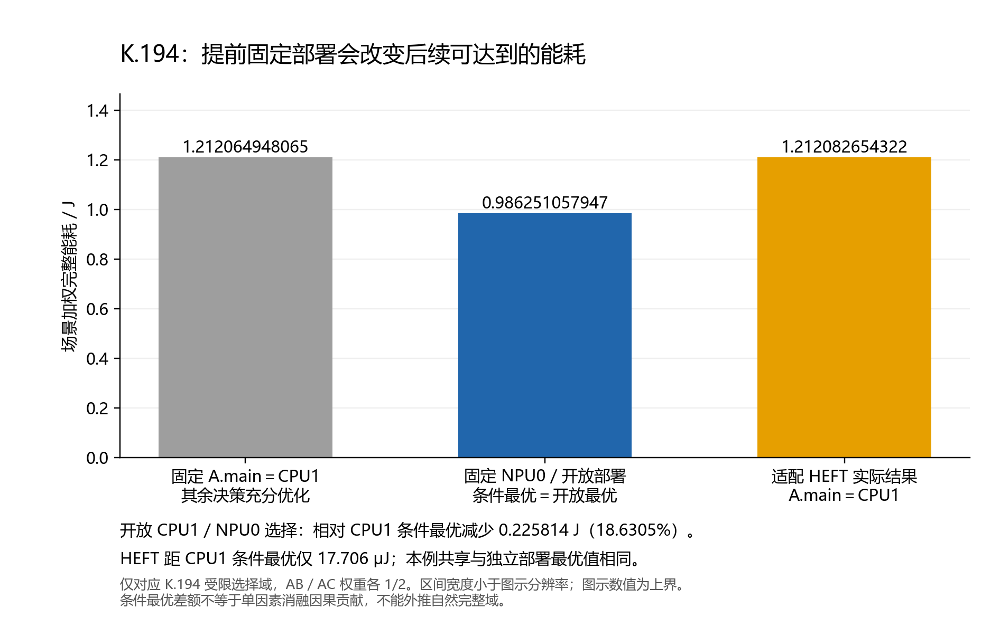
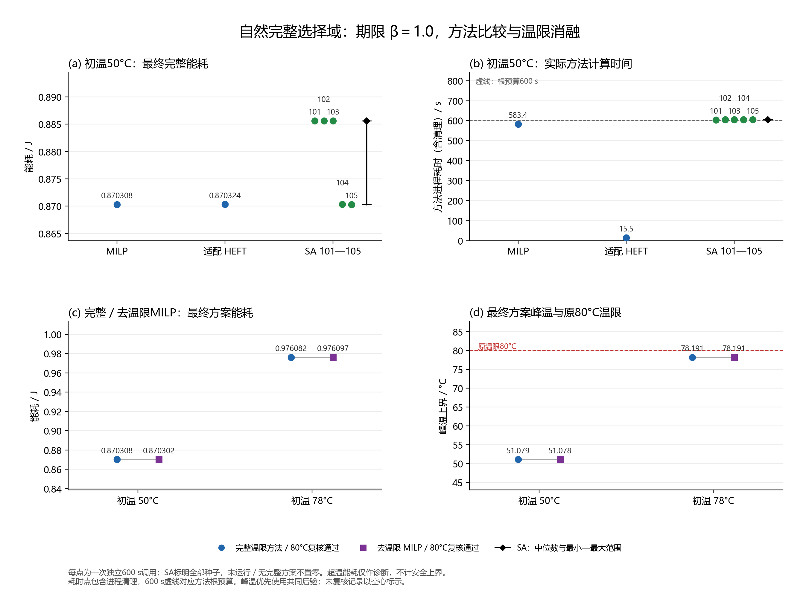

# 第三章证据收束与最小补充验证

状态：2026-11-03全部完成（文件名保留任务启动日）。旧证据与条件最优分析、10次补充实验及10次原80°C独立后验均已收束。起点为`main@1659dc74`，本轮执行源码冻结为`a30d0c6d`。不修改第三章论文正文，不扩展研究方向或实例。

## 1. 已有证据分别回答什么

第三章已有证据支持“设备、频点和时序需要在同一能耗与可行性模型中协调”，以及“MILP能在受限小域达到独立枚举参照、在自然完整域取得有效改善”。它们尚不支持MILP普遍优于启发式，也不支持热约束必然改变最终方案。

本报告的能量、温度与安全性均指声明参数下的模型内仿真与数值区间证明，不是硬件实测。微焦级差异可以被本数值评价区分，但不能直接当作真实平台上的同等节能幅度。

| 研究问题 | 已有直接证据 | 可写结论与边界 |
|---|---|---|
| 提前固定部署会损失什么 | 本轮从K.194原始枚举记录计算条件最优，详见下一节 | 固定CPU1会封闭更低能耗子域；不是仅延长此子域的时序搜索便能补回。结论限于原受限域。 |
| 时序是否影响能耗 | C19在设备/频档固定时，只移动B.pre起点：CPU高档驻留基准差7 mJ，结合热修正界后加权总能量差严格大于3.254 mJ | 完整能耗不是独立Stage模式能量的简单求和。该结果为模型内数学见证，不是硬件测量。 |
| 异构映射集合有何作用 | E2同HEFT、CPU/CPU+GPU/CPU+NPU/全设备四域，能耗依次1.353653003322/1.213262149725/0.988809437621/0.881087997281 J | 支持本实例资源选择价值；物理节点及空闲功率仍存在，不是关断芯片收益，亦不是精确最优差。 |
| 共享部署是否必然增加能耗 | E3共享/独立HEFT均0.881087997281 J；本轮K.194条件最优也显示共享代价为0 | 共享约束有建模意义，但这些实例没有展示最优能耗代价；不预设正面收益。 |
| MILP质量是否可靠 | K.196从1.088852027249降至0.986251057947 J，88.437秒形成完整SAFE，达到K.194枚举ε参照 | 最优性相关证据来自独立覆盖的枚举，不来自MILP求解器gap；仍共用物理评价核。 |
| 与启发式相比怎样 | K.196同域HEFT 1.212082654322 J；SA五种子中位0.988305075609 J，范围0.988279388930—0.990280945278 J | MILP在该受限域更优；不把SA五次最优当单次表现。历史计时方式不同，不给严格速度倍数。 |
| 自然完整域能否优化 | 既有β1.3自然六次执行实例：MILP600秒内取得0.849921625896 J，比自身初解低18.4913%；比旧300秒HEFT仅低0.0068% | 完整域优化可交付，但无全局最优证明；不同预算且差距很小，不构成普遍优势。 |
| 期限怎样影响调度 | E4a旧12次执行实例HEFT，β1.0/1.3/1.6能耗0.936682145480/0.881087997281/0.860766924353 J；β1.0最小期限余量0.4 ms | 期限放宽允许更低能耗安排；旧实例不能代替本轮六次执行的同问题对照。 |
| 响应模型信息有何作用 | H02在同一完整H模型下后验，R1使用H信息比统一R规划节能3.9539%；R2反而微高0.00151% | H/R是规划信息差异；完整信息可改变设备工作点与时序，但有限预算启发式不保证每题都更优。 |
| 温度相关能耗项是否影响选择 | E1 R1/R3完整温度评分分别少16.34/17.44 μJ，约0.002%，设备/频档相同，仅时序变化 | 可分辨但幅度很小；这是评分消融，不能冒称去温限消融。 |
| 温度上限是否真正参与可行性 | P2的相同中间候选由50°C时SAFE变为78°C时超温，五题最终HEFT安排仍相同；K.127的52°C门使初始化H改为M | 支持温度约束影响候选准入；P2不证明最终方案改变，K.127不证明外层反馈获益。 |

来源及边界逐项核查保存在[旧证据核查记录](chapter3_experiments/results/chapter3_closure_analysis01/historical_evidence_review.json)：105项只读检查、77份来源hash、0新增科研调用。E1—E4原始记录位于固定提交[1cbb3559](https://github.com/YBEMR/paper/tree/1cbb3559a74cd42e1c382f1cb772040429440857/research/e1_e4_validation)，不是当前main工作树文件。C19见固定提交[数学见证](https://github.com/YBEMR/paper/blob/db34b46bc2499fcd10f6f7ec6235cd0b6b89555a/research/hetero_thermal_pilot/C19_C12机制迁移与C17下界强化_面向主线7数学算法交接_20261022.md)。

## 2. K.194条件最优：部署与后续优化的关系

重用1550份场景安排的既有完整评价，核对共同输入、配置、hash、场景权重各1/2及274500个共享完整组合的覆盖。不重新生成安排、不求解、不热积分。按条件分组取已有能量区间的最小下界/上界，精确有理数运算，展示值取小数近似。精确区间、取到的安排及来源见[条件最优结果](chapter3_experiments/results/chapter3_closure_analysis01/conditional_optima.json)，可用[只读统计脚本](chapter3_experiments/analyze_conditional_optima.py)复算。

| 决策范围 | 最优能耗约值/J | 相对开放选择 |
|---|---:|---:|
| A.main固定CPU1，其他合法部署/工作点/时序充分优化 | 1.212064948065 | +22.8962% |
| A.main固定NPU0，其他合法决策充分优化 | 0.986251057947 | 0 |
| 开放A.main选择 | 0.986251057947 | 0 |
| 分场景独立部署 | 0.986251057947 | 0 |
| HEFT实际结果，位于CPU1条件域 | 1.212082654322 | 约+22.8980% |

固定CPU1的条件最优比开放最优高0.225813890117 J。HEFT只比CPU1条件最优高0.000017706257 J（0.0014608%）：最终结果已很接近该条件域的最优，其主要差额可由这个条件域的质量下限解释。HEFT并未禁止重新映射；[原始搜索记录](chapter3_experiments/results/k196_quality_comparison02/slots/heft__method/worker/raw_result.json)保存一次A.main→NPU0尝试，以`NO_LEGAL_EFT_INSERTION`构造失败。因此应区分“假设固定CPU1时可达到的质量”和“启发式尝试跨域但未构造成功”。条件差额占HEFT与开放最优差额约99.9922%，这是条件最优的数值分解，不能写成单因素消融证明的因果贡献比例。

其他决策确实仍被优化，包括只在AB场景出现的B.main的CPU1/NPU0选择。两个场景各自NPU0条件上界都严格低于CPU1条件下界；其余跨场景共享Stage部署固定，因此分场景最优天然满足共享部署，最优代价为0。该结论不要求最优安排唯一，也不能外推到完整合法域或其他场景组合。



## 3. 本轮补充验证的固定设计

沿用自然六次Stage执行实例：A.pre/A.main在AB、AC共享部署，另有B.main、C.main；两条DAG依赖、CPU/GPU/NPU资源竞争、共享频率域、400 ms评价窗口、全部原合法设备及L/M/H频档、5 ms网格不变。β由1.3改为1.0，原CPU-H路径生成期限A/B/C为90/100/90 ms。

静态检查：3594个窗口内局部选项，原期限过滤后388个（AB202、AC186）；事件84/73个，预计7568变量、48719原约束。去温限版本仅将规划上限80°C替换为原物理有效温区上界100°C，温度传播、温度相关漏电、完整目标及物理区间不变；由原构模器重算派生变量界和条件约束系数。共同后验统一按原80°C评价，超温完整能耗仅作诊断，不能当可行上界。

| 初温 | 完整热约束MILP | 去80°C规划限制MILP | HEFT | SA |
|---|---:|---:|---:|---|
| 50°C | 1 | 1 | 1 | 101—105各1 |
| 78°C | 1 | 1 | 0 | 0 |

共最多10次方法调用，每次根预算600秒，合计6000秒；准备、初始化、构模、求解和方法内评价计入。MILP沿用精确等式表示、固定名义30秒交付余量，其余求解设置不变。最终候选各最多一次60秒独立后验。预检使用静态/人工替身，真实电热预检0次。没有读枚举或历史最优作为初解。

冻结计划[plan.json](chapter3_experiments/results/chapter3_closure_preparation01/plan.json)，hash `b0629c38f0b5c5391fe3c9f2d24bce9764f9b3362758d6b994c8857476bc6030`，234份源码/输入绑定。37项纯检查通过。首次启动在创建claim与方法前被宿主资源门拒绝，0科研调用；复查通过后才启动，资源门未改。记录见[启动观测](chapter3_experiments/results/chapter3_closure_preparation01/prelaunch_observation01.json)。

## 4. 补充结果与调度解释

10次方法调用及10次原80°C独立后验全部完成，全部最终方案SAFE；0重试、0真实电热预检。批次共5385.157秒，方法进程合计5363.438秒，独立后验合计18.548秒，其余为控制及归档开销。[统一结果表](chapter3_experiments/results/chapter3_closure_analysis01/unified_results.csv)逐项保存输入/版本、初终能量区间、首次及最佳SAFE时间、根/进程/后验时间、峰温、分项、结束状态和求解器界；[完整汇总](chapter3_experiments/results/chapter3_closure_analysis01/summary.json)保留精确调度。

| 条件与方法 | 初解/J | 最终完整能耗/J | 峰温/°C | 方法进程/s | 结束原因 |
|---|---:|---:|---:|---:|---|
| 50°C 完整MILP | 1.042737730 | 0.870308316279 | 51.078647 | 583.391 | 原生MaxTime，exit=2 |
| 50°C 适配HEFT | 1.042838517 | 0.870324370116 | 51.078598 | 15.531 | 自然完成 |
| 50°C SA101 | 1.042838517 | 0.885640557396 | 51.434834 | 604.313 | 600秒限时 |
| 50°C 去温限MILP | 1.042737730 | 0.870301937135 | 51.078345 | 579.578 | 原生MaxTime，exit=2 |
| 50°C SA102 | 1.042838517 | 0.885634809181 | 51.526083 | 605.484 | 600秒限时 |
| 50°C SA103 | 1.042838517 | 0.885627434135 | 51.444245 | 605.031 | 600秒限时 |
| 50°C SA104 | 1.042838517 | 0.870335077092 | 51.078598 | 605.250 | 600秒限时 |
| 50°C SA105 | 1.042838517 | 0.870314698381 | 51.078345 | 604.953 | 600秒限时 |
| 78°C 完整MILP | 1.155528015 | 0.976082447587 | 78.190857 | 581.938 | 原生MaxTime，exit=2 |
| 78°C 去温限MILP | 1.155528015 | 0.976097445336 | 78.190708 | 577.969 | 原生MaxTime，exit=2 |

方法进程时间包括收尾，独立后验另计（每次1.187—2.578秒）。SA的方法根均为600秒；进程多出的4.313—5.484秒不用于接纳新的优化结果。四份MILP的根耗时为572.234—576.375秒，固定30秒为名义交付扣减，不能解释为硬实时保证。去温限方法的首次/最佳SAFE时间仅针对其规划温区，原80°C可行性由独立后验确认。原始计时结构中旧的“imports excluded”说明由本轮父进程启动锚的clock contract覆盖，准备、导入和初始化均在600秒根内。

### 4.1 同问题质量与计算成本

50°C完整MILP比自身初解降低16.5362%，比HEFT少16.053836 μJ，即0.0018446%；HEFT约15.5秒已取得相近能量，MILP约583.4秒。本例支持MILP完整域优化可执行，但不支持其在质量与速度上全面优于HEFT。两者均满足原模型的全部安全与期限条件。

SA五种子中位数0.885627434135 J，范围0.870314698381—0.885640557396 J，IQR 0.015299732089 J，五次结果标准差（分母n）0.007500037370 J；MILP相对中位节能1.72975%。三份结果处于较高能耗组合，另外两份已接近MILP；这只是五个预定种子的描述，不能将2/5外推为稳定成功概率，也不能以最佳种子105代替单次600秒表现。

50°C完整MILP首次SAFE32.484秒、最佳SAFE131.703秒；HEFT分别2.515/15.250秒；SA101—105最佳SAFE依次25.313/219.453/524.312/418.453/570.563秒。首次取得好方案与证明不能再改进是两件事，不能把最佳SAFE时刻当作算法实际终止耗时。

| MILP条件 | 原生调用/s | 构模/s | 原生分支节点 | 最终浮点目标/J | 报告绝对gap/J | 由目标−gap推算的浮点界/J |
|---|---:|---:|---:|---:|---:|---:|
| 50°C 完整MILP | 535.785 | 4.672 | 0 | 0.870308316279 | 0.119583 | 0.750725316279 |
| 50°C 去温限MILP | 549.831 | 4.735 | 312 | 0.870301937135 | 0.116379 | 0.753922937135 |
| 78°C 完整MILP | 541.724 | 5.234 | 83 | 0.976082447587 | 0.218523 | 0.757559447587 |
| 78°C 去温限MILP | 550.616 | 5.360 | 225 | 0.976097445336 | 0.221393 | 0.754704445336 |

四次MILP均未证明最优。上表浮点界只重述求解器报告，不是经过精确认证的最优参照；原模型独立解析下界L0=0.727566488316 J更松，也不能据此证明最终解接近最优。K.194的0.986251057947 J属于另一受限输入，不能拿来计算本轮自然域的最优差距。

实际模型为7568变量、48719原约束，与静态计数一致。MILP构模仅4.672—5.360秒，等式转换1.937—3.047秒；主要时间花在原生求解（535.785—550.616秒），不是构模规模失控。50°C完整MILP在0个分支节点时已找到3个可行点，说明其记录停留在根阶段的处理并已产生候选，不是没有求解。SA约588.2—589.1秒消耗在完整电热评价，HEFT同项13.124秒；这是现有实现的主要计算成本。

### 4.2 设备、频档与执行时序怎样协调

以下区间单位ms，缩写“CPU2/L”表示设备CPU2与L档。50°C低能组合共享B.main=NPU0/M 0—42、A.main=NPU0/L在AB的45—87，C.main=GPU0/L；差异集中在A.pre具体CPU单元及场景时序。

| 方法 | AB的A.pre | AC的A.pre | AC的A.main | AC的C.main |
|---|---|---|---|---|
| 完整MILP | CPU2/L 0—14 | CPU2/L 25—39 | NPU0/L 40—82 | GPU0/L 5—86 |
| HEFT | CPU1/L 5—19 | CPU1/L 5—19 | NPU0/L 20—62 | GPU0/L 5—86 |
| SA104 | CPU2/L 5—19 | CPU2/L 0—14 | NPU0/L 20—62 | GPU0/L 0—81 |
| SA105 | CPU2/L 30—44 | CPU2/L 10—24 | NPU0/L 30—72 | GPU0/L 5—86 |
| 去温限MILP | CPU1/L 30—44 | CPU1/L 30—44 | NPU0/L 45—87 | GPU0/L 5—86 |

与旧β1.3安排相比，B.main由L升到M并移到A.main之前。若A.main与B.main都保留NPU/L，B先执行时A最早60—102 ms，超过90 ms期限；A先执行时即使A.pre采用最短10 ms，B也最早55—111 ms，超过100 ms期限。期限收紧因此要求改变这组资源/频档/顺序中的至少一项。该条件论证不等于全域最优证明。

SA101—103在AB中把A.main留在NPU/M，起点分别55/50/55 ms。若只降为L而不改时序，结束时刻变为97/92/97 ms，全部错过90 ms期限；降频必须配合前移起点及前序/资源安排。这三份终解比MILP多出的约15.32 mJ中，域基准增加2.55 mJ、活动增加12.116263 mJ、公共项不变、温度修正增加约0.653—0.666 mJ。前两项可由AB中A.main的频档差直接核算；温度项涉及多项调度变化。终解结构解释主要能量差，不单凭它断言SA失败的唯一搜索原因。

MILP、HEFT、SA104/105及去温限MILP的前三项能量相同：基准0.50315、活动0.145867526379、外部公共0.12 J；剩余微小差额全部体现在温度修正。MILP/HEFT温度项分别0.101290789901/0.101306843737 J，不能没有固定其他变量的消融就独归某一次等待或CPU选择。所有分项在统一表逐行保留。

### 4.3 使用温限是否改变最终结果

50°C去温限MILP为0.870301937135 J，比完整版本低6.379145 μJ；两者均有约29°C的最终温度余量。78°C完整/去温限MILP分别为0.976082447587/0.976097445336 J，去温限反而高14.997749 μJ；峰温分别78.190857/78.190708°C，均通过80°C后验，且初始化也没有因80°C被拒。

78°C两份结果均用CPU2/L的A.pre、NPU/L的A.main、NPU/M的B.main及GPU/L的C.main。完整版本A.pre在AB/AC分别0—14/20—34，A.main在两场景均45—87；去温限版本A.pre为15—29/5—19，AC的A.main为25—67，其余主任务安排相同。两种版本的最终安排并非完全一致，但没有观察到温限迫使最终方案换设备或升降频，也没有产生去温限终解超温的案例。

50°C与78°C完整版本的基准、活动、公共分项相同，温度修正从0.101290789901升至0.207064921208 J，能量差在该项体现；由于最终时序略变，不能将该差额全部当作固定调度下仅改变初温的因果效应。去温限后的较大可行域在精确最优意义下不会更差，但有限预算输出可以更差。两组微小差距方向相反，同时分支节点/可行点数量不同，不足以归因为温限的节能或性能收益。**本轮未展示80°C约束改变最终安全性或主要部署频档；也未证明该约束在全域冗余。** P2/K.127的候选准入证据仍保留原边界。



## 5. 第三章可收束的结论与剩余缺口

第三章可以形成以下证据链：共同电热评价下，部署选择决定后续能达到的质量范围（K.194条件最优）；共享频域与温度使能耗依赖完整时序（C19等）；MILP在受限小域达到独立枚举参照，并在自然完整域通过联合工作点和时序调整改善自身初解；同问题启发式对照展示质量、种子间差异与成本的取舍；期限、响应信息和温度分别在对应证据范围内影响调度或候选可行性。

应保留三个限制：自然域没有精确最优证书；当前自然实例中HEFT已很接近MILP，不能宣称MILP普遍更优；本轮温限消融没有形成最终超温反例，温度上限的必要性主要由旧候选准入证据支撑，而非本轮最终能耗优势。全部为声明参数下的仿真，不含硬件精度或大规模推广验证。

**建议本阶段收束，不继续为拉开排名或制造超温而加实例、改参数。** 现有材料足以据实写作“联合模型、小域质量依据、自然域有界优化及成本边界”。只有导师或论文主张明确要求“自然域可证明最优”或“温限决定最终部署”时，才值得另行设计一个针对该缺口的小验证；那属于新目标和新授权，本轮不启动。第四章仍可围绕计算效率研究，不能把本轮SA的种子间差异或MILP慢自动写成已验证的新算法贡献。

## 6. 归档与复算

原始记录见[执行目录](chapter3_experiments/results/chapter3_closure_execution01/)，输入及冻结清单见[准备目录](chapter3_experiments/results/chapter3_closure_preparation01/)。执行subject为`a30d0c6d778924eea252f2033c18b78282f99147`；[执行核查](chapter3_experiments/results/chapter3_closure_execution01/execution_review.json)179项PASS，确认10方法/10后验、234冻结文件/197原科学源、实际送达数组与等式证书、预算、同候选80°C后验及进程清理。核查只读取归档，不构成再次安全评价。原生MAT及可重建PDF图按仓库忽略规则仅保存在本地，其hash与是否可由Git取得在[归档清单](chapter3_experiments/results/chapter3_closure_analysis01/archive_manifest.json)中明确区分；原始JSON、原生日志、候选与评价记录可随仓库获取。

以下入口只读取保存结果，输出目录使用新路径以免覆盖正式归档；不启动求解器或热积分：

```powershell
F:/Anaconda3/python.exe -B research/chapter3_experiments/summarize_closure.py research/chapter3_experiments/results/chapter3_closure_execution01 --plan research/chapter3_experiments/results/chapter3_closure_preparation01/plan.json --out-dir <新的统计目录>
F:/Anaconda3/python.exe -B research/chapter3_experiments/plot_closure.py --summary <新的统计目录>/summary.json --conditional research/chapter3_experiments/results/chapter3_closure_analysis01/conditional_optima.json --out-dir <新的图目录>
```

本轮至此完成；不追加科研调用、不修改论文正文、不自动扩大实验。
